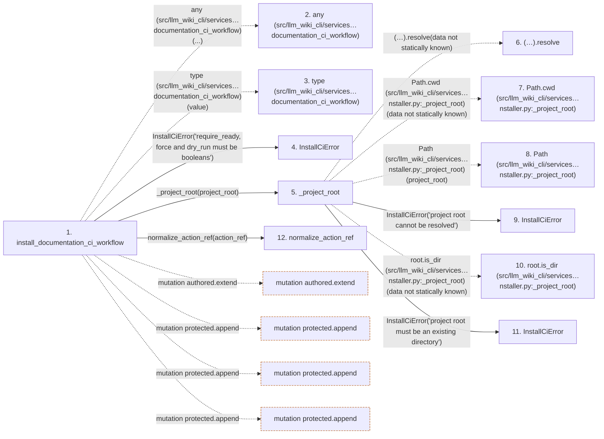

# install_documentation_ci_workflow

**Entry point:** `install_documentation_ci_workflow` (`api`)
**Source:** [ci_installer](../modules/ci_installer.md)
**Modules touched:** [ci_installer](../modules/ci_installer.md), [common](../modules/common.md), [concept_identity](../modules/concept_identity.md), [config](../modules/config.md), and 13 more

**Complete modules touched:**

- [ci_installer](../modules/ci_installer.md)
- [common](../modules/common.md)
- [concept_identity](../modules/concept_identity.md)
- [config](../modules/config.md)
- [filesystem_guard](../modules/filesystem_guard.md)
- [io](../modules/io.md)
- [knowledge_evidence](../modules/knowledge_evidence.md)
- [knowledge_storage](../modules/knowledge_storage.md)
- [knowledge_storage_io](../modules/knowledge_storage_io.md)
- [maintenance_state](../modules/maintenance_state.md)
- [manifest_storage](../modules/manifest_storage.md)
- [publication_config](../modules/publication_config.md)
- [source_selection](../modules/source_selection.md)
- [sync_manifest](../modules/sync_manifest.md)
- [validation](../modules/validation.md)
- [wiki_surface](../modules/wiki_surface.md)
- [wiki_write_basis](../modules/wiki_write_basis.md)

## Call sequence

> Static overview in presentation order, not runtime execution order. Arrows retain captured callers; representative internal continuations and boundary examples precede repeated helper detail.

```mermaid
sequenceDiagram
    participant p0 as install_documentation_ci_workflow
    participant p1 as _project_root
    participant p2 as normalize_action_ref
    participant p3 as _portable_project_path
    participant p4 as _project_directory
    participant p5 as load_publication_config
    participant p6 as _validate_default_selection_contract
    participant p7 as publication_path
    participant p8 as publication_control_overlap
    participant p9 as _install_workflow
    participant p10 as _documentation_workflow
    participant p11 as InstallCiError
    participant p12 as _without_github_expression
    participant p13 as locate_exact_repository_path
    participant p14 as _consumer_root
    participant p15 as _validate_workflow_target
    participant p16 as _validated_project_path
    participant p17 as _relative_path
    participant p18 as SyncManifest.load
    participant p19 as resolve_source_selection
    participant p20 as validate_persisted_source_selection_identity
    participant p21 as is_unmodified_managed_workflow
    participant p22 as read_publication_json
    participant p23 as ensure_guarded_directory
    participant p24 as atomic_write_guarded_bytes
    participant p25 as validate_publication_config
    participant p26 as require_repository_relative_path
    participant p27 as _locate_exact_path
    participant p28 as source_selection_identity_from_generation_inputs
    participant p29 as any (src/llm_wiki_cli/services…documentation_ci_workflow)
    participant p30 as authored.extend
    p0->>p1: _project_root
    p0->>p2: normalize_action_ref
    p0->>p3: _portable_project_path
    p0->>p4: _project_directory
    p0->>p5: load_publication_config
    p0->>p6: _validate_default_selection_contract
    p0->>p7: publication_path
    p0->>p8: publication_control_overlap
    p0->>p9: _install_workflow
    p0->>p10: _documentation_workflow
    p0->>p11: InstallCiError
    p3->>p12: _without_github_expression
    p4->>p13: locate_exact_repository_path
    p5->>p14: _consumer_root
    p9->>p15: _validate_workflow_target
    p3->>p16: _validated_project_path
    p5->>p17: _relative_path
    p6->>p18: SyncManifest.load
    p6->>p19: resolve_source_selection
    p6->>p20: validate_persisted_source_selection_identity
    p9->>p21: is_unmodified_managed_workflow
    p5->>p22: read_publication_json
    p9->>p23: ensure_guarded_directory
    p9->>p24: atomic_write_guarded_bytes
    p5->>p25: validate_publication_config
    p16->>p26: require_repository_relative_path
    p13->>p27: _locate_exact_path
    p20->>p28: source_selection_identity_from_generation_inputs
    p0-->>p29: any (src/llm_wiki_cli/services…documentation_ci_workflow)(...)
    p0-->>p30: authored.extend(...)
```

<!-- Auto-generated from static call edges. Dashed arrows are external or unresolved calls. Reviewed runtime conditions and side effects belong in Behavior. -->

> Call sequence diagram shows 30 of 1466 interactions; 1436 omitted to keep the visualization within the 30-interaction and generated-diagram limits, with uncertain identities omitted rather than inferred.

> Captured boundary calls: external 1 of 530 (529 omitted); unresolved 1 of 314 (313 omitted). These counts cover the captured static trace.

Omitted captured detail, grouped by actual caller occurrence and target module:

| Caller | Parent step | Target module | Kind | Omitted interactions |
| --- | --- | --- | --- | --- |
| `src/llm_wiki_cli/services/ci_installer.py:install_documentation_ci_workflow` | 1 | - | external | 2 |
| `src/llm_wiki_cli/services/ci_installer.py:_project_root` | 5 | - | unresolved | 2 |
| `src/llm_wiki_cli/services/ci_installer.py:_project_root` | 5 | - | external | 2 |
| `src/llm_wiki_cli/services/ci_installer.py:_project_root` | 5 | [src/llm_wiki_cli/services/ci_installer.py](../modules/ci_installer.md) | internal | 2 |
| `src/llm_wiki_cli/services/ci_installer.py:normalize_action_ref` | 12 | - | external | 1 |
| `src/llm_wiki_cli/services/ci_installer.py:normalize_action_ref` | 12 | - | unresolved | 2 |
| `src/llm_wiki_cli/services/ci_installer.py:normalize_action_ref` | 12 | [src/llm_wiki_cli/services/ci_installer.py](../modules/ci_installer.md) | internal | 1 |
| `src/llm_wiki_cli/services/ci_installer.py:_without_github_expression` | 18 | [src/llm_wiki_cli/services/ci_installer.py](../modules/ci_installer.md) | internal | 1 |
> Omission summary shows 8 of 324 groups; 316 further groups are not expanded here. Counts above include all omitted interactions.
> Detailed flow queries retain their own coverage and limits; omitted paths may execute at runtime.

> Trace truncated at the depth limit; deeper calls are omitted.

## Data flow

<!-- Auto-generated static analysis. Treat values and boundaries as best-effort hints, not runtime proof. -->

### Analysis coverage

**Effect analysis partially available.** Flow assembly and source effect analysis are separate; empty observations do not prove an empty handler body.

Source steps: 623; effect analysis evaluated: 325, partial: 21, unavailable: 277. Counts include steps omitted from the displayed trace.

Collector observations for 346 source steps with known totals: observed: 1958, emitted: 1891, omitted: 67. Unavailable totals are excluded.

- Callable record unavailable for one or more source steps; those steps have no represented callable body.
- Effect collector omitted observations before flow assembly; displayed effects are partial.
- Effect collector totals unavailable; observed counts cover captured records only.

| Step | Callable record | Effect analysis | Collector totals | Observed | Emitted | Omitted |
|---|---|---|---|---:|---:|---:|
| `install_documentation_ci_workflow` | `available` | `partial` | `available` | `24` | `19` | `5` |
| `any (src/llm_wiki_cli/services…documentation_ci_workflow)` | `not_applicable` | `not_applicable` | `not_applicable` | — | — | — |
| `type (src/llm_wiki_cli/services…documentation_ci_workflow)` | `not_applicable` | `not_applicable` | `not_applicable` | — | — | — |
| `InstallCiError` | `unavailable` | `unavailable` | `unavailable` | — | — | — |
| `_project_root` | `available` | `evaluated` | `available` | `2` | `2` | `0` |
| `(…).resolve` | `not_applicable` | `not_applicable` | `not_applicable` | — | — | — |
| `Path.cwd (src/llm_wiki_cli/services…nstaller.py:_project_root)` | `not_applicable` | `not_applicable` | `not_applicable` | — | — | — |
| `Path (src/llm_wiki_cli/services…nstaller.py:_project_root)` | `not_applicable` | `not_applicable` | `not_applicable` | — | — | — |
| `InstallCiError` | `unavailable` | `unavailable` | `unavailable` | — | — | — |
| `root.is_dir (src/llm_wiki_cli/services…nstaller.py:_project_root)` | `not_applicable` | `not_applicable` | `not_applicable` | — | — | — |
| `InstallCiError` | `unavailable` | `unavailable` | `unavailable` | — | — | — |
| `normalize_action_ref` | `available` | `evaluated` | `available` | `2` | `2` | `0` |

### Step data

| Step | Inputs | Reads | Writes | Returns |
|---|---|---|---|---|
| `install_documentation_ci_workflow` | `action_ref: str`, `config: str`, `working_directory: str`, `src_dir: str`, `target_dir: str \| None`, `baseline: str \| None`, `reviews: str \| None`, `previous_receipt: str \| None` | `DOCUMENTATION_WORKFLOW_PATH`, `PublicationConfigError`, `DOCUMENTATION_WORKFLOW_PATH` | `inputs[...]`, `inputs[...]`, `inputs[...]` | `_install_workflow(...)` |
| `any (src/llm_wiki_cli/services…documentation_ci_workflow)` | - | - | - | - |
| `type (src/llm_wiki_cli/services…documentation_ci_workflow)` | - | - | - | - |
| `InstallCiError` | - | - | - | - |
| `_project_root` | `project_root: str \| Path \| None` | - | - | `root` |
| `(…).resolve` | - | - | - | - |
| `Path.cwd (src/llm_wiki_cli/services…nstaller.py:_project_root)` | - | - | - | - |
| `Path (src/llm_wiki_cli/services…nstaller.py:_project_root)` | - | - | - | - |
| `InstallCiError` | - | - | - | - |
| `root.is_dir (src/llm_wiki_cli/services…nstaller.py:_project_root)` | - | - | - | - |
| `InstallCiError` | - | - | - | - |
| `normalize_action_ref` | `value: object` | - | - | `value.lower(...)` |

### Call data

| From | To | Line | Call |
|---|---|---:|---|
| install_documentation_ci_workflow | any (src/llm_wiki_cli/services…documentation_ci_workflow) | 365 | `any(...)` |
| install_documentation_ci_workflow | type (src/llm_wiki_cli/services…documentation_ci_workflow) | 365 | `type(value)` |
| install_documentation_ci_workflow | InstallCiError | 366 | `InstallCiError('require_ready, force and dry_run must be booleans')` |
| install_documentation_ci_workflow | _project_root | 367 | `_project_root(project_root)` |
| _project_root | (…).resolve | 497 | `(Path.cwd() if project_root is None else Path(project_root)).resolve(data not statically known)` |
| _project_root | Path.cwd (src/llm_wiki_cli/services…nstaller.py:_project_root) | 497 | `Path.cwd(data not statically known)` |
| _project_root | Path (src/llm_wiki_cli/services…nstaller.py:_project_root) | 497 | `Path(project_root)` |
| _project_root | InstallCiError | 499 | `InstallCiError('project root cannot be resolved')` |
| _project_root | root.is_dir (src/llm_wiki_cli/services…nstaller.py:_project_root) | 500 | `root.is_dir(data not statically known)` |
| _project_root | InstallCiError | 501 | `InstallCiError('project root must be an existing directory')` |
| install_documentation_ci_workflow | normalize_action_ref | 368 | `normalize_action_ref(action_ref)` |

### Boundary effects

| Kind | Target | Step | Line |
|---|---|---|---:|
| mutation | `authored.extend` | `install_documentation_ci_workflow` | 397 |
| mutation | `protected.append` | `install_documentation_ci_workflow` | 405 |
| mutation | `protected.append` | `install_documentation_ci_workflow` | 415 |
| mutation | `protected.append` | `install_documentation_ci_workflow` | 432 |

### Static analysis gaps

| Kind | Step | Target | Line |
|---|---|---|---:|
| external_call | `install_documentation_ci_workflow` | `any` | 365 |
| external_call | `install_documentation_ci_workflow` | `type` | 365 |
| unresolved_call | `_project_root` | `(Path.cwd() if project_root is None else Path(project_root)).resolve` | 497 |
| external_call | `_project_root` | `Path.cwd` | 497 |
| unresolved_call | `_project_root` | `root.is_dir` | 500 |
| step_limit | `install_documentation_ci_workflow` | `first 12 steps` | 0 |
| truncated_flow | `install_documentation_ci_workflow` | `depth limit` | 0 |

## Behavior

This flow starts at `install_documentation_ci_workflow` and is classified as `api`. The generated call and data-flow sections are bounded static projections; runtime conditions and side effects require source-level confirmation.
