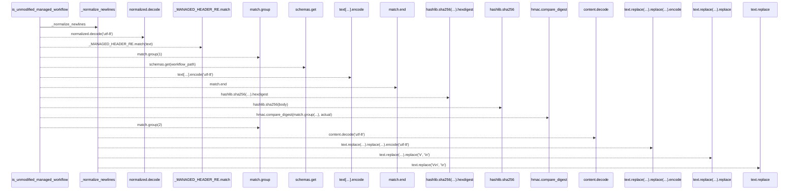
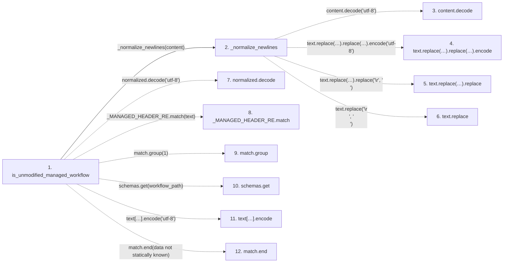

# is_unmodified_managed_workflow

**Entry point:** `is_unmodified_managed_workflow` (`api`)
**Source:** [ci_installer](../modules/ci_installer.md)
**Modules touched:** [ci_installer](../modules/ci_installer.md)

## Call sequence

> Static overview in presentation order, not runtime execution order. Arrows retain captured callers; representative internal continuations and boundary examples precede repeated helper detail.

<!-- Auto-generated from static call edges. Dashed arrows are external or unresolved calls. Reviewed runtime conditions and side effects belong in Behavior. -->

> Call sequence diagram shows 15 of 15 interactions; 0 omitted to keep the visualization within the 30-interaction and generated-diagram limits, with uncertain identities omitted rather than inferred.

> Captured boundary calls: external 2 of 2 (0 omitted); unresolved 12 of 12 (0 omitted). These counts cover the captured static trace.
> Detailed flow queries retain their own coverage and limits; omitted paths may execute at runtime.

## Data flow

<!-- Auto-generated static analysis. Treat values and boundaries as best-effort hints, not runtime proof. -->

### Analysis coverage

**Effect analysis evaluated.** Flow assembly and source effect analysis are separate; empty observations do not prove an empty handler body.

Source steps: 2; effect analysis evaluated: 2, partial: 0, unavailable: 0. Counts include steps omitted from the displayed trace.

Collector observations for 2 source steps with known totals: observed: 13, emitted: 13, omitted: 0. Unavailable totals are excluded.

### Step data

| Step | Inputs | Reads | Writes | Returns |
|---|---|---|---|---|
| `is_unmodified_managed_workflow` | `content: bytes`, `workflow_path: Path \| None` | `MANAGED_WORKFLOW_PATH`, `DOCUMENTATION_WORKFLOW_PATH`, `MANAGED_WORKFLOW_SCHEMA`, `DOCUMENTATION_WORKFLOW_SCHEMA` | - | `False`, `False`, `False`, `hmac.compare_digest(...)` |
| `_normalize_newlines` | `content: bytes` | - | - | `None`, `...` |
| `content.decode` | - | - | - | - |
| `text.replace(…).replace(…).encode` | - | - | - | - |
| `text.replace(…).replace` | - | - | - | - |
| `text.replace` | - | - | - | - |
| `normalized.decode` | - | - | - | - |
| `_MANAGED_HEADER_RE.match` | - | - | - | - |
| `match.group` | - | - | - | - |
| `schemas.get` | - | - | - | - |
| `text[…].encode` | - | - | - | - |
| `match.end` | - | - | - | - |

### Call data

| From | To | Line | Call |
|---|---|---:|---|
| is_unmodified_managed_workflow | _normalize_newlines | 262 | `_normalize_newlines(content)` |
| _normalize_newlines | content.decode | 251 | `content.decode('utf-8')` |
| _normalize_newlines | text.replace(…).replace(…).encode | 254 | `text.replace('\r\n', '\n').replace('\r', '\n').encode('utf-8')` |
| _normalize_newlines | text.replace(…).replace | 254 | `text.replace('\r\n', '\n').replace('\r', '\n')` |
| _normalize_newlines | text.replace | 254 | `text.replace('\r\n', '\n')` |
| is_unmodified_managed_workflow | normalized.decode | 265 | `normalized.decode('utf-8')` |
| is_unmodified_managed_workflow | _MANAGED_HEADER_RE.match | 266 | `_MANAGED_HEADER_RE.match(text)` |
| is_unmodified_managed_workflow | match.group | 274 | `match.group(1)` |
| is_unmodified_managed_workflow | schemas.get | 274 | `schemas.get(workflow_path)` |
| is_unmodified_managed_workflow | text[…].encode | 276 | `text[match.end():].encode('utf-8')` |
| is_unmodified_managed_workflow | match.end | 276 | `match.end(data not statically known)` |

### Boundary effects

*No boundary-effect observations were captured in this static trace.*

### Static analysis gaps

| Kind | Step | Target | Line |
|---|---|---|---:|
| unresolved_call | `_normalize_newlines` | `content.decode` | 251 |
| unresolved_call | `_normalize_newlines` | `text.replace('\r\n', '\n').replace('\r', '\n').encode` | 254 |
| unresolved_call | `_normalize_newlines` | `text.replace('\r\n', '\n').replace` | 254 |
| unresolved_call | `_normalize_newlines` | `text.replace` | 254 |
| unresolved_call | `is_unmodified_managed_workflow` | `normalized.decode` | 265 |
| unresolved_call | `is_unmodified_managed_workflow` | `_MANAGED_HEADER_RE.match` | 266 |
| unresolved_call | `is_unmodified_managed_workflow` | `match.group` | 274 |
| unresolved_call | `is_unmodified_managed_workflow` | `schemas.get` | 274 |
| unresolved_call | `is_unmodified_managed_workflow` | `text[match.end():].encode` | 276 |
| unresolved_call | `is_unmodified_managed_workflow` | `match.end` | 276 |
| step_limit | `is_unmodified_managed_workflow` | `first 12 steps` | 0 |

## Behavior

This flow starts at `is_unmodified_managed_workflow` and is classified as `api`. The generated call and data-flow sections are bounded static projections; runtime conditions and side effects require source-level confirmation.
