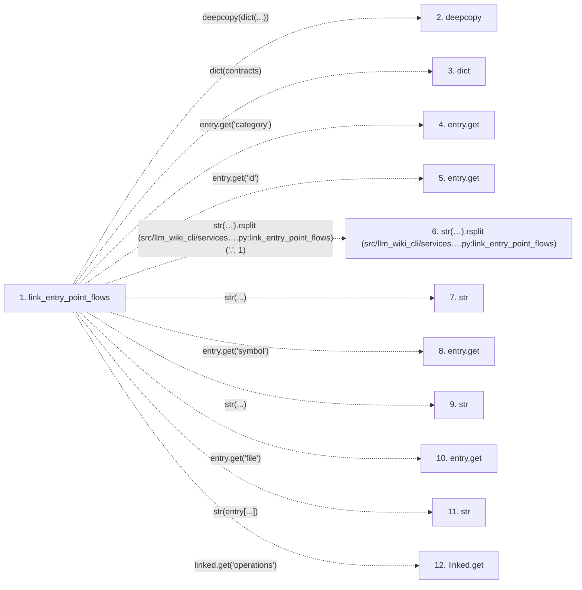

# link_entry_point_flows

**Entry point:** `link_entry_point_flows` (`api`)
**Source:** [api_contracts](../modules/api_contracts.md)
**Modules touched:** [api_contracts](../modules/api_contracts.md)

## Call sequence

> Static overview in presentation order, not runtime execution order. Arrows retain captured callers; representative internal continuations and boundary examples precede repeated helper detail.

```mermaid
sequenceDiagram
    participant p0 as link_entry_point_flows
    participant p1 as deepcopy
    participant p2 as dict
    participant p3 as entry.get
    participant p4 as str(…).rsplit (src/llm_wiki_cli/services….py:link_entry_point_flows)
    participant p5 as str
    participant p6 as linked.get
    participant p7 as isinstance
    participant p8 as operation.get
    participant p9 as str(…).rsplit (src/llm_wiki_cli/services…:link_entry_point_flows, 1)
    participant p10 as handler.get
    participant p11 as flow_ids.get
    p0-->>p1: deepcopy(dict(...))
    p0-->>p2: dict(contracts)
    p0-->>p3: entry.get('category')
    p0-->>p3: entry.get('id')
    p0-->>p4: str(…).rsplit (src/llm_wiki_cli/services….py:link_entry_point_flows)('.', 1)
    p0-->>p5: str(...)
    p0-->>p3: entry.get('symbol')
    p0-->>p5: str(...)
    p0-->>p3: entry.get('file')
    p0-->>p5: str(entry[...])
    p0-->>p6: linked.get('operations')
    p0-->>p7: isinstance(operations, list)
    p0-->>p7: isinstance(operation, dict)
    p0-->>p8: operation.get('handler')
    p0-->>p7: isinstance(handler, Mapping)
    p0-->>p9: str(…).rsplit (src/llm_wiki_cli/services…:link_entry_point_flows, 1)('.', 1)
    p0-->>p5: str(...)
    p0-->>p10: handler.get('symbol')
    p0-->>p11: flow_ids.get((...))
    p0-->>p5: str(...)
    p0-->>p10: handler.get('file')
```

<!-- Auto-generated from static call edges. Dashed arrows are external or unresolved calls. Reviewed runtime conditions and side effects belong in Behavior. -->

> Call sequence diagram shows 21 of 21 interactions; 0 omitted to keep the visualization within the 30-interaction and generated-diagram limits, with uncertain identities omitted rather than inferred.

> Captured boundary calls: external 10 of 10 (0 omitted); unresolved 11 of 11 (0 omitted). These counts cover the captured static trace.
> Detailed flow queries retain their own coverage and limits; omitted paths may execute at runtime.

## Data flow

<!-- Auto-generated static analysis. Treat values and boundaries as best-effort hints, not runtime proof. -->

### Analysis coverage

**Effect analysis evaluated.** Flow assembly and source effect analysis are separate; empty observations do not prove an empty handler body.

Source steps: 1; effect analysis evaluated: 1, partial: 0, unavailable: 0. Counts include steps omitted from the displayed trace.

### Step data

| Step | Inputs | Reads | Writes | Returns |
|---|---|---|---|---|
| `link_entry_point_flows` | `contracts: Mapping[str, object]`, `entry_points: Iterable[Mapping[str, object]]` | `Mapping` | `operation[...]` | `linked` |
| `deepcopy` | - | - | - | - |
| `dict` | - | - | - | - |
| `entry.get` | - | - | - | - |
| `entry.get` | - | - | - | - |
| `str(…).rsplit (src/llm_wiki_cli/services….py:link_entry_point_flows)` | - | - | - | - |
| `str` | - | - | - | - |
| `entry.get` | - | - | - | - |
| `str` | - | - | - | - |
| `entry.get` | - | - | - | - |
| `str` | - | - | - | - |
| `linked.get` | - | - | - | - |

### Call data

| From | To | Line | Call |
|---|---|---:|---|
| link_entry_point_flows | deepcopy | 1872 | `deepcopy(dict(...))` |
| link_entry_point_flows | dict | 1872 | `dict(contracts)` |
| link_entry_point_flows | entry.get | 1875 | `entry.get('category')` |
| link_entry_point_flows | entry.get | 1875 | `entry.get('id')` |
| link_entry_point_flows | str(…).rsplit (src/llm_wiki_cli/services….py:link_entry_point_flows) | 1877 | `str(entry.get('symbol') or '').rsplit('.', 1)` |
| link_entry_point_flows | str | 1877 | `str(...)` |
| link_entry_point_flows | entry.get | 1877 | `entry.get('symbol')` |
| link_entry_point_flows | str | 1878 | `str(...)` |
| link_entry_point_flows | entry.get | 1878 | `entry.get('file')` |
| link_entry_point_flows | str | 1878 | `str(entry[...])` |
| link_entry_point_flows | linked.get | 1879 | `linked.get('operations')` |

### Boundary effects

*No boundary-effect observations were captured in this static trace.*

### Static analysis gaps

| Kind | Step | Target | Line |
|---|---|---|---:|
| external_call | `link_entry_point_flows` | `deepcopy` | 1872 |
| unresolved_call | `link_entry_point_flows` | `entry.get` | 1875 |
| unresolved_call | `link_entry_point_flows` | `str(entry.get('symbol') or '').rsplit` | 1877 |
| unresolved_call | `link_entry_point_flows` | `entry.get` | 1877 |
| unresolved_call | `link_entry_point_flows` | `entry.get` | 1878 |
| unresolved_call | `link_entry_point_flows` | `linked.get` | 1879 |
| step_limit | `link_entry_point_flows` | `first 12 steps` | 0 |

## Behavior

This flow starts at `link_entry_point_flows` and is classified as `api`. The generated call and data-flow sections are bounded static projections; runtime conditions and side effects require source-level confirmation.
