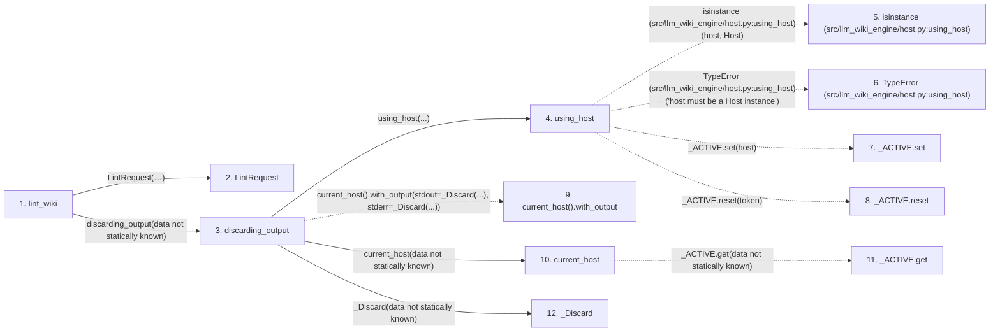

# lint_wiki

**Entry point:** `lint_wiki` (`api`)
**Source:** [api](../modules/api.md)
**Modules touched:** [analysis_compatibility](../modules/analysis_compatibility.md), [api](../modules/api.md), [canonical_json](../modules/canonical_json.md), [common](../modules/common.md), and 40 more

**Complete modules touched:**

- [analysis_compatibility](../modules/analysis_compatibility.md)
- [api](../modules/api.md)
- [canonical_json](../modules/canonical_json.md)
- [common](../modules/common.md)
- [data_flow](../modules/data_flow.md)
- [entrypoints](../modules/entrypoints.md)
- [extraction_jobs](../modules/extraction_jobs.md)
- [extraction_service](../modules/extraction_service.md)
- [filesystem_guard](../modules/filesystem_guard.md)
- [flow_followup](../modules/flow_followup.md)
- [health_contract](../modules/health_contract.md)
- [health_details](../modules/health_details.md)
- [host](../modules/host.md)
- [immutable](../modules/immutable.md)
- [infrastructure_inventory](../modules/infrastructure_inventory.md)
- [inventory_cache](../modules/inventory_cache.md)
- [io](../modules/io.md)
- [knowledge_artifacts](../modules/knowledge_artifacts.md)
- [knowledge_consumption](../modules/knowledge_consumption.md)
- [knowledge_envelope](../modules/knowledge_envelope.md)
- [knowledge_evidence](../modules/knowledge_evidence.md)
- [knowledge_freshness](../modules/knowledge_freshness.md)
- [knowledge_loader](../modules/knowledge_loader.md)
- [knowledge_observability](../modules/knowledge_observability.md)
- [knowledge_orchestration](../modules/knowledge_orchestration.md)
- [knowledge_verification](../modules/knowledge_verification.md)
- [lint_request](../modules/lint_request.md)
- [lint_service](../modules/lint_service.md)
- [module_coverage](../modules/module_coverage.md)
- [path_policy](../modules/path_policy.md)
- [plugins](../modules/plugins.md)
- [progress](../modules/progress.md)
- [runtime_output](../modules/runtime_output.md)
- [services_dependencies](../modules/services_dependencies.md)
- [source_retirement](../modules/source_retirement.md)
- [source_selection](../modules/source_selection.md)
- [source_snapshot](../modules/source_snapshot.md)
- [sync_analysis](../modules/sync_analysis.md)
- [sync_manifest](../modules/sync_manifest.md)
- [team](../modules/team.md)
- [wiki_lifecycle](../modules/wiki_lifecycle.md)
- [wiki_media](../modules/wiki_media.md)
- [yaml_formats](../modules/yaml_formats.md)
- [yaml_syntax](../modules/yaml_syntax.md)

## Call sequence

> Static overview in presentation order, not runtime execution order. Arrows retain captured callers; representative internal continuations and boundary examples precede repeated helper detail.

```mermaid
sequenceDiagram
    participant p0 as lint_wiki
    participant p1 as discarding_output
    participant p2 as execute_lint
    participant p3 as report_to_dict
    participant p4 as LintRequest
    participant p5 as InvalidRequestError
    participant p6 as _build_requested_report
    participant p7 as validate_path
    participant p8 as validate_source_root
    participant p9 as build_report
    participant p10 as cache_options_for
    participant p11 as extraction_job_request_for
    participant p12 as _new_lint_report
    participant p13 as _preflight_lint_inputs
    participant p14 as _finalize_lint_report
    participant p15 as prepare_cache_options
    participant p16 as _collect_lint_inputs
    participant p17 as _run_report_checks
    participant p18 as windows_current_user_sid
    participant p19 as first_unsafe_path_component
    participant p20 as resolve_team_policy
    participant p21 as capture_health_details
    participant p22 as _current_windows_user_sid
    participant p23 as _profile_phase
    participant p24 as _coerce_plugin_issue
    participant p25 as resolve_inventory_cache_path
    participant p26 as _check_unsupported_source_diagnostics
    participant p27 as team_config_issue
    participant p28 as _check_broken_links
    participant p29 as str (src/llm_wiki_cli/api.py:lint_wiki)
    participant p30 as current_host().with_output
    p0->>p1: discarding_output
    p0->>p2: execute_lint
    p0->>p3: report_to_dict
    p0->>p4: LintRequest
    p0->>p5: InvalidRequestError
    p2->>p6: _build_requested_report
    p6->>p7: validate_path
    p6->>p8: validate_source_root
    p6->>p9: build_report
    p6->>p10: cache_options_for
    p6->>p11: extraction_job_request_for
    p9->>p12: _new_lint_report
    p9->>p13: _preflight_lint_inputs
    p9->>p14: _finalize_lint_report
    p9->>p15: prepare_cache_options
    p9->>p16: _collect_lint_inputs
    p9->>p17: _run_report_checks
    p8->>p18: windows_current_user_sid
    p8->>p19: first_unsafe_path_component
    p13->>p20: resolve_team_policy
    p14->>p21: capture_health_details
    p18->>p22: _current_windows_user_sid
    p16->>p23: _profile_phase
    p13->>p24: _coerce_plugin_issue
    p15->>p25: resolve_inventory_cache_path
    p17->>p26: _check_unsupported_source_diagnostics
    p13->>p27: team_config_issue
    p17->>p28: _check_broken_links
    p0-->>p29: str (src/llm_wiki_cli/api.py:lint_wiki)(exc)
    p1-->>p30: current_host().with_output(stdout=_Discard(...), stderr=_Discard(...))
```

<!-- Auto-generated from static call edges. Dashed arrows are external or unresolved calls. Reviewed runtime conditions and side effects belong in Behavior. -->

> Call sequence diagram shows 30 of 700 interactions; 670 omitted to keep the visualization within the 30-interaction and generated-diagram limits, with uncertain identities omitted rather than inferred.

> Captured boundary calls: external 1 of 192 (191 omitted); unresolved 1 of 163 (162 omitted). These counts cover the captured static trace.

Omitted captured detail, grouped by actual caller occurrence and target module:

| Caller | Parent step | Target module | Kind | Omitted interactions |
| --- | --- | --- | --- | --- |
| `src/llm_wiki_engine/host.py:discarding_output` | 3 | [src/llm_wiki_engine/host.py](../modules/host.md) | internal | 4 |
| `src/llm_wiki_engine/host.py:using_host` | 4 | - | external | 2 |
| `src/llm_wiki_engine/host.py:using_host` | 4 | - | unresolved | 2 |
| `src/llm_wiki_engine/host.py:current_host` | 10 | - | unresolved | 1 |
| `src/llm_wiki_cli/services/lint_service.py:execute_lint` | 14 | - | external | 3 |
| `src/llm_wiki_cli/services/lint_service.py:_build_requested_report` | 17 | - | external | 7 |
| `src/llm_wiki_cli/services/path_policy.py:validate_path` | 20 | [src/llm_wiki_cli/services/path_policy.py](../modules/path_policy.md) | internal | 2 |
| `src/llm_wiki_cli/services/path_policy.py:validate_path` | 20 | - | unresolved | 5 |
> Omission summary shows 8 of 205 groups; 197 further groups are not expanded here. Counts above include all omitted interactions.
> Detailed flow queries retain their own coverage and limits; omitted paths may execute at runtime.

> Trace truncated at the depth limit; deeper calls are omitted.

## Data flow

<!-- Auto-generated static analysis. Treat values and boundaries as best-effort hints, not runtime proof. -->

### Analysis coverage

**Effect analysis partially available.** Flow assembly and source effect analysis are separate; empty observations do not prove an empty handler body.

Source steps: 346; effect analysis evaluated: 276, partial: 17, unavailable: 53. Counts include steps omitted from the displayed trace.

Collector observations for 293 source steps with known totals: observed: 1875, emitted: 1799, omitted: 76. Unavailable totals are excluded.

- Callable record unavailable for one or more source steps; those steps have no represented callable body.
- Effect collector omitted observations before flow assembly; displayed effects are partial.
- Effect collector totals unavailable; observed counts cover captured records only.

| Step | Callable record | Effect analysis | Collector totals | Observed | Emitted | Omitted |
|---|---|---|---|---:|---:|---:|
| `lint_wiki` | `available` | `partial` | `available` | `11` | `10` | `1` |
| `LintRequest` | `unavailable` | `unavailable` | `unavailable` | — | — | — |
| `discarding_output` | `available` | `evaluated` | `available` | `0` | `0` | `0` |
| `using_host` | `available` | `evaluated` | `available` | `2` | `2` | `0` |
| `isinstance (src/llm_wiki_engine/host.py:using_host)` | `not_applicable` | `not_applicable` | `not_applicable` | — | — | — |
| `TypeError (src/llm_wiki_engine/host.py:using_host)` | `not_applicable` | `not_applicable` | `not_applicable` | — | — | — |
| `_ACTIVE.set` | `not_applicable` | `not_applicable` | `not_applicable` | — | — | — |
| `_ACTIVE.reset` | `not_applicable` | `not_applicable` | `not_applicable` | — | — | — |
| `current_host().with_output` | `not_applicable` | `not_applicable` | `not_applicable` | — | — | — |
| `current_host` | `available` | `evaluated` | `available` | `2` | `2` | `0` |
| `_ACTIVE.get` | `not_applicable` | `not_applicable` | `not_applicable` | — | — | — |
| `_Discard` | `unavailable` | `unavailable` | `unavailable` | — | — | — |

### Step data

| Step | Inputs | Reads | Writes | Returns |
|---|---|---|---|---|
| `lint_wiki` | `source_root: str`, `wiki_root: str`, `strict: bool`, `knowledge_drift_report: bool`, `include_tests: list[str] \| None`, `helper_cache_dir: str \| None`, `trust_source_plugins: bool`, `source_selection: str \| Path \| None` | `LintRequestError` | - | `report_to_dict(...)` |
| `LintRequest` | - | - | - | - |
| `discarding_output` | - | - | - | - |
| `using_host` | `host: Host` | `Host` | - | - |
| `isinstance (src/llm_wiki_engine/host.py:using_host)` | - | - | - | - |
| `TypeError (src/llm_wiki_engine/host.py:using_host)` | - | - | - | - |
| `_ACTIVE.set` | - | - | - | - |
| `_ACTIVE.reset` | - | - | - | - |
| `current_host().with_output` | - | - | - | - |
| `current_host` | - | `_DEFAULT` | - | `...` |
| `_ACTIVE.get` | - | - | - | - |
| `_Discard` | - | - | - | - |

### Call data

| From | To | Line | Call |
|---|---|---:|---|
| lint_wiki | LintRequest | 1369 | `LintRequest(wiki_root=wiki_root, source_root=source_root, strict=strict, plugins=trust_source_plugins, knowledge_drift_report=knowledge_drift_report, include_tests=include_tests, helper_cache_dir=helper_cache_dir, source_selection=source_selection, media_size_warn_bytes=media_size_warn_bytes)` |
| lint_wiki | discarding_output | 1381 | `discarding_output(data not statically known)` |
| discarding_output | using_host | 255 | `using_host(...)` |
| using_host | isinstance (src/llm_wiki_engine/host.py:using_host) | 172 | `isinstance(host, Host)` |
| using_host | TypeError (src/llm_wiki_engine/host.py:using_host) | 173 | `TypeError('host must be a Host instance')` |
| using_host | _ACTIVE.set | 174 | `_ACTIVE.set(host)` |
| using_host | _ACTIVE.reset | 178 | `_ACTIVE.reset(token)` |
| discarding_output | current_host().with_output | 255 | `current_host().with_output(stdout=_Discard(...), stderr=_Discard(...))` |
| discarding_output | current_host | 255 | `current_host(data not statically known)` |
| current_host | _ACTIVE.get | 166 | `_ACTIVE.get(data not statically known)` |
| discarding_output | _Discard | 255 | `_Discard(data not statically known)` |

### Boundary effects

*No boundary-effect observations were captured in this static trace.*

### Static analysis gaps

| Kind | Step | Target | Line |
|---|---|---|---:|
| external_call | `using_host` | `isinstance` | 172 |
| external_call | `using_host` | `TypeError` | 173 |
| unresolved_call | `using_host` | `_ACTIVE.reset` | 178 |
| unresolved_call | `discarding_output` | `current_host().with_output` | 255 |
| unresolved_call | `current_host` | `_ACTIVE.get` | 166 |
| step_limit | `lint_wiki` | `first 12 steps` | 0 |
| truncated_flow | `lint_wiki` | `depth limit` | 0 |

## Behavior

This flow starts at `lint_wiki` and is classified as `api`. The generated call and data-flow sections are bounded static projections; runtime conditions and side effects require source-level confirmation.
