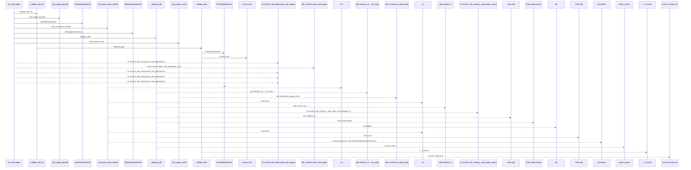
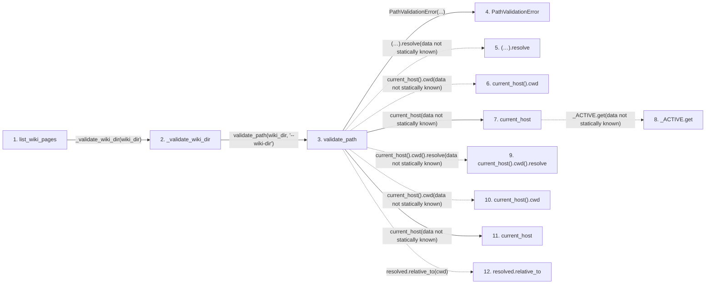

# list_wiki_pages

**Entry point:** `list_wiki_pages` (`api`)
**Source:** [api](../modules/api.md)
**Modules touched:** [api](../modules/api.md), [host](../modules/host.md), [path_policy](../modules/path_policy.md)

## Call sequence

> Static overview in presentation order, not runtime execution order. Arrows retain captured callers; representative internal continuations and boundary examples precede repeated helper detail.

<!-- Auto-generated from static call edges. Dashed arrows are external or unresolved calls. Reviewed runtime conditions and side effects belong in Behavior. -->

> Call sequence diagram shows 30 of 38 interactions; 8 omitted to keep the visualization within the 30-interaction and generated-diagram limits, with uncertain identities omitted rather than inferred.

> Captured boundary calls: external 11 of 11 (0 omitted); unresolved 9 of 13 (4 omitted). These counts cover the captured static trace.

Omitted captured detail, grouped by actual caller occurrence and target module:

| Caller | Parent step | Target module | Kind | Omitted interactions |
| --- | --- | --- | --- | --- |
| `src/llm_wiki_engine/host.py:current_host` | 7 | - | unresolved | 1 |
| `src/llm_wiki_engine/path_policy.py:validate_path` | 3 | - | unresolved | 3 |
| `src/llm_wiki_engine/path_policy.py:validate_path` | 3 | [src/llm_wiki_engine/host.py](../modules/host.md) | internal | 1 |
| `src/llm_wiki_engine/path_policy.py:validate_path` | 3 | [src/llm_wiki_engine/path_policy.py](../modules/path_policy.md) | internal | 1 |
| `src/llm_wiki_cli/api.py:list_wiki_pages` | 1 | [src/llm_wiki_cli/api.py](../modules/api.md) | internal | 2 |
> Detailed flow queries retain their own coverage and limits; omitted paths may execute at runtime.

## Data flow

<!-- Auto-generated static analysis. Treat values and boundaries as best-effort hints, not runtime proof. -->

### Analysis coverage

**Effect analysis partially available.** Flow assembly and source effect analysis are separate; empty observations do not prove an empty handler body.

Source steps: 15; effect analysis evaluated: 9, partial: 0, unavailable: 6. Counts include steps omitted from the displayed trace.

Collector observations for 9 source steps with known totals: observed: 29, emitted: 29, omitted: 0. Unavailable totals are excluded.

- Callable record unavailable for one or more source steps; those steps have no represented callable body.
- Effect collector totals unavailable; observed counts cover captured records only.

| Step | Callable record | Effect analysis | Collector totals | Observed | Emitted | Omitted |
|---|---|---|---|---:|---:|---:|
| `list_wiki_pages` | `available` | `evaluated` | `available` | `5` | `5` | `0` |
| `_validate_wiki_dir` | `available` | `evaluated` | `available` | `2` | `2` | `0` |
| `validate_path` | `available` | `evaluated` | `available` | `3` | `3` | `0` |
| `PathValidationError` | `unavailable` | `unavailable` | `unavailable` | — | — | — |
| `(…).resolve` | `not_applicable` | `not_applicable` | `not_applicable` | — | — | — |
| `current_host().cwd` | `not_applicable` | `not_applicable` | `not_applicable` | — | — | — |
| `current_host` | `available` | `evaluated` | `available` | `2` | `2` | `0` |
| `_ACTIVE.get` | `not_applicable` | `not_applicable` | `not_applicable` | — | — | — |
| `current_host().cwd().resolve` | `not_applicable` | `not_applicable` | `not_applicable` | — | — | — |
| `current_host().cwd` | `not_applicable` | `not_applicable` | `not_applicable` | — | — | — |
| `current_host` | `available` | `evaluated` | `available` | `2` | `2` | `0` |
| `resolved.relative_to` | `not_applicable` | `not_applicable` | `not_applicable` | — | — | — |

### Step data

| Step | Inputs | Reads | Writes | Returns |
|---|---|---|---|---|
| `list_wiki_pages` | `wiki_dir: str` | `PathValidationError`, `wiki_surface`, `wiki_surface` | - | `{...}` |
| `_validate_wiki_dir` | `wiki_dir: str` | - | - | `validate_path(...)` |
| `validate_path` | `path: str`, `label: str` | - | - | `resolved` |
| `PathValidationError` | - | - | - | - |
| `(…).resolve` | - | - | - | - |
| `current_host().cwd` | - | - | - | - |
| `current_host` | - | `_DEFAULT` | - | `...` |
| `_ACTIVE.get` | - | - | - | - |
| `current_host().cwd().resolve` | - | - | - | - |
| `current_host().cwd` | - | - | - | - |
| `current_host` | - | `_DEFAULT` | - | `...` |
| `resolved.relative_to` | - | - | - | - |

### Call data

| From | To | Line | Call |
|---|---|---:|---|
| list_wiki_pages | _validate_wiki_dir | 2101 | `_validate_wiki_dir(wiki_dir)` |
| _validate_wiki_dir | validate_path | 3924 | `validate_path(wiki_dir, '--wiki-dir')` |
| validate_path | PathValidationError | 102 | `PathValidationError(...)` |
| validate_path | (…).resolve | 103 | `(current_host().cwd() / path).resolve(data not statically known)` |
| validate_path | current_host().cwd | 103 | `current_host().cwd(data not statically known)` |
| validate_path | current_host | 103 | `current_host(data not statically known)` |
| current_host | _ACTIVE.get | 167 | `_ACTIVE.get(data not statically known)` |
| validate_path | current_host().cwd().resolve | 104 | `current_host().cwd().resolve(data not statically known)` |
| validate_path | current_host().cwd | 104 | `current_host().cwd(data not statically known)` |
| validate_path | current_host | 104 | `current_host(data not statically known)` |
| validate_path | resolved.relative_to | 106 | `resolved.relative_to(cwd)` |

### Boundary effects

*No boundary-effect observations were captured in this static trace.*

### Static analysis gaps

| Kind | Step | Target | Line |
|---|---|---|---:|
| unresolved_call | `validate_path` | `(current_host().cwd() / path).resolve` | 103 |
| unresolved_call | `validate_path` | `current_host().cwd` | 103 |
| unresolved_call | `current_host` | `_ACTIVE.get` | 167 |
| unresolved_call | `validate_path` | `current_host().cwd().resolve` | 104 |
| unresolved_call | `validate_path` | `current_host().cwd` | 104 |
| unresolved_call | `validate_path` | `resolved.relative_to` | 106 |
| step_limit | `list_wiki_pages` | `first 12 steps` | 0 |

## Behavior

This flow starts at `list_wiki_pages` and is classified as `api`. The generated call and data-flow sections are bounded static projections; runtime conditions and side effects require source-level confirmation.
