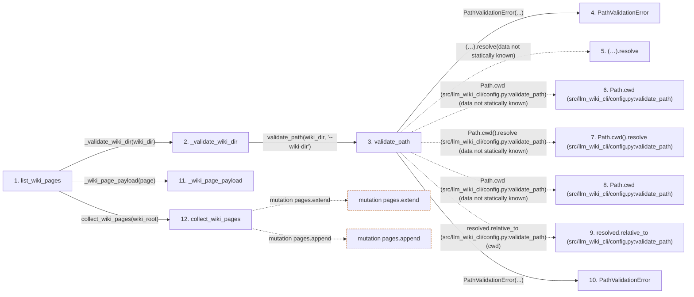

# list_wiki_pages

**Entry point:** `list_wiki_pages` (`api`)
**Source:** [api](../modules/api.md)
**Modules touched:** [api](../modules/api.md), [config](../modules/config.md), [validation](../modules/validation.md), [wiki_surface](../modules/wiki_surface.md)

## Call sequence

> Static overview in presentation order, not runtime execution order. Arrows retain captured callers; siblings are shown before deeper helper detail.

```mermaid
sequenceDiagram
    participant p0 as list_wiki_pages
    participant p1 as _validate_wiki_dir
    participant p2 as _wiki_page_payload
    participant p3 as collect_wiki_pages
    participant p4 as InvalidRequestError
    participant p5 as str (src/llm_wiki_cli/api.py:list_wiki_pages)
    participant p6 as _wiki_path_policy_details
    participant p7 as WorkspaceStateError
    participant p8 as _display_path
    participant p9 as _wiki_page_counts
    participant p10 as validate_path
    participant p11 as Path (src/llm_wiki_cli/services…ace.py:collect_wiki_pages)
    participant p12 as set
    participant p13 as path.relative_to(…).as_posix (src/llm_wiki_cli/api.py:_display_path)
    participant p14 as iter_page_kinds
    participant p15 as pages.extend
    participant p16 as id
    participant p17 as path.relative_to (src/llm_wiki_cli/api.py:_display_path)
    participant p18 as str (src/llm_wiki_cli/api.py:_wiki_page_counts)
    participant p19 as _collect_directory_pages
    participant p20 as seen.add
    participant p21 as Path.cwd().resolve (src/llm_wiki_cli/api.py:_display_path)
    participant p22 as len
    participant p23 as path.is_symlink (src/llm_wiki_cli/services…ace.py:collect_wiki_pages)
    participant p24 as Path.cwd (src/llm_wiki_cli/api.py:_display_path)
    p0->>p1: _validate_wiki_dir
    p0->>p2: _wiki_page_payload
    p0->>p3: collect_wiki_pages
    p0->>p4: InvalidRequestError
    p0-->>p5: str (src/llm_wiki_cli/api.py:list_wiki_pages)(exc)
    p0->>p4: InvalidRequestError
    p0-->>p5: str (src/llm_wiki_cli/api.py:list_wiki_pages)(exc)
    p0->>p6: _wiki_path_policy_details
    p0->>p4: InvalidRequestError
    p0-->>p5: str (src/llm_wiki_cli/api.py:list_wiki_pages)(exc)
    p0->>p7: WorkspaceStateError
    p0-->>p5: str (src/llm_wiki_cli/api.py:list_wiki_pages)(exc)
    p0->>p8: _display_path
    p0->>p9: _wiki_page_counts
    p1->>p10: validate_path
    p3-->>p11: Path (src/llm_wiki_cli/services…ace.py:collect_wiki_pages)(wiki_dir)
    p6-->>p12: set
    p8-->>p13: path.relative_to(…).as_posix (src/llm_wiki_cli/api.py:_display_path)
    p9->>p14: iter_page_kinds
    p3-->>p15: pages.extend(_collect_directory_pages(...))
    p6-->>p16: id(current)
    p8-->>p17: path.relative_to (src/llm_wiki_cli/api.py:_display_path)(...)
    p9-->>p18: str (src/llm_wiki_cli/api.py:_wiki_page_counts)(page[...])
    p3->>p19: _collect_directory_pages
    p6-->>p20: seen.add(id(...))
    p8-->>p21: Path.cwd().resolve (src/llm_wiki_cli/api.py:_display_path)
    p9-->>p22: len(pages)
    p3-->>p23: path.is_symlink (src/llm_wiki_cli/services…ace.py:collect_wiki_pages)
    p6-->>p16: id(current)
    p8-->>p24: Path.cwd (src/llm_wiki_cli/api.py:_display_path)
```

<!-- Auto-generated from static call edges. Dashed arrows are external or unresolved calls. Reviewed runtime conditions and side effects belong in Behavior. -->

> Call sequence diagram shows 30 of 112 interactions; 82 omitted to keep the visualization within the 30-interaction and generated-diagram limits, with uncertain identities omitted rather than inferred.

> Captured boundary calls: external 11 of 28 (17 omitted); unresolved 6 of 39 (33 omitted). These counts cover the captured static trace.

Omitted captured detail, grouped by actual caller occurrence and target module:

| Caller | Parent step | Target module | Kind | Omitted interactions |
| --- | --- | --- | --- | --- |
| `src/llm_wiki_cli/config.py:validate_path` | 3 | [src/llm_wiki_cli/config.py](../modules/config.md) | internal | 2 |
| `src/llm_wiki_cli/config.py:validate_path` | 3 | - | unresolved | 3 |
| `src/llm_wiki_cli/config.py:validate_path` | 3 | - | external | 2 |
| `src/llm_wiki_cli/services/wiki_surface.py:_collect_directory_pages` | 15 | - | unresolved | 7 |
| `src/llm_wiki_cli/services/wiki_surface.py:_collect_directory_pages` | 15 | [src/llm_wiki_cli/services/wiki_surface.py](../modules/wiki_surface.md) | internal | 5 |
| `src/llm_wiki_cli/services/wiki_surface.py:_collect_directory_pages` | 15 | - | external | 1 |
| `src/llm_wiki_cli/services/wiki_surface.py:resolve_wiki_page_path` | 23 | - | external | 3 |
| `src/llm_wiki_cli/services/wiki_surface.py:resolve_wiki_page_path` | 23 | - | unresolved | 8 |
> Omission summary shows 8 of 29 groups; 21 further groups are not expanded here. Counts above include all omitted interactions.
> Detailed flow queries retain their own coverage and limits; omitted paths may execute at runtime.

## Data flow

<!-- Auto-generated static analysis. Treat values and boundaries as best-effort hints, not runtime proof. -->

### Step data

| Step | Inputs | Reads | Writes | Returns |
|---|---|---|---|---|
| `list_wiki_pages` | `wiki_dir: str` | `PathValidationError`, `wiki_surface`, `wiki_surface` | - | `{...}` |
| `_validate_wiki_dir` | `wiki_dir: str` | - | - | `validate_path(...)` |
| `validate_path` | `path: str`, `label: str` | - | - | `resolved` |
| `PathValidationError` | - | - | - | - |
| `(…).resolve` | - | - | - | - |
| `Path.cwd (src/llm_wiki_cli/config.py:validate_path)` | - | - | - | - |
| `Path.cwd().resolve (src/llm_wiki_cli/config.py:validate_path)` | - | - | - | - |
| `Path.cwd (src/llm_wiki_cli/config.py:validate_path)` | - | - | - | - |
| `resolved.relative_to (src/llm_wiki_cli/config.py:validate_path)` | - | - | - | - |
| `PathValidationError` | - | - | - | - |
| `_wiki_page_payload` | `page: wiki_surface.WikiSurfacePage` | - | - | `{...}` |
| `collect_wiki_pages` | `wiki_dir: Union[str, Path]` | `_PAGE_KINDS` | - | `pages` |

### Call data

| From | To | Line | Call |
|---|---|---:|---|
| list_wiki_pages | _validate_wiki_dir | 1814 | `_validate_wiki_dir(wiki_dir)` |
| _validate_wiki_dir | validate_path | 3207 | `validate_path(wiki_dir, '--wiki-dir')` |
| validate_path | PathValidationError | 134 | `PathValidationError(...)` |
| validate_path | (…).resolve | 135 | `(Path.cwd() / path).resolve(data not statically known)` |
| validate_path | Path.cwd (src/llm_wiki_cli/config.py:validate_path) | 135 | `Path.cwd(data not statically known)` |
| validate_path | Path.cwd().resolve (src/llm_wiki_cli/config.py:validate_path) | 136 | `Path.cwd().resolve(data not statically known)` |
| validate_path | Path.cwd (src/llm_wiki_cli/config.py:validate_path) | 136 | `Path.cwd(data not statically known)` |
| validate_path | resolved.relative_to (src/llm_wiki_cli/config.py:validate_path) | 138 | `resolved.relative_to(cwd)` |
| validate_path | PathValidationError | 140 | `PathValidationError(...)` |
| list_wiki_pages | _wiki_page_payload | 1816 | `_wiki_page_payload(page)` |
| list_wiki_pages | collect_wiki_pages | 1817 | `wiki_surface.collect_wiki_pages(wiki_root)` |

### Boundary effects

| Kind | Target | Step | Line |
|---|---|---|---:|
| mutation | `pages.extend` | `collect_wiki_pages` | 293 |
| mutation | `pages.append` | `collect_wiki_pages` | 301 |

### Static analysis gaps

| Kind | Step | Target | Line |
|---|---|---|---:|
| unresolved_call | `validate_path` | `(Path.cwd() / path).resolve` | 135 |
| external_call | `validate_path` | `Path.cwd` | 135 |
| unresolved_call | `validate_path` | `Path.cwd().resolve` | 136 |
| external_call | `validate_path` | `Path.cwd` | 136 |
| unresolved_call | `validate_path` | `resolved.relative_to` | 138 |
| step_limit | `list_wiki_pages` | `first 12 steps` | 0 |

## Behavior

This flow starts at `list_wiki_pages` and is classified as `api`. The generated call and data-flow sections are bounded static projections; runtime conditions and side effects require source-level confirmation.
