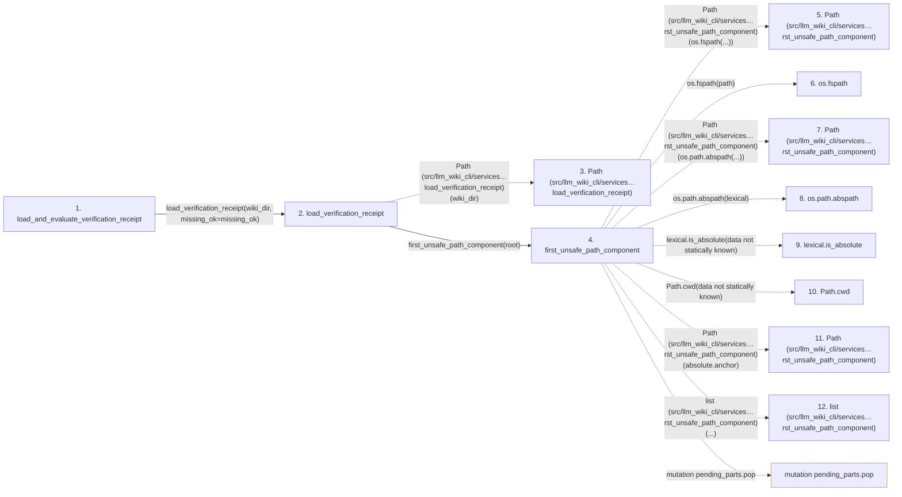

# load_and_evaluate_verification_receipt

**Entry point:** `load_and_evaluate_verification_receipt` (`api`)
**Source:** [verification_contracts](../modules/verification_contracts.md)
**Modules touched:** [io](../modules/io.md), [knowledge_evidence](../modules/knowledge_evidence.md), [validation](../modules/validation.md), [verification_contracts](../modules/verification_contracts.md)

## Call sequence

> Static overview in presentation order, not runtime execution order. Arrows retain captured callers; representative internal continuations and boundary examples precede repeated helper detail.

```mermaid
sequenceDiagram
    participant p0 as load_and_evaluate_verification_receipt
    participant p1 as load_verification_receipt
    participant p2 as evaluate_verification_receipt
    participant p3 as _read_regular_receipt
    participant p4 as deserialize_verification_receipt
    participant p5 as validate_verification_receipt
    participant p6 as serialize_verification_receipt
    participant p7 as formatted_json_bytes
    participant p8 as verification_receipt_to_payload
    participant p9 as _object
    participant p10 as _exact_fields
    participant p11 as _string
    participant p12 as _receipt_hash
    participant p13 as _scope_uid
    participant p14 as _receipt_anchor_mapping
    participant p15 as hash_json
    participant p16 as _parse_check
    participant p17 as _sha256
    participant p18 as _checker_id
    participant p19 as _normalized_anchor_mapping
    participant p20 as canonical_json_bytes
    participant p21 as _checker_version
    participant p22 as _array
    participant p23 as _parse_diagnostic
    participant p24 as _parse_coverage
    participant p25 as first_unsafe_path_component
    participant p26 as VerificationReceiptError
    participant p27 as verification_receipt_path
    participant p28 as VerificationReceiptEvaluation
    participant p29 as Path (src/llm_wiki_cli/services…load_verification_receipt)
    participant p30 as root.is_symlink
    p0->>p1: load_verification_receipt
    p0->>p2: evaluate_verification_receipt
    p1->>p3: _read_regular_receipt
    p1->>p4: deserialize_verification_receipt
    p4->>p5: validate_verification_receipt
    p4->>p6: serialize_verification_receipt
    p6->>p7: formatted_json_bytes
    p6->>p8: verification_receipt_to_payload
    p5->>p9: _object
    p5->>p10: _exact_fields
    p5->>p11: _string
    p5->>p12: _receipt_hash
    p5->>p13: _scope_uid
    p5->>p14: _receipt_anchor_mapping
    p5->>p15: hash_json
    p5->>p16: _parse_check
    p12->>p17: _sha256
    p16->>p18: _checker_id
    p14->>p19: _normalized_anchor_mapping
    p15->>p20: canonical_json_bytes
    p16->>p21: _checker_version
    p16->>p22: _array
    p16->>p23: _parse_diagnostic
    p16->>p24: _parse_coverage
    p1->>p25: first_unsafe_path_component
    p1->>p26: VerificationReceiptError
    p1->>p27: verification_receipt_path
    p2->>p28: VerificationReceiptEvaluation
    p1-->>p29: Path (src/llm_wiki_cli/services…load_verification_receipt)(wiki_dir)
    p1-->>p30: root.is_symlink
```

<!-- Auto-generated from static call edges. Dashed arrows are external or unresolved calls. Reviewed runtime conditions and side effects belong in Behavior. -->

> Call sequence diagram shows 30 of 247 interactions; 217 omitted to keep the visualization within the 30-interaction and generated-diagram limits, with uncertain identities omitted rather than inferred.

> Captured boundary calls: external 1 of 92 (91 omitted); unresolved 1 of 35 (34 omitted). These counts cover the captured static trace.

Omitted captured detail, grouped by actual caller occurrence and target module:

| Caller | Parent step | Target module | Kind | Omitted interactions |
| --- | --- | --- | --- | --- |
| `src/llm_wiki_cli/services/io.py:first_unsafe_path_component` | 4 | - | external | 20 |
| `src/llm_wiki_cli/services/io.py:first_unsafe_path_component` | 4 | - | unresolved | 5 |
| `src/llm_wiki_cli/services/verification_contracts.py:load_verification_receipt` | 2 | [src/llm_wiki_cli/services/verification_contracts.py](../modules/verification_contracts.md) | internal | 1 |
| `src/llm_wiki_cli/services/verification_contracts.py:verification_receipt_path` | 33 | - | external | 1 |
| `src/llm_wiki_cli/services/verification_contracts.py:_read_regular_receipt` | 35 | - | unresolved | 3 |
| `src/llm_wiki_cli/services/verification_contracts.py:_read_regular_receipt` | 35 | [src/llm_wiki_cli/services/verification_contracts.py](../modules/verification_contracts.md) | internal | 7 |
| `src/llm_wiki_cli/services/verification_contracts.py:_read_regular_receipt` | 35 | - | external | 12 |
| `src/llm_wiki_cli/services/verification_contracts.py:deserialize_verification_receipt` | 58 | - | external | 4 |
> Omission summary shows 8 of 69 groups; 61 further groups are not expanded here. Counts above include all omitted interactions.
> Detailed flow queries retain their own coverage and limits; omitted paths may execute at runtime.

> Trace truncated at the depth limit; deeper calls are omitted.

## Data flow

<!-- Auto-generated static analysis. Treat values and boundaries as best-effort hints, not runtime proof. -->

### Analysis coverage

**Effect analysis partially available.** Flow assembly and source effect analysis are separate; empty observations do not prove an empty handler body.

Source steps: 121; effect analysis evaluated: 67, partial: 0, unavailable: 54. Counts include steps omitted from the displayed trace.

- Callable record unavailable; the selected entry symbol has no represented callable body.
- Effect collector totals unavailable; observed counts cover captured records only.

| Step | Callable record | Effect analysis | Collector totals |
|---|---|---|---|
| `load_and_evaluate_verification_receipt` | `available` | `evaluated` | `available` |
| `load_verification_receipt` | `available` | `evaluated` | `available` |
| `Path (src/llm_wiki_cli/services…load_verification_receipt)` | `not_applicable` | `not_applicable` | `not_applicable` |
| `first_unsafe_path_component` | `available` | `evaluated` | `available` |
| `Path (src/llm_wiki_cli/services…rst_unsafe_path_component)` | `not_applicable` | `not_applicable` | `not_applicable` |
| `os.fspath` | `not_applicable` | `not_applicable` | `not_applicable` |
| `Path (src/llm_wiki_cli/services…rst_unsafe_path_component)` | `not_applicable` | `not_applicable` | `not_applicable` |
| `os.path.abspath` | `not_applicable` | `not_applicable` | `not_applicable` |
| `lexical.is_absolute` | `not_applicable` | `not_applicable` | `not_applicable` |
| `Path.cwd` | `not_applicable` | `not_applicable` | `not_applicable` |
| `Path (src/llm_wiki_cli/services…rst_unsafe_path_component)` | `not_applicable` | `not_applicable` | `not_applicable` |
| `list (src/llm_wiki_cli/services…rst_unsafe_path_component)` | `not_applicable` | `not_applicable` | `not_applicable` |

### Step data

| Step | Inputs | Reads | Writes | Returns |
|---|---|---|---|---|
| `load_and_evaluate_verification_receipt` | `wiki_dir: str \| Path`, `context: VerificationContext`, `missing_ok: bool` | - | - | `None`, `evaluate_verification_receipt(...)` |
| `load_verification_receipt` | `wiki_dir: str \| Path`, `missing_ok: bool` | - | - | `None`, `deserialize_verification_receipt(...)` |
| `Path (src/llm_wiki_cli/services…load_verification_receipt)` | - | - | - | - |
| `first_unsafe_path_component` | `path: str \| Path`, `trusted_symlink_uids: Set[int] \| None`, `trusted_symlink_owner: Callable[[Path], bool] \| None` | `stat`, `os` | - | `lexical`, `None`, `current`, `current`, `current`, `current`, `current`, `None` |
| `Path (src/llm_wiki_cli/services…rst_unsafe_path_component)` | - | - | - | - |
| `os.fspath` | - | - | - | - |
| `Path (src/llm_wiki_cli/services…rst_unsafe_path_component)` | - | - | - | - |
| `os.path.abspath` | - | - | - | - |
| `lexical.is_absolute` | - | - | - | - |
| `Path.cwd` | - | - | - | - |
| `Path (src/llm_wiki_cli/services…rst_unsafe_path_component)` | - | - | - | - |
| `list (src/llm_wiki_cli/services…rst_unsafe_path_component)` | - | - | - | - |

### Call data

| From | To | Line | Call |
|---|---|---:|---|
| load_and_evaluate_verification_receipt | load_verification_receipt | 1087 | `load_verification_receipt(wiki_dir, missing_ok=missing_ok)` |
| load_verification_receipt | Path (src/llm_wiki_cli/services…load_verification_receipt) | 956 | `Path(wiki_dir)` |
| load_verification_receipt | first_unsafe_path_component | 957 | `first_unsafe_path_component(root)` |
| first_unsafe_path_component | Path (src/llm_wiki_cli/services…rst_unsafe_path_component) | 51 | `Path(os.fspath(...))` |
| first_unsafe_path_component | os.fspath | 51 | `os.fspath(path)` |
| first_unsafe_path_component | Path (src/llm_wiki_cli/services…rst_unsafe_path_component) | 59 | `Path(os.path.abspath(...))` |
| first_unsafe_path_component | os.path.abspath | 59 | `os.path.abspath(lexical)` |
| first_unsafe_path_component | lexical.is_absolute | 60 | `lexical.is_absolute(data not statically known)` |
| first_unsafe_path_component | Path.cwd | 66 | `Path.cwd(data not statically known)` |
| first_unsafe_path_component | Path (src/llm_wiki_cli/services…rst_unsafe_path_component) | 67 | `Path(absolute.anchor)` |
| first_unsafe_path_component | list (src/llm_wiki_cli/services…rst_unsafe_path_component) | 68 | `list(...)` |

### Boundary effects

| Kind | Target | Step | Line |
|---|---|---|---:|
| mutation | `pending_parts.pop` | `first_unsafe_path_component` | 71 |

### Static analysis gaps

| Kind | Step | Target | Line |
|---|---|---|---:|
| external_call | `first_unsafe_path_component` | `os.fspath` | 51 |
| external_call | `first_unsafe_path_component` | `os.path.abspath` | 59 |
| unresolved_call | `first_unsafe_path_component` | `lexical.is_absolute` | 60 |
| external_call | `first_unsafe_path_component` | `Path.cwd` | 66 |
| step_limit | `load_and_evaluate_verification_receipt` | `first 12 steps` | 0 |
| truncated_flow | `load_and_evaluate_verification_receipt` | `depth limit` | 0 |

## Behavior

This flow starts at `load_and_evaluate_verification_receipt` and is classified as `api`. The generated call and data-flow sections are bounded static projections; runtime conditions and side effects require source-level confirmation.
