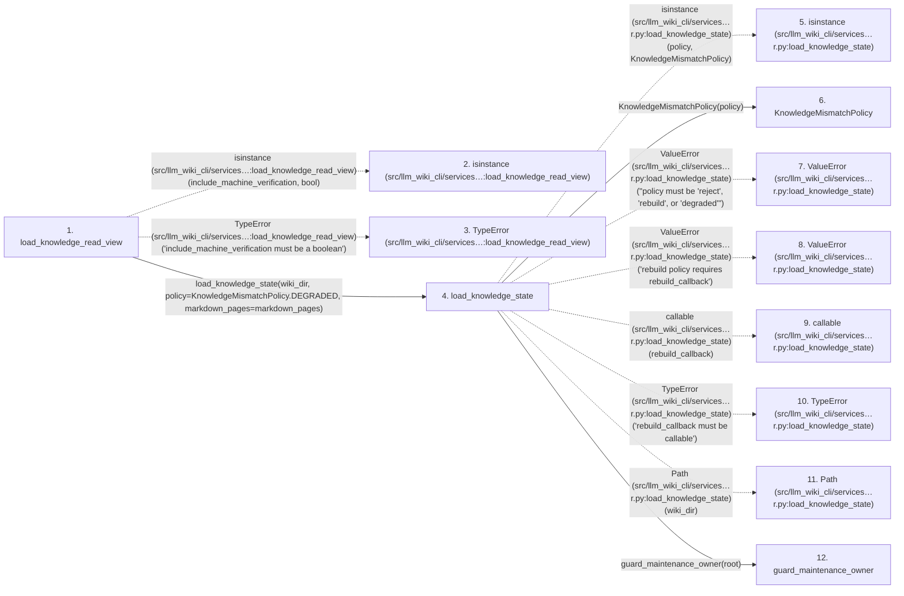

# load_knowledge_read_view

**Entry point:** `load_knowledge_read_view` (`api`)
**Source:** [knowledge_consumption](../modules/knowledge_consumption.md)
**Modules touched:** [analysis_compatibility](../modules/analysis_compatibility.md), [filesystem_guard](../modules/filesystem_guard.md), [immutable](../modules/immutable.md), and 32 more

**Complete modules touched:**

- [analysis_compatibility](../modules/analysis_compatibility.md)
- [filesystem_guard](../modules/filesystem_guard.md)
- [immutable](../modules/immutable.md)
- [implementation_evidence](../modules/implementation_evidence.md)
- [infrastructure_sync](../modules/infrastructure_sync.md)
- [io](../modules/io.md)
- [knowledge_artifacts](../modules/knowledge_artifacts.md)
- [knowledge_consumption](../modules/knowledge_consumption.md)
- [knowledge_envelope](../modules/knowledge_envelope.md)
- [knowledge_evidence](../modules/knowledge_evidence.md)
- [knowledge_freshness](../modules/knowledge_freshness.md)
- [knowledge_governance](../modules/knowledge_governance.md)
- [knowledge_graph](../modules/knowledge_graph.md)
- [knowledge_index](../modules/knowledge_index.md)
- [knowledge_loader](../modules/knowledge_loader.md)
- [knowledge_model](../modules/knowledge_model.md)
- [knowledge_packs](../modules/knowledge_packs.md)
- [knowledge_reuse](../modules/knowledge_reuse.md)
- [knowledge_storage](../modules/knowledge_storage.md)
- [knowledge_storage_io](../modules/knowledge_storage_io.md)
- [knowledge_verification](../modules/knowledge_verification.md)
- [maintenance_evidence](../modules/maintenance_evidence.md)
- [maintenance_projection](../modules/maintenance_projection.md)
- [maintenance_protocol](../modules/maintenance_protocol.md)
- [maintenance_shapes](../modules/maintenance_shapes.md)
- [maintenance_state](../modules/maintenance_state.md)
- [maintenance_status](../modules/maintenance_status.md)
- [manifest_storage](../modules/manifest_storage.md)
- [markdown_sections](../modules/markdown_sections.md)
- [section_ownership](../modules/section_ownership.md)
- [source_retirement](../modules/source_retirement.md)
- [sync_manifest](../modules/sync_manifest.md)
- [validation](../modules/validation.md)
- [verification_contracts](../modules/verification_contracts.md)
- [wiki_surface](../modules/wiki_surface.md)

## Call sequence

> Static overview in presentation order, not runtime execution order. Arrows retain captured callers; representative internal continuations and boundary examples precede repeated helper detail.

```mermaid
sequenceDiagram
    participant p0 as load_knowledge_read_view
    participant p1 as load_knowledge_state
    participant p2 as build_knowledge_read_view
    participant p3 as attach_machine_verification_read_view
    participant p4 as _unsupported_reason
    participant p5 as KnowledgeLoadResult
    participant p6 as _read_mode
    participant p7 as _validate_load_result
    participant p8 as load_machine_verification_read_view
    participant p9 as _loaded_freshness
    participant p10 as _knowledge_counts
    participant p11 as guard_maintenance_owner
    participant p12 as _snapshot_maintenance_report
    participant p13 as _implementation_report
    participant p14 as _load_once
    participant p15 as _absolute_path
    participant p16 as _read_artifact
    participant p17 as build_maintenance_status
    participant p18 as evaluate_knowledge_freshness
    participant p19 as marker_from_validated_state
    participant p20 as compare_knowledge_implementation
    participant p21 as load_adoption_marker
    participant p22 as validate_surface_index_bytes
    participant p23 as SyncManifest.load
    participant p24 as _issue_from_artifact_error
    participant p25 as load_verification_receipt
    participant p26 as _current_markdown
    participant p27 as _load_manifest
    participant p28 as evaluate_verification_receipt
    participant p29 as isinstance (src/llm_wiki_cli/services…:load_knowledge_read_view)
    participant p30 as _UNSUPPORTED_REASON_BY_ISSUE.get
    p0->>p1: load_knowledge_state
    p0->>p2: build_knowledge_read_view
    p0->>p3: attach_machine_verification_read_view
    p0->>p4: _unsupported_reason
    p0->>p5: KnowledgeLoadResult
    p2->>p6: _read_mode
    p2->>p7: _validate_load_result
    p3->>p8: load_machine_verification_read_view
    p2->>p9: _loaded_freshness
    p2->>p10: _knowledge_counts
    p1->>p11: guard_maintenance_owner
    p2->>p12: _snapshot_maintenance_report
    p2->>p13: _implementation_report
    p1->>p14: _load_once
    p11->>p15: _absolute_path
    p14->>p16: _read_artifact
    p12->>p17: build_maintenance_status
    p9->>p18: evaluate_knowledge_freshness
    p12->>p19: marker_from_validated_state
    p13->>p20: compare_knowledge_implementation
    p11->>p21: load_adoption_marker
    p14->>p22: validate_surface_index_bytes
    p11->>p23: SyncManifest.load
    p14->>p24: _issue_from_artifact_error
    p8->>p25: load_verification_receipt
    p14->>p26: _current_markdown
    p14->>p27: _load_manifest
    p8->>p28: evaluate_verification_receipt
    p0-->>p29: isinstance (src/llm_wiki_cli/services…:load_knowledge_read_view)(include_machine_verification, bool)
    p4-->>p30: _UNSUPPORTED_REASON_BY_ISSUE.get(issue.code)
```

<!-- Auto-generated from static call edges. Dashed arrows are external or unresolved calls. Reviewed runtime conditions and side effects belong in Behavior. -->

> Call sequence diagram shows 30 of 1811 interactions; 1781 omitted to keep the visualization within the 30-interaction and generated-diagram limits, with uncertain identities omitted rather than inferred.

> Captured boundary calls: external 1 of 591 (590 omitted); unresolved 1 of 341 (340 omitted). These counts cover the captured static trace.

Omitted captured detail, grouped by actual caller occurrence and target module:

| Caller | Parent step | Target module | Kind | Omitted interactions |
| --- | --- | --- | --- | --- |
| `src/llm_wiki_cli/services/knowledge_consumption.py:load_knowledge_read_view` | 1 | - | external | 1 |
| `src/llm_wiki_cli/services/knowledge_loader.py:load_knowledge_state` | 4 | - | external | 10 |
| `src/llm_wiki_cli/services/knowledge_loader.py:load_knowledge_state` | 4 | [src/llm_wiki_cli/services/knowledge_loader.py](../modules/knowledge_loader.md) | internal | 7 |
| `src/llm_wiki_cli/services/knowledge_storage_io.py:_absolute_path` | 13 | - | external | 4 |
| `src/llm_wiki_cli/services/knowledge_storage_io.py:_absolute_path` | 13 | [src/llm_wiki_cli/services/io.py](../modules/io.md) | internal | 1 |
| `src/llm_wiki_cli/services/io.py:first_unsafe_path_component` | 16 | - | external | 20 |
| `src/llm_wiki_cli/services/io.py:first_unsafe_path_component` | 16 | - | unresolved | 5 |
| `src/llm_wiki_cli/services/knowledge_storage_io.py:_absolute_path` | 13 | [src/llm_wiki_cli/services/knowledge_storage.py](../modules/knowledge_storage.md) | internal | 1 |
> Omission summary shows 8 of 396 groups; 388 further groups are not expanded here. Counts above include all omitted interactions.
> Detailed flow queries retain their own coverage and limits; omitted paths may execute at runtime.

> Trace truncated at the depth limit; deeper calls are omitted.

## Data flow

<!-- Auto-generated static analysis. Treat values and boundaries as best-effort hints, not runtime proof. -->

### Step data

| Step | Inputs | Reads | Writes | Returns |
|---|---|---|---|---|
| `load_knowledge_read_view` | `wiki_dir: str \| Path`, `live_evaluation: LiveKnowledgeEvaluation \| None`, `snapshot_only: bool`, `mode: KnowledgeReadMode \| str \| None`, `markdown_pages: Mapping[str, str \| bytes] \| None`, `include_machine_verification: bool` | `KnowledgeMismatchPolicy`, `KnowledgeStateLoadError`, `KnowledgeLoadState` | - | `view`, `attach_machine_verification_read_view(...)` |
| `isinstance (src/llm_wiki_cli/services…:load_knowledge_read_view)` | - | - | - | - |
| `TypeError (src/llm_wiki_cli/services…:load_knowledge_read_view)` | - | - | - | - |
| `load_knowledge_state` | `wiki_dir: str \| Path`, `policy: KnowledgeMismatchPolicy \| str`, `rebuild_callback: RebuildCallback \| None`, `markdown_pages: Mapping[str, str \| bytes] \| None` | `KnowledgeMismatchPolicy`, `KnowledgeMismatchPolicy`, `KnowledgeLoadState`, `KnowledgeLoadState`, `KnowledgeLoadState`, `KnowledgeMismatchPolicy`, `KnowledgeLoadState`, `KnowledgeMismatchPolicy` | - | `KnowledgeLoadResult(...)`, `result`, `replace(...)`, `replace(...)`, `KnowledgeLoadResult(...)` |
| `isinstance (src/llm_wiki_cli/services…r.py:load_knowledge_state)` | - | - | - | - |
| `KnowledgeMismatchPolicy` | - | - | - | - |
| `ValueError (src/llm_wiki_cli/services…r.py:load_knowledge_state)` | - | - | - | - |
| `ValueError (src/llm_wiki_cli/services…r.py:load_knowledge_state)` | - | - | - | - |
| `callable (src/llm_wiki_cli/services…r.py:load_knowledge_state)` | - | - | - | - |
| `TypeError (src/llm_wiki_cli/services…r.py:load_knowledge_state)` | - | - | - | - |
| `Path (src/llm_wiki_cli/services…r.py:load_knowledge_state)` | - | - | - | - |
| `guard_maintenance_owner` | `wiki_dir: str \| Path`, `manifest` | - | - | `None`, `None`, `marker` |

### Call data

| From | To | Line | Call |
|---|---|---:|---|
| load_knowledge_read_view | isinstance (src/llm_wiki_cli/services…:load_knowledge_read_view) | 692 | `isinstance(include_machine_verification, bool)` |
| load_knowledge_read_view | TypeError (src/llm_wiki_cli/services…:load_knowledge_read_view) | 693 | `TypeError('include_machine_verification must be a boolean')` |
| load_knowledge_read_view | load_knowledge_state | 695 | `load_knowledge_state(wiki_dir, policy=KnowledgeMismatchPolicy.DEGRADED, markdown_pages=markdown_pages)` |
| load_knowledge_state | isinstance (src/llm_wiki_cli/services…r.py:load_knowledge_state) | 112 | `isinstance(policy, KnowledgeMismatchPolicy)` |
| load_knowledge_state | KnowledgeMismatchPolicy | 113 | `KnowledgeMismatchPolicy(policy)` |
| load_knowledge_state | ValueError (src/llm_wiki_cli/services…r.py:load_knowledge_state) | 116 | `ValueError("policy must be 'reject', 'rebuild', or 'degraded'")` |
| load_knowledge_state | ValueError (src/llm_wiki_cli/services…r.py:load_knowledge_state) | 118 | `ValueError('rebuild policy requires rebuild_callback')` |
| load_knowledge_state | callable (src/llm_wiki_cli/services…r.py:load_knowledge_state) | 119 | `callable(rebuild_callback)` |
| load_knowledge_state | TypeError (src/llm_wiki_cli/services…r.py:load_knowledge_state) | 120 | `TypeError('rebuild_callback must be callable')` |
| load_knowledge_state | Path (src/llm_wiki_cli/services…r.py:load_knowledge_state) | 122 | `Path(wiki_dir)` |
| load_knowledge_state | guard_maintenance_owner | 126 | `guard_maintenance_owner(root)` |

### Boundary effects

*No boundary effects detected.*

### Static analysis gaps

| Kind | Step | Target | Line |
|---|---|---|---:|
| external_call | `load_knowledge_read_view` | `isinstance` | 692 |
| external_call | `load_knowledge_read_view` | `TypeError` | 693 |
| external_call | `load_knowledge_state` | `isinstance` | 112 |
| external_call | `load_knowledge_state` | `ValueError` | 116 |
| external_call | `load_knowledge_state` | `ValueError` | 118 |
| external_call | `load_knowledge_state` | `callable` | 119 |
| external_call | `load_knowledge_state` | `TypeError` | 120 |
| step_limit | `load_knowledge_read_view` | `first 12 steps` | 0 |
| truncated_flow | `load_knowledge_read_view` | `depth limit` | 0 |

## Behavior

This flow starts at `load_knowledge_read_view` and is classified as `api`. The generated call and data-flow sections are bounded static projections; runtime conditions and side effects require source-level confirmation.
