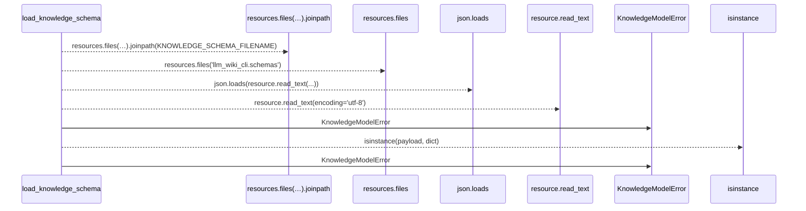
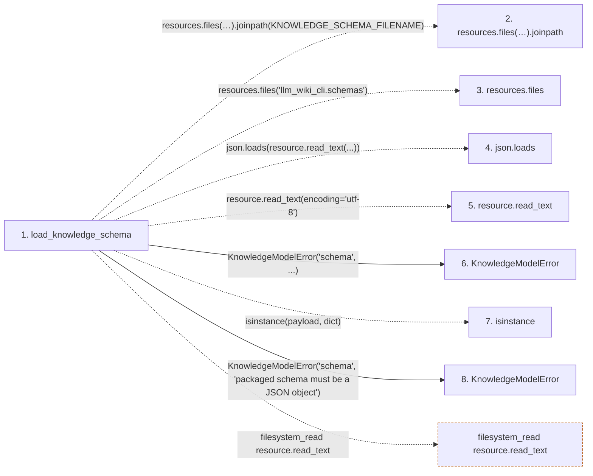

# load_knowledge_schema

**Entry point:** `load_knowledge_schema` (`api`)
**Source:** [knowledge_model](../modules/knowledge_model.md)
**Modules touched:** [knowledge_model](../modules/knowledge_model.md)

## Call sequence

> Static overview in presentation order, not runtime execution order. Arrows retain captured callers; representative internal continuations and boundary examples precede repeated helper detail.

<!-- Auto-generated from static call edges. Dashed arrows are external or unresolved calls. Reviewed runtime conditions and side effects belong in Behavior. -->

> Call sequence diagram shows 7 of 7 interactions; 0 omitted to keep the visualization within the 30-interaction and generated-diagram limits, with uncertain identities omitted rather than inferred.

> Captured boundary calls: external 3 of 3 (0 omitted); unresolved 2 of 2 (0 omitted). These counts cover the captured static trace.
> Detailed flow queries retain their own coverage and limits; omitted paths may execute at runtime.

## Data flow

<!-- Auto-generated static analysis. Treat values and boundaries as best-effort hints, not runtime proof. -->

### Analysis coverage

**Effect analysis partially available.** Flow assembly and source effect analysis are separate; empty observations do not prove an empty handler body.

Source steps: 3; effect analysis evaluated: 1, partial: 0, unavailable: 2. Counts include steps omitted from the displayed trace.

Collector observations for 1 source steps with known totals: observed: 5, emitted: 5, omitted: 0. Unavailable totals are excluded.

- Callable record unavailable; the selected entry symbol has no represented callable body.
- Effect collector totals unavailable; observed counts cover captured records only.

| Step | Callable record | Effect analysis | Collector totals | Observed | Emitted | Omitted |
|---|---|---|---|---:|---:|---:|
| `load_knowledge_schema` | `available` | `evaluated` | `available` | `5` | `5` | `0` |
| `resources.files(…).joinpath` | `not_applicable` | `not_applicable` | `not_applicable` | — | — | — |
| `resources.files` | `not_applicable` | `not_applicable` | `not_applicable` | — | — | — |
| `json.loads` | `not_applicable` | `not_applicable` | `not_applicable` | — | — | — |
| `resource.read_text` | `not_applicable` | `not_applicable` | `not_applicable` | — | — | — |
| `KnowledgeModelError` | `unavailable` | `unavailable` | `unavailable` | — | — | — |
| `isinstance` | `not_applicable` | `not_applicable` | `not_applicable` | — | — | — |
| `KnowledgeModelError` | `unavailable` | `unavailable` | `unavailable` | — | — | — |

### Step data

| Step | Inputs | Reads | Writes | Returns |
|---|---|---|---|---|
| `load_knowledge_schema` | - | `KNOWLEDGE_SCHEMA_FILENAME`, `json`, `KNOWLEDGE_SCHEMA_FILENAME` | - | `payload` |
| `resources.files(…).joinpath` | - | - | - | - |
| `resources.files` | - | - | - | - |
| `json.loads` | - | - | - | - |
| `resource.read_text` | - | - | - | - |
| `KnowledgeModelError` | - | - | - | - |
| `isinstance` | - | - | - | - |
| `KnowledgeModelError` | - | - | - | - |

### Call data

| From | To | Line | Call |
|---|---|---:|---|
| load_knowledge_schema | resources.files(…).joinpath | 718 | `resources.files('llm_wiki_cli.schemas').joinpath(KNOWLEDGE_SCHEMA_FILENAME)` |
| load_knowledge_schema | resources.files | 718 | `resources.files('llm_wiki_cli.schemas')` |
| load_knowledge_schema | json.loads | 721 | `json.loads(resource.read_text(...))` |
| load_knowledge_schema | resource.read_text | 721 | `resource.read_text(encoding='utf-8')` |
| load_knowledge_schema | KnowledgeModelError | 729 | `KnowledgeModelError('schema', ...)` |
| load_knowledge_schema | isinstance | 732 | `isinstance(payload, dict)` |
| load_knowledge_schema | KnowledgeModelError | 733 | `KnowledgeModelError('schema', 'packaged schema must be a JSON object')` |

### Boundary effects

| Kind | Target | Step | Line |
|---|---|---|---:|
| filesystem_read | `resource.read_text` | `load_knowledge_schema` | 721 |

### Static analysis gaps

| Kind | Step | Target | Line |
|---|---|---|---:|
| unresolved_call | `load_knowledge_schema` | `resources.files('llm_wiki_cli.schemas').joinpath` | 718 |
| external_call | `load_knowledge_schema` | `resources.files` | 718 |
| external_call | `load_knowledge_schema` | `isinstance` | 732 |

## Behavior

This flow starts at `load_knowledge_schema` and is classified as `api`. The generated call and data-flow sections are bounded static projections; runtime conditions and side effects require source-level confirmation.
