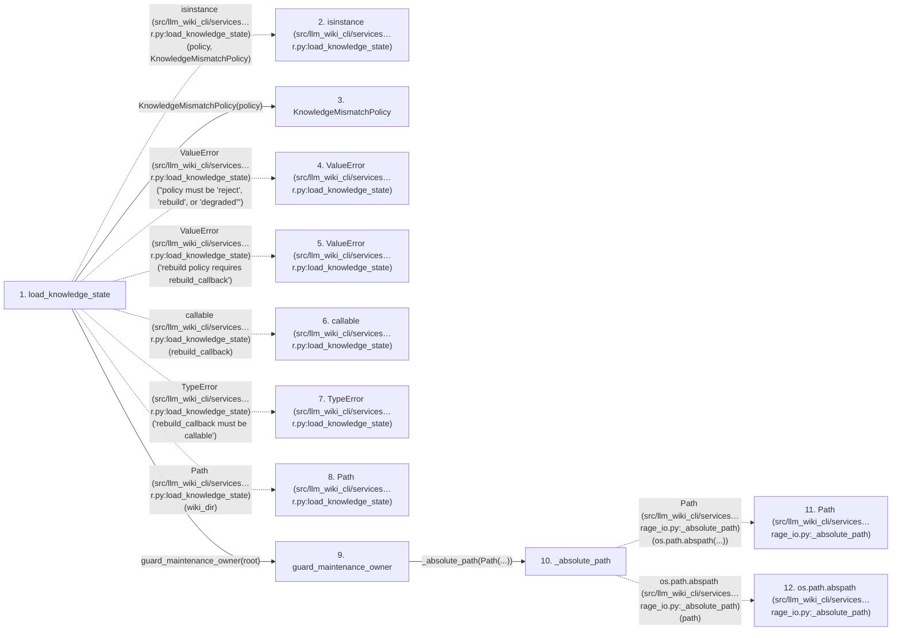

# load_knowledge_state

**Entry point:** `load_knowledge_state` (`api`)
**Source:** [knowledge_loader](../modules/knowledge_loader.md)
**Modules touched:** [analysis_compatibility](../modules/analysis_compatibility.md), [bootstrap_recovery](../modules/bootstrap_recovery.md), [common](../modules/common.md), [concept_identity](../modules/concept_identity.md), and 30 more

**Complete modules touched:**

- [analysis_compatibility](../modules/analysis_compatibility.md)
- [bootstrap_recovery](../modules/bootstrap_recovery.md)
- [common](../modules/common.md)
- [concept_identity](../modules/concept_identity.md)
- [filesystem_guard](../modules/filesystem_guard.md)
- [immutable](../modules/immutable.md)
- [implementation_evidence](../modules/implementation_evidence.md)
- [infrastructure_sync](../modules/infrastructure_sync.md)
- [io](../modules/io.md)
- [knowledge_artifacts](../modules/knowledge_artifacts.md)
- [knowledge_envelope](../modules/knowledge_envelope.md)
- [knowledge_evidence](../modules/knowledge_evidence.md)
- [knowledge_governance](../modules/knowledge_governance.md)
- [knowledge_graph](../modules/knowledge_graph.md)
- [knowledge_index](../modules/knowledge_index.md)
- [knowledge_loader](../modules/knowledge_loader.md)
- [knowledge_model](../modules/knowledge_model.md)
- [knowledge_packs](../modules/knowledge_packs.md)
- [knowledge_reuse](../modules/knowledge_reuse.md)
- [knowledge_storage](../modules/knowledge_storage.md)
- [knowledge_storage_io](../modules/knowledge_storage_io.md)
- [maintenance_projection](../modules/maintenance_projection.md)
- [maintenance_protocol](../modules/maintenance_protocol.md)
- [maintenance_shapes](../modules/maintenance_shapes.md)
- [maintenance_state](../modules/maintenance_state.md)
- [manifest_storage](../modules/manifest_storage.md)
- [markdown_sections](../modules/markdown_sections.md)
- [progress](../modules/progress.md)
- [python_implementation](../modules/python_implementation.md)
- [section_ownership](../modules/section_ownership.md)
- [source_retirement](../modules/source_retirement.md)
- [sync_manifest](../modules/sync_manifest.md)
- [validation](../modules/validation.md)
- [wiki_surface](../modules/wiki_surface.md)

## Call sequence

> Static overview in presentation order, not runtime execution order. Arrows retain captured callers; representative internal continuations and boundary examples precede repeated helper detail.

```mermaid
sequenceDiagram
    participant p0 as load_knowledge_state
    participant p1 as guard_maintenance_owner
    participant p2 as _load_once
    participant p3 as KnowledgeMismatchPolicy
    participant p4 as KnowledgeLoadResult
    participant p5 as KnowledgeLoadIssue
    participant p6 as KnowledgeStateLoadError
    participant p7 as _absolute_path
    participant p8 as _read_artifact
    participant p9 as guard_incomplete_bootstrap
    participant p10 as validate_surface_index_bytes
    participant p11 as load_adoption_marker
    participant p12 as _issue_from_artifact_error
    participant p13 as SyncManifest.load
    participant p14 as _current_markdown
    participant p15 as _load_manifest
    participant p16 as validate_knowledge_artifacts
    participant p17 as _marker_issues
    participant p18 as _live_governance_issues
    participant p19 as _decode_json_object
    participant p20 as pending_bootstrap
    participant p21 as _validate_surface_payload
    participant p22 as _surface_page_index
    participant p23 as hash_markdown_snapshot
    participant p24 as load_governance
    participant p25 as read_md
    participant p26 as _require_validation_receipt
    participant p27 as collect_wiki_pages
    participant p28 as validate_maintenance_adoption
    participant p29 as isinstance (src/llm_wiki_cli/services…r.py:load_knowledge_state)
    participant p30 as issue.field.split
    p0->>p1: guard_maintenance_owner
    p0->>p2: _load_once
    p0->>p3: KnowledgeMismatchPolicy
    p0->>p4: KnowledgeLoadResult
    p0->>p5: KnowledgeLoadIssue
    p0->>p6: KnowledgeStateLoadError
    p1->>p7: _absolute_path
    p2->>p8: _read_artifact
    p1->>p9: guard_incomplete_bootstrap
    p2->>p10: validate_surface_index_bytes
    p1->>p11: load_adoption_marker
    p2->>p12: _issue_from_artifact_error
    p1->>p13: SyncManifest.load
    p2->>p14: _current_markdown
    p2->>p15: _load_manifest
    p2->>p16: validate_knowledge_artifacts
    p2->>p17: _marker_issues
    p2->>p18: _live_governance_issues
    p10->>p19: _decode_json_object
    p9->>p20: pending_bootstrap
    p10->>p21: _validate_surface_payload
    p10->>p22: _surface_page_index
    p14->>p23: hash_markdown_snapshot
    p18->>p24: load_governance
    p14->>p25: read_md
    p16->>p26: _require_validation_receipt
    p14->>p27: collect_wiki_pages
    p11->>p28: validate_maintenance_adoption
    p0-->>p29: isinstance (src/llm_wiki_cli/services…r.py:load_knowledge_state)(policy, KnowledgeMismatchPolicy)
    p0-->>p30: issue.field.split('.')
```

<!-- Auto-generated from static call edges. Dashed arrows are external or unresolved calls. Reviewed runtime conditions and side effects belong in Behavior. -->

> Call sequence diagram shows 30 of 1876 interactions; 1846 omitted to keep the visualization within the 30-interaction and generated-diagram limits, with uncertain identities omitted rather than inferred.

> Captured boundary calls: external 1 of 590 (589 omitted); unresolved 1 of 322 (321 omitted). These counts cover the captured static trace.

Omitted captured detail, grouped by actual caller occurrence and target module:

| Caller | Parent step | Target module | Kind | Omitted interactions |
| --- | --- | --- | --- | --- |
| `src/llm_wiki_cli/services/knowledge_loader.py:load_knowledge_state` | 1 | - | external | 9 |
| `src/llm_wiki_cli/services/knowledge_storage_io.py:_absolute_path` | 10 | - | external | 4 |
| `src/llm_wiki_cli/services/knowledge_storage_io.py:_absolute_path` | 10 | [src/llm_wiki_cli/services/io.py](../modules/io.md) | internal | 1 |
| `src/llm_wiki_cli/services/io.py:first_unsafe_path_component` | 13 | - | external | 20 |
| `src/llm_wiki_cli/services/io.py:first_unsafe_path_component` | 13 | - | unresolved | 5 |
| `src/llm_wiki_cli/services/knowledge_storage_io.py:_absolute_path` | 10 | [src/llm_wiki_cli/services/knowledge_storage.py](../modules/knowledge_storage.md) | internal | 1 |
| `src/llm_wiki_cli/services/knowledge_storage_io.py:_absolute_path` | 10 | - | unresolved | 3 |
| `src/llm_wiki_cli/services/maintenance_protocol.py:guard_maintenance_owner` | 9 | - | external | 2 |
> Omission summary shows 8 of 465 groups; 457 further groups are not expanded here. Counts above include all omitted interactions.
> Detailed flow queries retain their own coverage and limits; omitted paths may execute at runtime.

> Trace truncated at the depth limit; deeper calls are omitted.

## Data flow

<!-- Auto-generated static analysis. Treat values and boundaries as best-effort hints, not runtime proof. -->

### Analysis coverage

**Effect analysis partially available.** Flow assembly and source effect analysis are separate; empty observations do not prove an empty handler body.

Source steps: 965; effect analysis evaluated: 511, partial: 31, unavailable: 423. Counts include steps omitted from the displayed trace.

Collector observations for 542 source steps with known totals: observed: 3065, emitted: 2805, omitted: 260. Unavailable totals are excluded.

- Callable record unavailable for one or more source steps; those steps have no represented callable body.
- Effect collector omitted observations before flow assembly; displayed effects are partial.
- Effect collector totals unavailable; observed counts cover captured records only.

| Step | Callable record | Effect analysis | Collector totals | Observed | Emitted | Omitted |
|---|---|---|---|---:|---:|---:|
| `load_knowledge_state` | `available` | `partial` | `available` | `18` | `17` | `1` |
| `isinstance (src/llm_wiki_cli/services…r.py:load_knowledge_state)` | `not_applicable` | `not_applicable` | `not_applicable` | — | — | — |
| `KnowledgeMismatchPolicy` | `unavailable` | `unavailable` | `unavailable` | — | — | — |
| `ValueError (src/llm_wiki_cli/services…r.py:load_knowledge_state)` | `not_applicable` | `not_applicable` | `not_applicable` | — | — | — |
| `ValueError (src/llm_wiki_cli/services…r.py:load_knowledge_state)` | `not_applicable` | `not_applicable` | `not_applicable` | — | — | — |
| `callable (src/llm_wiki_cli/services…r.py:load_knowledge_state)` | `not_applicable` | `not_applicable` | `not_applicable` | — | — | — |
| `TypeError (src/llm_wiki_cli/services…r.py:load_knowledge_state)` | `not_applicable` | `not_applicable` | `not_applicable` | — | — | — |
| `Path (src/llm_wiki_cli/services…r.py:load_knowledge_state)` | `not_applicable` | `not_applicable` | `not_applicable` | — | — | — |
| `guard_maintenance_owner` | `available` | `evaluated` | `available` | `5` | `5` | `0` |
| `_absolute_path` | `available` | `evaluated` | `available` | `2` | `2` | `0` |
| `Path (src/llm_wiki_cli/services…rage_io.py:_absolute_path)` | `not_applicable` | `not_applicable` | `not_applicable` | — | — | — |
| `os.path.abspath (src/llm_wiki_cli/services…rage_io.py:_absolute_path)` | `not_applicable` | `not_applicable` | `not_applicable` | — | — | — |

### Step data

| Step | Inputs | Reads | Writes | Returns |
|---|---|---|---|---|
| `load_knowledge_state` | `wiki_dir: str \| Path`, `policy: KnowledgeMismatchPolicy \| str`, `rebuild_callback: RebuildCallback \| None`, `markdown_pages: Mapping[str, str \| bytes] \| None` | `KnowledgeMismatchPolicy`, `KnowledgeMismatchPolicy`, `KnowledgeLoadState`, `KnowledgeLoadState`, `KnowledgeLoadState`, `KnowledgeMismatchPolicy`, `KnowledgeLoadState`, `KnowledgeMismatchPolicy` | - | `KnowledgeLoadResult(...)`, `result`, `replace(...)`, `replace(...)`, `KnowledgeLoadResult(...)` |
| `isinstance (src/llm_wiki_cli/services…r.py:load_knowledge_state)` | - | - | - | - |
| `KnowledgeMismatchPolicy` | - | - | - | - |
| `ValueError (src/llm_wiki_cli/services…r.py:load_knowledge_state)` | - | - | - | - |
| `ValueError (src/llm_wiki_cli/services…r.py:load_knowledge_state)` | - | - | - | - |
| `callable (src/llm_wiki_cli/services…r.py:load_knowledge_state)` | - | - | - | - |
| `TypeError (src/llm_wiki_cli/services…r.py:load_knowledge_state)` | - | - | - | - |
| `Path (src/llm_wiki_cli/services…r.py:load_knowledge_state)` | - | - | - | - |
| `guard_maintenance_owner` | `wiki_dir: str \| Path`, `manifest` | - | - | `None`, `None`, `marker` |
| `_absolute_path` | `path: Path` | - | - | `path` |
| `Path (src/llm_wiki_cli/services…rage_io.py:_absolute_path)` | - | - | - | - |
| `os.path.abspath (src/llm_wiki_cli/services…rage_io.py:_absolute_path)` | - | - | - | - |

### Call data

| From | To | Line | Call |
|---|---|---:|---|
| load_knowledge_state | isinstance (src/llm_wiki_cli/services…r.py:load_knowledge_state) | 112 | `isinstance(policy, KnowledgeMismatchPolicy)` |
| load_knowledge_state | KnowledgeMismatchPolicy | 113 | `KnowledgeMismatchPolicy(policy)` |
| load_knowledge_state | ValueError (src/llm_wiki_cli/services…r.py:load_knowledge_state) | 116 | `ValueError("policy must be 'reject', 'rebuild', or 'degraded'")` |
| load_knowledge_state | ValueError (src/llm_wiki_cli/services…r.py:load_knowledge_state) | 118 | `ValueError('rebuild policy requires rebuild_callback')` |
| load_knowledge_state | callable (src/llm_wiki_cli/services…r.py:load_knowledge_state) | 119 | `callable(rebuild_callback)` |
| load_knowledge_state | TypeError (src/llm_wiki_cli/services…r.py:load_knowledge_state) | 120 | `TypeError('rebuild_callback must be callable')` |
| load_knowledge_state | Path (src/llm_wiki_cli/services…r.py:load_knowledge_state) | 122 | `Path(wiki_dir)` |
| load_knowledge_state | guard_maintenance_owner | 126 | `guard_maintenance_owner(root)` |
| guard_maintenance_owner | _absolute_path | 104 | `_absolute_path(Path(...))` |
| _absolute_path | Path (src/llm_wiki_cli/services…rage_io.py:_absolute_path) | 49 | `Path(os.path.abspath(...))` |
| _absolute_path | os.path.abspath (src/llm_wiki_cli/services…rage_io.py:_absolute_path) | 49 | `os.path.abspath(path)` |

### Boundary effects

*No boundary-effect observations were captured in this static trace.*

### Static analysis gaps

| Kind | Step | Target | Line |
|---|---|---|---:|
| external_call | `load_knowledge_state` | `isinstance` | 112 |
| external_call | `load_knowledge_state` | `ValueError` | 116 |
| external_call | `load_knowledge_state` | `ValueError` | 118 |
| external_call | `load_knowledge_state` | `callable` | 119 |
| external_call | `load_knowledge_state` | `TypeError` | 120 |
| external_call | `_absolute_path` | `os.path.abspath` | 49 |
| step_limit | `load_knowledge_state` | `first 12 steps` | 0 |
| truncated_flow | `load_knowledge_state` | `depth limit` | 0 |

## Behavior

This flow starts at `load_knowledge_state` and is classified as `api`. The generated call and data-flow sections are bounded static projections; runtime conditions and side effects require source-level confirmation.
