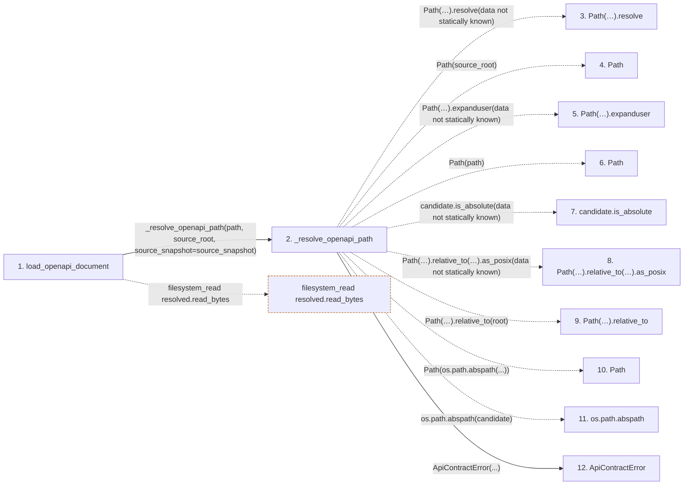

# load_openapi_document

**Entry point:** `load_openapi_document` (`api`)
**Source:** [api_contracts](../modules/api_contracts.md)
**Modules touched:** [api_contracts](../modules/api_contracts.md), [source_selection](../modules/source_selection.md), [validation](../modules/validation.md)

## Call sequence

> Static overview in presentation order, not runtime execution order. Arrows retain captured callers; representative internal continuations and boundary examples precede repeated helper detail.

```mermaid
sequenceDiagram
    participant p0 as load_openapi_document
    participant p1 as _resolve_openapi_path
    participant p2 as ApiContractError
    participant p3 as path_is_selected
    participant p4 as _path_contains_link_or_reparse
    participant p5 as _selection_path
    participant p6 as path_is_link_or_reparse
    participant p7 as _require_selection_path
    participant p8 as require_repository_relative_path
    participant p9 as SourceSelectionError
    participant p10 as _is_under
    participant p11 as _is_link_or_reparse_stat
    participant p12 as _syntax_key
    participant p13 as _known_syntax
    participant p14 as require_portable_relative_path
    participant p15 as _remember_syntax
    participant p16 as len (src/llm_wiki_cli/services…s.py:load_openapi_document)
    participant p17 as resolved.suffix.lower
    participant p18 as resolved.read_bytes
    participant p19 as data.decode
    participant p20 as json.loads
    participant p21 as yaml.safe_load
    participant p22 as isinstance (src/llm_wiki_cli/services…s.py:load_openapi_document)
    participant p23 as str
    participant p24 as document.get
    participant p25 as version.startswith
    p0->>p1: _resolve_openapi_path
    p0->>p2: ApiContractError
    p1->>p3: path_is_selected
    p1->>p4: _path_contains_link_or_reparse
    p3->>p5: _selection_path
    p4->>p6: path_is_link_or_reparse
    p5->>p7: _require_selection_path
    p7->>p8: require_repository_relative_path
    p3->>p9: SourceSelectionError
    p3->>p10: _is_under
    p6->>p11: _is_link_or_reparse_stat
    p8->>p12: _syntax_key
    p8->>p13: _known_syntax
    p8->>p14: require_portable_relative_path
    p8->>p15: _remember_syntax
    p0-->>p16: len (src/llm_wiki_cli/services…s.py:load_openapi_document)(data)
    p0-->>p17: resolved.suffix.lower
    p0-->>p18: resolved.read_bytes
    p0-->>p19: data.decode('utf-8')
    p0-->>p20: json.loads(text)
    p0-->>p21: yaml.safe_load(text)
    p0-->>p20: json.loads(text)
    p0-->>p21: yaml.safe_load(text)
    p0-->>p22: isinstance (src/llm_wiki_cli/services…s.py:load_openapi_document)(document, Mapping)
    p0-->>p23: str(...)
    p0-->>p24: document.get('openapi')
    p0-->>p25: version.startswith('3.0.')
    p0-->>p25: version.startswith('3.1.')
    p0-->>p22: isinstance (src/llm_wiki_cli/services…s.py:load_openapi_document)(document.get(...), Mapping)
    p0-->>p24: document.get('paths')
```

<!-- Auto-generated from static call edges. Dashed arrows are external or unresolved calls. Reviewed runtime conditions and side effects belong in Behavior. -->

> Call sequence diagram shows 30 of 98 interactions; 68 omitted to keep the visualization within the 30-interaction and generated-diagram limits, with uncertain identities omitted rather than inferred.

> Captured boundary calls: external 8 of 30 (22 omitted); unresolved 7 of 27 (20 omitted). These counts cover the captured static trace.

Omitted captured detail, grouped by actual caller occurrence and target module:

| Caller | Parent step | Target module | Kind | Omitted interactions |
| --- | --- | --- | --- | --- |
| `src/llm_wiki_cli/services/api_contracts.py:_resolve_openapi_path` | 2 | - | unresolved | 10 |
| `src/llm_wiki_cli/services/api_contracts.py:_resolve_openapi_path` | 2 | - | external | 4 |
| `src/llm_wiki_cli/services/api_contracts.py:_resolve_openapi_path` | 2 | [src/llm_wiki_cli/services/api_contracts.py](../modules/api_contracts.md) | internal | 8 |
| `src/llm_wiki_cli/services/validation.py:require_repository_relative_path` | 22 | - | external | 7 |
| `src/llm_wiki_cli/services/validation.py:require_repository_relative_path` | 22 | - | unresolved | 5 |
| `src/llm_wiki_cli/services/source_selection.py:_require_selection_path` | 21 | [src/llm_wiki_cli/services/source_selection.py](../modules/source_selection.md) | internal | 7 |
| `src/llm_wiki_cli/services/source_selection.py:_selection_path` | 20 | [src/llm_wiki_cli/services/source_selection.py](../modules/source_selection.md) | internal | 3 |
| `src/llm_wiki_cli/services/source_selection.py:_selection_path` | 20 | - | external | 2 |
> Omission summary shows 8 of 19 groups; 11 further groups are not expanded here. Counts above include all omitted interactions.
> Detailed flow queries retain their own coverage and limits; omitted paths may execute at runtime.

> Trace truncated at the depth limit; deeper calls are omitted.

## Data flow

<!-- Auto-generated static analysis. Treat values and boundaries as best-effort hints, not runtime proof. -->

### Analysis coverage

**Effect analysis partially available.** Flow assembly and source effect analysis are separate; empty observations do not prove an empty handler body.

Source steps: 42; effect analysis evaluated: 14, partial: 2, unavailable: 26. Counts include steps omitted from the displayed trace.

Collector observations for 16 source steps with known totals: observed: 105, emitted: 91, omitted: 14. Unavailable totals are excluded.

- Callable record unavailable; the selected entry symbol has no represented callable body.
- Effect collector omitted observations before flow assembly; displayed effects are partial.
- Effect collector totals unavailable; observed counts cover captured records only.

| Step | Callable record | Effect analysis | Collector totals | Observed | Emitted | Omitted |
|---|---|---|---|---:|---:|---:|
| `load_openapi_document` | `available` | `evaluated` | `available` | `11` | `11` | `0` |
| `_resolve_openapi_path` | `available` | `evaluated` | `available` | `5` | `5` | `0` |
| `Path(…).resolve` | `not_applicable` | `not_applicable` | `not_applicable` | — | — | — |
| `Path` | `not_applicable` | `not_applicable` | `not_applicable` | — | — | — |
| `Path(…).expanduser` | `not_applicable` | `not_applicable` | `not_applicable` | — | — | — |
| `Path` | `not_applicable` | `not_applicable` | `not_applicable` | — | — | — |
| `candidate.is_absolute` | `not_applicable` | `not_applicable` | `not_applicable` | — | — | — |
| `Path(…).relative_to(…).as_posix` | `not_applicable` | `not_applicable` | `not_applicable` | — | — | — |
| `Path(…).relative_to` | `not_applicable` | `not_applicable` | `not_applicable` | — | — | — |
| `Path` | `not_applicable` | `not_applicable` | `not_applicable` | — | — | — |
| `os.path.abspath` | `not_applicable` | `not_applicable` | `not_applicable` | — | — | — |
| `ApiContractError` | `unavailable` | `unavailable` | `unavailable` | — | — | — |

### Step data

| Step | Inputs | Reads | Writes | Returns |
|---|---|---|---|---|
| `load_openapi_document` | `path: str \| Path`, `source_root: str \| Path`, `source_snapshot: SourceSnapshot \| None` | `_OPENAPI_INPUT_LIMIT`, `json`, `json`, `yaml`, `Mapping`, `Mapping` | - | `{...}` |
| `_resolve_openapi_path` | `path: str \| Path`, `source_root: str \| Path`, `source_snapshot: SourceSnapshot \| None` | `SourceSelectionError` | - | `(...)` |
| `Path(…).resolve` | - | - | - | - |
| `Path` | - | - | - | - |
| `Path(…).expanduser` | - | - | - | - |
| `Path` | - | - | - | - |
| `candidate.is_absolute` | - | - | - | - |
| `Path(…).relative_to(…).as_posix` | - | - | - | - |
| `Path(…).relative_to` | - | - | - | - |
| `Path` | - | - | - | - |
| `os.path.abspath` | - | - | - | - |
| `ApiContractError` | - | - | - | - |

### Call data

| From | To | Line | Call |
|---|---|---:|---|
| load_openapi_document | _resolve_openapi_path | 1286 | `_resolve_openapi_path(path, source_root, source_snapshot=source_snapshot)` |
| _resolve_openapi_path | Path(…).resolve | 1214 | `Path(source_root).resolve(data not statically known)` |
| _resolve_openapi_path | Path | 1214 | `Path(source_root)` |
| _resolve_openapi_path | Path(…).expanduser | 1215 | `Path(path).expanduser(data not statically known)` |
| _resolve_openapi_path | Path | 1215 | `Path(path)` |
| _resolve_openapi_path | candidate.is_absolute | 1216 | `candidate.is_absolute(data not statically known)` |
| _resolve_openapi_path | Path(…).relative_to(…).as_posix | 1219 | `Path(os.path.abspath(candidate)).relative_to(root).as_posix(data not statically known)` |
| _resolve_openapi_path | Path(…).relative_to | 1219 | `Path(os.path.abspath(candidate)).relative_to(root)` |
| _resolve_openapi_path | Path | 1219 | `Path(os.path.abspath(...))` |
| _resolve_openapi_path | os.path.abspath | 1219 | `os.path.abspath(candidate)` |
| _resolve_openapi_path | ApiContractError | 1221 | `ApiContractError(...)` |

### Boundary effects

| Kind | Target | Step | Line |
|---|---|---|---:|
| filesystem_read | `resolved.read_bytes` | `load_openapi_document` | 1293 |

### Static analysis gaps

| Kind | Step | Target | Line |
|---|---|---|---:|
| unresolved_call | `_resolve_openapi_path` | `Path(source_root).resolve` | 1214 |
| unresolved_call | `_resolve_openapi_path` | `Path(path).expanduser` | 1215 |
| unresolved_call | `_resolve_openapi_path` | `candidate.is_absolute` | 1216 |
| unresolved_call | `_resolve_openapi_path` | `Path(os.path.abspath(candidate)).relative_to(root).as_posix` | 1219 |
| unresolved_call | `_resolve_openapi_path` | `Path(os.path.abspath(candidate)).relative_to` | 1219 |
| external_call | `_resolve_openapi_path` | `os.path.abspath` | 1219 |
| step_limit | `load_openapi_document` | `first 12 steps` | 0 |
| truncated_flow | `load_openapi_document` | `depth limit` | 0 |

## Behavior

This flow starts at `load_openapi_document` and is classified as `api`. The generated call and data-flow sections are bounded static projections; runtime conditions and side effects require source-level confirmation.
