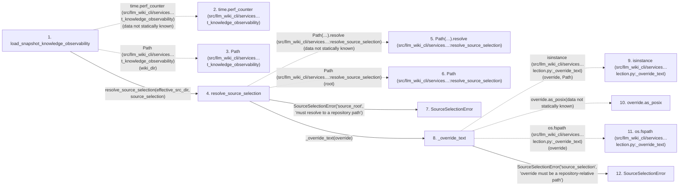

# load_snapshot_knowledge_observability

**Entry point:** `load_snapshot_knowledge_observability` (`api`)
**Source:** [knowledge_observability](../modules/knowledge_observability.md)
**Modules touched:** [analysis_compatibility](../modules/analysis_compatibility.md), [canonical_json](../modules/canonical_json.md), [common](../modules/common.md), [config](../modules/config.md), and 36 more

**Complete modules touched:**

- [analysis_compatibility](../modules/analysis_compatibility.md)
- [canonical_json](../modules/canonical_json.md)
- [common](../modules/common.md)
- [config](../modules/config.md)
- [filesystem_guard](../modules/filesystem_guard.md)
- [immutable](../modules/immutable.md)
- [implementation_evidence](../modules/implementation_evidence.md)
- [infrastructure_sync](../modules/infrastructure_sync.md)
- [io](../modules/io.md)
- [knowledge_artifacts](../modules/knowledge_artifacts.md)
- [knowledge_consumption](../modules/knowledge_consumption.md)
- [knowledge_envelope](../modules/knowledge_envelope.md)
- [knowledge_evidence](../modules/knowledge_evidence.md)
- [knowledge_freshness](../modules/knowledge_freshness.md)
- [knowledge_governance](../modules/knowledge_governance.md)
- [knowledge_graph](../modules/knowledge_graph.md)
- [knowledge_index](../modules/knowledge_index.md)
- [knowledge_loader](../modules/knowledge_loader.md)
- [knowledge_model](../modules/knowledge_model.md)
- [knowledge_observability](../modules/knowledge_observability.md)
- [knowledge_packs](../modules/knowledge_packs.md)
- [knowledge_reuse](../modules/knowledge_reuse.md)
- [knowledge_storage](../modules/knowledge_storage.md)
- [knowledge_storage_io](../modules/knowledge_storage_io.md)
- [maintenance_evidence](../modules/maintenance_evidence.md)
- [maintenance_projection](../modules/maintenance_projection.md)
- [maintenance_protocol](../modules/maintenance_protocol.md)
- [maintenance_state](../modules/maintenance_state.md)
- [maintenance_status](../modules/maintenance_status.md)
- [manifest_storage](../modules/manifest_storage.md)
- [markdown_sections](../modules/markdown_sections.md)
- [paths](../modules/paths.md)
- [section_ownership](../modules/section_ownership.md)
- [source_selection](../modules/source_selection.md)
- [source_snapshot](../modules/source_snapshot.md)
- [sync_manifest](../modules/sync_manifest.md)
- [validation](../modules/validation.md)
- [wiki_media](../modules/wiki_media.md)
- [wiki_surface](../modules/wiki_surface.md)
- [wiki_surface_index](../modules/wiki_surface_index.md)

## Call sequence

> Static overview in presentation order, not runtime execution order. Arrows retain captured callers; siblings are shown before deeper helper detail.

```mermaid
sequenceDiagram
    participant p0 as load_snapshot_knowledge_observability
    participant p1 as time.perf_counter (src/llm_wiki_cli/services…t_knowledge_observability)
    participant p2 as Path (src/llm_wiki_cli/services…t_knowledge_observability)
    participant p3 as resolve_source_selection
    participant p4 as capture_source_selection_inputs
    participant p5 as SyncManifest.load
    participant p6 as validate_persisted_source_selection_identity
    participant p7 as build_source_snapshot
    participant p8 as _snapshot_result
    participant p9 as _degraded_snapshot_view
    participant p10 as _knowledge_projection_declared
    participant p11 as build_knowledge_read_view
    participant p12 as KnowledgeLoadResult
    participant p13 as evaluate_surface_index
    participant p14 as load_knowledge_state
    participant p15 as _snapshot_error_view
    participant p16 as _with_current_source_selection
    participant p17 as Path(…).resolve (src/llm_wiki_cli/services…:resolve_source_selection)
    participant p18 as Path(…).resolve (src/llm_wiki_cli/services…e_source_selection_inputs)
    participant p19 as manifest_path.exists
    participant p20 as source_selection_identity_from_generation_inputs
    participant p21 as _validate_capture_options
    participant p22 as max (src/llm_wiki_cli/services…ility.py:_snapshot_result)
    p0-->>p1: time.perf_counter (src/llm_wiki_cli/services…t_knowledge_observability)
    p0-->>p2: Path (src/llm_wiki_cli/services…t_knowledge_observability)(wiki_dir)
    p0->>p3: resolve_source_selection
    p0->>p4: capture_source_selection_inputs
    p0->>p5: SyncManifest.load
    p0->>p6: validate_persisted_source_selection_identity
    p0->>p7: build_source_snapshot
    p0->>p8: _snapshot_result
    p0->>p9: _degraded_snapshot_view
    p0->>p8: _snapshot_result
    p0->>p9: _degraded_snapshot_view
    p0->>p10: _knowledge_projection_declared
    p0->>p11: build_knowledge_read_view
    p0->>p12: KnowledgeLoadResult
    p0->>p8: _snapshot_result
    p0->>p13: evaluate_surface_index
    p0->>p8: _snapshot_result
    p0->>p9: _degraded_snapshot_view
    p0->>p14: load_knowledge_state
    p0->>p15: _snapshot_error_view
    p0->>p9: _degraded_snapshot_view
    p0->>p16: _with_current_source_selection
    p0->>p11: build_knowledge_read_view
    p0->>p8: _snapshot_result
    p3-->>p17: Path(…).resolve (src/llm_wiki_cli/services…:resolve_source_selection)
    p4-->>p18: Path(…).resolve (src/llm_wiki_cli/services…e_source_selection_inputs)
    p5-->>p19: manifest_path.exists
    p6->>p20: source_selection_identity_from_generation_inputs
    p7->>p21: _validate_capture_options
    p8-->>p22: max (src/llm_wiki_cli/services…ility.py:_snapshot_result)(0, round(...))
```

<!-- Auto-generated from static call edges. Dashed arrows are external or unresolved calls. Reviewed runtime conditions and side effects belong in Behavior. -->

> Call sequence diagram shows 30 of 2667 interactions; 2637 omitted to keep the visualization within the 30-interaction and generated-diagram limits, with uncertain identities omitted rather than inferred.

> Captured boundary calls: external 3 of 830 (827 omitted); unresolved 3 of 664 (661 omitted). These counts cover the captured static trace.

Omitted captured detail, grouped by actual caller occurrence and target module:

| Caller | Parent step | Target module | Kind | Omitted interactions |
| --- | --- | --- | --- | --- |
| `src/llm_wiki_cli/services/source_selection.py:resolve_source_selection` | 4 | - | external | 1 |
| `src/llm_wiki_cli/services/source_selection.py:resolve_source_selection` | 4 | [src/llm_wiki_cli/services/source_selection.py](../modules/source_selection.md) | internal | 8 |
| `src/llm_wiki_cli/services/source_selection.py:_override_text` | 8 | - | external | 3 |
| `src/llm_wiki_cli/services/source_selection.py:_override_text` | 8 | - | unresolved | 1 |
| `src/llm_wiki_cli/services/source_selection.py:_override_text` | 8 | [src/llm_wiki_cli/services/source_selection.py](../modules/source_selection.md) | internal | 3 |
| `src/llm_wiki_cli/services/source_selection.py:_selection_path` | 15 | [src/llm_wiki_cli/services/source_selection.py](../modules/source_selection.md) | internal | 4 |
| `src/llm_wiki_cli/services/source_selection.py:_require_selection_path` | 16 | [src/llm_wiki_cli/services/validation.py](../modules/validation.md) | internal | 1 |
| `src/llm_wiki_cli/services/validation.py:require_repository_relative_path` | 17 | - | external | 7 |
> Omission summary shows 8 of 704 groups; 696 further groups are not expanded here. Counts above include all omitted interactions.
> Detailed flow queries retain their own coverage and limits; omitted paths may execute at runtime.

> Trace truncated at the depth limit; deeper calls are omitted.

## Data flow

<!-- Auto-generated static analysis. Treat values and boundaries as best-effort hints, not runtime proof. -->

### Step data

| Step | Inputs | Reads | Writes | Returns |
|---|---|---|---|---|
| `load_snapshot_knowledge_observability` | `wiki_dir: str \| Path`, `src_dir: str \| Path \| None`, `source_selection: str \| Path \| None` | `SourceSelectionError`, `KnowledgeLoadState`, `KnowledgeMismatchPolicy`, `KnowledgeStateLoadError` | - | `_snapshot_result(...)`, `_snapshot_result(...)`, `_snapshot_result(...)`, `_snapshot_result(...)`, `_snapshot_result(...)` |
| `time.perf_counter (src/llm_wiki_cli/services…t_knowledge_observability)` | - | - | - | - |
| `Path (src/llm_wiki_cli/services…t_knowledge_observability)` | - | - | - | - |
| `resolve_source_selection` | `root: str \| Path`, `override: str \| Path \| None` | `SOURCE_SELECTION_PATH` | - | `None`, `None`, `policy` |
| `Path(…).resolve (src/llm_wiki_cli/services…:resolve_source_selection)` | - | - | - | - |
| `Path (src/llm_wiki_cli/services…:resolve_source_selection)` | - | - | - | - |
| `SourceSelectionError` | - | - | - | - |
| `_override_text` | `override: str \| Path` | `Path` | - | `_selection_path(...)` |
| `isinstance (src/llm_wiki_cli/services…lection.py:_override_text)` | - | - | - | - |
| `override.as_posix` | - | - | - | - |
| `os.fspath (src/llm_wiki_cli/services…lection.py:_override_text)` | - | - | - | - |
| `SourceSelectionError` | - | - | - | - |

### Call data

| From | To | Line | Call |
|---|---|---:|---|
| load_snapshot_knowledge_observability | time.perf_counter (src/llm_wiki_cli/services…t_knowledge_observability) | 529 | `time.perf_counter(data not statically known)` |
| load_snapshot_knowledge_observability | Path (src/llm_wiki_cli/services…t_knowledge_observability) | 530 | `Path(wiki_dir)` |
| load_snapshot_knowledge_observability | resolve_source_selection | 535 | `resolve_source_selection(effective_src_dir, source_selection)` |
| resolve_source_selection | Path(…).resolve (src/llm_wiki_cli/services…:resolve_source_selection) | 606 | `Path(root).resolve(data not statically known)` |
| resolve_source_selection | Path (src/llm_wiki_cli/services…:resolve_source_selection) | 606 | `Path(root)` |
| resolve_source_selection | SourceSelectionError | 608 | `SourceSelectionError('source_root', 'must resolve to a repository path')` |
| resolve_source_selection | _override_text | 615 | `_override_text(override)` |
| _override_text | isinstance (src/llm_wiki_cli/services…lection.py:_override_text) | 583 | `isinstance(override, Path)` |
| _override_text | override.as_posix | 583 | `override.as_posix(data not statically known)` |
| _override_text | os.fspath (src/llm_wiki_cli/services…lection.py:_override_text) | 583 | `os.fspath(override)` |
| _override_text | SourceSelectionError | 585 | `SourceSelectionError('source_selection', 'override must be a repository-relative path')` |

### Boundary effects

*No boundary effects detected.*

### Static analysis gaps

| Kind | Step | Target | Line |
|---|---|---|---:|
| external_call | `load_snapshot_knowledge_observability` | `time.perf_counter` | 529 |
| unresolved_call | `resolve_source_selection` | `Path(root).resolve` | 606 |
| external_call | `_override_text` | `isinstance` | 583 |
| unresolved_call | `_override_text` | `override.as_posix` | 583 |
| external_call | `_override_text` | `os.fspath` | 583 |
| step_limit | `load_snapshot_knowledge_observability` | `first 12 steps` | 0 |
| truncated_flow | `load_snapshot_knowledge_observability` | `depth limit` | 0 |

## Behavior

This flow starts at `load_snapshot_knowledge_observability` and is classified as `api`. The generated call and data-flow sections are bounded static projections; runtime conditions and side effects require source-level confirmation.
