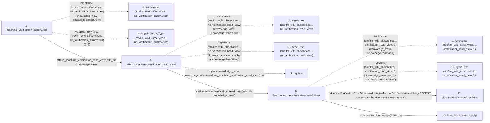

# machine_verification_summaries

**Entry point:** `machine_verification_summaries` (`api`)
**Source:** [knowledge_verification](../modules/knowledge_verification.md)
**Modules touched:** [io](../modules/io.md), [knowledge_artifacts](../modules/knowledge_artifacts.md), [knowledge_consumption](../modules/knowledge_consumption.md), [knowledge_evidence](../modules/knowledge_evidence.md), and 2 more

**Complete modules touched:**

- [io](../modules/io.md)
- [knowledge_artifacts](../modules/knowledge_artifacts.md)
- [knowledge_consumption](../modules/knowledge_consumption.md)
- [knowledge_evidence](../modules/knowledge_evidence.md)
- [knowledge_verification](../modules/knowledge_verification.md)
- [verification_contracts](../modules/verification_contracts.md)

## Call sequence

> Static overview in presentation order, not runtime execution order. Arrows retain captured callers; representative internal continuations and boundary examples precede repeated helper detail.

```mermaid
sequenceDiagram
    participant p0 as machine_verification_summaries
    participant p1 as attach_machine_verification_read_view
    participant p2 as verification_summaries_for_concepts
    participant p3 as load_machine_verification_read_view
    participant p4 as _deep_copy
    participant p5 as load_verification_receipt
    participant p6 as _validated_artifacts_for_view
    participant p7 as evaluate_verification_receipt
    participant p8 as _read_regular_receipt
    participant p9 as deserialize_verification_receipt
    participant p10 as validate_verification_receipt
    participant p11 as serialize_verification_receipt
    participant p12 as _frozen_summaries
    participant p13 as MachineVerificationReadView
    participant p14 as hash_json
    participant p15 as machine_verification_summary
    participant p16 as require_validated_artifacts
    participant p17 as first_unsafe_path_component
    participant p18 as VerificationReceiptError
    participant p19 as verification_receipt_path
    participant p20 as VerificationReceiptEvaluation
    participant p21 as formatted_json_bytes
    participant p22 as _receipt_to_payload
    participant p23 as verification_receipt_to_payload
    participant p24 as _object
    participant p25 as _exact_fields
    participant p26 as _string
    participant p27 as _receipt_hash
    participant p28 as _scope_uid
    participant p29 as isinstance (src/llm_wiki_cli/services…ne_verification_summaries)
    participant p30 as concept.extensions.get (src/llm_wiki_cli/services…on_summaries_for_concepts)
    p0->>p1: attach_machine_verification_read_view
    p0->>p2: verification_summaries_for_concepts
    p1->>p3: load_machine_verification_read_view
    p2->>p4: _deep_copy
    p3->>p5: load_verification_receipt
    p3->>p6: _validated_artifacts_for_view
    p3->>p7: evaluate_verification_receipt
    p5->>p8: _read_regular_receipt
    p5->>p9: deserialize_verification_receipt
    p9->>p10: validate_verification_receipt
    p9->>p11: serialize_verification_receipt
    p2->>p12: _frozen_summaries
    p3->>p13: MachineVerificationReadView
    p3->>p14: hash_json
    p3->>p15: machine_verification_summary
    p6->>p16: require_validated_artifacts
    p5->>p17: first_unsafe_path_component
    p5->>p18: VerificationReceiptError
    p5->>p19: verification_receipt_path
    p7->>p20: VerificationReceiptEvaluation
    p11->>p21: formatted_json_bytes
    p10->>p22: _receipt_to_payload
    p11->>p23: verification_receipt_to_payload
    p10->>p24: _object
    p10->>p25: _exact_fields
    p10->>p26: _string
    p10->>p27: _receipt_hash
    p10->>p28: _scope_uid
    p0-->>p29: isinstance (src/llm_wiki_cli/services…ne_verification_summaries)(knowledge_view, KnowledgeReadView)
    p2-->>p30: concept.extensions.get (src/llm_wiki_cli/services…on_summaries_for_concepts)(GOVERNANCE_EXTENSION_KEY)
```

<!-- Auto-generated from static call edges. Dashed arrows are external or unresolved calls. Reviewed runtime conditions and side effects belong in Behavior. -->

> Call sequence diagram shows 30 of 204 interactions; 174 omitted to keep the visualization within the 30-interaction and generated-diagram limits, with uncertain identities omitted rather than inferred.

> Captured boundary calls: external 1 of 101 (100 omitted); unresolved 1 of 32 (31 omitted). These counts cover the captured static trace.

Omitted captured detail, grouped by actual caller occurrence and target module:

| Caller | Parent step | Target module | Kind | Omitted interactions |
| --- | --- | --- | --- | --- |
| `src/llm_wiki_cli/services/knowledge_verification.py:machine_verification_summaries` | 1 | - | external | 1 |
| `src/llm_wiki_cli/services/knowledge_verification.py:attach_machine_verification_read_view` | 4 | - | external | 3 |
| `src/llm_wiki_cli/services/knowledge_verification.py:load_machine_verification_read_view` | 8 | - | external | 11 |
| `src/llm_wiki_cli/services/verification_contracts.py:load_verification_receipt` | 12 | - | external | 1 |
| `src/llm_wiki_cli/services/io.py:first_unsafe_path_component` | 14 | - | external | 20 |
| `src/llm_wiki_cli/services/io.py:first_unsafe_path_component` | 14 | - | unresolved | 5 |
| `src/llm_wiki_cli/services/verification_contracts.py:load_verification_receipt` | 12 | - | unresolved | 1 |
| `src/llm_wiki_cli/services/verification_contracts.py:load_verification_receipt` | 12 | [src/llm_wiki_cli/services/verification_contracts.py](../modules/verification_contracts.md) | internal | 1 |
> Omission summary shows 8 of 35 groups; 27 further groups are not expanded here. Counts above include all omitted interactions.
> Detailed flow queries retain their own coverage and limits; omitted paths may execute at runtime.

> Trace truncated at the depth limit; deeper calls are omitted.

## Data flow

<!-- Auto-generated static analysis. Treat values and boundaries as best-effort hints, not runtime proof. -->

### Analysis coverage

**Effect analysis partially available.** Flow assembly and source effect analysis are separate; empty observations do not prove an empty handler body.

Source steps: 72; effect analysis evaluated: 43, partial: 1, unavailable: 28. Counts include steps omitted from the displayed trace.

Collector observations for 44 source steps with known totals: observed: 224, emitted: 221, omitted: 3. Unavailable totals are excluded.

- Callable record unavailable for one or more source steps; those steps have no represented callable body.
- Effect collector omitted observations before flow assembly; displayed effects are partial.
- Effect collector totals unavailable; observed counts cover captured records only.

| Step | Callable record | Effect analysis | Collector totals | Observed | Emitted | Omitted |
|---|---|---|---|---:|---:|---:|
| `machine_verification_summaries` | `available` | `evaluated` | `available` | `5` | `5` | `0` |
| `isinstance (src/llm_wiki_cli/services…ne_verification_summaries)` | `not_applicable` | `not_applicable` | `not_applicable` | — | — | — |
| `MappingProxyType (src/llm_wiki_cli/services…ne_verification_summaries)` | `not_applicable` | `not_applicable` | `not_applicable` | — | — | — |
| `attach_machine_verification_read_view` | `available` | `evaluated` | `available` | `6` | `6` | `0` |
| `isinstance (src/llm_wiki_cli/services…ne_verification_read_view)` | `not_applicable` | `not_applicable` | `not_applicable` | — | — | — |
| `TypeError (src/llm_wiki_cli/services…ne_verification_read_view)` | `not_applicable` | `not_applicable` | `not_applicable` | — | — | — |
| `replace` | `not_applicable` | `not_applicable` | `not_applicable` | — | — | — |
| `load_machine_verification_read_view` | `available` | `evaluated` | `available` | `13` | `13` | `0` |
| `isinstance (src/llm_wiki_cli/services…verification_read_view, 1)` | `not_applicable` | `not_applicable` | `not_applicable` | — | — | — |
| `TypeError (src/llm_wiki_cli/services…verification_read_view, 1)` | `not_applicable` | `not_applicable` | `not_applicable` | — | — | — |
| `MachineVerificationReadView` | `unavailable` | `unavailable` | `unavailable` | — | — | — |
| `load_verification_receipt` | `available` | `evaluated` | `available` | `4` | `4` | `0` |

### Step data

| Step | Inputs | Reads | Writes | Returns |
|---|---|---|---|---|
| `machine_verification_summaries` | `wiki_dir: str \| Path`, `knowledge_view: KnowledgeReadView` | `KnowledgeReadView` | - | `MappingProxyType(...)`, `verification_summaries_for_concepts(...)` |
| `isinstance (src/llm_wiki_cli/services…ne_verification_summaries)` | - | - | - | - |
| `MappingProxyType (src/llm_wiki_cli/services…ne_verification_summaries)` | - | - | - | - |
| `attach_machine_verification_read_view` | `wiki_dir: str \| Path`, `knowledge_view: KnowledgeReadView` | `KnowledgeReadView`, `MachineVerificationAvailability` | - | `knowledge_view`, `replace(...)` |
| `isinstance (src/llm_wiki_cli/services…ne_verification_read_view)` | - | - | - | - |
| `TypeError (src/llm_wiki_cli/services…ne_verification_read_view)` | - | - | - | - |
| `replace` | - | - | - | - |
| `load_machine_verification_read_view` | `wiki_dir: str \| Path`, `knowledge_view: KnowledgeReadView` | `KnowledgeReadView`, `MachineVerificationAvailability`, `MachineVerificationAvailability`, `MachineVerificationAvailability`, `GOVERNANCE_EXTENSION_KEY`, `Mapping`, `MachineVerificationAvailability` | - | `MachineVerificationReadView(...)`, `MachineVerificationReadView(...)`, `MachineVerificationReadView(...)`, `MachineVerificationReadView(...)` |
| `isinstance (src/llm_wiki_cli/services…verification_read_view, 1)` | - | - | - | - |
| `TypeError (src/llm_wiki_cli/services…verification_read_view, 1)` | - | - | - | - |
| `MachineVerificationReadView` | - | - | - | - |
| `load_verification_receipt` | `wiki_dir: str \| Path`, `missing_ok: bool` | - | - | `None`, `deserialize_verification_receipt(...)` |

### Call data

| From | To | Line | Call |
|---|---|---:|---|
| machine_verification_summaries | isinstance (src/llm_wiki_cli/services…ne_verification_summaries) | 39 | `isinstance(knowledge_view, KnowledgeReadView)` |
| machine_verification_summaries | MappingProxyType (src/llm_wiki_cli/services…ne_verification_summaries) | 43 | `MappingProxyType({...})` |
| machine_verification_summaries | attach_machine_verification_read_view | 44 | `attach_machine_verification_read_view(wiki_dir, knowledge_view)` |
| attach_machine_verification_read_view | isinstance (src/llm_wiki_cli/services…ne_verification_read_view) | 54 | `isinstance(knowledge_view, KnowledgeReadView)` |
| attach_machine_verification_read_view | TypeError (src/llm_wiki_cli/services…ne_verification_read_view) | 55 | `TypeError('knowledge_view must be a KnowledgeReadView')` |
| attach_machine_verification_read_view | replace | 61 | `replace(knowledge_view, machine_verification=load_machine_verification_read_view(...))` |
| attach_machine_verification_read_view | load_machine_verification_read_view | 63 | `load_machine_verification_read_view(wiki_dir, knowledge_view)` |
| load_machine_verification_read_view | isinstance (src/llm_wiki_cli/services…verification_read_view, 1) | 76 | `isinstance(knowledge_view, KnowledgeReadView)` |
| load_machine_verification_read_view | TypeError (src/llm_wiki_cli/services…verification_read_view, 1) | 77 | `TypeError('knowledge_view must be a KnowledgeReadView')` |
| load_machine_verification_read_view | MachineVerificationReadView | 81 | `MachineVerificationReadView(availability=MachineVerificationAvailability.ABSENT, reason='verification-receipt-not-present')` |
| load_machine_verification_read_view | load_verification_receipt | 87 | `load_verification_receipt(Path(...))` |

### Boundary effects

*No boundary-effect observations were captured in this static trace.*

### Static analysis gaps

| Kind | Step | Target | Line |
|---|---|---|---:|
| external_call | `machine_verification_summaries` | `isinstance` | 39 |
| external_call | `machine_verification_summaries` | `MappingProxyType` | 43 |
| external_call | `attach_machine_verification_read_view` | `isinstance` | 54 |
| external_call | `attach_machine_verification_read_view` | `TypeError` | 55 |
| external_call | `attach_machine_verification_read_view` | `replace` | 61 |
| external_call | `load_machine_verification_read_view` | `isinstance` | 76 |
| external_call | `load_machine_verification_read_view` | `TypeError` | 77 |
| step_limit | `machine_verification_summaries` | `first 12 steps` | 0 |
| truncated_flow | `machine_verification_summaries` | `depth limit` | 0 |

## Behavior

This flow starts at `machine_verification_summaries` and is classified as `api`. The generated call and data-flow sections are bounded static projections; runtime conditions and side effects require source-level confirmation.
