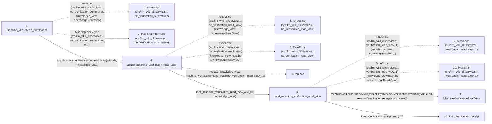

# machine_verification_summaries

**Entry point:** `machine_verification_summaries` (`api`)
**Source:** [knowledge_verification](../modules/knowledge_verification.md)
**Modules touched:** [io](../modules/io.md), [knowledge_consumption](../modules/knowledge_consumption.md), [knowledge_evidence](../modules/knowledge_evidence.md), [knowledge_verification](../modules/knowledge_verification.md), and 1 more

**Complete modules touched:**

- [io](../modules/io.md)
- [knowledge_consumption](../modules/knowledge_consumption.md)
- [knowledge_evidence](../modules/knowledge_evidence.md)
- [knowledge_verification](../modules/knowledge_verification.md)
- [verification_contracts](../modules/verification_contracts.md)

## Call sequence

> Static overview in presentation order, not runtime execution order. Arrows retain captured callers; siblings are shown before deeper helper detail.

```mermaid
sequenceDiagram
    participant p0 as machine_verification_summaries
    participant p1 as isinstance (src/llm_wiki_cli/services…ne_verification_summaries)
    participant p2 as MappingProxyType (src/llm_wiki_cli/services…ne_verification_summaries)
    participant p3 as attach_machine_verification_read_view
    participant p4 as verification_summaries_for_concepts
    participant p5 as isinstance (src/llm_wiki_cli/services…ne_verification_read_view)
    participant p6 as isinstance (src/llm_wiki_cli/services…on_summaries_for_concepts)
    participant p7 as TypeError (src/llm_wiki_cli/services…ne_verification_read_view)
    participant p8 as TypeError (src/llm_wiki_cli/services…on_summaries_for_concepts)
    participant p9 as replace
    participant p10 as load_machine_verification_read_view
    participant p11 as MappingProxyType (src/llm_wiki_cli/services…on_summaries_for_concepts)
    participant p12 as concept.extensions.get (src/llm_wiki_cli/services…on_summaries_for_concepts)
    participant p13 as governance.get (src/llm_wiki_cli/services…on_summaries_for_concepts)
    participant p14 as _frozen_summaries
    participant p15 as dict (src/llm_wiki_cli/services…on_summaries_for_concepts)
    participant p16 as sorted (src/llm_wiki_cli/services…on_summaries_for_concepts)
    participant p17 as set
    participant p18 as concept_coordinates.values
    participant p19 as list (src/llm_wiki_cli/services…on_summaries_for_concepts)
    participant p20 as _deep_copy
    participant p21 as selected.checks.items
    p0-->>p1: isinstance (src/llm_wiki_cli/services…ne_verification_summaries)(knowledge_view, KnowledgeReadView)
    p0-->>p2: MappingProxyType (src/llm_wiki_cli/services…ne_verification_summaries)({...})
    p0->>p3: attach_machine_verification_read_view
    p0->>p4: verification_summaries_for_concepts
    p3-->>p5: isinstance (src/llm_wiki_cli/services…ne_verification_read_view)(knowledge_view, KnowledgeReadView)
    p4-->>p6: isinstance (src/llm_wiki_cli/services…on_summaries_for_concepts)(knowledge_view, KnowledgeReadView)
    p3-->>p7: TypeError (src/llm_wiki_cli/services…ne_verification_read_view)('knowledge_view must be a KnowledgeReadView')
    p4-->>p8: TypeError (src/llm_wiki_cli/services…on_summaries_for_concepts)('knowledge_view must be a KnowledgeReadView')
    p3-->>p9: replace(knowledge_view, machine_verification=load_machine_verification_read_view(...))
    p4-->>p6: isinstance (src/llm_wiki_cli/services…on_summaries_for_concepts)(selected, MachineVerificationReadView)
    p3->>p10: load_machine_verification_read_view
    p4-->>p8: TypeError (src/llm_wiki_cli/services…on_summaries_for_concepts)('evaluated must be a MachineVerificationReadView')
    p4-->>p11: MappingProxyType (src/llm_wiki_cli/services…on_summaries_for_concepts)({...})
    p4-->>p12: concept.extensions.get (src/llm_wiki_cli/services…on_summaries_for_concepts)(GOVERNANCE_EXTENSION_KEY)
    p4-->>p6: isinstance (src/llm_wiki_cli/services…on_summaries_for_concepts)(governance, Mapping)
    p4-->>p13: governance.get (src/llm_wiki_cli/services…on_summaries_for_concepts)('uid')
    p4-->>p6: isinstance (src/llm_wiki_cli/services…on_summaries_for_concepts)(uid, str)
    p4-->>p11: MappingProxyType (src/llm_wiki_cli/services…on_summaries_for_concepts)({...})
    p4->>p14: _frozen_summaries
    p4-->>p15: dict (src/llm_wiki_cli/services…on_summaries_for_concepts)(invalid)
    p4-->>p16: sorted (src/llm_wiki_cli/services…on_summaries_for_concepts)(set(...))
    p4-->>p17: set(concept_coordinates.values(...))
    p4-->>p18: concept_coordinates.values
    p4-->>p19: list (src/llm_wiki_cli/services…on_summaries_for_concepts)(selected.invalidation_reasons)
    p4->>p20: _deep_copy
    p4-->>p16: sorted (src/llm_wiki_cli/services…on_summaries_for_concepts)(selected.checks.items(...))
    p4-->>p21: selected.checks.items
    p4->>p14: _frozen_summaries
    p4-->>p11: MappingProxyType (src/llm_wiki_cli/services…on_summaries_for_concepts)({...})
    p4-->>p11: MappingProxyType (src/llm_wiki_cli/services…on_summaries_for_concepts)({...})
```

<!-- Auto-generated from static call edges. Dashed arrows are external or unresolved calls. Reviewed runtime conditions and side effects belong in Behavior. -->

> Call sequence diagram shows 30 of 198 interactions; 168 omitted to keep the visualization within the 30-interaction and generated-diagram limits, with uncertain identities omitted rather than inferred.

> Captured boundary calls: external 20 of 97 (77 omitted); unresolved 4 of 32 (28 omitted). These counts cover the captured static trace.

Omitted captured detail, grouped by actual caller occurrence and target module:

| Caller | Parent step | Target module | Kind | Omitted interactions |
| --- | --- | --- | --- | --- |
| `src/llm_wiki_cli/services/knowledge_verification.py:load_machine_verification_read_view` | 8 | - | external | 11 |
| `src/llm_wiki_cli/services/knowledge_verification.py:load_machine_verification_read_view` | 8 | [src/llm_wiki_cli/services/knowledge_consumption.py](../modules/knowledge_consumption.md) | internal | 4 |
| `src/llm_wiki_cli/services/knowledge_verification.py:load_machine_verification_read_view` | 8 | [src/llm_wiki_cli/services/verification_contracts.py](../modules/verification_contracts.md) | internal | 2 |
| `src/llm_wiki_cli/services/verification_contracts.py:load_verification_receipt` | 12 | - | external | 1 |
| `src/llm_wiki_cli/services/verification_contracts.py:load_verification_receipt` | 12 | [src/llm_wiki_cli/services/io.py](../modules/io.md) | internal | 1 |
| `src/llm_wiki_cli/services/io.py:first_unsafe_path_component` | 14 | - | external | 20 |
| `src/llm_wiki_cli/services/io.py:first_unsafe_path_component` | 14 | - | unresolved | 5 |
| `src/llm_wiki_cli/services/verification_contracts.py:load_verification_receipt` | 12 | [src/llm_wiki_cli/services/verification_contracts.py](../modules/verification_contracts.md) | internal | 5 |
> Omission summary shows 8 of 37 groups; 29 further groups are not expanded here. Counts above include all omitted interactions.
> Detailed flow queries retain their own coverage and limits; omitted paths may execute at runtime.

> Trace truncated at the depth limit; deeper calls are omitted.

## Data flow

<!-- Auto-generated static analysis. Treat values and boundaries as best-effort hints, not runtime proof. -->

### Step data

| Step | Inputs | Reads | Writes | Returns |
|---|---|---|---|---|
| `machine_verification_summaries` | `wiki_dir: str \| Path`, `knowledge_view: KnowledgeReadView` | `KnowledgeReadView` | - | `MappingProxyType(...)`, `verification_summaries_for_concepts(...)` |
| `isinstance (src/llm_wiki_cli/services…ne_verification_summaries)` | - | - | - | - |
| `MappingProxyType (src/llm_wiki_cli/services…ne_verification_summaries)` | - | - | - | - |
| `attach_machine_verification_read_view` | `wiki_dir: str \| Path`, `knowledge_view: KnowledgeReadView` | `KnowledgeReadView`, `MachineVerificationAvailability` | - | `knowledge_view`, `replace(...)` |
| `isinstance (src/llm_wiki_cli/services…ne_verification_read_view)` | - | - | - | - |
| `TypeError (src/llm_wiki_cli/services…ne_verification_read_view)` | - | - | - | - |
| `replace` | - | - | - | - |
| `load_machine_verification_read_view` | `wiki_dir: str \| Path`, `knowledge_view: KnowledgeReadView` | `KnowledgeReadView`, `MachineVerificationAvailability`, `MachineVerificationAvailability`, `MachineVerificationAvailability`, `GOVERNANCE_EXTENSION_KEY`, `Mapping`, `MachineVerificationAvailability` | - | `MachineVerificationReadView(...)`, `MachineVerificationReadView(...)`, `MachineVerificationReadView(...)`, `MachineVerificationReadView(...)` |
| `isinstance (src/llm_wiki_cli/services…verification_read_view, 1)` | - | - | - | - |
| `TypeError (src/llm_wiki_cli/services…verification_read_view, 1)` | - | - | - | - |
| `MachineVerificationReadView` | - | - | - | - |
| `load_verification_receipt` | `wiki_dir: str \| Path`, `missing_ok: bool` | - | - | `None`, `deserialize_verification_receipt(...)` |

### Call data

| From | To | Line | Call |
|---|---|---:|---|
| machine_verification_summaries | isinstance (src/llm_wiki_cli/services…ne_verification_summaries) | 38 | `isinstance(knowledge_view, KnowledgeReadView)` |
| machine_verification_summaries | MappingProxyType (src/llm_wiki_cli/services…ne_verification_summaries) | 42 | `MappingProxyType({...})` |
| machine_verification_summaries | attach_machine_verification_read_view | 43 | `attach_machine_verification_read_view(wiki_dir, knowledge_view)` |
| attach_machine_verification_read_view | isinstance (src/llm_wiki_cli/services…ne_verification_read_view) | 53 | `isinstance(knowledge_view, KnowledgeReadView)` |
| attach_machine_verification_read_view | TypeError (src/llm_wiki_cli/services…ne_verification_read_view) | 54 | `TypeError('knowledge_view must be a KnowledgeReadView')` |
| attach_machine_verification_read_view | replace | 60 | `replace(knowledge_view, machine_verification=load_machine_verification_read_view(...))` |
| attach_machine_verification_read_view | load_machine_verification_read_view | 62 | `load_machine_verification_read_view(wiki_dir, knowledge_view)` |
| load_machine_verification_read_view | isinstance (src/llm_wiki_cli/services…verification_read_view, 1) | 75 | `isinstance(knowledge_view, KnowledgeReadView)` |
| load_machine_verification_read_view | TypeError (src/llm_wiki_cli/services…verification_read_view, 1) | 76 | `TypeError('knowledge_view must be a KnowledgeReadView')` |
| load_machine_verification_read_view | MachineVerificationReadView | 80 | `MachineVerificationReadView(availability=MachineVerificationAvailability.ABSENT, reason='verification-receipt-not-present')` |
| load_machine_verification_read_view | load_verification_receipt | 86 | `load_verification_receipt(Path(...))` |

### Boundary effects

*No boundary effects detected.*

### Static analysis gaps

| Kind | Step | Target | Line |
|---|---|---|---:|
| external_call | `machine_verification_summaries` | `isinstance` | 38 |
| external_call | `machine_verification_summaries` | `MappingProxyType` | 42 |
| external_call | `attach_machine_verification_read_view` | `isinstance` | 53 |
| external_call | `attach_machine_verification_read_view` | `TypeError` | 54 |
| external_call | `attach_machine_verification_read_view` | `replace` | 60 |
| external_call | `load_machine_verification_read_view` | `isinstance` | 75 |
| external_call | `load_machine_verification_read_view` | `TypeError` | 76 |
| step_limit | `machine_verification_summaries` | `first 12 steps` | 0 |
| truncated_flow | `machine_verification_summaries` | `depth limit` | 0 |

## Behavior

This flow starts at `machine_verification_summaries` and is classified as `api`. The generated call and data-flow sections are bounded static projections; runtime conditions and side effects require source-level confirmation.
