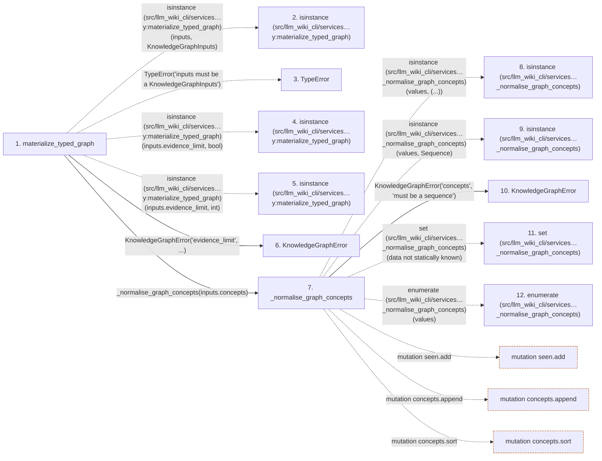

# materialize_typed_graph

**Entry point:** `materialize_typed_graph` (`api`)
**Source:** [knowledge_graph](../modules/knowledge_graph.md)
**Modules touched:** [knowledge_evidence](../modules/knowledge_evidence.md), [knowledge_graph](../modules/knowledge_graph.md), [validation](../modules/validation.md), [wiki_media](../modules/wiki_media.md), and 1 more

**Complete modules touched:**

- [knowledge_evidence](../modules/knowledge_evidence.md)
- [knowledge_graph](../modules/knowledge_graph.md)
- [validation](../modules/validation.md)
- [wiki_media](../modules/wiki_media.md)
- [wiki_surface](../modules/wiki_surface.md)

## Call sequence

> Static overview in presentation order, not runtime execution order. Arrows retain captured callers; representative internal continuations and boundary examples precede repeated helper detail.

```mermaid
sequenceDiagram
    participant p0 as materialize_typed_graph
    participant p1 as _normalise_graph_concepts
    participant p2 as _json_value
    participant p3 as _observation_bundle_for_hash
    participant p4 as _normalise_analyzer_limitations
    participant p5 as _canonical_json
    participant p6 as _materialization_state
    participant p7 as _materialize_contains
    participant p8 as _materialize_imports
    participant p9 as _materialize_calls
    participant p10 as _materialize_entrypoints
    participant p11 as _materialize_data_effects
    participant p12 as _materialize_external_dependencies
    participant p13 as _aggregate_input_hash
    participant p14 as validate_typed_graph
    participant p15 as KnowledgeGraphError
    participant p16 as _graph_concept_payload
    participant p17 as _sorted_json_records
    participant p18 as sha256_bytes
    participant p19 as _observation_collection
    participant p20 as _parse_typed_graph
    participant p21 as concept_endpoint
    participant p22 as source_symbol_endpoint
    participant p23 as _locator
    participant p24 as _limitations
    participant p25 as _limitation
    participant p26 as _coverage
    participant p27 as _relative_path
    participant p28 as _positive_int
    participant p29 as isinstance (src/llm_wiki_cli/services…y:materialize_typed_graph)
    participant p30 as _canonical_json(…).encode (src/llm_wiki_cli/services…y:materialize_typed_graph)
    p0->>p1: _normalise_graph_concepts
    p0->>p2: _json_value
    p0->>p3: _observation_bundle_for_hash
    p0->>p4: _normalise_analyzer_limitations
    p0->>p5: _canonical_json
    p0->>p6: _materialization_state
    p0->>p7: _materialize_contains
    p0->>p8: _materialize_imports
    p0->>p9: _materialize_calls
    p0->>p10: _materialize_entrypoints
    p0->>p11: _materialize_data_effects
    p0->>p12: _materialize_external_dependencies
    p0->>p13: _aggregate_input_hash
    p0->>p14: validate_typed_graph
    p0->>p15: KnowledgeGraphError
    p0->>p16: _graph_concept_payload
    p0->>p17: _sorted_json_records
    p0->>p18: sha256_bytes
    p8->>p19: _observation_collection
    p14->>p20: _parse_typed_graph
    p7->>p21: concept_endpoint
    p7->>p22: source_symbol_endpoint
    p1->>p23: _locator
    p7->>p24: _limitations
    p4->>p25: _limitation
    p7->>p26: _coverage
    p1->>p27: _relative_path
    p1->>p28: _positive_int
    p0-->>p29: isinstance (src/llm_wiki_cli/services…y:materialize_typed_graph)(inputs, KnowledgeGraphInputs)
    p0-->>p30: _canonical_json(…).encode (src/llm_wiki_cli/services…y:materialize_typed_graph)('utf-8')
```

<!-- Auto-generated from static call edges. Dashed arrows are external or unresolved calls. Reviewed runtime conditions and side effects belong in Behavior. -->

> Call sequence diagram shows 30 of 873 interactions; 843 omitted to keep the visualization within the 30-interaction and generated-diagram limits, with uncertain identities omitted rather than inferred.

> Captured boundary calls: external 1 of 273 (272 omitted); unresolved 1 of 218 (217 omitted). These counts cover the captured static trace.

Omitted captured detail, grouped by actual caller occurrence and target module:

| Caller | Parent step | Target module | Kind | Omitted interactions |
| --- | --- | --- | --- | --- |
| `src/llm_wiki_cli/services/knowledge_graph.py:materialize_typed_graph` | 1 | - | external | 6 |
| `src/llm_wiki_cli/services/knowledge_graph.py:_normalise_graph_concepts` | 7 | - | external | 6 |
| `src/llm_wiki_cli/services/knowledge_graph.py:_normalise_graph_concepts` | 7 | [src/llm_wiki_cli/services/knowledge_graph.py](../modules/knowledge_graph.md) | internal | 7 |
| `src/llm_wiki_cli/services/knowledge_graph.py:_locator` | 15 | [src/llm_wiki_cli/services/knowledge_graph.py](../modules/knowledge_graph.md) | internal | 3 |
| `src/llm_wiki_cli/services/knowledge_graph.py:_name` | 16 | [src/llm_wiki_cli/services/validation.py](../modules/validation.md) | internal | 1 |
| `src/llm_wiki_cli/services/validation.py:require_nonempty_text` | 17 | - | external | 1 |
| `src/llm_wiki_cli/services/validation.py:require_nonempty_text` | 17 | - | unresolved | 1 |
| `src/llm_wiki_cli/services/validation.py:require_nonempty_text` | 17 | [src/llm_wiki_cli/services/validation.py](../modules/validation.md) | internal | 1 |
> Omission summary shows 8 of 202 groups; 194 further groups are not expanded here. Counts above include all omitted interactions.
> Detailed flow queries retain their own coverage and limits; omitted paths may execute at runtime.

> Trace truncated at the depth limit; deeper calls are omitted.

## Data flow

<!-- Auto-generated static analysis. Treat values and boundaries as best-effort hints, not runtime proof. -->

### Analysis coverage

**Effect analysis partially available.** Flow assembly and source effect analysis are separate; empty observations do not prove an empty handler body.

Source steps: 383; effect analysis evaluated: 284, partial: 4, unavailable: 95. Counts include steps omitted from the displayed trace.

Collector observations for 288 source steps with known totals: observed: 1314, emitted: 1298, omitted: 16. Unavailable totals are excluded.

- Callable record unavailable; the selected entry symbol has no represented callable body.
- Effect collector omitted observations before flow assembly; displayed effects are partial.
- Effect collector totals unavailable; observed counts cover captured records only.

| Step | Callable record | Effect analysis | Collector totals | Observed | Emitted | Omitted |
|---|---|---|---|---:|---:|---:|
| `materialize_typed_graph` | `available` | `evaluated` | `available` | `7` | `7` | `0` |
| `isinstance (src/llm_wiki_cli/services…y:materialize_typed_graph)` | `not_applicable` | `not_applicable` | `not_applicable` | — | — | — |
| `TypeError` | `not_applicable` | `not_applicable` | `not_applicable` | — | — | — |
| `isinstance (src/llm_wiki_cli/services…y:materialize_typed_graph)` | `not_applicable` | `not_applicable` | `not_applicable` | — | — | — |
| `isinstance (src/llm_wiki_cli/services…y:materialize_typed_graph)` | `not_applicable` | `not_applicable` | `not_applicable` | — | — | — |
| `KnowledgeGraphError` | `unavailable` | `unavailable` | `unavailable` | — | — | — |
| `_normalise_graph_concepts` | `available` | `evaluated` | `available` | `8` | `8` | `0` |
| `isinstance (src/llm_wiki_cli/services…_normalise_graph_concepts)` | `not_applicable` | `not_applicable` | `not_applicable` | — | — | — |
| `isinstance (src/llm_wiki_cli/services…_normalise_graph_concepts)` | `not_applicable` | `not_applicable` | `not_applicable` | — | — | — |
| `KnowledgeGraphError` | `unavailable` | `unavailable` | `unavailable` | — | — | — |
| `set (src/llm_wiki_cli/services…_normalise_graph_concepts)` | `not_applicable` | `not_applicable` | `not_applicable` | — | — | — |
| `enumerate (src/llm_wiki_cli/services…_normalise_graph_concepts)` | `not_applicable` | `not_applicable` | `not_applicable` | — | — | — |

### Step data

| Step | Inputs | Reads | Writes | Returns |
|---|---|---|---|---|
| `materialize_typed_graph` | `inputs: KnowledgeGraphInputs` | `KnowledgeGraphInputs`, `MAX_EVIDENCE_LIMIT`, `MAX_EVIDENCE_LIMIT`, `TYPED_GRAPH_SCHEMA_VERSION` | `input_hashes[...]` | `validate_typed_graph(...)` |
| `isinstance (src/llm_wiki_cli/services…y:materialize_typed_graph)` | - | - | - | - |
| `TypeError` | - | - | - | - |
| `isinstance (src/llm_wiki_cli/services…y:materialize_typed_graph)` | - | - | - | - |
| `isinstance (src/llm_wiki_cli/services…y:materialize_typed_graph)` | - | - | - | - |
| `KnowledgeGraphError` | - | - | - | - |
| `_normalise_graph_concepts` | `values: Sequence[GraphConcept]` | `Mapping`, `Sequence`, `GraphConcept` | - | `tuple(...)` |
| `isinstance (src/llm_wiki_cli/services…_normalise_graph_concepts)` | - | - | - | - |
| `isinstance (src/llm_wiki_cli/services…_normalise_graph_concepts)` | - | - | - | - |
| `KnowledgeGraphError` | - | - | - | - |
| `set (src/llm_wiki_cli/services…_normalise_graph_concepts)` | - | - | - | - |
| `enumerate (src/llm_wiki_cli/services…_normalise_graph_concepts)` | - | - | - | - |

### Call data

| From | To | Line | Call |
|---|---|---:|---|
| materialize_typed_graph | isinstance (src/llm_wiki_cli/services…y:materialize_typed_graph) | 318 | `isinstance(inputs, KnowledgeGraphInputs)` |
| materialize_typed_graph | TypeError | 319 | `TypeError('inputs must be a KnowledgeGraphInputs')` |
| materialize_typed_graph | isinstance (src/llm_wiki_cli/services…y:materialize_typed_graph) | 321 | `isinstance(inputs.evidence_limit, bool)` |
| materialize_typed_graph | isinstance (src/llm_wiki_cli/services…y:materialize_typed_graph) | 322 | `isinstance(inputs.evidence_limit, int)` |
| materialize_typed_graph | KnowledgeGraphError | 325 | `KnowledgeGraphError('evidence_limit', ...)` |
| materialize_typed_graph | _normalise_graph_concepts | 329 | `_normalise_graph_concepts(inputs.concepts)` |
| _normalise_graph_concepts | isinstance (src/llm_wiki_cli/services…_normalise_graph_concepts) | 1243 | `isinstance(values, (...))` |
| _normalise_graph_concepts | isinstance (src/llm_wiki_cli/services…_normalise_graph_concepts) | 1243 | `isinstance(values, Sequence)` |
| _normalise_graph_concepts | KnowledgeGraphError | 1244 | `KnowledgeGraphError('concepts', 'must be a sequence')` |
| _normalise_graph_concepts | set (src/llm_wiki_cli/services…_normalise_graph_concepts) | 1246 | `set(data not statically known)` |
| _normalise_graph_concepts | enumerate (src/llm_wiki_cli/services…_normalise_graph_concepts) | 1247 | `enumerate(values)` |

### Boundary effects

| Kind | Target | Step | Line |
|---|---|---|---:|
| mutation | `seen.add` | `_normalise_graph_concepts` | 1254 |
| mutation | `concepts.append` | `_normalise_graph_concepts` | 1274 |
| mutation | `concepts.sort` | `_normalise_graph_concepts` | 1284 |

### Static analysis gaps

| Kind | Step | Target | Line |
|---|---|---|---:|
| external_call | `materialize_typed_graph` | `isinstance` | 318 |
| external_call | `materialize_typed_graph` | `TypeError` | 319 |
| external_call | `materialize_typed_graph` | `isinstance` | 321 |
| external_call | `materialize_typed_graph` | `isinstance` | 322 |
| external_call | `_normalise_graph_concepts` | `isinstance` | 1243 |
| external_call | `_normalise_graph_concepts` | `enumerate` | 1247 |
| step_limit | `materialize_typed_graph` | `first 12 steps` | 0 |
| truncated_flow | `materialize_typed_graph` | `depth limit` | 0 |

## Behavior

This flow starts at `materialize_typed_graph` and is classified as `api`. The generated call and data-flow sections are bounded static projections; runtime conditions and side effects require source-level confirmation.
