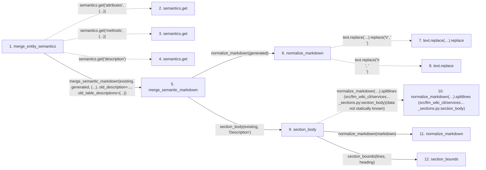

# merge_entity_semantics

**Entry point:** `merge_entity_semantics` (`api`)
**Source:** [section_ownership](../modules/section_ownership.md)
**Modules touched:** [markdown_sections](../modules/markdown_sections.md), [section_ownership](../modules/section_ownership.md)

## Call sequence

> Static overview in presentation order, not runtime execution order. Arrows retain captured callers; siblings are shown before deeper helper detail.

```mermaid
sequenceDiagram
    participant p0 as merge_entity_semantics
    participant p1 as semantics.get
    participant p2 as merge_semantic_markdown
    participant p3 as isinstance
    participant p4 as dict
    participant p5 as normalize_markdown
    participant p6 as section_body
    participant p7 as should_preserve_semantic_value
    participant p8 as replace_section_body
    participant p9 as table_description_cells
    participant p10 as preserve_table_description_cells
    participant p11 as (…).get (src/llm_wiki_cli/services…y:merge_semantic_markdown)
    participant p12 as SemanticMergeResult
    participant p13 as text.replace(…).replace
    participant p14 as normalize_markdown(…).splitlines (src/llm_wiki_cli/services…_sections.py:section_body)
    participant p15 as is_placeholder_description
    participant p16 as normalize_markdown(…).splitlines (src/llm_wiki_cli/services…s.py:replace_section_body)
    participant p17 as normalize_markdown(…).splitlines (src/llm_wiki_cli/services…y:table_description_cells)
    participant p18 as normalize_markdown(…).splitlines (src/llm_wiki_cli/services…e_table_description_cells)
    participant p19 as text.replace
    participant p20 as (…).strip (src/llm_wiki_cli/services…d_preserve_semantic_value)
    p0-->>p1: semantics.get('attributes', {...})
    p0-->>p1: semantics.get('methods', {...})
    p0-->>p1: semantics.get('description')
    p0->>p2: merge_semantic_markdown
    p0-->>p3: isinstance(description, str)
    p0-->>p3: isinstance(attributes, Mapping)
    p0-->>p4: dict(attributes)
    p0-->>p3: isinstance(methods, Mapping)
    p0-->>p4: dict(methods)
    p2->>p5: normalize_markdown
    p2->>p6: section_body
    p2->>p6: section_body
    p2->>p7: should_preserve_semantic_value
    p2->>p8: replace_section_body
    p2->>p9: table_description_cells
    p2->>p10: preserve_table_description_cells
    p2-->>p11: (…).get (src/llm_wiki_cli/services…y:merge_semantic_markdown)(heading)
    p2->>p12: SemanticMergeResult
    p5-->>p13: text.replace(…).replace('\r', '\n')
    p6-->>p14: normalize_markdown(…).splitlines (src/llm_wiki_cli/services…_sections.py:section_body)
    p7->>p15: is_placeholder_description
    p8-->>p16: normalize_markdown(…).splitlines (src/llm_wiki_cli/services…s.py:replace_section_body)
    p9-->>p17: normalize_markdown(…).splitlines (src/llm_wiki_cli/services…y:table_description_cells)
    p10-->>p18: normalize_markdown(…).splitlines (src/llm_wiki_cli/services…e_table_description_cells)
    p5-->>p19: text.replace('\r\n', '\n')
    p6->>p5: normalize_markdown
    p7-->>p20: (…).strip (src/llm_wiki_cli/services…d_preserve_semantic_value)
    p8->>p5: normalize_markdown
    p9->>p5: normalize_markdown
    p10->>p5: normalize_markdown
```

<!-- Auto-generated from static call edges. Dashed arrows are external or unresolved calls. Reviewed runtime conditions and side effects belong in Behavior. -->

> Call sequence diagram shows 30 of 112 interactions; 82 omitted to keep the visualization within the 30-interaction and generated-diagram limits, with uncertain identities omitted rather than inferred.

> Captured boundary calls: external 5 of 24 (19 omitted); unresolved 11 of 57 (46 omitted). These counts cover the captured static trace.

Omitted captured detail, grouped by actual caller occurrence and target module:

| Caller | Parent step | Target module | Kind | Omitted interactions |
| --- | --- | --- | --- | --- |
| `src/llm_wiki_cli/services/markdown_sections.py:section_body` | 9 | [src/llm_wiki_cli/services/markdown_sections.py](../modules/markdown_sections.md) | internal | 2 |
| `src/llm_wiki_cli/services/markdown_sections.py:section_bounds` | 12 | - | unresolved | 10 |
| `src/llm_wiki_cli/services/markdown_sections.py:section_bounds` | 12 | - | external | 6 |
| `src/llm_wiki_cli/services/markdown_sections.py:section_body` | 9 | - | unresolved | 2 |
| `src/llm_wiki_cli/services/markdown_sections.py:trim_blank_lines` | 31 | - | external | 1 |
| `src/llm_wiki_cli/services/markdown_sections.py:trim_blank_lines` | 31 | - | unresolved | 2 |
| `src/llm_wiki_cli/services/markdown_sections.py:is_placeholder_description` | 37 | - | unresolved | 2 |
| `src/llm_wiki_cli/services/markdown_sections.py:should_preserve_semantic_value` | 36 | - | unresolved | 2 |
> Omission summary shows 8 of 23 groups; 15 further groups are not expanded here. Counts above include all omitted interactions.
> Detailed flow queries retain their own coverage and limits; omitted paths may execute at runtime.

## Data flow

<!-- Auto-generated static analysis. Treat values and boundaries as best-effort hints, not runtime proof. -->

### Step data

| Step | Inputs | Reads | Writes | Returns |
|---|---|---|---|---|
| `merge_entity_semantics` | `existing: str`, `generated: str`, `old_semantics: Mapping[str, object] \| None` | `Mapping`, `Mapping` | - | `merge_semantic_markdown(...)` |
| `semantics.get` | - | - | - | - |
| `semantics.get` | - | - | - | - |
| `semantics.get` | - | - | - | - |
| `merge_semantic_markdown` | `existing: str`, `generated: str`, `table_headings: tuple[str, ...]`, `old_description: str \| None`, `old_table_descriptions: dict[str, dict[str, str]] \| None` | - | - | `SemanticMergeResult(...)` |
| `normalize_markdown` | `text: str` | - | - | `...` |
| `text.replace(…).replace` | - | - | - | - |
| `text.replace` | - | - | - | - |
| `section_body` | `markdown: str`, `heading: str` | - | - | `None`, `...` |
| `normalize_markdown(…).splitlines (src/llm_wiki_cli/services…_sections.py:section_body)` | - | - | - | - |
| `normalize_markdown` | `text: str` | - | - | `...` |
| `section_bounds` | `lines: list[str]`, `heading: str` | - | - | `(...)`, `None` |

### Call data

| From | To | Line | Call |
|---|---|---:|---|
| merge_entity_semantics | semantics.get | 1191 | `semantics.get('attributes', {...})` |
| merge_entity_semantics | semantics.get | 1192 | `semantics.get('methods', {...})` |
| merge_entity_semantics | semantics.get | 1193 | `semantics.get('description')` |
| merge_entity_semantics | merge_semantic_markdown | 1194 | `merge_semantic_markdown(existing, generated, (...), old_description=..., old_table_descriptions={...})` |
| merge_semantic_markdown | normalize_markdown | 1155 | `normalize_markdown(generated)` |
| normalize_markdown | text.replace(…).replace | 81 | `text.replace('\r\n', '\n').replace('\r', '\n')` |
| normalize_markdown | text.replace | 81 | `text.replace('\r\n', '\n')` |
| merge_semantic_markdown | section_body | 1157 | `section_body(existing, 'Description')` |
| section_body | normalize_markdown(…).splitlines (src/llm_wiki_cli/services…_sections.py:section_body) | 695 | `normalize_markdown(markdown).splitlines(data not statically known)` |
| section_body | normalize_markdown | 695 | `normalize_markdown(markdown)` |
| section_body | section_bounds | 696 | `section_bounds(lines, heading)` |

### Boundary effects

*No boundary effects detected.*

### Static analysis gaps

| Kind | Step | Target | Line |
|---|---|---|---:|
| unresolved_call | `merge_entity_semantics` | `semantics.get` | 1191 |
| unresolved_call | `merge_entity_semantics` | `semantics.get` | 1192 |
| unresolved_call | `merge_entity_semantics` | `semantics.get` | 1193 |
| unresolved_call | `normalize_markdown` | `text.replace('\r\n', '\n').replace` | 81 |
| unresolved_call | `normalize_markdown` | `text.replace` | 81 |
| unresolved_call | `section_body` | `normalize_markdown(markdown).splitlines` | 695 |
| step_limit | `merge_entity_semantics` | `first 12 steps` | 0 |

## Behavior

This flow starts at `merge_entity_semantics` and is classified as `api`. The generated call and data-flow sections are bounded static projections; runtime conditions and side effects require source-level confirmation.
