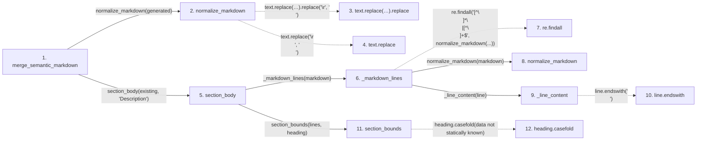

# merge_semantic_markdown

**Entry point:** `merge_semantic_markdown` (`api`)
**Source:** [section_ownership](../modules/section_ownership.md)
**Modules touched:** [markdown_sections](../modules/markdown_sections.md), [section_ownership](../modules/section_ownership.md)

## Call sequence

> Static overview in presentation order, not runtime execution order. Arrows retain captured callers; representative internal continuations and boundary examples precede repeated helper detail.

```mermaid
sequenceDiagram
    participant p0 as merge_semantic_markdown
    participant p1 as section_body
    participant p2 as should_preserve_semantic_value
    participant p3 as replace_section_body
    participant p4 as table_description_cells
    participant p5 as preserve_table_description_cells
    participant p6 as normalize_markdown
    participant p7 as SemanticMergeResult
    participant p8 as _markdown_lines
    participant p9 as is_placeholder_description
    participant p10 as section_bounds
    participant p11 as split_table_row
    participant p12 as trim_blank_lines
    participant p13 as is_table_separator
    participant p14 as semantic_table_key
    participant p15 as format_table_row
    participant p16 as _line_content
    participant p17 as range (src/llm_wiki_cli/services…y:table_description_cells)
    participant p18 as (…).get (src/llm_wiki_cli/services…y:merge_semantic_markdown)
    participant p19 as text.replace(…).replace
    participant p20 as text.replace
    participant p21 as (…).strip (src/llm_wiki_cli/services…d_preserve_semantic_value)
    participant p22 as (…).join(…).strip (src/llm_wiki_cli/services…_sections.py:section_body)
    participant p23 as (…).strip (src/llm_wiki_cli/services…reserve_semantic_value, 1)
    participant p24 as range (src/llm_wiki_cli/services…e_table_description_cells)
    participant p25 as '\n'.join (src/llm_wiki_cli/services…_sections.py:section_body)
    participant p26 as old_generated.strip
    participant p27 as '\n'.join (src/llm_wiki_cli/services…s.py:replace_section_body)
    participant p28 as headers.index (src/llm_wiki_cli/services…y:table_description_cells)
    participant p29 as headers.index (src/llm_wiki_cli/services…e_table_description_cells)
    p0->>p1: section_body
    p0->>p2: should_preserve_semantic_value
    p0->>p3: replace_section_body
    p0->>p4: table_description_cells
    p0->>p5: preserve_table_description_cells
    p0->>p6: normalize_markdown
    p0->>p7: SemanticMergeResult
    p1->>p8: _markdown_lines
    p2->>p9: is_placeholder_description
    p1->>p10: section_bounds
    p4->>p11: split_table_row
    p1->>p12: trim_blank_lines
    p4->>p13: is_table_separator
    p4->>p14: semantic_table_key
    p5->>p15: format_table_row
    p8->>p16: _line_content
    p4-->>p17: range (src/llm_wiki_cli/services…y:table_description_cells)(start, end)
    p0-->>p18: (…).get (src/llm_wiki_cli/services…y:merge_semantic_markdown)(heading)
    p6-->>p19: text.replace(…).replace('\r', '\n')
    p6-->>p20: text.replace('\r\n', '\n')
    p2-->>p21: (…).strip (src/llm_wiki_cli/services…d_preserve_semantic_value)
    p1-->>p22: (…).join(…).strip (src/llm_wiki_cli/services…_sections.py:section_body)
    p2-->>p23: (…).strip (src/llm_wiki_cli/services…reserve_semantic_value, 1)
    p5-->>p24: range (src/llm_wiki_cli/services…e_table_description_cells)(start, end)
    p1-->>p25: '\n'.join (src/llm_wiki_cli/services…_sections.py:section_body)(trim_blank_lines(...))
    p2-->>p26: old_generated.strip
    p3-->>p27: '\n'.join (src/llm_wiki_cli/services…s.py:replace_section_body)(...)
    p4-->>p28: headers.index (src/llm_wiki_cli/services…y:table_description_cells)('Description')
    p5-->>p29: headers.index (src/llm_wiki_cli/services…e_table_description_cells)('Description')
    p4-->>p17: range (src/llm_wiki_cli/services…y:table_description_cells)(row_start, end)
```

<!-- Auto-generated from static call edges. Dashed arrows are external or unresolved calls. Reviewed runtime conditions and side effects belong in Behavior. -->

> Call sequence diagram shows 30 of 103 interactions; 73 omitted to keep the visualization within the 30-interaction and generated-diagram limits, with uncertain identities omitted rather than inferred.

> Captured boundary calls: external 3 of 20 (17 omitted); unresolved 11 of 50 (39 omitted). These counts cover the captured static trace.

Omitted captured detail, grouped by actual caller occurrence and target module:

| Caller | Parent step | Target module | Kind | Omitted interactions |
| --- | --- | --- | --- | --- |
| `src/llm_wiki_cli/services/markdown_sections.py:_markdown_lines` | 6 | - | external | 1 |
| `src/llm_wiki_cli/services/markdown_sections.py:_markdown_lines` | 6 | [src/llm_wiki_cli/services/markdown_sections.py](../modules/markdown_sections.md) | internal | 1 |
| `src/llm_wiki_cli/services/markdown_sections.py:_line_content` | 9 | - | unresolved | 1 |
| `src/llm_wiki_cli/services/markdown_sections.py:section_bounds` | 11 | - | unresolved | 10 |
| `src/llm_wiki_cli/services/markdown_sections.py:section_bounds` | 11 | - | external | 6 |
| `src/llm_wiki_cli/services/markdown_sections.py:trim_blank_lines` | 30 | - | external | 1 |
| `src/llm_wiki_cli/services/markdown_sections.py:trim_blank_lines` | 30 | - | unresolved | 2 |
| `src/llm_wiki_cli/services/section_ownership.py:merge_semantic_markdown` | 1 | [src/llm_wiki_cli/services/markdown_sections.py](../modules/markdown_sections.md) | internal | 1 |
> Omission summary shows 8 of 23 groups; 15 further groups are not expanded here. Counts above include all omitted interactions.
> Detailed flow queries retain their own coverage and limits; omitted paths may execute at runtime.

## Data flow

<!-- Auto-generated static analysis. Treat values and boundaries as best-effort hints, not runtime proof. -->

### Analysis coverage

**Effect analysis partially available.** Flow assembly and source effect analysis are separate; empty observations do not prove an empty handler body.

Source steps: 34; effect analysis evaluated: 33, partial: 0, unavailable: 1. Counts include steps omitted from the displayed trace.

Collector observations for 33 source steps with known totals: observed: 151, emitted: 151, omitted: 0. Unavailable totals are excluded.

- Callable record unavailable for one or more source steps; those steps have no represented callable body.
- Effect collector totals unavailable; observed counts cover captured records only.

| Step | Callable record | Effect analysis | Collector totals | Observed | Emitted | Omitted |
|---|---|---|---|---:|---:|---:|
| `merge_semantic_markdown` | `available` | `evaluated` | `available` | `6` | `6` | `0` |
| `normalize_markdown` | `available` | `evaluated` | `available` | `2` | `2` | `0` |
| `text.replace(…).replace` | `not_applicable` | `not_applicable` | `not_applicable` | — | — | — |
| `text.replace` | `not_applicable` | `not_applicable` | `not_applicable` | — | — | — |
| `section_body` | `available` | `evaluated` | `available` | `4` | `4` | `0` |
| `_markdown_lines` | `available` | `evaluated` | `available` | `3` | `3` | `0` |
| `re.findall` | `not_applicable` | `not_applicable` | `not_applicable` | — | — | — |
| `normalize_markdown` | `available` | `evaluated` | `available` | `2` | `2` | `0` |
| `_line_content` | `available` | `evaluated` | `available` | `2` | `2` | `0` |
| `line.endswith` | `not_applicable` | `not_applicable` | `not_applicable` | — | — | — |
| `section_bounds` | `available` | `evaluated` | `available` | `4` | `4` | `0` |
| `heading.casefold` | `not_applicable` | `not_applicable` | `not_applicable` | — | — | — |

### Step data

| Step | Inputs | Reads | Writes | Returns |
|---|---|---|---|---|
| `merge_semantic_markdown` | `existing: str`, `generated: str`, `table_headings: tuple[str, ...]`, `old_description: str \| None`, `old_table_descriptions: dict[str, dict[str, str]] \| None` | - | - | `SemanticMergeResult(...)` |
| `normalize_markdown` | `text: str` | - | - | `...` |
| `text.replace(…).replace` | - | - | - | - |
| `text.replace` | - | - | - | - |
| `section_body` | `markdown: str`, `heading: str` | - | - | `None`, `...` |
| `_markdown_lines` | `markdown: str`, `keepends: bool` | - | - | `...` |
| `re.findall` | - | - | - | - |
| `normalize_markdown` | `text: str` | - | - | `...` |
| `_line_content` | `line: str` | - | - | `...` |
| `line.endswith` | - | - | - | - |
| `section_bounds` | `lines: list[str]`, `heading: str` | - | - | `(...)`, `None` |
| `heading.casefold` | - | - | - | - |

### Call data

| From | To | Line | Call |
|---|---|---:|---|
| merge_semantic_markdown | normalize_markdown | 1158 | `normalize_markdown(generated)` |
| normalize_markdown | text.replace(…).replace | 82 | `text.replace('\r\n', '\n').replace('\r', '\n')` |
| normalize_markdown | text.replace | 82 | `text.replace('\r\n', '\n')` |
| merge_semantic_markdown | section_body | 1160 | `section_body(existing, 'Description')` |
| section_body | _markdown_lines | 703 | `_markdown_lines(markdown)` |
| _markdown_lines | re.findall | 218 | `re.findall('[^\\n]*\\n\|[^\\n]+$', normalize_markdown(...))` |
| _markdown_lines | normalize_markdown | 218 | `normalize_markdown(markdown)` |
| _markdown_lines | _line_content | 219 | `_line_content(line)` |
| _line_content | line.endswith | 212 | `line.endswith('\n')` |
| section_body | section_bounds | 704 | `section_bounds(lines, heading)` |
| section_bounds | heading.casefold | 669 | `heading.casefold(data not statically known)` |

### Boundary effects

*No boundary-effect observations were captured in this static trace.*

### Static analysis gaps

| Kind | Step | Target | Line |
|---|---|---|---:|
| unresolved_call | `normalize_markdown` | `text.replace('\r\n', '\n').replace` | 82 |
| unresolved_call | `normalize_markdown` | `text.replace` | 82 |
| external_call | `_markdown_lines` | `re.findall` | 218 |
| unresolved_call | `_line_content` | `line.endswith` | 212 |
| unresolved_call | `section_bounds` | `heading.casefold` | 669 |
| step_limit | `merge_semantic_markdown` | `first 12 steps` | 0 |

## Behavior

This flow starts at `merge_semantic_markdown` and is classified as `api`. The generated call and data-flow sections are bounded static projections; runtime conditions and side effects require source-level confirmation.
