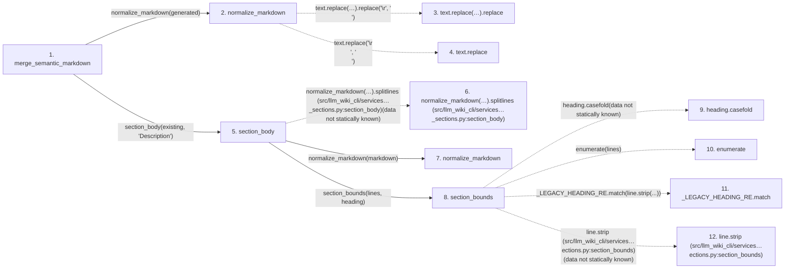

# merge_semantic_markdown

**Entry point:** `merge_semantic_markdown` (`api`)
**Source:** [section_ownership](../modules/section_ownership.md)
**Modules touched:** [markdown_sections](../modules/markdown_sections.md), [section_ownership](../modules/section_ownership.md)

## Call sequence

> Static overview in presentation order, not runtime execution order. Arrows retain captured callers; siblings are shown before deeper helper detail.

```mermaid
sequenceDiagram
    participant p0 as merge_semantic_markdown
    participant p1 as normalize_markdown
    participant p2 as section_body
    participant p3 as should_preserve_semantic_value
    participant p4 as replace_section_body
    participant p5 as table_description_cells
    participant p6 as preserve_table_description_cells
    participant p7 as (…).get (src/llm_wiki_cli/services…y:merge_semantic_markdown)
    participant p8 as SemanticMergeResult
    participant p9 as text.replace(…).replace
    participant p10 as normalize_markdown(…).splitlines (src/llm_wiki_cli/services…_sections.py:section_body)
    participant p11 as is_placeholder_description
    participant p12 as normalize_markdown(…).splitlines (src/llm_wiki_cli/services…s.py:replace_section_body)
    participant p13 as normalize_markdown(…).splitlines (src/llm_wiki_cli/services…y:table_description_cells)
    participant p14 as normalize_markdown(…).splitlines (src/llm_wiki_cli/services…e_table_description_cells)
    participant p15 as text.replace
    participant p16 as (…).strip (src/llm_wiki_cli/services…d_preserve_semantic_value)
    participant p17 as section_bounds
    participant p18 as (…).strip (src/llm_wiki_cli/services…reserve_semantic_value, 1)
    participant p19 as (…).join(…).strip (src/llm_wiki_cli/services…_sections.py:section_body)
    participant p20 as old_generated.strip
    participant p21 as body.splitlines
    participant p22 as range (src/llm_wiki_cli/services…y:table_description_cells)
    p0->>p1: normalize_markdown
    p0->>p2: section_body
    p0->>p2: section_body
    p0->>p3: should_preserve_semantic_value
    p0->>p4: replace_section_body
    p0->>p5: table_description_cells
    p0->>p6: preserve_table_description_cells
    p0-->>p7: (…).get (src/llm_wiki_cli/services…y:merge_semantic_markdown)(heading)
    p0->>p8: SemanticMergeResult
    p1-->>p9: text.replace(…).replace('\r', '\n')
    p2-->>p10: normalize_markdown(…).splitlines (src/llm_wiki_cli/services…_sections.py:section_body)
    p3->>p11: is_placeholder_description
    p4-->>p12: normalize_markdown(…).splitlines (src/llm_wiki_cli/services…s.py:replace_section_body)
    p5-->>p13: normalize_markdown(…).splitlines (src/llm_wiki_cli/services…y:table_description_cells)
    p6-->>p14: normalize_markdown(…).splitlines (src/llm_wiki_cli/services…e_table_description_cells)
    p1-->>p15: text.replace('\r\n', '\n')
    p2->>p1: normalize_markdown
    p3-->>p16: (…).strip (src/llm_wiki_cli/services…d_preserve_semantic_value)
    p4->>p1: normalize_markdown
    p5->>p1: normalize_markdown
    p6->>p1: normalize_markdown
    p2->>p17: section_bounds
    p3-->>p18: (…).strip (src/llm_wiki_cli/services…reserve_semantic_value, 1)
    p4->>p17: section_bounds
    p5->>p17: section_bounds
    p6->>p17: section_bounds
    p2-->>p19: (…).join(…).strip (src/llm_wiki_cli/services…_sections.py:section_body)
    p3-->>p20: old_generated.strip
    p4-->>p21: body.splitlines
    p5-->>p22: range (src/llm_wiki_cli/services…y:table_description_cells)(start, end)
```

<!-- Auto-generated from static call edges. Dashed arrows are external or unresolved calls. Reviewed runtime conditions and side effects belong in Behavior. -->

> Call sequence diagram shows 30 of 103 interactions; 73 omitted to keep the visualization within the 30-interaction and generated-diagram limits, with uncertain identities omitted rather than inferred.

> Captured boundary calls: external 1 of 19 (18 omitted); unresolved 12 of 54 (42 omitted). These counts cover the captured static trace.

Omitted captured detail, grouped by actual caller occurrence and target module:

| Caller | Parent step | Target module | Kind | Omitted interactions |
| --- | --- | --- | --- | --- |
| `src/llm_wiki_cli/services/markdown_sections.py:section_bounds` | 8 | - | unresolved | 10 |
| `src/llm_wiki_cli/services/markdown_sections.py:section_bounds` | 8 | - | external | 6 |
| `src/llm_wiki_cli/services/markdown_sections.py:section_body` | 5 | - | unresolved | 1 |
| `src/llm_wiki_cli/services/markdown_sections.py:section_body` | 5 | [src/llm_wiki_cli/services/markdown_sections.py](../modules/markdown_sections.md) | internal | 1 |
| `src/llm_wiki_cli/services/markdown_sections.py:trim_blank_lines` | 27 | - | external | 1 |
| `src/llm_wiki_cli/services/markdown_sections.py:trim_blank_lines` | 27 | - | unresolved | 2 |
| `src/llm_wiki_cli/services/markdown_sections.py:is_placeholder_description` | 33 | - | unresolved | 2 |
| `src/llm_wiki_cli/services/markdown_sections.py:replace_section_body` | 39 | - | unresolved | 1 |
> Omission summary shows 8 of 21 groups; 13 further groups are not expanded here. Counts above include all omitted interactions.
> Detailed flow queries retain their own coverage and limits; omitted paths may execute at runtime.

## Data flow

<!-- Auto-generated static analysis. Treat values and boundaries as best-effort hints, not runtime proof. -->

### Step data

| Step | Inputs | Reads | Writes | Returns |
|---|---|---|---|---|
| `merge_semantic_markdown` | `existing: str`, `generated: str`, `table_headings: tuple[str, ...]`, `old_description: str \| None`, `old_table_descriptions: dict[str, dict[str, str]] \| None` | - | - | `SemanticMergeResult(...)` |
| `normalize_markdown` | `text: str` | - | - | `...` |
| `text.replace(…).replace` | - | - | - | - |
| `text.replace` | - | - | - | - |
| `section_body` | `markdown: str`, `heading: str` | - | - | `None`, `...` |
| `normalize_markdown(…).splitlines (src/llm_wiki_cli/services…_sections.py:section_body)` | - | - | - | - |
| `normalize_markdown` | `text: str` | - | - | `...` |
| `section_bounds` | `lines: list[str]`, `heading: str` | - | - | `(...)`, `None` |
| `heading.casefold` | - | - | - | - |
| `enumerate` | - | - | - | - |
| `_LEGACY_HEADING_RE.match` | - | - | - | - |
| `line.strip (src/llm_wiki_cli/services…ections.py:section_bounds)` | - | - | - | - |

### Call data

| From | To | Line | Call |
|---|---|---:|---|
| merge_semantic_markdown | normalize_markdown | 1155 | `normalize_markdown(generated)` |
| normalize_markdown | text.replace(…).replace | 81 | `text.replace('\r\n', '\n').replace('\r', '\n')` |
| normalize_markdown | text.replace | 81 | `text.replace('\r\n', '\n')` |
| merge_semantic_markdown | section_body | 1157 | `section_body(existing, 'Description')` |
| section_body | normalize_markdown(…).splitlines (src/llm_wiki_cli/services…_sections.py:section_body) | 695 | `normalize_markdown(markdown).splitlines(data not statically known)` |
| section_body | normalize_markdown | 695 | `normalize_markdown(markdown)` |
| section_body | section_bounds | 696 | `section_bounds(lines, heading)` |
| section_bounds | heading.casefold | 661 | `heading.casefold(data not statically known)` |
| section_bounds | enumerate | 662 | `enumerate(lines)` |
| section_bounds | _LEGACY_HEADING_RE.match | 663 | `_LEGACY_HEADING_RE.match(line.strip(...))` |
| section_bounds | line.strip (src/llm_wiki_cli/services…ections.py:section_bounds) | 663 | `line.strip(data not statically known)` |

### Boundary effects

*No boundary effects detected.*

### Static analysis gaps

| Kind | Step | Target | Line |
|---|---|---|---:|
| unresolved_call | `normalize_markdown` | `text.replace('\r\n', '\n').replace` | 81 |
| unresolved_call | `normalize_markdown` | `text.replace` | 81 |
| unresolved_call | `section_body` | `normalize_markdown(markdown).splitlines` | 695 |
| unresolved_call | `section_bounds` | `heading.casefold` | 661 |
| external_call | `section_bounds` | `enumerate` | 662 |
| unresolved_call | `section_bounds` | `_LEGACY_HEADING_RE.match` | 663 |
| unresolved_call | `section_bounds` | `line.strip` | 663 |
| step_limit | `merge_semantic_markdown` | `first 12 steps` | 0 |

## Behavior

This flow starts at `merge_semantic_markdown` and is classified as `api`. The generated call and data-flow sections are bounded static projections; runtime conditions and side effects require source-level confirmation.
