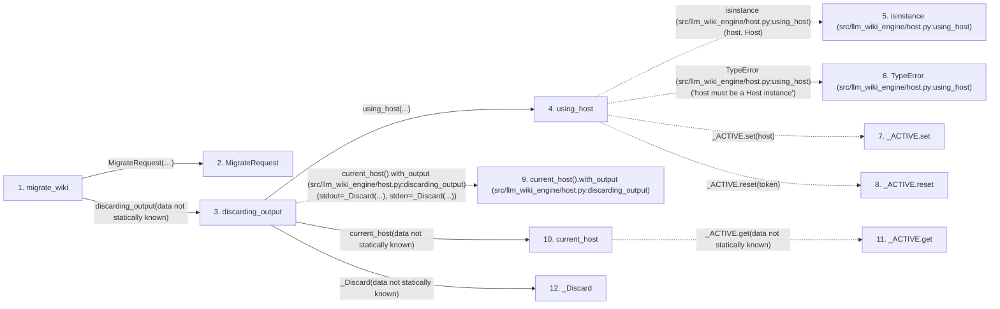

# migrate_wiki

**Entry point:** `migrate_wiki` (`api`)
**Source:** [api](../modules/api.md)
**Modules touched:** [api](../modules/api.md), [bootstrap_runtime](../modules/bootstrap_runtime.md), [canonical_json](../modules/canonical_json.md), [common](../modules/common.md), and 34 more

**Complete modules touched:**

- [api](../modules/api.md)
- [bootstrap_runtime](../modules/bootstrap_runtime.md)
- [canonical_json](../modules/canonical_json.md)
- [common](../modules/common.md)
- [concept_identity](../modules/concept_identity.md)
- [dockerfile_parser](../modules/dockerfile_parser.md)
- [domain_pack](../modules/domain_pack.md)
- [engine_events](../modules/engine_events.md)
- [extraction_service](../modules/extraction_service.md)
- [filesystem_guard](../modules/filesystem_guard.md)
- [gitignore](../modules/gitignore.md)
- [historical_sources](../modules/historical_sources.md)
- [host](../modules/host.md)
- [imports](../modules/imports.md)
- [infrastructure_state](../modules/infrastructure_state.md)
- [io](../modules/io.md)
- [knowledge_envelope](../modules/knowledge_envelope.md)
- [knowledge_evidence](../modules/knowledge_evidence.md)
- [knowledge_generation](../modules/knowledge_generation.md)
- [knowledge_governance](../modules/knowledge_governance.md)
- [knowledge_loader](../modules/knowledge_loader.md)
- [knowledge_orchestration](../modules/knowledge_orchestration.md)
- [knowledge_storage](../modules/knowledge_storage.md)
- [knowledge_storage_io](../modules/knowledge_storage_io.md)
- [maintenance_state](../modules/maintenance_state.md)
- [manifest_storage](../modules/manifest_storage.md)
- [migrate_runtime](../modules/migrate_runtime.md)
- [migrate_service](../modules/migrate_service.md)
- [pack_interfaces](../modules/pack_interfaces.md)
- [path_policy](../modules/path_policy.md)
- [python_imports](../modules/python_imports.md)
- [source_selection](../modules/source_selection.md)
- [source_snapshot](../modules/source_snapshot.md)
- [sync_manifest](../modules/sync_manifest.md)
- [validation](../modules/validation.md)
- [wiki_surface](../modules/wiki_surface.md)
- [wiki_surface_index](../modules/wiki_surface_index.md)
- [yaml_syntax](../modules/yaml_syntax.md)

## Call sequence

> Static overview in presentation order, not runtime execution order. Arrows retain captured callers; representative internal continuations and boundary examples precede repeated helper detail.

```mermaid
sequenceDiagram
    participant p0 as migrate_wiki
    participant p1 as discarding_output
    participant p2 as execute_migrate
    participant p3 as MigrateRequest
    participant p4 as InvalidRequestError
    participant p5 as WorkspaceStateError
    participant p6 as run_request
    participant p7 as validate_source_root
    participant p8 as _abort
    participant p9 as _build_migration_plan
    participant p10 as _print_migration_governance_plan
    participant p11 as _matched_archive_count
    participant p12 as _build_chunks
    participant p13 as _print_chunk_plan
    participant p14 as _print_migration_artifact_preview
    participant p15 as validate_path
    participant p16 as emit
    participant p17 as SyncManifest.load
    participant p18 as _preview_migration_artifact_plan
    participant p19 as resolve_source_selection
    participant p20 as _pending_targets
    participant p21 as _should_archive_matched_page
    participant p22 as _finalizers_pending
    participant p23 as validate_persisted_source_selection_identity
    participant p24 as capture_source_selection_inputs
    participant p25 as build_source_snapshot
    participant p26 as get_inventory_result
    participant p27 as windows_current_user_sid
    participant p28 as get_docker_inventory
    participant p29 as str (src/llm_wiki_cli/api.py:migrate_wiki)
    participant p30 as current_host().with_output (src/llm_wiki_engine/host.py:discarding_output)
    p0->>p1: discarding_output
    p0->>p2: execute_migrate
    p0->>p3: MigrateRequest
    p0->>p4: InvalidRequestError
    p0->>p5: WorkspaceStateError
    p2->>p6: run_request
    p6->>p7: validate_source_root
    p6->>p8: _abort
    p6->>p9: _build_migration_plan
    p6->>p10: _print_migration_governance_plan
    p6->>p11: _matched_archive_count
    p6->>p12: _build_chunks
    p6->>p13: _print_chunk_plan
    p6->>p14: _print_migration_artifact_preview
    p7->>p15: validate_path
    p8->>p16: emit
    p9->>p17: SyncManifest.load
    p14->>p18: _preview_migration_artifact_plan
    p9->>p19: resolve_source_selection
    p12->>p20: _pending_targets
    p11->>p21: _should_archive_matched_page
    p12->>p22: _finalizers_pending
    p9->>p23: validate_persisted_source_selection_identity
    p9->>p24: capture_source_selection_inputs
    p9->>p25: build_source_snapshot
    p9->>p26: get_inventory_result
    p7->>p27: windows_current_user_sid
    p9->>p28: get_docker_inventory
    p0-->>p29: str (src/llm_wiki_cli/api.py:migrate_wiki)(exc)
    p1-->>p30: current_host().with_output (src/llm_wiki_engine/host.py:discarding_output)(stdout=_Discard(...), stderr=_Discard(...))
```

<!-- Auto-generated from static call edges. Dashed arrows are external or unresolved calls. Reviewed runtime conditions and side effects belong in Behavior. -->

> Call sequence diagram shows 30 of 1150 interactions; 1120 omitted to keep the visualization within the 30-interaction and generated-diagram limits, with uncertain identities omitted rather than inferred.

> Captured boundary calls: external 1 of 354 (353 omitted); unresolved 1 of 324 (323 omitted). These counts cover the captured static trace.

Omitted captured detail, grouped by actual caller occurrence and target module:

| Caller | Parent step | Target module | Kind | Omitted interactions |
| --- | --- | --- | --- | --- |
| `src/llm_wiki_engine/host.py:discarding_output` | 3 | [src/llm_wiki_engine/host.py](../modules/host.md) | internal | 4 |
| `src/llm_wiki_engine/host.py:using_host` | 4 | - | external | 2 |
| `src/llm_wiki_engine/host.py:using_host` | 4 | - | unresolved | 2 |
| `src/llm_wiki_engine/host.py:current_host` | 10 | - | unresolved | 1 |
| `src/llm_wiki_cli/services/migrate_runtime.py:execute_migrate` | 14 | - | external | 3 |
| `src/llm_wiki_cli/services/migrate_runtime.py:run_request` | 17 | - | external | 9 |
| `src/llm_wiki_engine/path_policy.py:validate_path` | 21 | [src/llm_wiki_engine/path_policy.py](../modules/path_policy.md) | internal | 2 |
| `src/llm_wiki_engine/path_policy.py:validate_path` | 21 | - | unresolved | 5 |
> Omission summary shows 8 of 304 groups; 296 further groups are not expanded here. Counts above include all omitted interactions.
> Detailed flow queries retain their own coverage and limits; omitted paths may execute at runtime.

> Trace truncated at the depth limit; deeper calls are omitted.

## Data flow

<!-- Auto-generated static analysis. Treat values and boundaries as best-effort hints, not runtime proof. -->

### Analysis coverage

**Effect analysis partially available.** Flow assembly and source effect analysis are separate; empty observations do not prove an empty handler body.

Source steps: 473; effect analysis evaluated: 345, partial: 20, unavailable: 108. Counts include steps omitted from the displayed trace.

Collector observations for 365 source steps with known totals: observed: 2166, emitted: 2115, omitted: 51. Unavailable totals are excluded.

- Callable record unavailable for one or more source steps; those steps have no represented callable body.
- Effect collector omitted observations before flow assembly; displayed effects are partial.
- Effect collector totals unavailable; observed counts cover captured records only.

| Step | Callable record | Effect analysis | Collector totals | Observed | Emitted | Omitted |
|---|---|---|---|---:|---:|---:|
| `migrate_wiki` | `available` | `evaluated` | `available` | `11` | `11` | `0` |
| `MigrateRequest` | `unavailable` | `unavailable` | `unavailable` | — | — | — |
| `discarding_output` | `available` | `evaluated` | `available` | `0` | `0` | `0` |
| `using_host` | `available` | `evaluated` | `available` | `2` | `2` | `0` |
| `isinstance (src/llm_wiki_engine/host.py:using_host)` | `not_applicable` | `not_applicable` | `not_applicable` | — | — | — |
| `TypeError (src/llm_wiki_engine/host.py:using_host)` | `not_applicable` | `not_applicable` | `not_applicable` | — | — | — |
| `_ACTIVE.set` | `not_applicable` | `not_applicable` | `not_applicable` | — | — | — |
| `_ACTIVE.reset` | `not_applicable` | `not_applicable` | `not_applicable` | — | — | — |
| `current_host().with_output (src/llm_wiki_engine/host.py:discarding_output)` | `not_applicable` | `not_applicable` | `not_applicable` | — | — | — |
| `current_host` | `available` | `evaluated` | `available` | `2` | `2` | `0` |
| `_ACTIVE.get` | `not_applicable` | `not_applicable` | `not_applicable` | — | — | — |
| `_Discard` | `unavailable` | `unavailable` | `unavailable` | — | — | — |

### Step data

| Step | Inputs | Reads | Writes | Returns |
|---|---|---|---|---|
| `migrate_wiki` | `source_root: str`, `wiki_root: str`, `dry_run: bool`, `chunk_size: int \| None`, `chunk: int \| None`, `plan_chunks: bool`, `trust_source_plugins: bool`, `source_selection: str \| Path \| None` | `MigrateRequestError`, `MigrateError` | - | `execute_migrate(...)` |
| `MigrateRequest` | - | - | - | - |
| `discarding_output` | - | - | - | - |
| `using_host` | `host: Host` | `Host` | - | - |
| `isinstance (src/llm_wiki_engine/host.py:using_host)` | - | - | - | - |
| `TypeError (src/llm_wiki_engine/host.py:using_host)` | - | - | - | - |
| `_ACTIVE.set` | - | - | - | - |
| `_ACTIVE.reset` | - | - | - | - |
| `current_host().with_output (src/llm_wiki_engine/host.py:discarding_output)` | - | - | - | - |
| `current_host` | - | `_DEFAULT` | - | `...` |
| `_ACTIVE.get` | - | - | - | - |
| `_Discard` | - | - | - | - |

### Call data

| From | To | Line | Call |
|---|---|---:|---|
| migrate_wiki | MigrateRequest | 1344 | `MigrateRequest(source_root=source_root, wiki_root=wiki_root, dry_run=dry_run, chunk_size=chunk_size, chunk=chunk, plan_chunks=plan_chunks, plugins=trust_source_plugins, source_selection=source_selection)` |
| migrate_wiki | discarding_output | 1355 | `discarding_output(data not statically known)` |
| discarding_output | using_host | 282 | `using_host(...)` |
| using_host | isinstance (src/llm_wiki_engine/host.py:using_host) | 173 | `isinstance(host, Host)` |
| using_host | TypeError (src/llm_wiki_engine/host.py:using_host) | 174 | `TypeError('host must be a Host instance')` |
| using_host | _ACTIVE.set | 175 | `_ACTIVE.set(host)` |
| using_host | _ACTIVE.reset | 179 | `_ACTIVE.reset(token)` |
| discarding_output | current_host().with_output (src/llm_wiki_engine/host.py:discarding_output) | 282 | `current_host().with_output(stdout=_Discard(...), stderr=_Discard(...))` |
| discarding_output | current_host | 282 | `current_host(data not statically known)` |
| current_host | _ACTIVE.get | 167 | `_ACTIVE.get(data not statically known)` |
| discarding_output | _Discard | 282 | `_Discard(data not statically known)` |

### Boundary effects

*No boundary-effect observations were captured in this static trace.*

### Static analysis gaps

| Kind | Step | Target | Line |
|---|---|---|---:|
| external_call | `using_host` | `isinstance` | 173 |
| external_call | `using_host` | `TypeError` | 174 |
| unresolved_call | `using_host` | `_ACTIVE.reset` | 179 |
| unresolved_call | `discarding_output` | `current_host().with_output` | 282 |
| unresolved_call | `current_host` | `_ACTIVE.get` | 167 |
| step_limit | `migrate_wiki` | `first 12 steps` | 0 |
| truncated_flow | `migrate_wiki` | `depth limit` | 0 |

## Behavior

This flow starts at `migrate_wiki` and is classified as `api`. The generated call and data-flow sections are bounded static projections; runtime conditions and side effects require source-level confirmation.
