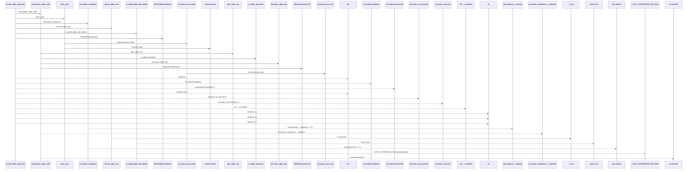
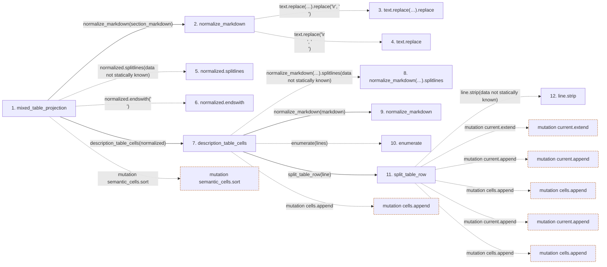

# mixed_table_projection

**Entry point:** `mixed_table_projection` (`api`)
**Source:** [markdown_sections](../modules/markdown_sections.md)
**Modules touched:** [knowledge_evidence](../modules/knowledge_evidence.md), [markdown_sections](../modules/markdown_sections.md)

## Call sequence

> Static overview in presentation order, not runtime execution order. Arrows retain captured callers; representative internal continuations and boundary examples precede repeated helper detail.

<!-- Auto-generated from static call edges. Dashed arrows are external or unresolved calls. Reviewed runtime conditions and side effects belong in Behavior. -->

> Call sequence diagram shows 30 of 71 interactions; 41 omitted to keep the visualization within the 30-interaction and generated-diagram limits, with uncertain identities omitted rather than inferred.

> Captured boundary calls: external 6 of 21 (15 omitted); unresolved 11 of 33 (22 omitted). These counts cover the captured static trace.

Omitted captured detail, grouped by actual caller occurrence and target module:

| Caller | Parent step | Target module | Kind | Omitted interactions |
| --- | --- | --- | --- | --- |
| `src/llm_wiki_cli/services/markdown_sections.py:description_table_cells` | 7 | [src/llm_wiki_cli/services/markdown_sections.py](../modules/markdown_sections.md) | internal | 3 |
| `src/llm_wiki_cli/services/markdown_sections.py:split_table_row` | 11 | - | unresolved | 12 |
| `src/llm_wiki_cli/services/markdown_sections.py:split_table_row` | 11 | - | external | 3 |
| `src/llm_wiki_cli/services/markdown_sections.py:description_table_cells` | 7 | - | unresolved | 3 |
| `src/llm_wiki_cli/services/markdown_sections.py:description_table_cells` | 7 | - | external | 7 |
| `src/llm_wiki_cli/services/markdown_sections.py:is_table_separator` | 29 | - | external | 2 |
| `src/llm_wiki_cli/services/markdown_sections.py:is_table_separator` | 29 | - | unresolved | 1 |
| `src/llm_wiki_cli/services/markdown_sections.py:semantic_table_key` | 39 | - | external | 1 |
> Omission summary shows 8 of 14 groups; 6 further groups are not expanded here. Counts above include all omitted interactions.
> Detailed flow queries retain their own coverage and limits; omitted paths may execute at runtime.

## Data flow

<!-- Auto-generated static analysis. Treat values and boundaries as best-effort hints, not runtime proof. -->

### Step data

| Step | Inputs | Reads | Writes | Returns |
|---|---|---|---|---|
| `mixed_table_projection` | `section_markdown: str` | `MIXED_TABLE_DOMAIN`, `MIXED_TABLE_DOMAIN` | `row[...]`, `structural_lines[...]`, `semantic_by_key[...]` | `MixedTableProjection(...)` |
| `normalize_markdown` | `text: str` | - | - | `...` |
| `text.replace(…).replace` | - | - | - | - |
| `text.replace` | - | - | - | - |
| `normalized.splitlines` | - | - | - | - |
| `normalized.endswith` | - | - | - | - |
| `description_table_cells` | `markdown: str` | - | `occurrences[...]` | `tuple(...)`, `(...)` |
| `normalize_markdown(…).splitlines` | - | - | - | - |
| `normalize_markdown` | `text: str` | - | - | `...` |
| `enumerate` | - | - | - | - |
| `split_table_row` | `line: str` | - | - | `[...]`, `cells` |
| `line.strip` | - | - | - | - |

### Call data

| From | To | Line | Call |
|---|---|---:|---|
| mixed_table_projection | normalize_markdown | 605 | `normalize_markdown(section_markdown)` |
| normalize_markdown | text.replace(…).replace | 81 | `text.replace('\r\n', '\n').replace('\r', '\n')` |
| normalize_markdown | text.replace | 81 | `text.replace('\r\n', '\n')` |
| mixed_table_projection | normalized.splitlines | 606 | `normalized.splitlines(data not statically known)` |
| mixed_table_projection | normalized.endswith | 607 | `normalized.endswith('\n')` |
| mixed_table_projection | description_table_cells | 608 | `description_table_cells(normalized)` |
| description_table_cells | normalize_markdown(…).splitlines | 558 | `normalize_markdown(markdown).splitlines(data not statically known)` |
| description_table_cells | normalize_markdown | 558 | `normalize_markdown(markdown)` |
| description_table_cells | enumerate | 559 | `enumerate(lines)` |
| description_table_cells | split_table_row | 560 | `split_table_row(line)` |
| split_table_row | line.strip | 467 | `line.strip(data not statically known)` |

### Boundary effects

| Kind | Target | Step | Line |
|---|---|---|---:|
| mutation | `semantic_cells.sort` | `mixed_table_projection` | 629 |
| mutation | `cells.append` | `description_table_cells` | 581 |
| mutation | `current.extend` | `split_table_row` | 478 |
| mutation | `current.append` | `split_table_row` | 486 |
| mutation | `cells.append` | `split_table_row` | 494 |
| mutation | `current.append` | `split_table_row` | 497 |
| mutation | `cells.append` | `split_table_row` | 499 |

### Static analysis gaps

| Kind | Step | Target | Line |
|---|---|---|---:|
| unresolved_call | `normalize_markdown` | `text.replace('\r\n', '\n').replace` | 81 |
| unresolved_call | `normalize_markdown` | `text.replace` | 81 |
| unresolved_call | `mixed_table_projection` | `normalized.splitlines` | 606 |
| unresolved_call | `mixed_table_projection` | `normalized.endswith` | 607 |
| unresolved_call | `description_table_cells` | `normalize_markdown(markdown).splitlines` | 558 |
| external_call | `description_table_cells` | `enumerate` | 559 |
| unresolved_call | `split_table_row` | `line.strip` | 467 |
| step_limit | `mixed_table_projection` | `first 12 steps` | 0 |

## Behavior

This flow starts at `mixed_table_projection` and is classified as `api`. The generated call and data-flow sections are bounded static projections; runtime conditions and side effects require source-level confirmation.
