# module_observation_hash

**Entry point:** `module_observation_hash` (`api`)
**Source:** [knowledge_evidence](../modules/knowledge_evidence.md)
**Modules touched:** [knowledge_evidence](../modules/knowledge_evidence.md), [validation](../modules/validation.md)

## Call sequence

> Static overview in presentation order, not runtime execution order. Arrows retain captured callers; representative internal continuations and boundary examples precede repeated helper detail.

```mermaid
sequenceDiagram
    participant p0 as module_observation_hash
    participant p1 as _validate_inventory_complete
    participant p2 as normalize_module_observation
    participant p3 as _hash_normalized_observation
    participant p4 as _normalize_module_observation
    participant p5 as hash_json
    participant p6 as _inventory_language
    participant p7 as canonical_json_bytes
    participant p8 as _record_array
    participant p9 as _validate_import_record
    participant p10 as _record_name
    participant p11 as _validate_module_entity_record
    participant p12 as _copy_selected_fields
    participant p13 as _validate_callable_record
    participant p14 as _json_array
    participant p15 as _validate_constant_record
    participant p16 as _validate_module_call_record
    participant p17 as _structural_copy
    participant p18 as _failure
    participant p19 as require_nonempty_text
    participant p20 as _optional_record_array
    participant p21 as _validate_optional_strings
    participant p22 as _validate_optional_string_array
    participant p23 as _validate_optional_booleans
    participant p24 as _validate_string_array
    participant p25 as _record_object
    participant p26 as require_bool
    participant p27 as sha256_bytes
    participant p28 as _pointer
    participant p29 as TypeError
    participant p30 as seen_names.get
    p0->>p1: _validate_inventory_complete
    p0->>p2: normalize_module_observation
    p0->>p3: _hash_normalized_observation
    p2->>p4: _normalize_module_observation
    p3->>p5: hash_json
    p4->>p6: _inventory_language
    p5->>p7: canonical_json_bytes
    p4->>p8: _record_array
    p4->>p9: _validate_import_record
    p4->>p10: _record_name
    p4->>p11: _validate_module_entity_record
    p4->>p12: _copy_selected_fields
    p4->>p13: _validate_callable_record
    p4->>p14: _json_array
    p4->>p15: _validate_constant_record
    p4->>p16: _validate_module_call_record
    p12->>p17: _structural_copy
    p6->>p18: _failure
    p10->>p19: require_nonempty_text
    p8->>p20: _optional_record_array
    p9->>p21: _validate_optional_strings
    p11->>p22: _validate_optional_string_array
    p9->>p23: _validate_optional_booleans
    p22->>p24: _validate_string_array
    p20->>p25: _record_object
    p1->>p26: require_bool
    p5->>p27: sha256_bytes
    p8->>p28: _pointer
    p1-->>p29: TypeError('inventory_complete must be a boolean')
    p4-->>p30: seen_names.get(name, 0)
```

<!-- Auto-generated from static call edges. Dashed arrows are external or unresolved calls. Reviewed runtime conditions and side effects belong in Behavior. -->

> Call sequence diagram shows 30 of 229 interactions; 199 omitted to keep the visualization within the 30-interaction and generated-diagram limits, with uncertain identities omitted rather than inferred.

> Captured boundary calls: external 1 of 45 (44 omitted); unresolved 1 of 53 (52 omitted). These counts cover the captured static trace.

Omitted captured detail, grouped by actual caller occurrence and target module:

| Caller | Parent step | Target module | Kind | Omitted interactions |
| --- | --- | --- | --- | --- |
| `src/llm_wiki_cli/services/validation.py:require_bool` | 3 | - | external | 1 |
| `src/llm_wiki_cli/services/knowledge_evidence.py:_inventory_language` | 8 | - | external | 2 |
| `src/llm_wiki_cli/services/knowledge_evidence.py:_failure` | 10 | [src/llm_wiki_cli/services/knowledge_evidence.py](../modules/knowledge_evidence.md) | internal | 1 |
| `src/llm_wiki_cli/services/knowledge_evidence.py:_inventory_language` | 8 | - | unresolved | 1 |
| `src/llm_wiki_cli/services/knowledge_evidence.py:_inventory_language` | 8 | [src/llm_wiki_cli/services/knowledge_evidence.py](../modules/knowledge_evidence.md) | internal | 2 |
| `src/llm_wiki_cli/services/knowledge_evidence.py:_normalize_module_observation` | 7 | - | external | 7 |
| `src/llm_wiki_cli/services/knowledge_evidence.py:_record_array` | 17 | [src/llm_wiki_cli/services/knowledge_evidence.py](../modules/knowledge_evidence.md) | internal | 1 |
| `src/llm_wiki_cli/services/knowledge_evidence.py:_pointer` | 19 | - | unresolved | 2 |
> Omission summary shows 8 of 62 groups; 54 further groups are not expanded here. Counts above include all omitted interactions.
> Detailed flow queries retain their own coverage and limits; omitted paths may execute at runtime.

> Trace truncated at the depth limit; deeper calls are omitted.

## Data flow

```mermaid
flowchart LR
    s1["1. module_observation_hash"]
    s2["2. _validate_inventory_complete"]
    s3["3. require_bool"]
    s4["4. isinstance (src/llm_wiki_cli/services…alidation.py:require_bool)"]
    s5["5. TypeError"]
    s6["6. normalize_module_observation"]
    s7["7. _normalize_module_observation"]
    s8["8. _inventory_language"]
    s9["9. isinstance (src/llm_wiki_cli/services…ce.py:_inventory_language)"]
    s10["10. _failure"]
    s11["11. _InventoryNormalizationError"]
    s12["12. file_data.get (src/llm_wiki_cli/services…ce.py:_inventory_language)"]
    s1 -->|"_validate_inventory_complete(inventory_complete)"| s2
    s2 -->|"require_bool(inventory_complete, error=TypeError(...))"| s3
    s3 -. "isinstance (src/llm_wiki_cli/services…alidation.py:require_bool)(value, bool)" .-> s4
    s2 -. "TypeError('inventory_complete must be a boolean')" .-> s5
    s1 -->|"normalize_module_observation(file_data)"| s6
    s6 -->|"_normalize_module_observation(file_data)"| s7
    s7 -->|"_inventory_language(file_data)"| s8
    s8 -. "isinstance (src/llm_wiki_cli/services…ce.py:_inventory_language)(file_data, Mapping)" .-> s9
    s8 -->|"_failure('', 'object-required', 'inventory object', file_data)"| s10
    s10 -->|"_InventoryNormalizationError(reason, pointer=pointer, rule=rule, expected=expected, value=value, exact=exact)"| s11
    s8 -. "file_data.get (src/llm_wiki_cli/services…ce.py:_inventory_language)('language', MISSING_VALUE)" .-> s12
    b0["mutation class_summaries.append"]
    s7 -. "mutation class_summaries.append" .-> b0
    b1["mutation function_summaries.append"]
    s7 -. "mutation function_summaries.append" .-> b1
    b2["mutation constant_summaries.append"]
    s7 -. "mutation constant_summaries.append" .-> b2
    b3["mutation call_summaries.append"]
    s7 -. "mutation call_summaries.append" .-> b3
    click s1 "../modules/knowledge_evidence.md"
    click s2 "../modules/knowledge_evidence.md"
    click s3 "../modules/validation.md"
    click s6 "../modules/knowledge_evidence.md"
    click s7 "../modules/knowledge_evidence.md"
    click s8 "../modules/knowledge_evidence.md"
    click s10 "../modules/knowledge_evidence.md"
    click s11 "../modules/knowledge_evidence.md"
    classDef boundary stroke:#b45309,stroke-dasharray: 4 2
    class b0 boundary
    class b1 boundary
    class b2 boundary
    class b3 boundary
```

<!-- Auto-generated static analysis. Treat values and boundaries as best-effort hints, not runtime proof. -->

### Step data

| Step | Inputs | Reads | Writes | Returns |
|---|---|---|---|---|
| `module_observation_hash` | `file_data: Mapping[str, Any]`, `inventory_complete: bool` | - | - | `None`, `_hash_normalized_observation(...)` |
| `_validate_inventory_complete` | `inventory_complete: object` | - | - | - |
| `require_bool` | `value: object`, `error: Exception` | - | - | `value` |
| `isinstance (src/llm_wiki_cli/services…alidation.py:require_bool)` | - | - | - | - |
| `TypeError` | - | - | - | - |
| `normalize_module_observation` | `file_data: Mapping[str, Any]` | `_InventoryNormalizationError` | - | `_normalize_module_observation(...)`, `None` |
| `_normalize_module_observation` | `file_data: Mapping[str, Any] \| None` | `Mapping`, `_MODULE_ENTITY_FIELDS`, `_MODULE_NONSTRUCTURAL_KEYS`, `_MODULE_FUNCTION_FIELDS`, `_MODULE_NONSTRUCTURAL_KEYS`, `MODULE_OBSERVATION_SCOPE`, `_MODULE_NONSTRUCTURAL_KEYS`, `_MODULE_CONSTANT_FIELDS` | `seen_names[...]`, `summary[...]`, `payload[...]`, `payload[...]`, `payload[...]`, `payload[...]` | `payload` |
| `_inventory_language` | `file_data: Mapping[str, Any] \| None` | `Mapping`, `MISSING_VALUE`, `_SUPPORTED_OBSERVATION_LANGUAGES`, `UNKNOWN_UNSUPPORTED_LANGUAGE` | - | `language` |
| `isinstance (src/llm_wiki_cli/services…ce.py:_inventory_language)` | - | - | - | - |
| `_failure` | `pointer`, `rule`, `expected`, `value`, `reason`, `exact` | - | - | `_InventoryNormalizationError(...)` |
| `_InventoryNormalizationError` | - | - | - | - |
| `file_data.get (src/llm_wiki_cli/services…ce.py:_inventory_language)` | - | - | - | - |

### Call data

| From | To | Line | Call |
|---|---|---:|---|
| module_observation_hash | _validate_inventory_complete | 278 | `_validate_inventory_complete(inventory_complete)` |
| _validate_inventory_complete | require_bool | 839 | `require_bool(inventory_complete, error=TypeError(...))` |
| require_bool | isinstance (src/llm_wiki_cli/services…alidation.py:require_bool) | 810 | `isinstance(value, bool)` |
| _validate_inventory_complete | TypeError | 841 | `TypeError('inventory_complete must be a boolean')` |
| module_observation_hash | normalize_module_observation | 281 | `normalize_module_observation(file_data)` |
| normalize_module_observation | _normalize_module_observation | 242 | `_normalize_module_observation(file_data)` |
| _normalize_module_observation | _inventory_language | 457 | `_inventory_language(file_data)` |
| _inventory_language | isinstance (src/llm_wiki_cli/services…ce.py:_inventory_language) | 540 | `isinstance(file_data, Mapping)` |
| _inventory_language | _failure | 541 | `_failure('', 'object-required', 'inventory object', file_data)` |
| _failure | _InventoryNormalizationError | 166 | `_InventoryNormalizationError(reason, pointer=pointer, rule=rule, expected=expected, value=value, exact=exact)` |
| _inventory_language | file_data.get (src/llm_wiki_cli/services…ce.py:_inventory_language) | 542 | `file_data.get('language', MISSING_VALUE)` |

### Boundary effects

| Kind | Target | Step | Line |
|---|---|---|---:|
| mutation | `class_summaries.append` | `_normalize_module_observation` | 474 |
| mutation | `function_summaries.append` | `_normalize_module_observation` | 480 |
| mutation | `constant_summaries.append` | `_normalize_module_observation` | 502 |
| mutation | `call_summaries.append` | `_normalize_module_observation` | 509 |

### Static analysis gaps

| Kind | Step | Target | Line |
|---|---|---|---:|
| external_call | `require_bool` | `isinstance` | 810 |
| external_call | `_validate_inventory_complete` | `TypeError` | 841 |
| external_call | `_inventory_language` | `isinstance` | 540 |
| unresolved_call | `_inventory_language` | `file_data.get` | 542 |
| step_limit | `module_observation_hash` | `first 12 steps` | 0 |
| truncated_flow | `module_observation_hash` | `depth limit` | 0 |

## Behavior

This flow starts at `module_observation_hash` and is classified as `api`. The generated call and data-flow sections are bounded static projections; runtime conditions and side effects require source-level confirmation.
