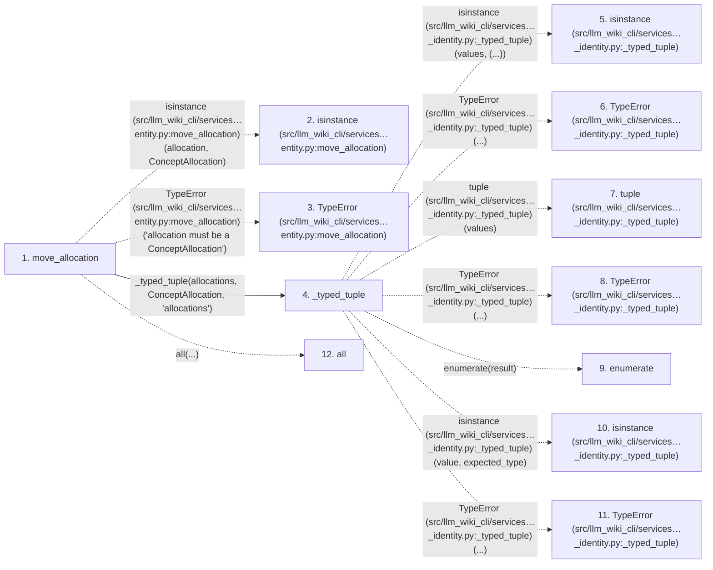

# move_allocation

**Entry point:** `move_allocation` (`api`)
**Source:** [concept_identity](../modules/concept_identity.md)
**Modules touched:** [concept_identity](../modules/concept_identity.md), [wiki_surface](../modules/wiki_surface.md)

## Call sequence

> Static overview in presentation order, not runtime execution order. Arrows retain captured callers; siblings are shown before deeper helper detail.

```mermaid
sequenceDiagram
    participant p0 as move_allocation
    participant p1 as isinstance (src/llm_wiki_cli/services…entity.py:move_allocation)
    participant p2 as TypeError (src/llm_wiki_cli/services…entity.py:move_allocation)
    participant p3 as _typed_tuple
    participant p4 as all
    participant p5 as validate_identity_registry
    participant p6 as {item.uid: item for item in current}.get
    participant p7 as ConceptIdentityError
    participant p8 as aliases_for_move
    participant p9 as ConceptAllocation
    participant p10 as tuple (src/llm_wiki_cli/services…entity.py:move_allocation)
    participant p11 as IdentityUpdate
    participant p12 as isinstance (src/llm_wiki_cli/services…_identity.py:_typed_tuple)
    participant p13 as isinstance (src/llm_wiki_cli/services…ntity.py:aliases_for_move)
    participant p14 as TypeError (src/llm_wiki_cli/services…_identity.py:_typed_tuple)
    participant p15 as TypeError (src/llm_wiki_cli/services…ntity.py:aliases_for_move)
    participant p16 as tuple (src/llm_wiki_cli/services…_identity.py:_typed_tuple)
    participant p17 as find_identity_collisions
    participant p18 as IdentityCollisionError
    participant p19 as enumerate
    participant p20 as tuple (src/llm_wiki_cli/services…alidate_identity_registry)
    participant p21 as sorted (src/llm_wiki_cli/services…alidate_identity_registry)
    p0-->>p1: isinstance (src/llm_wiki_cli/services…entity.py:move_allocation)(allocation, ConceptAllocation)
    p0-->>p2: TypeError (src/llm_wiki_cli/services…entity.py:move_allocation)('allocation must be a ConceptAllocation')
    p0->>p3: _typed_tuple
    p0-->>p4: all(...)
    p0->>p5: validate_identity_registry
    p0-->>p6: {item.uid: item for item in current}.get(allocation.uid)
    p0->>p7: ConceptIdentityError
    p0->>p8: aliases_for_move
    p0->>p9: ConceptAllocation
    p0-->>p10: tuple (src/llm_wiki_cli/services…entity.py:move_allocation)(...)
    p0->>p5: validate_identity_registry
    p0->>p11: IdentityUpdate
    p3-->>p12: isinstance (src/llm_wiki_cli/services…_identity.py:_typed_tuple)(values, (...))
    p5->>p3: _typed_tuple
    p8-->>p13: isinstance (src/llm_wiki_cli/services…ntity.py:aliases_for_move)(allocation, ConceptAllocation)
    p3-->>p14: TypeError (src/llm_wiki_cli/services…_identity.py:_typed_tuple)(...)
    p5->>p3: _typed_tuple
    p8-->>p15: TypeError (src/llm_wiki_cli/services…ntity.py:aliases_for_move)('allocation must be a ConceptAllocation')
    p3-->>p16: tuple (src/llm_wiki_cli/services…_identity.py:_typed_tuple)(values)
    p5->>p17: find_identity_collisions
    p8-->>p13: isinstance (src/llm_wiki_cli/services…ntity.py:aliases_for_move)(new_reference, ConceptReference)
    p3-->>p14: TypeError (src/llm_wiki_cli/services…_identity.py:_typed_tuple)(...)
    p5->>p18: IdentityCollisionError
    p8-->>p15: TypeError (src/llm_wiki_cli/services…ntity.py:aliases_for_move)('new_reference must be a ConceptReference')
    p3-->>p19: enumerate(result)
    p5-->>p20: tuple (src/llm_wiki_cli/services…alidate_identity_registry)(sorted(...))
    p8->>p7: ConceptIdentityError
    p3-->>p12: isinstance (src/llm_wiki_cli/services…_identity.py:_typed_tuple)(value, expected_type)
    p5-->>p21: sorted (src/llm_wiki_cli/services…alidate_identity_registry)(current, key=...)
    p8->>p3: _typed_tuple
```

<!-- Auto-generated from static call edges. Dashed arrows are external or unresolved calls. Reviewed runtime conditions and side effects belong in Behavior. -->

> Call sequence diagram shows 30 of 168 interactions; 138 omitted to keep the visualization within the 30-interaction and generated-diagram limits, with uncertain identities omitted rather than inferred.

> Captured boundary calls: external 16 of 55 (39 omitted); unresolved 1 of 35 (34 omitted). These counts cover the captured static trace.

Omitted captured detail, grouped by actual caller occurrence and target module:

| Caller | Parent step | Target module | Kind | Omitted interactions |
| --- | --- | --- | --- | --- |
| `src/llm_wiki_cli/services/concept_identity.py:_typed_tuple` | 4 | - | external | 1 |
| `src/llm_wiki_cli/services/concept_identity.py:find_identity_collisions` | 16 | [src/llm_wiki_cli/services/concept_identity.py](../modules/concept_identity.md) | internal | 10 |
| `src/llm_wiki_cli/services/concept_identity.py:find_identity_collisions` | 16 | - | external | 24 |
| `src/llm_wiki_cli/services/concept_identity.py:find_identity_collisions` | 16 | - | unresolved | 15 |
| `src/llm_wiki_cli/services/concept_identity.py:identity_coordinate_key` | 25 | [src/llm_wiki_cli/services/concept_identity.py](../modules/concept_identity.md) | internal | 2 |
| `src/llm_wiki_cli/services/concept_identity.py:validate_alias_type` | 26 | - | external | 1 |
| `src/llm_wiki_cli/services/concept_identity.py:validate_alias_type` | 26 | [src/llm_wiki_cli/services/concept_identity.py](../modules/concept_identity.md) | internal | 2 |
| `src/llm_wiki_cli/services/concept_identity.py:validate_alias_value` | 30 | [src/llm_wiki_cli/services/concept_identity.py](../modules/concept_identity.md) | internal | 3 |
> Omission summary shows 8 of 30 groups; 22 further groups are not expanded here. Counts above include all omitted interactions.
> Detailed flow queries retain their own coverage and limits; omitted paths may execute at runtime.

> Trace truncated at the depth limit; deeper calls are omitted.

## Data flow

<!-- Auto-generated static analysis. Treat values and boundaries as best-effort hints, not runtime proof. -->

### Step data

| Step | Inputs | Reads | Writes | Returns |
|---|---|---|---|---|
| `move_allocation` | `allocation: ConceptAllocation`, `new_reference: ConceptReference`, `allocations: Iterable[ConceptAllocation]`, `aliases: Iterable[IdentityAlias]` | `ConceptAllocation`, `ConceptAllocation` | - | `IdentityUpdate(...)` |
| `isinstance (src/llm_wiki_cli/services…entity.py:move_allocation)` | - | - | - | - |
| `TypeError (src/llm_wiki_cli/services…entity.py:move_allocation)` | - | - | - | - |
| `_typed_tuple` | `values: Iterable[_RecordT]`, `expected_type: type[_RecordT]`, `field: str` | - | - | `result` |
| `isinstance (src/llm_wiki_cli/services…_identity.py:_typed_tuple)` | - | - | - | - |
| `TypeError (src/llm_wiki_cli/services…_identity.py:_typed_tuple)` | - | - | - | - |
| `tuple (src/llm_wiki_cli/services…_identity.py:_typed_tuple)` | - | - | - | - |
| `TypeError (src/llm_wiki_cli/services…_identity.py:_typed_tuple)` | - | - | - | - |
| `enumerate` | - | - | - | - |
| `isinstance (src/llm_wiki_cli/services…_identity.py:_typed_tuple)` | - | - | - | - |
| `TypeError (src/llm_wiki_cli/services…_identity.py:_typed_tuple)` | - | - | - | - |
| `all` | - | - | - | - |

### Call data

| From | To | Line | Call |
|---|---|---:|---|
| move_allocation | isinstance (src/llm_wiki_cli/services…entity.py:move_allocation) | 850 | `isinstance(allocation, ConceptAllocation)` |
| move_allocation | TypeError (src/llm_wiki_cli/services…entity.py:move_allocation) | 851 | `TypeError('allocation must be a ConceptAllocation')` |
| move_allocation | _typed_tuple | 852 | `_typed_tuple(allocations, ConceptAllocation, 'allocations')` |
| _typed_tuple | isinstance (src/llm_wiki_cli/services…_identity.py:_typed_tuple) | 1013 | `isinstance(values, (...))` |
| _typed_tuple | TypeError (src/llm_wiki_cli/services…_identity.py:_typed_tuple) | 1014 | `TypeError(...)` |
| _typed_tuple | tuple (src/llm_wiki_cli/services…_identity.py:_typed_tuple) | 1016 | `tuple(values)` |
| _typed_tuple | TypeError (src/llm_wiki_cli/services…_identity.py:_typed_tuple) | 1018 | `TypeError(...)` |
| _typed_tuple | enumerate | 1021 | `enumerate(result)` |
| _typed_tuple | isinstance (src/llm_wiki_cli/services…_identity.py:_typed_tuple) | 1022 | `isinstance(value, expected_type)` |
| _typed_tuple | TypeError (src/llm_wiki_cli/services…_identity.py:_typed_tuple) | 1023 | `TypeError(...)` |
| move_allocation | all | 853 | `all(...)` |

### Boundary effects

*No boundary effects detected.*

### Static analysis gaps

| Kind | Step | Target | Line |
|---|---|---|---:|
| external_call | `move_allocation` | `isinstance` | 850 |
| external_call | `move_allocation` | `TypeError` | 851 |
| external_call | `_typed_tuple` | `isinstance` | 1013 |
| external_call | `_typed_tuple` | `TypeError` | 1014 |
| external_call | `_typed_tuple` | `TypeError` | 1018 |
| external_call | `_typed_tuple` | `enumerate` | 1021 |
| external_call | `_typed_tuple` | `isinstance` | 1022 |
| external_call | `_typed_tuple` | `TypeError` | 1023 |
| external_call | `move_allocation` | `all` | 853 |
| step_limit | `move_allocation` | `first 12 steps` | 0 |
| truncated_flow | `move_allocation` | `depth limit` | 0 |

## Behavior

This flow starts at `move_allocation` and is classified as `api`. The generated call and data-flow sections are bounded static projections; runtime conditions and side effects require source-level confirmation.
