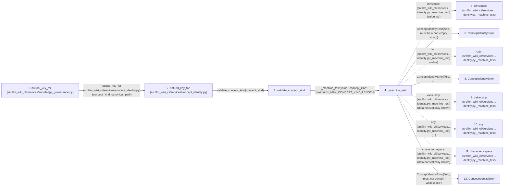

# natural_key_for

**Entry point:** `natural_key_for` (`api`)
**Source:** [knowledge_governance](../modules/knowledge_governance.md)
**Modules touched:** [concept_identity](../modules/concept_identity.md), [knowledge_governance](../modules/knowledge_governance.md), [validation](../modules/validation.md)

## Call sequence

> Static overview in presentation order, not runtime execution order. Arrows retain captured callers; siblings are shown before deeper helper detail.

```mermaid
sequenceDiagram
    participant p0 as natural_key_for (src/llm_wiki_cli/services/knowledge_governance.py)
    participant p1 as natural_key_for (src/llm_wiki_cli/services/concept_identity.py)
    participant p2 as GovernanceError
    participant p3 as validate_concept_kind
    participant p4 as require_repository_relative_path
    participant p5 as ConceptIdentityError
    participant p6 as validate_natural_key
    participant p7 as _machine_text
    participant p8 as isinstance (src/llm_wiki_cli/services…_repository_relative_path)
    participant p9 as _QUALIFIED_KIND_RE.fullmatch
    participant p10 as _syntax_key
    participant p11 as text.partition
    participant p12 as _known_syntax
    participant p13 as _NATURAL_KEY_PREFIX_RE.fullmatch
    participant p14 as value.strip (src/llm_wiki_cli/services…_repository_relative_path)
    participant p15 as _NATURAL_KEY_PAYLOAD_RE.fullmatch
    participant p16 as any (src/llm_wiki_cli/services…_repository_relative_path)
    participant p17 as ord (src/llm_wiki_cli/services…_repository_relative_path)
    participant p18 as _INVALID_PERCENT_RE.search
    participant p19 as value.startswith (src/llm_wiki_cli/services…_repository_relative_path)
    participant p20 as _PERCENT_ESCAPE_RE.finditer
    participant p21 as match.group
    p0->>p1: natural_key_for (src/llm_wiki_cli/services/concept_identity.py)
    p0->>p2: GovernanceError
    p1->>p3: validate_concept_kind
    p1->>p4: require_repository_relative_path
    p1->>p5: ConceptIdentityError
    p1->>p5: ConceptIdentityError
    p1->>p5: ConceptIdentityError
    p1->>p5: ConceptIdentityError
    p1->>p6: validate_natural_key
    p3->>p7: _machine_text
    p4-->>p8: isinstance (src/llm_wiki_cli/services…_repository_relative_path)(value, str)
    p6->>p7: _machine_text
    p3-->>p9: _QUALIFIED_KIND_RE.fullmatch(text)
    p4->>p10: _syntax_key
    p6-->>p11: text.partition(':')
    p3->>p5: ConceptIdentityError
    p4->>p12: _known_syntax
    p6-->>p13: _NATURAL_KEY_PREFIX_RE.fullmatch(prefix)
    p4-->>p14: value.strip (src/llm_wiki_cli/services…_repository_relative_path)
    p6-->>p15: _NATURAL_KEY_PAYLOAD_RE.fullmatch(payload)
    p4-->>p16: any (src/llm_wiki_cli/services…_repository_relative_path)(...)
    p6->>p5: ConceptIdentityError
    p4-->>p17: ord (src/llm_wiki_cli/services…_repository_relative_path)(character)
    p6-->>p18: _INVALID_PERCENT_RE.search(payload)
    p4-->>p17: ord (src/llm_wiki_cli/services…_repository_relative_path)(character)
    p6->>p5: ConceptIdentityError
    p4-->>p19: value.startswith (src/llm_wiki_cli/services…_repository_relative_path)('/')
    p6-->>p20: _PERCENT_ESCAPE_RE.finditer(payload)
    p4-->>p19: value.startswith (src/llm_wiki_cli/services…_repository_relative_path)('\\')
    p6-->>p21: match.group(1)
```

<!-- Auto-generated from static call edges. Dashed arrows are external or unresolved calls. Reviewed runtime conditions and side effects belong in Behavior. -->

> Call sequence diagram shows 30 of 145 interactions; 115 omitted to keep the visualization within the 30-interaction and generated-diagram limits, with uncertain identities omitted rather than inferred.

> Captured boundary calls: external 4 of 38 (34 omitted); unresolved 10 of 48 (38 omitted). These counts cover the captured static trace.

Omitted captured detail, grouped by actual caller occurrence and target module:

| Caller | Parent step | Target module | Kind | Omitted interactions |
| --- | --- | --- | --- | --- |
| `src/llm_wiki_cli/services/concept_identity.py:_machine_text` | 4 | - | external | 6 |
| `src/llm_wiki_cli/services/concept_identity.py:_machine_text` | 4 | [src/llm_wiki_cli/services/concept_identity.py](../modules/concept_identity.md) | internal | 5 |
| `src/llm_wiki_cli/services/concept_identity.py:_machine_text` | 4 | - | unresolved | 3 |
| `src/llm_wiki_cli/services/validation.py:_syntax_key` | 23 | - | external | 6 |
| `src/llm_wiki_cli/services/validation.py:_known_syntax` | 30 | - | unresolved | 2 |
| `src/llm_wiki_cli/services/validation.py:require_repository_relative_path` | 21 | - | unresolved | 2 |
| `src/llm_wiki_cli/services/validation.py:require_repository_relative_path` | 21 | - | external | 3 |
| `src/llm_wiki_cli/services/validation.py:require_repository_relative_path` | 21 | [src/llm_wiki_cli/services/validation.py](../modules/validation.md) | internal | 2 |
> Omission summary shows 8 of 31 groups; 23 further groups are not expanded here. Counts above include all omitted interactions.
> Detailed flow queries retain their own coverage and limits; omitted paths may execute at runtime.

## Data flow

<!-- Auto-generated static analysis. Treat values and boundaries as best-effort hints, not runtime proof. -->

### Step data

| Step | Inputs | Reads | Writes | Returns |
|---|---|---|---|---|
| `natural_key_for (src/llm_wiki_cli/services/knowledge_governance.py)` | `concept_kind: str`, `canonical_path: str` | `ConceptIdentityError` | - | `_identity_natural_key_for(...)` |
| `natural_key_for (src/llm_wiki_cli/services/concept_identity.py)` | `concept_kind: str`, `canonical_path: str` | - | - | `validate_natural_key(...)` |
| `validate_concept_kind` | `value: object` | `_MAX_CONCEPT_KIND_LENGTH`, `_UID_TAG_BY_KIND` | - | `text` |
| `_machine_text` | `value: object`, `field: str`, `maximum: int` | - | - | `value` |
| `isinstance (src/llm_wiki_cli/services…identity.py:_machine_text)` | - | - | - | - |
| `ConceptIdentityError` | - | - | - | - |
| `len (src/llm_wiki_cli/services…identity.py:_machine_text)` | - | - | - | - |
| `ConceptIdentityError` | - | - | - | - |
| `value.strip (src/llm_wiki_cli/services…identity.py:_machine_text)` | - | - | - | - |
| `any (src/llm_wiki_cli/services…identity.py:_machine_text)` | - | - | - | - |
| `character.isspace (src/llm_wiki_cli/services…identity.py:_machine_text)` | - | - | - | - |
| `ConceptIdentityError` | - | - | - | - |

### Call data

| From | To | Line | Call |
|---|---|---:|---|
| natural_key_for (src/llm_wiki_cli/services/knowledge_governance.py) | natural_key_for (src/llm_wiki_cli/services/concept_identity.py) | 396 | `_identity_natural_key_for(concept_kind, canonical_path)` |
| natural_key_for (src/llm_wiki_cli/services/concept_identity.py) | validate_concept_kind | 327 | `validate_concept_kind(concept_kind)` |
| validate_concept_kind | _machine_text | 306 | `_machine_text(value, 'concept_kind', maximum=_MAX_CONCEPT_KIND_LENGTH)` |
| _machine_text | isinstance (src/llm_wiki_cli/services…identity.py:_machine_text) | 942 | `isinstance(value, str)` |
| _machine_text | ConceptIdentityError | 943 | `ConceptIdentityError(field, 'must be a non-empty string')` |
| _machine_text | len (src/llm_wiki_cli/services…identity.py:_machine_text) | 944 | `len(value)` |
| _machine_text | ConceptIdentityError | 945 | `ConceptIdentityError(field, ...)` |
| _machine_text | value.strip (src/llm_wiki_cli/services…identity.py:_machine_text) | 946 | `value.strip(data not statically known)` |
| _machine_text | any (src/llm_wiki_cli/services…identity.py:_machine_text) | 946 | `any(...)` |
| _machine_text | character.isspace (src/llm_wiki_cli/services…identity.py:_machine_text) | 946 | `character.isspace(data not statically known)` |
| _machine_text | ConceptIdentityError | 947 | `ConceptIdentityError(field, 'must not contain whitespace')` |

### Boundary effects

*No boundary effects detected.*

### Static analysis gaps

| Kind | Step | Target | Line |
|---|---|---|---:|
| external_call | `_machine_text` | `isinstance` | 942 |
| unresolved_call | `_machine_text` | `value.strip` | 946 |
| external_call | `_machine_text` | `any` | 946 |
| unresolved_call | `_machine_text` | `character.isspace` | 946 |
| step_limit | `natural_key_for` | `first 12 steps` | 0 |

## Behavior

This flow starts at `natural_key_for` and is classified as `api`. The generated call and data-flow sections are bounded static projections; runtime conditions and side effects require source-level confirmation.
