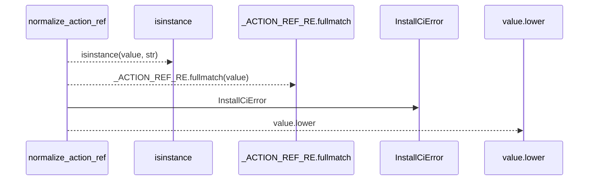
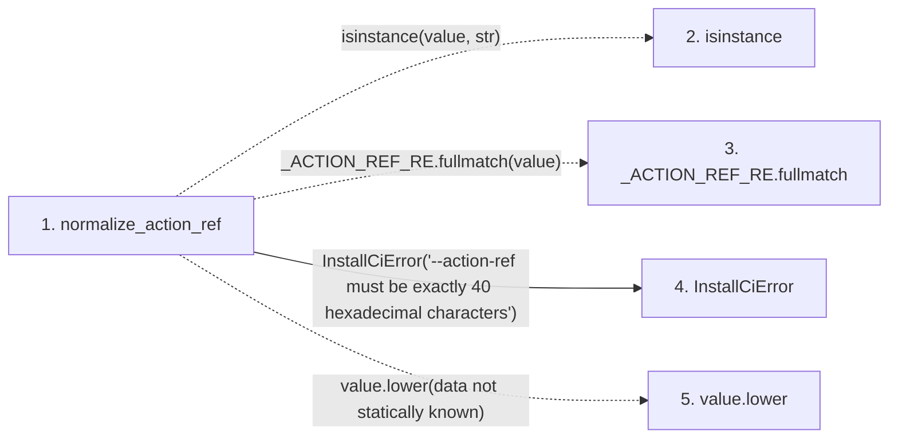

# normalize_action_ref

**Entry point:** `normalize_action_ref` (`api`)
**Source:** [ci_installer](../modules/ci_installer.md)
**Modules touched:** [ci_installer](../modules/ci_installer.md)

## Call sequence

> Static overview in presentation order, not runtime execution order. Arrows retain captured callers; representative internal continuations and boundary examples precede repeated helper detail.

<!-- Auto-generated from static call edges. Dashed arrows are external or unresolved calls. Reviewed runtime conditions and side effects belong in Behavior. -->

> Call sequence diagram shows 4 of 4 interactions; 0 omitted to keep the visualization within the 30-interaction and generated-diagram limits, with uncertain identities omitted rather than inferred.

> Captured boundary calls: external 1 of 1 (0 omitted); unresolved 2 of 2 (0 omitted). These counts cover the captured static trace.
> Detailed flow queries retain their own coverage and limits; omitted paths may execute at runtime.

## Data flow

<!-- Auto-generated static analysis. Treat values and boundaries as best-effort hints, not runtime proof. -->

### Analysis coverage

**Effect analysis partially available.** Flow assembly and source effect analysis are separate; empty observations do not prove an empty handler body.

Source steps: 2; effect analysis evaluated: 1, partial: 0, unavailable: 1. Counts include steps omitted from the displayed trace.

Collector observations for 1 source steps with known totals: observed: 2, emitted: 2, omitted: 0. Unavailable totals are excluded.

- Callable record unavailable; the selected entry symbol has no represented callable body.
- Effect collector totals unavailable; observed counts cover captured records only.

| Step | Callable record | Effect analysis | Collector totals | Observed | Emitted | Omitted |
|---|---|---|---|---:|---:|---:|
| `normalize_action_ref` | `available` | `evaluated` | `available` | `2` | `2` | `0` |
| `isinstance` | `not_applicable` | `not_applicable` | `not_applicable` | — | — | — |
| `_ACTION_REF_RE.fullmatch` | `not_applicable` | `not_applicable` | `not_applicable` | — | — | — |
| `InstallCiError` | `unavailable` | `unavailable` | `unavailable` | — | — | — |
| `value.lower` | `not_applicable` | `not_applicable` | `not_applicable` | — | — | — |

### Step data

| Step | Inputs | Reads | Writes | Returns |
|---|---|---|---|---|
| `normalize_action_ref` | `value: object` | - | - | `value.lower(...)` |
| `isinstance` | - | - | - | - |
| `_ACTION_REF_RE.fullmatch` | - | - | - | - |
| `InstallCiError` | - | - | - | - |
| `value.lower` | - | - | - | - |

### Call data

| From | To | Line | Call |
|---|---|---:|---|
| normalize_action_ref | isinstance | 63 | `isinstance(value, str)` |
| normalize_action_ref | _ACTION_REF_RE.fullmatch | 63 | `_ACTION_REF_RE.fullmatch(value)` |
| normalize_action_ref | InstallCiError | 64 | `InstallCiError('--action-ref must be exactly 40 hexadecimal characters')` |
| normalize_action_ref | value.lower | 65 | `value.lower(data not statically known)` |

### Boundary effects

*No boundary-effect observations were captured in this static trace.*

### Static analysis gaps

| Kind | Step | Target | Line |
|---|---|---|---:|
| external_call | `normalize_action_ref` | `isinstance` | 63 |
| unresolved_call | `normalize_action_ref` | `_ACTION_REF_RE.fullmatch` | 63 |
| unresolved_call | `normalize_action_ref` | `value.lower` | 65 |

## Behavior

This flow starts at `normalize_action_ref` and is classified as `api`. The generated call and data-flow sections are bounded static projections; runtime conditions and side effects require source-level confirmation.
