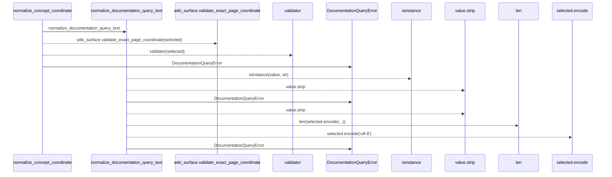
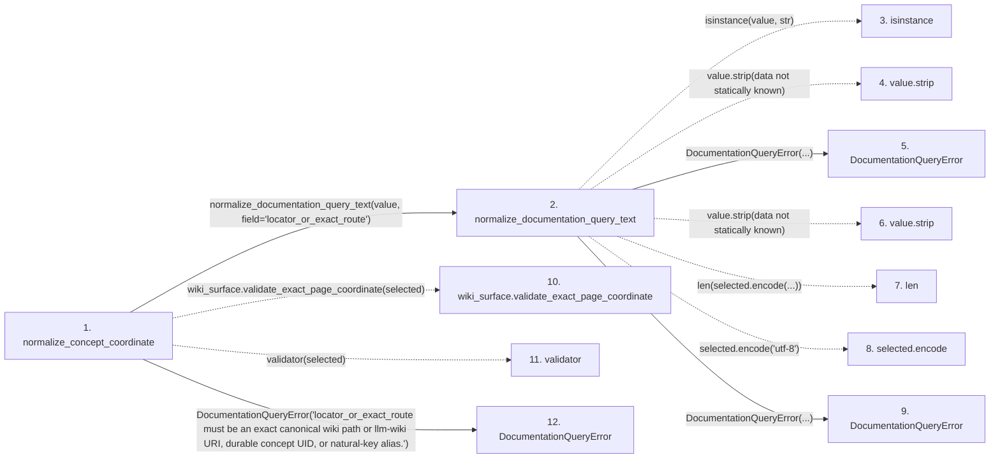

# normalize_concept_coordinate

**Entry point:** `normalize_concept_coordinate` (`api`)
**Source:** [query_request_format](../modules/query_request_format.md)
**Modules touched:** [query_request_format](../modules/query_request_format.md)

## Call sequence

> Static overview in presentation order, not runtime execution order. Arrows retain captured callers; representative internal continuations and boundary examples precede repeated helper detail.

<!-- Auto-generated from static call edges. Dashed arrows are external or unresolved calls. Reviewed runtime conditions and side effects belong in Behavior. -->

> Call sequence diagram shows 11 of 11 interactions; 0 omitted to keep the visualization within the 30-interaction and generated-diagram limits, with uncertain identities omitted rather than inferred.

> Captured boundary calls: external 2 of 2 (0 omitted); unresolved 5 of 5 (0 omitted). These counts cover the captured static trace.
> Detailed flow queries retain their own coverage and limits; omitted paths may execute at runtime.

## Data flow

<!-- Auto-generated static analysis. Treat values and boundaries as best-effort hints, not runtime proof. -->

### Analysis coverage

**Effect analysis partially available.** Flow assembly and source effect analysis are separate; empty observations do not prove an empty handler body.

Source steps: 5; effect analysis evaluated: 2, partial: 0, unavailable: 3. Counts include steps omitted from the displayed trace.

Collector observations for 2 source steps with known totals: observed: 12, emitted: 12, omitted: 0. Unavailable totals are excluded.

- Callable record unavailable for one or more source steps; those steps have no represented callable body.
- Effect collector totals unavailable; observed counts cover captured records only.

| Step | Callable record | Effect analysis | Collector totals | Observed | Emitted | Omitted |
|---|---|---|---|---:|---:|---:|
| `normalize_concept_coordinate` | `available` | `evaluated` | `available` | `7` | `7` | `0` |
| `normalize_documentation_query_text` | `available` | `evaluated` | `available` | `5` | `5` | `0` |
| `isinstance` | `not_applicable` | `not_applicable` | `not_applicable` | — | — | — |
| `value.strip` | `not_applicable` | `not_applicable` | `not_applicable` | — | — | — |
| `DocumentationQueryError` | `unavailable` | `unavailable` | `unavailable` | — | — | — |
| `value.strip` | `not_applicable` | `not_applicable` | `not_applicable` | — | — | — |
| `len` | `not_applicable` | `not_applicable` | `not_applicable` | — | — | — |
| `selected.encode` | `not_applicable` | `not_applicable` | `not_applicable` | — | — | — |
| `DocumentationQueryError` | `unavailable` | `unavailable` | `unavailable` | — | — | — |
| `wiki_surface.validate_exact_page_coordinate` | `not_applicable` | `not_applicable` | `not_applicable` | — | — | — |
| `validator` | `not_applicable` | `not_applicable` | `not_applicable` | — | — | — |
| `DocumentationQueryError` | `unavailable` | `unavailable` | `unavailable` | — | — | — |

### Step data

| Step | Inputs | Reads | Writes | Returns |
|---|---|---|---|---|
| `normalize_concept_coordinate` | `value: object` | `wiki_surface`, `validate_concept_uid`, `validate_natural_key`, `ConceptIdentityError` | - | `wiki_surface.validate_exact_page_coordinate(...)`, `validator(...)` |
| `normalize_documentation_query_text` | `value: object`, `field: str` | `QUERY_IDENTITY_BYTE_LIMIT`, `QUERY_IDENTITY_BYTE_LIMIT` | - | `selected` |
| `isinstance` | - | - | - | - |
| `value.strip` | - | - | - | - |
| `DocumentationQueryError` | - | - | - | - |
| `value.strip` | - | - | - | - |
| `len` | - | - | - | - |
| `selected.encode` | - | - | - | - |
| `DocumentationQueryError` | - | - | - | - |
| `wiki_surface.validate_exact_page_coordinate` | - | - | - | - |
| `validator` | - | - | - | - |
| `DocumentationQueryError` | - | - | - | - |

### Call data

| From | To | Line | Call |
|---|---|---:|---|
| normalize_concept_coordinate | normalize_documentation_query_text | 62 | `normalize_documentation_query_text(value, field='locator_or_exact_route')` |
| normalize_documentation_query_text | isinstance | 49 | `isinstance(value, str)` |
| normalize_documentation_query_text | value.strip | 49 | `value.strip(data not statically known)` |
| normalize_documentation_query_text | DocumentationQueryError | 50 | `DocumentationQueryError(...)` |
| normalize_documentation_query_text | value.strip | 51 | `value.strip(data not statically known)` |
| normalize_documentation_query_text | len | 52 | `len(selected.encode(...))` |
| normalize_documentation_query_text | selected.encode | 52 | `selected.encode('utf-8')` |
| normalize_documentation_query_text | DocumentationQueryError | 53 | `DocumentationQueryError(...)` |
| normalize_concept_coordinate | wiki_surface.validate_exact_page_coordinate | 67 | `wiki_surface.validate_exact_page_coordinate(selected)` |
| normalize_concept_coordinate | validator | 72 | `validator(selected)` |
| normalize_concept_coordinate | DocumentationQueryError | 75 | `DocumentationQueryError('locator_or_exact_route must be an exact canonical wiki path or llm-wiki URI, durable concept UID, or natural-key alias.')` |

### Boundary effects

*No boundary-effect observations were captured in this static trace.*

### Static analysis gaps

| Kind | Step | Target | Line |
|---|---|---|---:|
| external_call | `normalize_documentation_query_text` | `isinstance` | 49 |
| unresolved_call | `normalize_documentation_query_text` | `value.strip` | 49 |
| unresolved_call | `normalize_documentation_query_text` | `value.strip` | 51 |
| unresolved_call | `normalize_documentation_query_text` | `selected.encode` | 52 |
| unresolved_call | `normalize_concept_coordinate` | `wiki_surface.validate_exact_page_coordinate` | 67 |
| unresolved_call | `normalize_concept_coordinate` | `validator` | 72 |

## Behavior

This flow starts at `normalize_concept_coordinate` and is classified as `api`. The generated call and data-flow sections are bounded static projections; runtime conditions and side effects require source-level confirmation.
