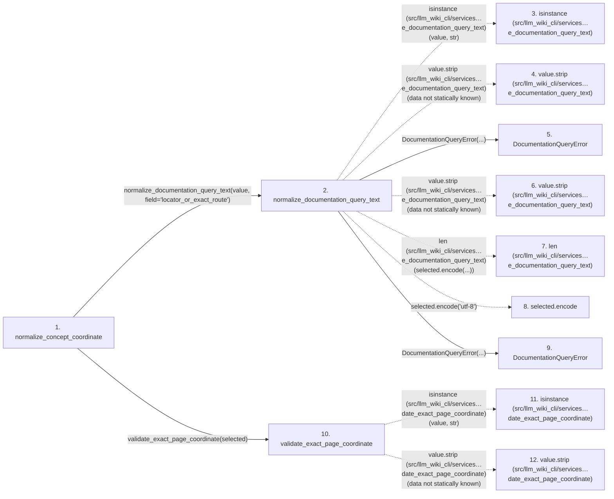

# normalize_concept_coordinate

**Entry point:** `normalize_concept_coordinate` (`api`)
**Source:** [documentation_query_builder](../modules/documentation_query_builder.md)
**Modules touched:** [documentation_queries](../modules/documentation_queries.md), [documentation_query_builder](../modules/documentation_query_builder.md), [validation](../modules/validation.md), [wiki_surface](../modules/wiki_surface.md)

## Call sequence

> Static overview in presentation order, not runtime execution order. Arrows retain captured callers; siblings are shown before deeper helper detail.

```mermaid
sequenceDiagram
    participant p0 as normalize_concept_coordinate
    participant p1 as normalize_documentation_query_text
    participant p2 as validate_exact_page_coordinate
    participant p3 as validator
    participant p4 as DocumentationQueryError
    participant p5 as isinstance (src/llm_wiki_cli/services…e_documentation_query_text)
    participant p6 as isinstance (src/llm_wiki_cli/services…date_exact_page_coordinate)
    participant p7 as value.strip (src/llm_wiki_cli/services…e_documentation_query_text)
    participant p8 as value.strip (src/llm_wiki_cli/services…date_exact_page_coordinate)
    participant p9 as WikiSurfaceError
    participant p10 as len (src/llm_wiki_cli/services…e_documentation_query_text)
    participant p11 as any (src/llm_wiki_cli/services…date_exact_page_coordinate)
    participant p12 as selected.encode
    participant p13 as ord (src/llm_wiki_cli/services…date_exact_page_coordinate)
    participant p14 as _matches_directory_path
    participant p15 as _matches_directory_uri
    participant p16 as canonical_path
    participant p17 as mcp_uri
    participant p18 as coordinate.startswith (src/llm_wiki_cli/services…py:_matches_directory_path)
    participant p19 as coordinate.startswith (src/llm_wiki_cli/services….py:_matches_directory_uri)
    participant p20 as coordinate.endswith
    participant p21 as len (src/llm_wiki_cli/services….py:_matches_directory_uri)
    participant p22 as len (src/llm_wiki_cli/services…py:_matches_directory_path)
    participant p23 as re.search
    p0->>p1: normalize_documentation_query_text
    p0->>p2: validate_exact_page_coordinate
    p0-->>p3: validator(selected)
    p0->>p4: DocumentationQueryError
    p1-->>p5: isinstance (src/llm_wiki_cli/services…e_documentation_query_text)(value, str)
    p2-->>p6: isinstance (src/llm_wiki_cli/services…date_exact_page_coordinate)(value, str)
    p1-->>p7: value.strip (src/llm_wiki_cli/services…e_documentation_query_text)
    p2-->>p8: value.strip (src/llm_wiki_cli/services…date_exact_page_coordinate)
    p1->>p4: DocumentationQueryError
    p2->>p9: WikiSurfaceError
    p1-->>p7: value.strip (src/llm_wiki_cli/services…e_documentation_query_text)
    p2-->>p8: value.strip (src/llm_wiki_cli/services…date_exact_page_coordinate)
    p1-->>p10: len (src/llm_wiki_cli/services…e_documentation_query_text)(selected.encode(...))
    p2-->>p11: any (src/llm_wiki_cli/services…date_exact_page_coordinate)(...)
    p1-->>p12: selected.encode('utf-8')
    p2-->>p13: ord (src/llm_wiki_cli/services…date_exact_page_coordinate)(character)
    p1->>p4: DocumentationQueryError
    p2-->>p13: ord (src/llm_wiki_cli/services…date_exact_page_coordinate)(character)
    p2->>p9: WikiSurfaceError
    p2->>p14: _matches_directory_path
    p2->>p15: _matches_directory_uri
    p2->>p16: canonical_path
    p2->>p17: mcp_uri
    p2->>p9: WikiSurfaceError
    p14-->>p18: coordinate.startswith (src/llm_wiki_cli/services…py:_matches_directory_path)(prefix)
    p15-->>p19: coordinate.startswith (src/llm_wiki_cli/services….py:_matches_directory_uri)(prefix)
    p14-->>p20: coordinate.endswith('.md')
    p15-->>p21: len (src/llm_wiki_cli/services….py:_matches_directory_uri)(prefix)
    p14-->>p22: len (src/llm_wiki_cli/services…py:_matches_directory_path)(prefix)
    p15-->>p23: re.search(' (?![0-9A-Fa-f]{2})', encoded_page_id)
```

<!-- Auto-generated from static call edges. Dashed arrows are external or unresolved calls. Reviewed runtime conditions and side effects belong in Behavior. -->

> Call sequence diagram shows 30 of 74 interactions; 44 omitted to keep the visualization within the 30-interaction and generated-diagram limits, with uncertain identities omitted rather than inferred.

> Captured boundary calls: external 9 of 23 (14 omitted); unresolved 9 of 16 (7 omitted). These counts cover the captured static trace.

Omitted captured detail, grouped by actual caller occurrence and target module:

| Caller | Parent step | Target module | Kind | Omitted interactions |
| --- | --- | --- | --- | --- |
| `src/llm_wiki_cli/services/wiki_surface.py:_matches_directory_path` | 19 | - | external | 2 |
| `src/llm_wiki_cli/services/wiki_surface.py:_matches_directory_path` | 19 | [src/llm_wiki_cli/services/wiki_surface.py](../modules/wiki_surface.md) | internal | 2 |
| `src/llm_wiki_cli/services/wiki_surface.py:is_safe_page_id` | 25 | - | external | 3 |
| `src/llm_wiki_cli/services/wiki_surface.py:is_safe_page_id` | 25 | - | unresolved | 2 |
| `src/llm_wiki_cli/services/wiki_surface.py:is_safe_page_id` | 25 | [src/llm_wiki_cli/services/validation.py](../modules/validation.md) | internal | 1 |
| `src/llm_wiki_cli/services/validation.py:is_portable_path_component` | 31 | [src/llm_wiki_cli/services/validation.py](../modules/validation.md) | internal | 1 |
| `src/llm_wiki_cli/services/validation.py:require_portable_path_component` | 32 | - | unresolved | 4 |
| `src/llm_wiki_cli/services/validation.py:require_portable_path_component` | 32 | [src/llm_wiki_cli/services/validation.py](../modules/validation.md) | internal | 5 |
> Omission summary shows 8 of 18 groups; 10 further groups are not expanded here. Counts above include all omitted interactions.
> Detailed flow queries retain their own coverage and limits; omitted paths may execute at runtime.

## Data flow

<!-- Auto-generated static analysis. Treat values and boundaries as best-effort hints, not runtime proof. -->

### Step data

| Step | Inputs | Reads | Writes | Returns |
|---|---|---|---|---|
| `normalize_concept_coordinate` | `value: object` | `wiki_surface`, `validate_concept_uid`, `validate_natural_key`, `ConceptIdentityError` | - | `wiki_surface.validate_exact_page_coordinate(...)`, `validator(...)` |
| `normalize_documentation_query_text` | `value: object`, `field: str` | `QUERY_IDENTITY_BYTE_LIMIT`, `QUERY_IDENTITY_BYTE_LIMIT` | - | `selected` |
| `isinstance (src/llm_wiki_cli/services…e_documentation_query_text)` | - | - | - | - |
| `value.strip (src/llm_wiki_cli/services…e_documentation_query_text)` | - | - | - | - |
| `DocumentationQueryError` | - | - | - | - |
| `value.strip (src/llm_wiki_cli/services…e_documentation_query_text)` | - | - | - | - |
| `len (src/llm_wiki_cli/services…e_documentation_query_text)` | - | - | - | - |
| `selected.encode` | - | - | - | - |
| `DocumentationQueryError` | - | - | - | - |
| `validate_exact_page_coordinate` | `value: object` | `_PAGE_KINDS` | - | `coordinate`, `coordinate` |
| `isinstance (src/llm_wiki_cli/services…date_exact_page_coordinate)` | - | - | - | - |
| `value.strip (src/llm_wiki_cli/services…date_exact_page_coordinate)` | - | - | - | - |

### Call data

| From | To | Line | Call |
|---|---|---:|---|
| normalize_concept_coordinate | normalize_documentation_query_text | 77 | `normalize_documentation_query_text(value, field='locator_or_exact_route')` |
| normalize_documentation_query_text | isinstance (src/llm_wiki_cli/services…e_documentation_query_text) | 64 | `isinstance(value, str)` |
| normalize_documentation_query_text | value.strip (src/llm_wiki_cli/services…e_documentation_query_text) | 64 | `value.strip(data not statically known)` |
| normalize_documentation_query_text | DocumentationQueryError | 65 | `DocumentationQueryError(...)` |
| normalize_documentation_query_text | value.strip (src/llm_wiki_cli/services…e_documentation_query_text) | 66 | `value.strip(data not statically known)` |
| normalize_documentation_query_text | len (src/llm_wiki_cli/services…e_documentation_query_text) | 67 | `len(selected.encode(...))` |
| normalize_documentation_query_text | selected.encode | 67 | `selected.encode('utf-8')` |
| normalize_documentation_query_text | DocumentationQueryError | 68 | `DocumentationQueryError(...)` |
| normalize_concept_coordinate | validate_exact_page_coordinate | 82 | `wiki_surface.validate_exact_page_coordinate(selected)` |
| validate_exact_page_coordinate | isinstance (src/llm_wiki_cli/services…date_exact_page_coordinate) | 263 | `isinstance(value, str)` |
| validate_exact_page_coordinate | value.strip (src/llm_wiki_cli/services…date_exact_page_coordinate) | 263 | `value.strip(data not statically known)` |

### Boundary effects

*No boundary effects detected.*

### Static analysis gaps

| Kind | Step | Target | Line |
|---|---|---|---:|
| external_call | `normalize_documentation_query_text` | `isinstance` | 64 |
| unresolved_call | `normalize_documentation_query_text` | `value.strip` | 64 |
| unresolved_call | `normalize_documentation_query_text` | `value.strip` | 66 |
| unresolved_call | `normalize_documentation_query_text` | `selected.encode` | 67 |
| external_call | `validate_exact_page_coordinate` | `isinstance` | 263 |
| unresolved_call | `validate_exact_page_coordinate` | `value.strip` | 263 |
| step_limit | `normalize_concept_coordinate` | `first 12 steps` | 0 |

## Behavior

This flow starts at `normalize_concept_coordinate` and is classified as `api`. The generated call and data-flow sections are bounded static projections; runtime conditions and side effects require source-level confirmation.
