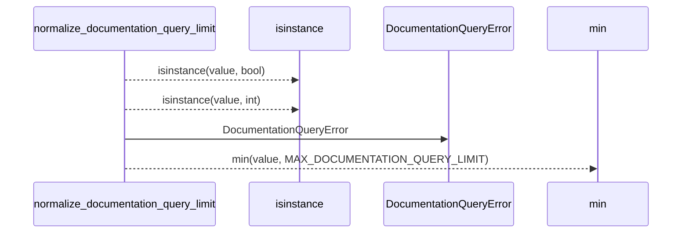
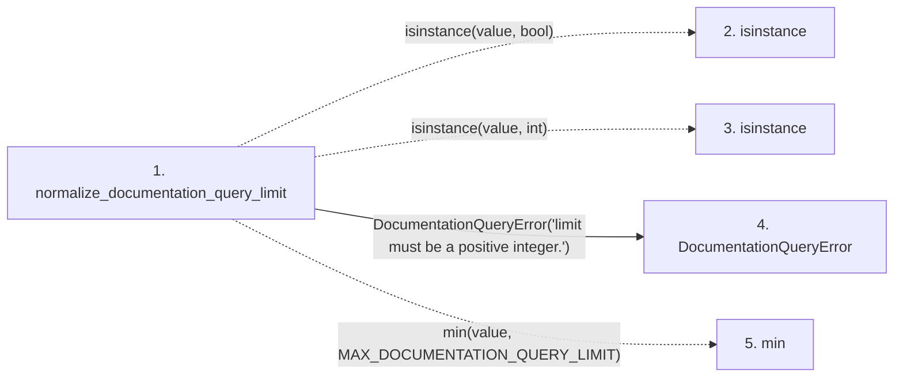

# normalize_documentation_query_limit

**Entry point:** `normalize_documentation_query_limit` (`api`)
**Source:** [documentation_query_builder](../modules/documentation_query_builder.md)
**Modules touched:** [documentation_queries](../modules/documentation_queries.md), [documentation_query_builder](../modules/documentation_query_builder.md)

## Call sequence

> Static overview in presentation order, not runtime execution order. Arrows retain captured callers; representative internal continuations and boundary examples precede repeated helper detail.

<!-- Auto-generated from static call edges. Dashed arrows are external or unresolved calls. Reviewed runtime conditions and side effects belong in Behavior. -->

> Call sequence diagram shows 4 of 4 interactions; 0 omitted to keep the visualization within the 30-interaction and generated-diagram limits, with uncertain identities omitted rather than inferred.

> Captured boundary calls: external 3 of 3 (0 omitted); unresolved 0 of 0 (0 omitted). These counts cover the captured static trace.
> Detailed flow queries retain their own coverage and limits; omitted paths may execute at runtime.

## Data flow

<!-- Auto-generated static analysis. Treat values and boundaries as best-effort hints, not runtime proof. -->

### Analysis coverage

**Effect analysis partially available.** Flow assembly and source effect analysis are separate; empty observations do not prove an empty handler body.

Source steps: 2; effect analysis evaluated: 1, partial: 0, unavailable: 1. Counts include steps omitted from the displayed trace.

- Callable record unavailable; the selected entry symbol has no represented callable body.
- Effect collector totals unavailable; observed counts cover captured records only.

| Step | Callable record | Effect analysis | Collector totals |
|---|---|---|---|
| `normalize_documentation_query_limit` | `available` | `evaluated` | `available` |
| `isinstance` | `not_applicable` | `not_applicable` | `not_applicable` |
| `isinstance` | `not_applicable` | `not_applicable` | `not_applicable` |
| `DocumentationQueryError` | `unavailable` | `unavailable` | `unavailable` |
| `min` | `not_applicable` | `not_applicable` | `not_applicable` |

### Step data

| Step | Inputs | Reads | Writes | Returns |
|---|---|---|---|---|
| `normalize_documentation_query_limit` | `value: object` | `MAX_DOCUMENTATION_QUERY_LIMIT` | - | `min(...)` |
| `isinstance` | - | - | - | - |
| `isinstance` | - | - | - | - |
| `DocumentationQueryError` | - | - | - | - |
| `min` | - | - | - | - |

### Call data

| From | To | Line | Call |
|---|---|---:|---|
| normalize_documentation_query_limit | isinstance | 57 | `isinstance(value, bool)` |
| normalize_documentation_query_limit | isinstance | 57 | `isinstance(value, int)` |
| normalize_documentation_query_limit | DocumentationQueryError | 58 | `DocumentationQueryError('limit must be a positive integer.')` |
| normalize_documentation_query_limit | min | 59 | `min(value, MAX_DOCUMENTATION_QUERY_LIMIT)` |

### Boundary effects

*No boundary-effect observations were captured in this static trace.*

### Static analysis gaps

| Kind | Step | Target | Line |
|---|---|---|---:|
| external_call | `normalize_documentation_query_limit` | `isinstance` | 57 |
| external_call | `normalize_documentation_query_limit` | `min` | 59 |

## Behavior

This flow starts at `normalize_documentation_query_limit` and is classified as `api`. The generated call and data-flow sections are bounded static projections; runtime conditions and side effects require source-level confirmation.
