# normalize_entity_observation

**Entry point:** `normalize_entity_observation` (`api`)
**Source:** [knowledge_evidence](../modules/knowledge_evidence.md)
**Modules touched:** [knowledge_evidence](../modules/knowledge_evidence.md), [validation](../modules/validation.md)

## Call sequence

> Static overview in presentation order, not runtime execution order. Arrows retain captured callers; representative internal continuations and boundary examples precede repeated helper detail.

```mermaid
sequenceDiagram
    participant p0 as normalize_entity_observation
    participant p1 as _validate_entity_coordinate
    participant p2 as _normalize_entity_observation
    participant p3 as require_nonempty_text
    participant p4 as _inventory_language
    participant p5 as require_positive_int
    participant p6 as _record_array
    participant p7 as _record_name
    participant p8 as _validate_entity_record
    participant p9 as _structural_copy
    participant p10 as require_nonnegative_int
    participant p11 as _validate_module_entity_record
    participant p12 as _failure
    participant p13 as _optional_record_array
    participant p14 as _validate_optional_json_array
    participant p15 as _validate_optional_mapping
    participant p16 as _validate_optional_record_array
    participant p17 as _validate_callable_record
    participant p18 as _validate_optional_strings
    participant p19 as _validate_optional_booleans
    participant p20 as _record_object
    participant p21 as _validate_optional_string_array
    participant p22 as _validate_string_array
    participant p23 as _pointer
    participant p24 as contains_control_character
    participant p25 as require_int
    participant p26 as _InventoryNormalizationError
    participant p27 as require_list
    participant p28 as require_mapping
    participant p29 as ValueError
    participant p30 as record.get (src/llm_wiki_cli/services…_evidence.py:_record_name)
    p0->>p1: _validate_entity_coordinate
    p0->>p2: _normalize_entity_observation
    p1->>p3: require_nonempty_text
    p2->>p4: _inventory_language
    p1->>p5: require_positive_int
    p2->>p6: _record_array
    p2->>p7: _record_name
    p2->>p8: _validate_entity_record
    p2->>p9: _structural_copy
    p5->>p10: require_nonnegative_int
    p8->>p11: _validate_module_entity_record
    p4->>p12: _failure
    p6->>p13: _optional_record_array
    p8->>p14: _validate_optional_json_array
    p8->>p15: _validate_optional_mapping
    p8->>p16: _validate_optional_record_array
    p8->>p17: _validate_callable_record
    p11->>p18: _validate_optional_strings
    p11->>p19: _validate_optional_booleans
    p13->>p20: _record_object
    p11->>p21: _validate_optional_string_array
    p21->>p22: _validate_string_array
    p6->>p23: _pointer
    p3->>p24: contains_control_character
    p10->>p25: require_int
    p12->>p26: _InventoryNormalizationError
    p14->>p27: require_list
    p15->>p28: require_mapping
    p1-->>p29: ValueError('entity_name must be a non-empty string')
    p7-->>p30: record.get (src/llm_wiki_cli/services…_evidence.py:_record_name)('name', MISSING_VALUE)
```

<!-- Auto-generated from static call edges. Dashed arrows are external or unresolved calls. Reviewed runtime conditions and side effects belong in Behavior. -->

> Call sequence diagram shows 30 of 196 interactions; 166 omitted to keep the visualization within the 30-interaction and generated-diagram limits, with uncertain identities omitted rather than inferred.

> Captured boundary calls: external 1 of 41 (40 omitted); unresolved 1 of 31 (30 omitted). These counts cover the captured static trace.

Omitted captured detail, grouped by actual caller occurrence and target module:

| Caller | Parent step | Target module | Kind | Omitted interactions |
| --- | --- | --- | --- | --- |
| `src/llm_wiki_cli/services/validation.py:require_nonempty_text` | 3 | - | external | 1 |
| `src/llm_wiki_cli/services/validation.py:require_nonempty_text` | 3 | - | unresolved | 1 |
| `src/llm_wiki_cli/services/validation.py:contains_control_character` | 6 | - | unresolved | 1 |
| `src/llm_wiki_cli/services/validation.py:require_int` | 11 | - | external | 2 |
| `src/llm_wiki_cli/services/knowledge_evidence.py:_validate_entity_coordinate` | 2 | - | external | 1 |
| `src/llm_wiki_cli/services/knowledge_evidence.py:_inventory_language` | 16 | - | external | 2 |
| `src/llm_wiki_cli/services/knowledge_evidence.py:_inventory_language` | 16 | - | unresolved | 1 |
| `src/llm_wiki_cli/services/knowledge_evidence.py:_inventory_language` | 16 | [src/llm_wiki_cli/services/knowledge_evidence.py](../modules/knowledge_evidence.md) | internal | 2 |
> Omission summary shows 8 of 54 groups; 46 further groups are not expanded here. Counts above include all omitted interactions.
> Detailed flow queries retain their own coverage and limits; omitted paths may execute at runtime.

## Data flow

```mermaid
flowchart LR
    s1["1. normalize_entity_observation"]
    s2["2. _validate_entity_coordinate"]
    s3["3. require_nonempty_text"]
    s4["4. isinstance (src/llm_wiki_cli/services….py:require_nonempty_text)"]
    s5["5. value.strip"]
    s6["6. contains_control_character"]
    s7["7. pattern.search"]
    s8["8. ValueError"]
    s9["9. require_positive_int"]
    s10["10. require_nonnegative_int"]
    s11["11. require_int"]
    s12["12. isinstance (src/llm_wiki_cli/services/validation.py:require_int)"]
    s1 -->|"_validate_entity_coordinate(entity_name, occurrence)"| s2
    s2 -->|"require_nonempty_text(entity_name, error=ValueError(...), reject_control_characters=False)"| s3
    s3 -. "isinstance (src/llm_wiki_cli/services….py:require_nonempty_text)(value, str)" .-> s4
    s3 -. "value.strip(data not statically known)" .-> s5
    s3 -->|"contains_control_character(parsed, reject_delete_character=reject_delete_character)"| s6
    s6 -. "pattern.search(value)" .-> s7
    s2 -. "ValueError('entity_name must be a non-empty string')" .-> s8
    s2 -->|"require_positive_int(occurrence, invalid_error=ValueError(...))"| s9
    s9 -->|"require_nonnegative_int(value, error=invalid_error)"| s10
    s10 -->|"require_int(value, error=error)"| s11
    s11 -. "isinstance (src/llm_wiki_cli/services/validation.py:require_int)(value, bool)" .-> s12
    click s1 "../modules/knowledge_evidence.md"
    click s2 "../modules/knowledge_evidence.md"
    click s3 "../modules/validation.md"
    click s6 "../modules/validation.md"
    click s9 "../modules/validation.md"
    click s10 "../modules/validation.md"
    click s11 "../modules/validation.md"
```

<!-- Auto-generated static analysis. Treat values and boundaries as best-effort hints, not runtime proof. -->

### Analysis coverage

**Effect analysis partially available.** Flow assembly and source effect analysis are separate; empty observations do not prove an empty handler body.

Source steps: 125; effect analysis evaluated: 124, partial: 0, unavailable: 1. Counts include steps omitted from the displayed trace.

Collector observations for 124 source steps with known totals: observed: 582, emitted: 582, omitted: 0. Unavailable totals are excluded.

- Callable record unavailable for one or more source steps; those steps have no represented callable body.
- Effect collector totals unavailable; observed counts cover captured records only.

| Step | Callable record | Effect analysis | Collector totals | Observed | Emitted | Omitted |
|---|---|---|---|---:|---:|---:|
| `normalize_entity_observation` | `available` | `evaluated` | `available` | `6` | `6` | `0` |
| `_validate_entity_coordinate` | `available` | `evaluated` | `available` | `2` | `2` | `0` |
| `require_nonempty_text` | `available` | `evaluated` | `available` | `8` | `8` | `0` |
| `isinstance (src/llm_wiki_cli/services….py:require_nonempty_text)` | `not_applicable` | `not_applicable` | `not_applicable` | — | — | — |
| `value.strip` | `not_applicable` | `not_applicable` | `not_applicable` | — | — | — |
| `contains_control_character` | `available` | `evaluated` | `available` | `5` | `5` | `0` |
| `pattern.search` | `not_applicable` | `not_applicable` | `not_applicable` | — | — | — |
| `ValueError` | `not_applicable` | `not_applicable` | `not_applicable` | — | — | — |
| `require_positive_int` | `available` | `evaluated` | `available` | `4` | `4` | `0` |
| `require_nonnegative_int` | `available` | `evaluated` | `available` | `3` | `3` | `0` |
| `require_int` | `available` | `evaluated` | `available` | `3` | `3` | `0` |
| `isinstance (src/llm_wiki_cli/services/validation.py:require_int)` | `not_applicable` | `not_applicable` | `not_applicable` | — | — | — |

### Step data

| Step | Inputs | Reads | Writes | Returns |
|---|---|---|---|---|
| `normalize_entity_observation` | `file_data: Mapping[str, Any]`, `entity_name: str`, `occurrence: int` | `_InventoryNormalizationError` | - | `_normalize_entity_observation(...)`, `None` |
| `_validate_entity_coordinate` | `entity_name: object`, `occurrence: object` | - | - | - |
| `require_nonempty_text` | `value: object`, `error: Exception`, `trim_error: Exception \| None`, `normalize: bool`, `require_trimmed: bool`, `reject_control_characters: bool`, `reject_delete_character: bool` | - | - | `parsed` |
| `isinstance (src/llm_wiki_cli/services….py:require_nonempty_text)` | - | - | - | - |
| `value.strip` | - | - | - | - |
| `contains_control_character` | `value: str`, `reject_delete_character: bool` | `_ASCII_CONTROL_DELETE`, `_ASCII_CONTROL` | - | `...` |
| `pattern.search` | - | - | - | - |
| `ValueError` | - | - | - | - |
| `require_positive_int` | `value: object`, `invalid_error: Exception`, `zero_error: Exception \| None` | - | - | `parsed` |
| `require_nonnegative_int` | `value: object`, `error: Exception` | - | - | `parsed` |
| `require_int` | `value: object`, `error: Exception` | - | - | `value` |
| `isinstance (src/llm_wiki_cli/services/validation.py:require_int)` | - | - | - | - |

### Call data

| From | To | Line | Call |
|---|---|---:|---|
| normalize_entity_observation | _validate_entity_coordinate | 260 | `_validate_entity_coordinate(entity_name, occurrence)` |
| _validate_entity_coordinate | require_nonempty_text | 903 | `require_nonempty_text(entity_name, error=ValueError(...), reject_control_characters=False)` |
| require_nonempty_text | isinstance (src/llm_wiki_cli/services….py:require_nonempty_text) | 631 | `isinstance(value, str)` |
| require_nonempty_text | value.strip | 633 | `value.strip(data not statically known)` |
| require_nonempty_text | contains_control_character | 639 | `contains_control_character(parsed, reject_delete_character=reject_delete_character)` |
| contains_control_character | pattern.search | 693 | `pattern.search(value)` |
| _validate_entity_coordinate | ValueError | 905 | `ValueError('entity_name must be a non-empty string')` |
| _validate_entity_coordinate | require_positive_int | 908 | `require_positive_int(occurrence, invalid_error=ValueError(...))` |
| require_positive_int | require_nonnegative_int | 856 | `require_nonnegative_int(value, error=invalid_error)` |
| require_nonnegative_int | require_int | 834 | `require_int(value, error=error)` |
| require_int | isinstance (src/llm_wiki_cli/services/validation.py:require_int) | 826 | `isinstance(value, bool)` |

### Boundary effects

*No boundary-effect observations were captured in this static trace.*

### Static analysis gaps

| Kind | Step | Target | Line |
|---|---|---|---:|
| external_call | `require_nonempty_text` | `isinstance` | 631 |
| unresolved_call | `require_nonempty_text` | `value.strip` | 633 |
| unresolved_call | `contains_control_character` | `pattern.search` | 693 |
| external_call | `_validate_entity_coordinate` | `ValueError` | 905 |
| external_call | `require_int` | `isinstance` | 826 |
| step_limit | `normalize_entity_observation` | `first 12 steps` | 0 |

## Behavior

This flow starts at `normalize_entity_observation` and is classified as `api`. The generated call and data-flow sections are bounded static projections; runtime conditions and side effects require source-level confirmation.
