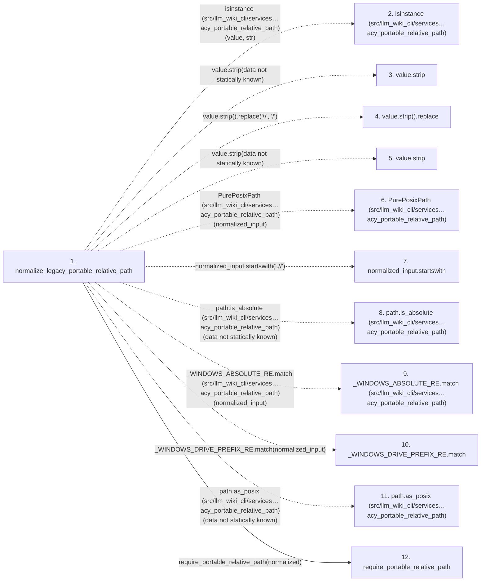

# normalize_legacy_portable_relative_path

**Entry point:** `normalize_legacy_portable_relative_path` (`api`)
**Source:** [validation](../modules/validation.md)
**Modules touched:** [validation](../modules/validation.md)

## Call sequence

> Static overview in presentation order, not runtime execution order. Arrows retain captured callers; representative internal continuations and boundary examples precede repeated helper detail.

```mermaid
sequenceDiagram
    participant p0 as normalize_legacy_portable_relative_path
    participant p1 as require_portable_relative_path
    participant p2 as _default_path_error
    participant p3 as _check_path_collision
    participant p4 as require_portable_path_component
    participant p5 as _syntax_key
    participant p6 as _known_syntax
    participant p7 as _remember_syntax
    participant p8 as SharedValidationError
    participant p9 as portable_path_key
    participant p10 as isinstance (src/llm_wiki_cli/services…acy_portable_relative_path)
    participant p11 as value.strip
    participant p12 as value.strip().replace
    participant p13 as PurePosixPath (src/llm_wiki_cli/services…acy_portable_relative_path)
    participant p14 as normalized_input.startswith
    participant p15 as path.is_absolute (src/llm_wiki_cli/services…acy_portable_relative_path)
    participant p16 as _WINDOWS_ABSOLUTE_RE.match (src/llm_wiki_cli/services…acy_portable_relative_path)
    participant p17 as _WINDOWS_DRIVE_PREFIX_RE.match
    participant p18 as path.as_posix (src/llm_wiki_cli/services…acy_portable_relative_path)
    participant p19 as isinstance (src/llm_wiki_cli/services…ire_portable_relative_path)
    participant p20 as os.fspath
    participant p21 as raw.encode
    participant p22 as raw.replace
    participant p23 as PurePosixPath (src/llm_wiki_cli/services…ire_portable_relative_path)
    participant p24 as path.is_absolute (src/llm_wiki_cli/services…ire_portable_relative_path)
    participant p25 as _WINDOWS_ABSOLUTE_RE.match (src/llm_wiki_cli/services…ire_portable_relative_path)
    participant p26 as path.as_posix (src/llm_wiki_cli/services…ire_portable_relative_path)
    participant p27 as normalized.strip
    participant p28 as canonical.casefold().endswith
    p0->>p1: require_portable_relative_path
    p1->>p2: _default_path_error
    p1->>p3: _check_path_collision
    p1->>p4: require_portable_path_component
    p1->>p5: _syntax_key
    p1->>p6: _known_syntax
    p1->>p7: _remember_syntax
    p2->>p8: SharedValidationError
    p3->>p9: portable_path_key
    p0-->>p10: isinstance (src/llm_wiki_cli/services…acy_portable_relative_path)(value, str)
    p0-->>p11: value.strip
    p0-->>p12: value.strip().replace('\\', '/')
    p0-->>p11: value.strip
    p0-->>p13: PurePosixPath (src/llm_wiki_cli/services…acy_portable_relative_path)(normalized_input)
    p0-->>p14: normalized_input.startswith('.//')
    p0-->>p15: path.is_absolute (src/llm_wiki_cli/services…acy_portable_relative_path)
    p0-->>p16: _WINDOWS_ABSOLUTE_RE.match (src/llm_wiki_cli/services…acy_portable_relative_path)(normalized_input)
    p0-->>p17: _WINDOWS_DRIVE_PREFIX_RE.match(normalized_input)
    p0-->>p18: path.as_posix (src/llm_wiki_cli/services…acy_portable_relative_path)
    p1-->>p19: isinstance (src/llm_wiki_cli/services…ire_portable_relative_path)(value, (...))
    p1-->>p20: os.fspath(value)
    p1-->>p19: isinstance (src/llm_wiki_cli/services…ire_portable_relative_path)(raw, str)
    p1-->>p21: raw.encode('utf-8')
    p1-->>p22: raw.replace('\\', '/')
    p1-->>p23: PurePosixPath (src/llm_wiki_cli/services…ire_portable_relative_path)(normalized)
    p1-->>p24: path.is_absolute (src/llm_wiki_cli/services…ire_portable_relative_path)
    p1-->>p25: _WINDOWS_ABSOLUTE_RE.match (src/llm_wiki_cli/services…ire_portable_relative_path)(raw)
    p1-->>p26: path.as_posix (src/llm_wiki_cli/services…ire_portable_relative_path)
    p1-->>p27: normalized.strip
    p1-->>p28: canonical.casefold().endswith(required_suffix.casefold(...))
```

<!-- Auto-generated from static call edges. Dashed arrows are external or unresolved calls. Reviewed runtime conditions and side effects belong in Behavior. -->

> Call sequence diagram shows 30 of 69 interactions; 39 omitted to keep the visualization within the 30-interaction and generated-diagram limits, with uncertain identities omitted rather than inferred.

> Captured boundary calls: external 6 of 19 (13 omitted); unresolved 15 of 28 (13 omitted). These counts cover the captured static trace.

Omitted captured detail, grouped by actual caller occurrence and target module:

| Caller | Parent step | Target module | Kind | Omitted interactions |
| --- | --- | --- | --- | --- |
| `src/llm_wiki_cli/services/validation.py:require_portable_relative_path` | 12 | [src/llm_wiki_cli/services/validation.py](../modules/validation.md) | internal | 7 |
| `src/llm_wiki_cli/services/validation.py:_syntax_key` | 19 | - | external | 6 |
| `src/llm_wiki_cli/services/validation.py:_known_syntax` | 26 | - | unresolved | 2 |
| `src/llm_wiki_cli/services/validation.py:portable_path_key` | 30 | - | unresolved | 1 |
| `src/llm_wiki_cli/services/validation.py:portable_path_key` | 30 | - | external | 1 |
| `src/llm_wiki_cli/services/validation.py:_check_path_collision` | 29 | - | unresolved | 2 |
| `src/llm_wiki_cli/services/validation.py:_check_path_collision` | 29 | [src/llm_wiki_cli/services/validation.py](../modules/validation.md) | internal | 1 |
| `src/llm_wiki_cli/services/validation.py:require_portable_relative_path` | 12 | - | unresolved | 2 |
> Omission summary shows 8 of 13 groups; 5 further groups are not expanded here. Counts above include all omitted interactions.
> Detailed flow queries retain their own coverage and limits; omitted paths may execute at runtime.

## Data flow

<!-- Auto-generated static analysis. Treat values and boundaries as best-effort hints, not runtime proof. -->

### Analysis coverage

**Effect analysis partially available.** Flow assembly and source effect analysis are separate; empty observations do not prove an empty handler body.

Source steps: 23; effect analysis evaluated: 14, partial: 2, unavailable: 7. Counts include steps omitted from the displayed trace.

Collector observations for 16 source steps with known totals: observed: 85, emitted: 74, omitted: 11. Unavailable totals are excluded.

- Callable record unavailable for one or more source steps; those steps have no represented callable body.
- Effect collector omitted observations before flow assembly; displayed effects are partial.
- Effect collector totals unavailable; observed counts cover captured records only.

| Step | Callable record | Effect analysis | Collector totals | Observed | Emitted | Omitted |
|---|---|---|---|---:|---:|---:|
| `normalize_legacy_portable_relative_path` | `available` | `evaluated` | `available` | `14` | `14` | `0` |
| `isinstance (src/llm_wiki_cli/services…acy_portable_relative_path)` | `not_applicable` | `not_applicable` | `not_applicable` | — | — | — |
| `value.strip` | `not_applicable` | `not_applicable` | `not_applicable` | — | — | — |
| `value.strip().replace` | `not_applicable` | `not_applicable` | `not_applicable` | — | — | — |
| `value.strip` | `not_applicable` | `not_applicable` | `not_applicable` | — | — | — |
| `PurePosixPath (src/llm_wiki_cli/services…acy_portable_relative_path)` | `not_applicable` | `not_applicable` | `not_applicable` | — | — | — |
| `normalized_input.startswith` | `not_applicable` | `not_applicable` | `not_applicable` | — | — | — |
| `path.is_absolute (src/llm_wiki_cli/services…acy_portable_relative_path)` | `not_applicable` | `not_applicable` | `not_applicable` | — | — | — |
| `_WINDOWS_ABSOLUTE_RE.match (src/llm_wiki_cli/services…acy_portable_relative_path)` | `not_applicable` | `not_applicable` | `not_applicable` | — | — | — |
| `_WINDOWS_DRIVE_PREFIX_RE.match` | `not_applicable` | `not_applicable` | `not_applicable` | — | — | — |
| `path.as_posix (src/llm_wiki_cli/services…acy_portable_relative_path)` | `not_applicable` | `not_applicable` | `not_applicable` | — | — | — |
| `require_portable_relative_path` | `available` | `partial` | `available` | `21` | `11` | `10` |

### Step data

| Step | Inputs | Reads | Writes | Returns |
|---|---|---|---|---|
| `normalize_legacy_portable_relative_path` | `value: object`, `text_error: Exception \| None`, `absolute_error: Exception \| None`, `traversal_error: Exception \| None`, `empty_error: Exception \| None`, `invalid_error: Exception \| None`, `reject_dot_prefixed_absolute: bool` | `SharedValidationError` | - | `None`, `None`, `None`, `None`, `require_portable_relative_path(...)`, `None` |
| `isinstance (src/llm_wiki_cli/services…acy_portable_relative_path)` | - | - | - | - |
| `value.strip` | - | - | - | - |
| `value.strip().replace` | - | - | - | - |
| `value.strip` | - | - | - | - |
| `PurePosixPath (src/llm_wiki_cli/services…acy_portable_relative_path)` | - | - | - | - |
| `normalized_input.startswith` | - | - | - | - |
| `path.is_absolute (src/llm_wiki_cli/services…acy_portable_relative_path)` | - | - | - | - |
| `_WINDOWS_ABSOLUTE_RE.match (src/llm_wiki_cli/services…acy_portable_relative_path)` | - | - | - | - |
| `_WINDOWS_DRIVE_PREFIX_RE.match` | - | - | - | - |
| `path.as_posix (src/llm_wiki_cli/services…acy_portable_relative_path)` | - | - | - | - |
| `require_portable_relative_path` | `value: object`, `normalize_backslashes: bool`, `normalize_posix_spelling: bool`, `required_suffix: str \| None`, `defer_non_nfc_error: bool`, `reject_delete_character: bool`, `text_error: Exception \| None`, `relative_error: Exception \| None` | `os` | - | `cached`, `_remember_syntax(...)` |

### Call data

| From | To | Line | Call |
|---|---|---:|---|
| normalize_legacy_portable_relative_path | isinstance (src/llm_wiki_cli/services…acy_portable_relative_path) | 387 | `isinstance(value, str)` |
| normalize_legacy_portable_relative_path | value.strip | 387 | `value.strip(data not statically known)` |
| normalize_legacy_portable_relative_path | value.strip().replace | 391 | `value.strip().replace('\\', '/')` |
| normalize_legacy_portable_relative_path | value.strip | 391 | `value.strip(data not statically known)` |
| normalize_legacy_portable_relative_path | PurePosixPath (src/llm_wiki_cli/services…acy_portable_relative_path) | 392 | `PurePosixPath(normalized_input)` |
| normalize_legacy_portable_relative_path | normalized_input.startswith | 396 | `normalized_input.startswith('.//')` |
| normalize_legacy_portable_relative_path | path.is_absolute (src/llm_wiki_cli/services…acy_portable_relative_path) | 398 | `path.is_absolute(data not statically known)` |
| normalize_legacy_portable_relative_path | _WINDOWS_ABSOLUTE_RE.match (src/llm_wiki_cli/services…acy_portable_relative_path) | 399 | `_WINDOWS_ABSOLUTE_RE.match(normalized_input)` |
| normalize_legacy_portable_relative_path | _WINDOWS_DRIVE_PREFIX_RE.match | 400 | `_WINDOWS_DRIVE_PREFIX_RE.match(normalized_input)` |
| normalize_legacy_portable_relative_path | path.as_posix (src/llm_wiki_cli/services…acy_portable_relative_path) | 409 | `path.as_posix(data not statically known)` |
| normalize_legacy_portable_relative_path | require_portable_relative_path | 415 | `require_portable_relative_path(normalized)` |

### Boundary effects

*No boundary-effect observations were captured in this static trace.*

### Static analysis gaps

| Kind | Step | Target | Line |
|---|---|---|---:|
| external_call | `normalize_legacy_portable_relative_path` | `isinstance` | 387 |
| unresolved_call | `normalize_legacy_portable_relative_path` | `value.strip` | 387 |
| unresolved_call | `normalize_legacy_portable_relative_path` | `value.strip().replace` | 391 |
| unresolved_call | `normalize_legacy_portable_relative_path` | `value.strip` | 391 |
| external_call | `normalize_legacy_portable_relative_path` | `PurePosixPath` | 392 |
| unresolved_call | `normalize_legacy_portable_relative_path` | `normalized_input.startswith` | 396 |
| unresolved_call | `normalize_legacy_portable_relative_path` | `path.is_absolute` | 398 |
| unresolved_call | `normalize_legacy_portable_relative_path` | `_WINDOWS_ABSOLUTE_RE.match` | 399 |
| unresolved_call | `normalize_legacy_portable_relative_path` | `_WINDOWS_DRIVE_PREFIX_RE.match` | 400 |
| unresolved_call | `normalize_legacy_portable_relative_path` | `path.as_posix` | 409 |
| step_limit | `normalize_legacy_portable_relative_path` | `first 12 steps` | 0 |

## Behavior

This flow starts at `normalize_legacy_portable_relative_path` and is classified as `api`. The generated call and data-flow sections are bounded static projections; runtime conditions and side effects require source-level confirmation.
