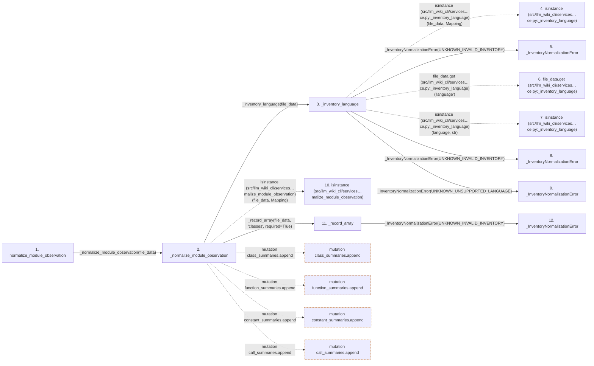

# normalize_module_observation

**Entry point:** `normalize_module_observation` (`api`)
**Source:** [knowledge_evidence](../modules/knowledge_evidence.md)
**Modules touched:** [knowledge_evidence](../modules/knowledge_evidence.md), [validation](../modules/validation.md)

## Call sequence

> Static overview in presentation order, not runtime execution order. Arrows retain captured callers; representative internal continuations and boundary examples precede repeated helper detail.

```mermaid
sequenceDiagram
    participant p0 as normalize_module_observation
    participant p1 as _normalize_module_observation
    participant p2 as _inventory_language
    participant p3 as _record_array
    participant p4 as _validate_import_record
    participant p5 as _record_name
    participant p6 as _validate_module_entity_record
    participant p7 as _copy_selected_fields
    participant p8 as _validate_callable_record
    participant p9 as _json_array
    participant p10 as _validate_string_array
    participant p11 as _validate_constant_record
    participant p12 as _validate_module_call_record
    participant p13 as require_nonempty_text
    participant p14 as _structural_copy
    participant p15 as _validate_optional_string_array
    participant p16 as _validate_optional_strings
    participant p17 as _optional_record_array
    participant p18 as _validate_optional_booleans
    participant p19 as require_string_list
    participant p20 as require_mapping_list
    participant p21 as _InventoryNormalizationError
    participant p22 as require_list
    participant p23 as require_string
    participant p24 as require_bool
    participant p25 as contains_control_character
    participant p26 as require_mapping
    participant p27 as isinstance (src/llm_wiki_cli/services…malize_module_observation)
    participant p28 as seen_names.get
    participant p29 as class_summaries.append
    participant p30 as function_summaries.append
    p0->>p1: _normalize_module_observation
    p1->>p2: _inventory_language
    p1->>p3: _record_array
    p1->>p4: _validate_import_record
    p1->>p5: _record_name
    p1->>p6: _validate_module_entity_record
    p1->>p7: _copy_selected_fields
    p1->>p8: _validate_callable_record
    p1->>p9: _json_array
    p1->>p10: _validate_string_array
    p1->>p11: _validate_constant_record
    p1->>p12: _validate_module_call_record
    p5->>p13: require_nonempty_text
    p7->>p14: _structural_copy
    p6->>p15: _validate_optional_string_array
    p4->>p16: _validate_optional_strings
    p8->>p17: _optional_record_array
    p4->>p18: _validate_optional_booleans
    p15->>p19: require_string_list
    p17->>p20: require_mapping_list
    p1->>p21: _InventoryNormalizationError
    p9->>p22: require_list
    p16->>p23: require_string
    p18->>p24: require_bool
    p13->>p25: contains_control_character
    p20->>p26: require_mapping
    p1-->>p27: isinstance (src/llm_wiki_cli/services…malize_module_observation)(file_data, Mapping)
    p1-->>p28: seen_names.get(name, 0)
    p1-->>p29: class_summaries.append(summary)
    p1-->>p30: function_summaries.append(_copy_selected_fields(...))
```

<!-- Auto-generated from static call edges. Dashed arrows are external or unresolved calls. Reviewed runtime conditions and side effects belong in Behavior. -->

> Call sequence diagram shows 30 of 120 interactions; 90 omitted to keep the visualization within the 30-interaction and generated-diagram limits, with uncertain identities omitted rather than inferred.

> Captured boundary calls: external 1 of 27 (26 omitted); unresolved 3 of 21 (18 omitted). These counts cover the captured static trace.

Omitted captured detail, grouped by actual caller occurrence and target module:

| Caller | Parent step | Target module | Kind | Omitted interactions |
| --- | --- | --- | --- | --- |
| `src/llm_wiki_cli/services/knowledge_evidence.py:_inventory_language` | 3 | - | external | 2 |
| `src/llm_wiki_cli/services/knowledge_evidence.py:_inventory_language` | 3 | [src/llm_wiki_cli/services/knowledge_evidence.py](../modules/knowledge_evidence.md) | internal | 3 |
| `src/llm_wiki_cli/services/knowledge_evidence.py:_inventory_language` | 3 | - | unresolved | 1 |
| `src/llm_wiki_cli/services/knowledge_evidence.py:_record_array` | 11 | [src/llm_wiki_cli/services/knowledge_evidence.py](../modules/knowledge_evidence.md) | internal | 3 |
| `src/llm_wiki_cli/services/knowledge_evidence.py:_record_array` | 11 | - | external | 3 |
| `src/llm_wiki_cli/services/knowledge_evidence.py:_normalize_module_observation` | 2 | [src/llm_wiki_cli/services/knowledge_evidence.py](../modules/knowledge_evidence.md) | internal | 9 |
| `src/llm_wiki_cli/services/knowledge_evidence.py:_validate_import_record` | 20 | - | unresolved | 1 |
| `src/llm_wiki_cli/services/knowledge_evidence.py:_validate_import_record` | 20 | - | external | 1 |
> Omission summary shows 8 of 43 groups; 35 further groups are not expanded here. Counts above include all omitted interactions.
> Detailed flow queries retain their own coverage and limits; omitted paths may execute at runtime.

## Data flow

<!-- Auto-generated static analysis. Treat values and boundaries as best-effort hints, not runtime proof. -->

### Step data

| Step | Inputs | Reads | Writes | Returns |
|---|---|---|---|---|
| `normalize_module_observation` | `file_data: Mapping[str, Any]` | `_InventoryNormalizationError` | - | `_normalize_module_observation(...)`, `None` |
| `_normalize_module_observation` | `file_data: Mapping[str, Any] \| None` | `Mapping`, `_MODULE_ENTITY_FIELDS`, `_MODULE_NONSTRUCTURAL_KEYS`, `_MODULE_FUNCTION_FIELDS`, `_MODULE_NONSTRUCTURAL_KEYS`, `MODULE_OBSERVATION_SCOPE`, `_MODULE_NONSTRUCTURAL_KEYS`, `UNKNOWN_INVALID_INVENTORY` | `seen_names[...]`, `summary[...]`, `payload[...]`, `payload[...]`, `payload[...]`, `payload[...]` | `payload` |
| `_inventory_language` | `file_data: Mapping[str, Any] \| None` | `Mapping`, `UNKNOWN_INVALID_INVENTORY`, `UNKNOWN_INVALID_INVENTORY`, `_SUPPORTED_OBSERVATION_LANGUAGES`, `UNKNOWN_UNSUPPORTED_LANGUAGE` | - | `language` |
| `isinstance (src/llm_wiki_cli/services…ce.py:_inventory_language)` | - | - | - | - |
| `_InventoryNormalizationError` | - | - | - | - |
| `file_data.get (src/llm_wiki_cli/services…ce.py:_inventory_language)` | - | - | - | - |
| `isinstance (src/llm_wiki_cli/services…ce.py:_inventory_language)` | - | - | - | - |
| `_InventoryNormalizationError` | - | - | - | - |
| `_InventoryNormalizationError` | - | - | - | - |
| `isinstance (src/llm_wiki_cli/services…malize_module_observation)` | - | - | - | - |
| `_record_array` | `file_data: Mapping[str, Any]`, `field: str`, `required: bool` | `UNKNOWN_INVALID_INVENTORY`, `UNKNOWN_INVALID_INVENTORY`, `Mapping`, `UNKNOWN_INVALID_INVENTORY` | - | `[...]`, `value` |
| `_InventoryNormalizationError` | - | - | - | - |

### Call data

| From | To | Line | Call |
|---|---|---:|---|
| normalize_module_observation | _normalize_module_observation | 220 | `_normalize_module_observation(file_data)` |
| _normalize_module_observation | _inventory_language | 427 | `_inventory_language(file_data)` |
| _inventory_language | isinstance (src/llm_wiki_cli/services…ce.py:_inventory_language) | 543 | `isinstance(file_data, Mapping)` |
| _inventory_language | _InventoryNormalizationError | 544 | `_InventoryNormalizationError(UNKNOWN_INVALID_INVENTORY)` |
| _inventory_language | file_data.get (src/llm_wiki_cli/services…ce.py:_inventory_language) | 545 | `file_data.get('language')` |
| _inventory_language | isinstance (src/llm_wiki_cli/services…ce.py:_inventory_language) | 546 | `isinstance(language, str)` |
| _inventory_language | _InventoryNormalizationError | 547 | `_InventoryNormalizationError(UNKNOWN_INVALID_INVENTORY)` |
| _inventory_language | _InventoryNormalizationError | 549 | `_InventoryNormalizationError(UNKNOWN_UNSUPPORTED_LANGUAGE)` |
| _normalize_module_observation | isinstance (src/llm_wiki_cli/services…malize_module_observation) | 428 | `isinstance(file_data, Mapping)` |
| _normalize_module_observation | _record_array | 429 | `_record_array(file_data, 'classes', required=True)` |
| _record_array | _InventoryNormalizationError | 561 | `_InventoryNormalizationError(UNKNOWN_INVALID_INVENTORY)` |

### Boundary effects

| Kind | Target | Step | Line |
|---|---|---|---:|
| mutation | `class_summaries.append` | `_normalize_module_observation` | 447 |
| mutation | `function_summaries.append` | `_normalize_module_observation` | 452 |
| mutation | `constant_summaries.append` | `_normalize_module_observation` | 481 |
| mutation | `call_summaries.append` | `_normalize_module_observation` | 496 |

### Static analysis gaps

| Kind | Step | Target | Line |
|---|---|---|---:|
| external_call | `_inventory_language` | `isinstance` | 543 |
| unresolved_call | `_inventory_language` | `file_data.get` | 545 |
| external_call | `_inventory_language` | `isinstance` | 546 |
| external_call | `_normalize_module_observation` | `isinstance` | 428 |
| step_limit | `normalize_module_observation` | `first 12 steps` | 0 |

## Behavior

This flow starts at `normalize_module_observation` and is classified as `api`. The generated call and data-flow sections are bounded static projections; runtime conditions and side effects require source-level confirmation.
