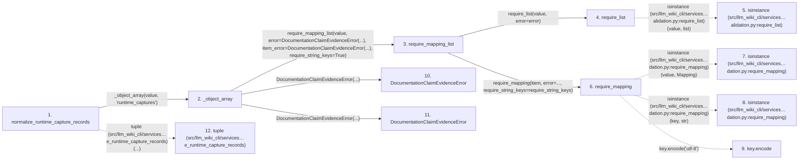

# normalize_runtime_capture_records

**Entry point:** `normalize_runtime_capture_records` (`api`)
**Source:** [documentation_claim_evidence](../modules/documentation_claim_evidence.md)
**Modules touched:** [documentation_claim_evidence](../modules/documentation_claim_evidence.md), [knowledge_evidence](../modules/knowledge_evidence.md), [validation](../modules/validation.md)

## Call sequence

> Static overview in presentation order, not runtime execution order. Arrows retain captured callers; representative internal continuations and boundary examples precede repeated helper detail.

```mermaid
sequenceDiagram
    participant p0 as normalize_runtime_capture_records
    participant p1 as _object_array
    participant p2 as _normalize_capture_record
    participant p3 as DocumentationClaimEvidenceError
    participant p4 as require_mapping_list
    participant p5 as _mapping
    participant p6 as _exact_fields
    participant p7 as _capture_result
    participant p8 as _runtime_capture_path
    participant p9 as _native_observation
    participant p10 as _redaction
    participant p11 as _environment
    participant p12 as _identifier
    participant p13 as _optional_identifier
    participant p14 as _optional_locator
    participant p15 as _section_locator
    participant p16 as _reject_sensitive_metadata
    participant p17 as _portable_path
    participant p18 as _enum
    participant p19 as _string_list
    participant p20 as _reason
    participant p21 as require_exact_choice
    participant p22 as _text
    participant p23 as require_portable_relative_path
    participant p24 as require_trimmed_text
    participant p25 as _default_path_error
    participant p26 as _check_path_collision
    participant p27 as require_portable_path_component
    participant p28 as is_valid_sha256
    participant p29 as tuple (src/llm_wiki_cli/services…e_runtime_capture_records)
    participant p30 as PurePosixPath(…).suffix.casefold
    p0->>p1: _object_array
    p0->>p2: _normalize_capture_record
    p0->>p3: DocumentationClaimEvidenceError
    p1->>p4: require_mapping_list
    p2->>p5: _mapping
    p2->>p6: _exact_fields
    p2->>p7: _capture_result
    p2->>p8: _runtime_capture_path
    p2->>p9: _native_observation
    p2->>p10: _redaction
    p2->>p11: _environment
    p2->>p12: _identifier
    p2->>p13: _optional_identifier
    p2->>p14: _optional_locator
    p2->>p15: _section_locator
    p2->>p16: _reject_sensitive_metadata
    p8->>p17: _portable_path
    p7->>p18: _enum
    p10->>p19: _string_list
    p9->>p20: _reason
    p18->>p21: require_exact_choice
    p17->>p22: _text
    p17->>p23: require_portable_relative_path
    p22->>p24: require_trimmed_text
    p23->>p25: _default_path_error
    p23->>p26: _check_path_collision
    p23->>p27: require_portable_path_component
    p2->>p28: is_valid_sha256
    p0-->>p29: tuple (src/llm_wiki_cli/services…e_runtime_capture_records)(...)
    p2-->>p30: PurePosixPath(…).suffix.casefold
```

<!-- Auto-generated from static call edges. Dashed arrows are external or unresolved calls. Reviewed runtime conditions and side effects belong in Behavior. -->

> Call sequence diagram shows 30 of 226 interactions; 196 omitted to keep the visualization within the 30-interaction and generated-diagram limits, with uncertain identities omitted rather than inferred.

> Captured boundary calls: external 1 of 71 (70 omitted); unresolved 1 of 40 (39 omitted). These counts cover the captured static trace.

Omitted captured detail, grouped by actual caller occurrence and target module:

| Caller | Parent step | Target module | Kind | Omitted interactions |
| --- | --- | --- | --- | --- |
| `src/llm_wiki_cli/services/validation.py:require_mapping_list` | 3 | [src/llm_wiki_cli/services/validation.py](../modules/validation.md) | internal | 2 |
| `src/llm_wiki_cli/services/validation.py:require_list` | 4 | - | external | 1 |
| `src/llm_wiki_cli/services/validation.py:require_mapping` | 6 | - | external | 2 |
| `src/llm_wiki_cli/services/validation.py:require_mapping` | 6 | - | unresolved | 1 |
| `src/llm_wiki_cli/services/documentation_claim_evidence.py:_object_array` | 2 | [src/llm_wiki_cli/services/documentation_claim_evidence.py](../modules/documentation_claim_evidence.md) | internal | 2 |
| `src/llm_wiki_cli/services/documentation_claim_evidence.py:_mapping` | 14 | [src/llm_wiki_cli/services/validation.py](../modules/validation.md) | internal | 1 |
| `src/llm_wiki_cli/services/documentation_claim_evidence.py:_mapping` | 14 | [src/llm_wiki_cli/services/documentation_claim_evidence.py](../modules/documentation_claim_evidence.md) | internal | 1 |
| `src/llm_wiki_cli/services/documentation_claim_evidence.py:_exact_fields` | 17 | [src/llm_wiki_cli/services/validation.py](../modules/validation.md) | internal | 1 |
> Omission summary shows 8 of 67 groups; 59 further groups are not expanded here. Counts above include all omitted interactions.
> Detailed flow queries retain their own coverage and limits; omitted paths may execute at runtime.

> Trace truncated at the depth limit; deeper calls are omitted.

## Data flow

<!-- Auto-generated static analysis. Treat values and boundaries as best-effort hints, not runtime proof. -->

### Analysis coverage

**Effect analysis partially available.** Flow assembly and source effect analysis are separate; empty observations do not prove an empty handler body.

Source steps: 116; effect analysis evaluated: 66, partial: 4, unavailable: 46. Counts include steps omitted from the displayed trace.

Collector observations for 70 source steps with known totals: observed: 313, emitted: 300, omitted: 13. Unavailable totals are excluded.

- Callable record unavailable for one or more source steps; those steps have no represented callable body.
- Effect collector omitted observations before flow assembly; displayed effects are partial.
- Effect collector totals unavailable; observed counts cover captured records only.

| Step | Callable record | Effect analysis | Collector totals | Observed | Emitted | Omitted |
|---|---|---|---|---:|---:|---:|
| `normalize_runtime_capture_records` | `available` | `evaluated` | `available` | `2` | `2` | `0` |
| `_object_array` | `available` | `evaluated` | `available` | `3` | `3` | `0` |
| `require_mapping_list` | `available` | `evaluated` | `available` | `5` | `5` | `0` |
| `require_list` | `available` | `evaluated` | `available` | `3` | `3` | `0` |
| `isinstance (src/llm_wiki_cli/services…alidation.py:require_list)` | `not_applicable` | `not_applicable` | `not_applicable` | — | — | — |
| `require_mapping` | `available` | `evaluated` | `available` | `8` | `8` | `0` |
| `isinstance (src/llm_wiki_cli/services…dation.py:require_mapping)` | `not_applicable` | `not_applicable` | `not_applicable` | — | — | — |
| `isinstance (src/llm_wiki_cli/services…dation.py:require_mapping)` | `not_applicable` | `not_applicable` | `not_applicable` | — | — | — |
| `key.encode` | `not_applicable` | `not_applicable` | `not_applicable` | — | — | — |
| `DocumentationClaimEvidenceError` | `unavailable` | `unavailable` | `unavailable` | — | — | — |
| `DocumentationClaimEvidenceError` | `unavailable` | `unavailable` | `unavailable` | — | — | — |
| `tuple (src/llm_wiki_cli/services…e_runtime_capture_records)` | `not_applicable` | `not_applicable` | `not_applicable` | — | — | — |

### Step data

| Step | Inputs | Reads | Writes | Returns |
|---|---|---|---|---|
| `normalize_runtime_capture_records` | `value: object` | - | - | `tuple(...)` |
| `_object_array` | `value: object`, `field_name: str` | - | - | `require_mapping_list(...)` |
| `require_mapping_list` | `value: object`, `error: Exception`, `item_error: Exception \| None`, `require_string_keys: bool` | - | - | `items` |
| `require_list` | `value: object`, `error: Exception` | - | - | `value` |
| `isinstance (src/llm_wiki_cli/services…alidation.py:require_list)` | - | - | - | - |
| `require_mapping` | `value: object`, `error: Exception`, `require_string_keys: bool`, `key_error: Exception \| None`, `require_utf8_keys: bool`, `utf8_key_error: Exception \| None` | `Mapping` | - | `value` |
| `isinstance (src/llm_wiki_cli/services…dation.py:require_mapping)` | - | - | - | - |
| `isinstance (src/llm_wiki_cli/services…dation.py:require_mapping)` | - | - | - | - |
| `key.encode` | - | - | - | - |
| `DocumentationClaimEvidenceError` | - | - | - | - |
| `DocumentationClaimEvidenceError` | - | - | - | - |
| `tuple (src/llm_wiki_cli/services…e_runtime_capture_records)` | - | - | - | - |

### Call data

| From | To | Line | Call |
|---|---|---:|---|
| normalize_runtime_capture_records | _object_array | 208 | `_object_array(value, 'runtime_captures')` |
| _object_array | require_mapping_list | 1431 | `require_mapping_list(value, error=DocumentationClaimEvidenceError(...), item_error=DocumentationClaimEvidenceError(...), require_string_keys=True)` |
| require_mapping_list | require_list | 1061 | `require_list(value, error=error)` |
| require_list | isinstance (src/llm_wiki_cli/services…alidation.py:require_list) | 810 | `isinstance(value, list)` |
| require_mapping_list | require_mapping | 1063 | `require_mapping(item, error=..., require_string_keys=require_string_keys)` |
| require_mapping | isinstance (src/llm_wiki_cli/services…dation.py:require_mapping) | 773 | `isinstance(value, Mapping)` |
| require_mapping | isinstance (src/llm_wiki_cli/services…dation.py:require_mapping) | 777 | `isinstance(key, str)` |
| require_mapping | key.encode | 782 | `key.encode('utf-8')` |
| _object_array | DocumentationClaimEvidenceError | 1433 | `DocumentationClaimEvidenceError(...)` |
| _object_array | DocumentationClaimEvidenceError | 1434 | `DocumentationClaimEvidenceError(...)` |
| normalize_runtime_capture_records | tuple (src/llm_wiki_cli/services…e_runtime_capture_records) | 209 | `tuple(...)` |

### Boundary effects

*No boundary-effect observations were captured in this static trace.*

### Static analysis gaps

| Kind | Step | Target | Line |
|---|---|---|---:|
| external_call | `require_list` | `isinstance` | 810 |
| external_call | `require_mapping` | `isinstance` | 773 |
| external_call | `require_mapping` | `isinstance` | 777 |
| unresolved_call | `require_mapping` | `key.encode` | 782 |
| step_limit | `normalize_runtime_capture_records` | `first 12 steps` | 0 |
| truncated_flow | `normalize_runtime_capture_records` | `depth limit` | 0 |

## Behavior

This flow starts at `normalize_runtime_capture_records` and is classified as `api`. The generated call and data-flow sections are bounded static projections; runtime conditions and side effects require source-level confirmation.
