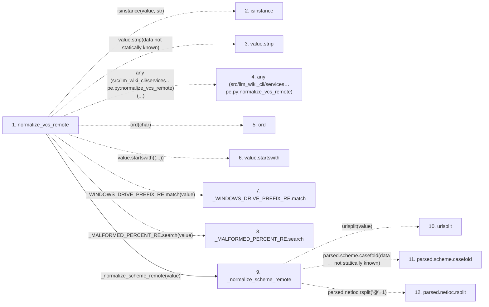

# normalize_vcs_remote

**Entry point:** `normalize_vcs_remote` (`api`)
**Source:** [knowledge_envelope](../modules/knowledge_envelope.md)
**Modules touched:** [knowledge_envelope](../modules/knowledge_envelope.md)

## Call sequence

> Static overview in presentation order, not runtime execution order. Arrows retain captured callers; representative internal continuations and boundary examples precede repeated helper detail.

```mermaid
sequenceDiagram
    participant p0 as normalize_vcs_remote
    participant p1 as _normalize_scheme_remote
    participant p2 as _normalize_scp_remote
    participant p3 as _normalized_remote_identity
    participant p4 as isinstance
    participant p5 as value.strip
    participant p6 as any (src/llm_wiki_cli/services…pe.py:normalize_vcs_remote)
    participant p7 as ord
    participant p8 as value.startswith
    participant p9 as _WINDOWS_DRIVE_PREFIX_RE.match
    participant p10 as _MALFORMED_PERCENT_RE.search
    participant p11 as urlsplit
    participant p12 as _SCP_REMOTE_RE.fullmatch
    participant p13 as unquote
    participant p14 as parsed.scheme.casefold
    participant p15 as match.group(…).split(…)[…].split
    participant p16 as decoded_path.removeprefix
    participant p17 as parsed.netloc.rsplit
    participant p18 as match.group(…).split
    participant p19 as path.removesuffix
    participant p20 as authority.endswith
    participant p21 as match.group
    participant p22 as path.casefold().endswith
    participant p23 as host.casefold
    participant p24 as match.group(…).casefold
    participant p25 as path.casefold
    participant p26 as path.split
    participant p27 as any (src/llm_wiki_cli/services…normalized_remote_identity)
    participant p28 as '/'.join
    participant p29 as _REPOSITORY_IDENTITY_RE.fullmatch
    p0->>p1: _normalize_scheme_remote
    p0->>p2: _normalize_scp_remote
    p0->>p3: _normalized_remote_identity
    p0-->>p4: isinstance(value, str)
    p0-->>p5: value.strip
    p0-->>p6: any (src/llm_wiki_cli/services…pe.py:normalize_vcs_remote)(...)
    p0-->>p7: ord(char)
    p0-->>p8: value.startswith((...))
    p0-->>p9: _WINDOWS_DRIVE_PREFIX_RE.match(value)
    p0-->>p10: _MALFORMED_PERCENT_RE.search(value)
    p1-->>p11: urlsplit(value)
    p2-->>p12: _SCP_REMOTE_RE.fullmatch(value)
    p3-->>p13: unquote(raw_path)
    p1-->>p14: parsed.scheme.casefold
    p2-->>p15: match.group(…).split(…)[…].split('?', 1)
    p3-->>p16: decoded_path.removeprefix('/')
    p1-->>p17: parsed.netloc.rsplit('@', 1)
    p2-->>p18: match.group(…).split(' ', 1)
    p3-->>p19: path.removesuffix('/')
    p1-->>p20: authority.endswith(':')
    p2-->>p21: match.group('path')
    p3-->>p22: path.casefold().endswith('.git')
    p1-->>p23: host.casefold
    p2-->>p24: match.group(…).casefold
    p3-->>p25: path.casefold
    p2-->>p21: match.group('host')
    p3-->>p26: path.split('/')
    p3-->>p27: any (src/llm_wiki_cli/services…normalized_remote_identity)(...)
    p3-->>p28: '/'.join(parts)
    p3-->>p29: _REPOSITORY_IDENTITY_RE.fullmatch(identity)
```

<!-- Auto-generated from static call edges. Dashed arrows are external or unresolved calls. Reviewed runtime conditions and side effects belong in Behavior. -->

> Call sequence diagram shows 30 of 32 interactions; 2 omitted to keep the visualization within the 30-interaction and generated-diagram limits, with uncertain identities omitted rather than inferred.

> Captured boundary calls: external 6 of 6 (0 omitted); unresolved 21 of 23 (2 omitted). These counts cover the captured static trace.

Omitted captured detail, grouped by actual caller occurrence and target module:

| Caller | Parent step | Target module | Kind | Omitted interactions |
| --- | --- | --- | --- | --- |
| `src/llm_wiki_cli/services/knowledge_envelope.py:_normalized_remote_identity` | 22 | - | unresolved | 2 |
> Detailed flow queries retain their own coverage and limits; omitted paths may execute at runtime.

## Data flow

<!-- Auto-generated static analysis. Treat values and boundaries as best-effort hints, not runtime proof. -->

### Step data

| Step | Inputs | Reads | Writes | Returns |
|---|---|---|---|---|
| `normalize_vcs_remote` | `value: object` | - | - | `None`, `None`, `_normalized_remote_identity(...)` |
| `isinstance` | - | - | - | - |
| `value.strip` | - | - | - | - |
| `any (src/llm_wiki_cli/services…pe.py:normalize_vcs_remote)` | - | - | - | - |
| `ord` | - | - | - | - |
| `value.startswith` | - | - | - | - |
| `_WINDOWS_DRIVE_PREFIX_RE.match` | - | - | - | - |
| `_MALFORMED_PERCENT_RE.search` | - | - | - | - |
| `_normalize_scheme_remote` | `value: str` | - | - | `None`, `None`, `None`, `None`, `None`, `(...)` |
| `urlsplit` | - | - | - | - |
| `parsed.scheme.casefold` | - | - | - | - |
| `parsed.netloc.rsplit` | - | - | - | - |

### Call data

| From | To | Line | Call |
|---|---|---:|---|
| normalize_vcs_remote | isinstance | 709 | `isinstance(value, str)` |
| normalize_vcs_remote | value.strip | 711 | `value.strip(data not statically known)` |
| normalize_vcs_remote | any (src/llm_wiki_cli/services…pe.py:normalize_vcs_remote) | 712 | `any(...)` |
| normalize_vcs_remote | ord | 712 | `ord(char)` |
| normalize_vcs_remote | value.startswith | 714 | `value.startswith((...))` |
| normalize_vcs_remote | _WINDOWS_DRIVE_PREFIX_RE.match | 715 | `_WINDOWS_DRIVE_PREFIX_RE.match(value)` |
| normalize_vcs_remote | _MALFORMED_PERCENT_RE.search | 716 | `_MALFORMED_PERCENT_RE.search(value)` |
| normalize_vcs_remote | _normalize_scheme_remote | 721 | `_normalize_scheme_remote(value)` |
| _normalize_scheme_remote | urlsplit | 1453 | `urlsplit(value)` |
| _normalize_scheme_remote | parsed.scheme.casefold | 1458 | `parsed.scheme.casefold(data not statically known)` |
| _normalize_scheme_remote | parsed.netloc.rsplit | 1461 | `parsed.netloc.rsplit('@', 1)` |

### Boundary effects

*No boundary effects detected.*

### Static analysis gaps

| Kind | Step | Target | Line |
|---|---|---|---:|
| external_call | `normalize_vcs_remote` | `isinstance` | 709 |
| unresolved_call | `normalize_vcs_remote` | `value.strip` | 711 |
| external_call | `normalize_vcs_remote` | `any` | 712 |
| external_call | `normalize_vcs_remote` | `ord` | 712 |
| unresolved_call | `normalize_vcs_remote` | `value.startswith` | 714 |
| unresolved_call | `normalize_vcs_remote` | `_WINDOWS_DRIVE_PREFIX_RE.match` | 715 |
| unresolved_call | `normalize_vcs_remote` | `_MALFORMED_PERCENT_RE.search` | 716 |
| external_call | `_normalize_scheme_remote` | `urlsplit` | 1453 |
| unresolved_call | `_normalize_scheme_remote` | `parsed.scheme.casefold` | 1458 |
| unresolved_call | `_normalize_scheme_remote` | `parsed.netloc.rsplit` | 1461 |
| step_limit | `normalize_vcs_remote` | `first 12 steps` | 0 |

## Behavior

This flow starts at `normalize_vcs_remote` and is classified as `api`. The generated call and data-flow sections are bounded static projections; runtime conditions and side effects require source-level confirmation.
