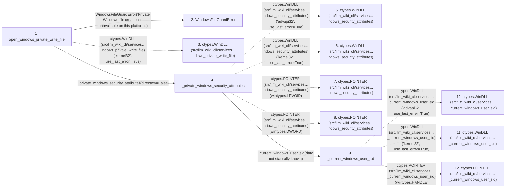

# open_windows_private_write_file

**Entry point:** `open_windows_private_write_file` (`api`)
**Source:** [filesystem_guard](../modules/filesystem_guard.md)
**Modules touched:** [filesystem_guard](../modules/filesystem_guard.md)

## Call sequence

> Static overview in presentation order, not runtime execution order. Arrows retain captured callers; representative internal continuations and boundary examples precede repeated helper detail.

```mermaid
sequenceDiagram
    participant p0 as open_windows_private_write_file
    participant p1 as _private_windows_security_attributes
    participant p2 as _assert_windows_regular_file_handle
    participant p3 as _verify_windows_handle_restrictive_dacl
    participant p4 as WindowsFileGuardError
    participant p5 as _windows_api_path
    participant p6 as _close_windows_handle
    participant p7 as _windows_handle_information
    participant p8 as _current_windows_user_sid
    participant p9 as _windows_sid_string
    participant p10 as WindowsSecurityGuardError
    participant p11 as ctypes.WinDLL (src/llm_wiki_cli/services…indows_private_write_file)
    participant p12 as create_file
    participant p13 as Path
    participant p14 as ctypes.byref (src/llm_wiki_cli/services…indows_private_write_file)
    participant p15 as wintypes.HANDLE (src/llm_wiki_cli/services…indows_private_write_file)
    participant p16 as ctypes.WinError (src/llm_wiki_cli/services…indows_private_write_file)
    participant p17 as ctypes.get_last_error (src/llm_wiki_cli/services…indows_private_write_file)
    participant p18 as int (src/llm_wiki_cli/services…indows_private_write_file)
    participant p19 as str
    participant p20 as msvcrt.open_osfhandle
    participant p21 as getattr
    participant p22 as ctypes.WinDLL (src/llm_wiki_cli/services…ndows_security_attributes)
    participant p23 as os.path.abspath
    participant p24 as ctypes.WinDLL (src/llm_wiki_cli/services…s_handle_restrictive_dacl)
    participant p25 as os.fspath
    participant p26 as int (src/llm_wiki_cli/services…ndows_regular_file_handle)
    p0->>p1: _private_windows_security_attributes
    p0->>p2: _assert_windows_regular_file_handle
    p0->>p3: _verify_windows_handle_restrictive_dacl
    p0->>p4: WindowsFileGuardError
    p0->>p5: _windows_api_path
    p0->>p6: _close_windows_handle
    p2->>p7: _windows_handle_information
    p1->>p8: _current_windows_user_sid
    p8->>p9: _windows_sid_string
    p1->>p10: WindowsSecurityGuardError
    p0-->>p11: ctypes.WinDLL (src/llm_wiki_cli/services…indows_private_write_file)('kernel32', use_last_error=True)
    p0-->>p12: create_file(_windows_api_path(...), ..., 0, ctypes.byref(...), 1, ..., None)
    p0-->>p13: Path(path)
    p0-->>p14: ctypes.byref (src/llm_wiki_cli/services…indows_private_write_file)(security)
    p0-->>p15: wintypes.HANDLE (src/llm_wiki_cli/services…indows_private_write_file)(...)
    p0-->>p16: ctypes.WinError (src/llm_wiki_cli/services…indows_private_write_file)(ctypes.get_last_error(...))
    p0-->>p17: ctypes.get_last_error (src/llm_wiki_cli/services…indows_private_write_file)
    p0-->>p18: int (src/llm_wiki_cli/services…indows_private_write_file)(handle)
    p0-->>p13: Path(path)
    p0-->>p19: str(path)
    p0-->>p20: msvcrt.open_osfhandle(native_handle, ...)
    p0-->>p21: getattr(os, 'O_BINARY', 0)
    p0-->>p21: getattr(os, 'O_NOINHERIT', 0)
    p1-->>p22: ctypes.WinDLL (src/llm_wiki_cli/services…ndows_security_attributes)('advapi32', use_last_error=True)
    p5-->>p23: os.path.abspath(os.fspath(...))
    p3-->>p24: ctypes.WinDLL (src/llm_wiki_cli/services…s_handle_restrictive_dacl)('advapi32', use_last_error=True)
    p1-->>p22: ctypes.WinDLL (src/llm_wiki_cli/services…ndows_security_attributes)('kernel32', use_last_error=True)
    p5-->>p25: os.fspath(path)
    p2-->>p26: int (src/llm_wiki_cli/services…ndows_regular_file_handle)(information.dwFileAttributes)
    p3-->>p24: ctypes.WinDLL (src/llm_wiki_cli/services…s_handle_restrictive_dacl)('kernel32', use_last_error=True)
```

<!-- Auto-generated from static call edges. Dashed arrows are external or unresolved calls. Reviewed runtime conditions and side effects belong in Behavior. -->

> Call sequence diagram shows 30 of 168 interactions; 138 omitted to keep the visualization within the 30-interaction and generated-diagram limits, with uncertain identities omitted rather than inferred.

> Captured boundary calls: external 19 of 111 (92 omitted); unresolved 1 of 21 (20 omitted). These counts cover the captured static trace.

Omitted captured detail, grouped by actual caller occurrence and target module:

| Caller | Parent step | Target module | Kind | Omitted interactions |
| --- | --- | --- | --- | --- |
| `src/llm_wiki_cli/services/filesystem_guard.py:_private_windows_security_attributes` | 4 | - | external | 7 |
| `src/llm_wiki_cli/services/filesystem_guard.py:_current_windows_user_sid` | 9 | - | external | 19 |
| `src/llm_wiki_cli/services/filesystem_guard.py:_current_windows_user_sid` | 9 | - | unresolved | 4 |
| `src/llm_wiki_cli/services/filesystem_guard.py:_current_windows_user_sid` | 9 | [src/llm_wiki_cli/services/filesystem_guard.py](../modules/filesystem_guard.md) | internal | 4 |
| `src/llm_wiki_cli/services/filesystem_guard.py:_windows_sid_string` | 35 | - | external | 8 |
| `src/llm_wiki_cli/services/filesystem_guard.py:_windows_sid_string` | 35 | - | unresolved | 2 |
| `src/llm_wiki_cli/services/filesystem_guard.py:_windows_sid_string` | 35 | [src/llm_wiki_cli/services/filesystem_guard.py](../modules/filesystem_guard.md) | internal | 2 |
| `src/llm_wiki_cli/services/filesystem_guard.py:_close_windows_handle` | 48 | - | external | 2 |
> Omission summary shows 8 of 20 groups; 12 further groups are not expanded here. Counts above include all omitted interactions.
> Detailed flow queries retain their own coverage and limits; omitted paths may execute at runtime.

## Data flow

<!-- Auto-generated static analysis. Treat values and boundaries as best-effort hints, not runtime proof. -->

### Analysis coverage

**Effect analysis partially available.** Flow assembly and source effect analysis are separate; empty observations do not prove an empty handler body.

Source steps: 37; effect analysis evaluated: 12, partial: 1, unavailable: 24. Counts include steps omitted from the displayed trace.

Collector observations for 13 source steps with known totals: observed: 81, emitted: 79, omitted: 2. Unavailable totals are excluded.

- Callable record unavailable; the selected entry symbol has no represented callable body.
- Effect collector omitted observations before flow assembly; displayed effects are partial.
- Effect collector totals unavailable; observed counts cover captured records only.

| Step | Callable record | Effect analysis | Collector totals | Observed | Emitted | Omitted |
|---|---|---|---|---:|---:|---:|
| `open_windows_private_write_file` | `available` | `evaluated` | `available` | `6` | `6` | `0` |
| `WindowsFileGuardError` | `unavailable` | `unavailable` | `unavailable` | — | — | — |
| `ctypes.WinDLL (src/llm_wiki_cli/services…indows_private_write_file)` | `not_applicable` | `not_applicable` | `not_applicable` | — | — | — |
| `_private_windows_security_attributes` | `available` | `evaluated` | `available` | `5` | `5` | `0` |
| `ctypes.WinDLL (src/llm_wiki_cli/services…ndows_security_attributes)` | `not_applicable` | `not_applicable` | `not_applicable` | — | — | — |
| `ctypes.WinDLL (src/llm_wiki_cli/services…ndows_security_attributes)` | `not_applicable` | `not_applicable` | `not_applicable` | — | — | — |
| `ctypes.POINTER (src/llm_wiki_cli/services…ndows_security_attributes)` | `not_applicable` | `not_applicable` | `not_applicable` | — | — | — |
| `ctypes.POINTER (src/llm_wiki_cli/services…ndows_security_attributes)` | `not_applicable` | `not_applicable` | `not_applicable` | — | — | — |
| `_current_windows_user_sid` | `available` | `evaluated` | `available` | `8` | `8` | `0` |
| `ctypes.WinDLL (src/llm_wiki_cli/services…_current_windows_user_sid)` | `not_applicable` | `not_applicable` | `not_applicable` | — | — | — |
| `ctypes.WinDLL (src/llm_wiki_cli/services…_current_windows_user_sid)` | `not_applicable` | `not_applicable` | `not_applicable` | — | — | — |
| `ctypes.POINTER (src/llm_wiki_cli/services…_current_windows_user_sid)` | `not_applicable` | `not_applicable` | `not_applicable` | — | — | — |

### Step data

| Step | Inputs | Reads | Writes | Returns |
|---|---|---|---|---|
| `open_windows_private_write_file` | `path: Path` | `os`, `os` | `create_file.argtypes`, `create_file.restype` | `descriptor` |
| `WindowsFileGuardError` | - | - | - | - |
| `ctypes.WinDLL (src/llm_wiki_cli/services…indows_private_write_file)` | - | - | - | - |
| `_private_windows_security_attributes` | `directory: bool` | - | `convert.argtypes`, `convert.restype`, `local_free.argtypes`, `local_free.restype` | - |
| `ctypes.WinDLL (src/llm_wiki_cli/services…ndows_security_attributes)` | - | - | - | - |
| `ctypes.WinDLL (src/llm_wiki_cli/services…ndows_security_attributes)` | - | - | - | - |
| `ctypes.POINTER (src/llm_wiki_cli/services…ndows_security_attributes)` | - | - | - | - |
| `ctypes.POINTER (src/llm_wiki_cli/services…ndows_security_attributes)` | - | - | - | - |
| `_current_windows_user_sid` | - | `ctypes` | `open_process_token.argtypes`, `open_process_token.restype`, `get_token_information.argtypes`, `get_token_information.restype`, `get_current_process.argtypes`, `get_current_process.restype` | `_windows_sid_string(...)` |
| `ctypes.WinDLL (src/llm_wiki_cli/services…_current_windows_user_sid)` | - | - | - | - |
| `ctypes.WinDLL (src/llm_wiki_cli/services…_current_windows_user_sid)` | - | - | - | - |
| `ctypes.POINTER (src/llm_wiki_cli/services…_current_windows_user_sid)` | - | - | - | - |

### Call data

| From | To | Line | Call |
|---|---|---:|---|
| open_windows_private_write_file | WindowsFileGuardError | 567 | `WindowsFileGuardError('Private Windows file creation is unavailable on this platform.')` |
| open_windows_private_write_file | ctypes.WinDLL (src/llm_wiki_cli/services…indows_private_write_file) | 572 | `ctypes.WinDLL('kernel32', use_last_error=True)` |
| open_windows_private_write_file | _private_windows_security_attributes | 586 | `_private_windows_security_attributes(directory=False)` |
| _private_windows_security_attributes | ctypes.WinDLL (src/llm_wiki_cli/services…ndows_security_attributes) | 955 | `ctypes.WinDLL('advapi32', use_last_error=True)` |
| _private_windows_security_attributes | ctypes.WinDLL (src/llm_wiki_cli/services…ndows_security_attributes) | 956 | `ctypes.WinDLL('kernel32', use_last_error=True)` |
| _private_windows_security_attributes | ctypes.POINTER (src/llm_wiki_cli/services…ndows_security_attributes) | 961 | `ctypes.POINTER(wintypes.LPVOID)` |
| _private_windows_security_attributes | ctypes.POINTER (src/llm_wiki_cli/services…ndows_security_attributes) | 962 | `ctypes.POINTER(wintypes.DWORD)` |
| _private_windows_security_attributes | _current_windows_user_sid | 976 | `_current_windows_user_sid(data not statically known)` |
| _current_windows_user_sid | ctypes.WinDLL (src/llm_wiki_cli/services…_current_windows_user_sid) | 1004 | `ctypes.WinDLL('advapi32', use_last_error=True)` |
| _current_windows_user_sid | ctypes.WinDLL (src/llm_wiki_cli/services…_current_windows_user_sid) | 1005 | `ctypes.WinDLL('kernel32', use_last_error=True)` |
| _current_windows_user_sid | ctypes.POINTER (src/llm_wiki_cli/services…_current_windows_user_sid) | 1010 | `ctypes.POINTER(wintypes.HANDLE)` |

### Boundary effects

*No boundary-effect observations were captured in this static trace.*

### Static analysis gaps

| Kind | Step | Target | Line |
|---|---|---|---:|
| external_call | `open_windows_private_write_file` | `ctypes.WinDLL` | 572 |
| external_call | `_private_windows_security_attributes` | `ctypes.WinDLL` | 955 |
| external_call | `_private_windows_security_attributes` | `ctypes.WinDLL` | 956 |
| external_call | `_private_windows_security_attributes` | `ctypes.POINTER` | 961 |
| external_call | `_private_windows_security_attributes` | `ctypes.POINTER` | 962 |
| external_call | `_current_windows_user_sid` | `ctypes.WinDLL` | 1004 |
| external_call | `_current_windows_user_sid` | `ctypes.WinDLL` | 1005 |
| external_call | `_current_windows_user_sid` | `ctypes.POINTER` | 1010 |
| step_limit | `open_windows_private_write_file` | `first 12 steps` | 0 |

## Behavior

This flow starts at `open_windows_private_write_file` and is classified as `api`. The generated call and data-flow sections are bounded static projections; runtime conditions and side effects require source-level confirmation.
