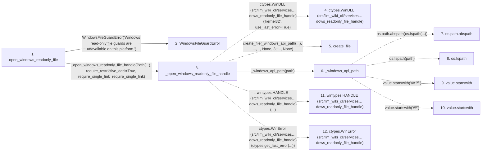

# open_windows_readonly_file

**Entry point:** `open_windows_readonly_file` (`api`)
**Source:** [filesystem_guard](../modules/filesystem_guard.md)
**Modules touched:** [filesystem_guard](../modules/filesystem_guard.md)

## Call sequence

> Static overview in presentation order, not runtime execution order. Arrows retain captured callers; siblings are shown before deeper helper detail.

```mermaid
sequenceDiagram
    participant p0 as open_windows_readonly_file
    participant p1 as WindowsFileGuardError
    participant p2 as _open_windows_readonly_file_handle
    participant p3 as Path
    participant p4 as msvcrt.open_osfhandle
    participant p5 as getattr (src/llm_wiki_cli/services…pen_windows_readonly_file)
    participant p6 as os.fdopen
    participant p7 as os.fstat
    participant p8 as stream.fileno
    participant p9 as windows_object_identity
    participant p10 as str (src/llm_wiki_cli/services…pen_windows_readonly_file)
    participant p11 as stream.close
    participant p12 as os.close
    participant p13 as _close_windows_handle
    participant p14 as ctypes.WinDLL (src/llm_wiki_cli/services…dows_readonly_file_handle)
    participant p15 as windows_object_identity_from_values
    participant p16 as create_file
    participant p17 as int (src/llm_wiki_cli/services…y:windows_object_identity)
    participant p18 as _windows_api_path
    participant p19 as getattr (src/llm_wiki_cli/services…y:windows_object_identity)
    participant p20 as wintypes.HANDLE (src/llm_wiki_cli/services…dows_readonly_file_handle)
    participant p21 as ctypes.WinError (src/llm_wiki_cli/services…dows_readonly_file_handle)
    p0->>p1: WindowsFileGuardError
    p0->>p2: _open_windows_readonly_file_handle
    p0-->>p3: Path(path)
    p0->>p2: _open_windows_readonly_file_handle
    p0-->>p3: Path(path)
    p0->>p2: _open_windows_readonly_file_handle
    p0-->>p3: Path(path)
    p0-->>p4: msvcrt.open_osfhandle(native_handle, ...)
    p0-->>p5: getattr (src/llm_wiki_cli/services…pen_windows_readonly_file)(os, 'O_BINARY', 0)
    p0-->>p5: getattr (src/llm_wiki_cli/services…pen_windows_readonly_file)(os, 'O_NOINHERIT', 0)
    p0-->>p6: os.fdopen(descriptor, 'rb')
    p0-->>p7: os.fstat(stream.fileno(...))
    p0-->>p8: stream.fileno
    p0->>p9: windows_object_identity
    p0-->>p10: str (src/llm_wiki_cli/services…pen_windows_readonly_file)(path)
    p0->>p1: WindowsFileGuardError
    p0-->>p10: str (src/llm_wiki_cli/services…pen_windows_readonly_file)(exc)
    p0->>p1: WindowsFileGuardError
    p0-->>p11: stream.close
    p0-->>p12: os.close(descriptor)
    p0->>p13: _close_windows_handle
    p2-->>p14: ctypes.WinDLL (src/llm_wiki_cli/services…dows_readonly_file_handle)('kernel32', use_last_error=True)
    p9->>p15: windows_object_identity_from_values
    p2-->>p16: create_file(_windows_api_path(...), ..., 1, None, 3, ..., None)
    p9-->>p17: int (src/llm_wiki_cli/services…y:windows_object_identity)(getattr(...))
    p2->>p18: _windows_api_path
    p9-->>p19: getattr (src/llm_wiki_cli/services…y:windows_object_identity)(result, 'st_dev', 0)
    p2-->>p20: wintypes.HANDLE (src/llm_wiki_cli/services…dows_readonly_file_handle)(...)
    p9-->>p17: int (src/llm_wiki_cli/services…y:windows_object_identity)(getattr(...))
    p2-->>p21: ctypes.WinError (src/llm_wiki_cli/services…dows_readonly_file_handle)(ctypes.get_last_error(...))
```

<!-- Auto-generated from static call edges. Dashed arrows are external or unresolved calls. Reviewed runtime conditions and side effects belong in Behavior. -->

> Call sequence diagram shows 30 of 170 interactions; 140 omitted to keep the visualization within the 30-interaction and generated-diagram limits, with uncertain identities omitted rather than inferred.

> Captured boundary calls: external 17 of 109 (92 omitted); unresolved 3 of 20 (17 omitted). These counts cover the captured static trace.

Omitted captured detail, grouped by actual caller occurrence and target module:

| Caller | Parent step | Target module | Kind | Omitted interactions |
| --- | --- | --- | --- | --- |
| `src/llm_wiki_cli/services/filesystem_guard.py:_windows_api_path` | 6 | - | external | 2 |
| `src/llm_wiki_cli/services/filesystem_guard.py:_windows_api_path` | 6 | - | unresolved | 2 |
| `src/llm_wiki_cli/services/filesystem_guard.py:_open_windows_readonly_file_handle` | 3 | - | external | 9 |
| `src/llm_wiki_cli/services/filesystem_guard.py:_open_windows_readonly_file_handle` | 3 | [src/llm_wiki_cli/services/filesystem_guard.py](../modules/filesystem_guard.md) | internal | 7 |
| `src/llm_wiki_cli/services/filesystem_guard.py:_open_windows_readonly_file_handle` | 3 | - | unresolved | 3 |
| `src/llm_wiki_cli/services/filesystem_guard.py:_verify_windows_handle_restrictive_dacl` | 29 | - | external | 50 |
| `src/llm_wiki_cli/services/filesystem_guard.py:_verify_windows_handle_restrictive_dacl` | 29 | - | unresolved | 5 |
| `src/llm_wiki_cli/services/filesystem_guard.py:_verify_windows_handle_restrictive_dacl` | 29 | [src/llm_wiki_cli/services/filesystem_guard.py](../modules/filesystem_guard.md) | internal | 15 |
> Omission summary shows 8 of 19 groups; 11 further groups are not expanded here. Counts above include all omitted interactions.
> Detailed flow queries retain their own coverage and limits; omitted paths may execute at runtime.

## Data flow

<!-- Auto-generated static analysis. Treat values and boundaries as best-effort hints, not runtime proof. -->

### Step data

| Step | Inputs | Reads | Writes | Returns |
|---|---|---|---|---|
| `open_windows_readonly_file` | `path: Path`, `require_restrictive_dacl: bool`, `require_single_link: bool` | `os`, `os`, `os`, `os`, `WindowsIdentityUnavailableError`, `WindowsFileGuardError` | - | - |
| `WindowsFileGuardError` | - | - | - | - |
| `_open_windows_readonly_file_handle` | `path: Path`, `require_restrictive_dacl: bool`, `require_single_link: bool` | - | `create_file.argtypes`, `create_file.restype`, `get_file_type.argtypes`, `get_file_type.restype`, `get_information.argtypes`, `get_information.restype` | `native_handle` |
| `ctypes.WinDLL (src/llm_wiki_cli/services…dows_readonly_file_handle)` | - | - | - | - |
| `create_file` | - | - | - | - |
| `_windows_api_path` | `path: Path` | - | - | `value`, `...`, `...` |
| `os.path.abspath` | - | - | - | - |
| `os.fspath` | - | - | - | - |
| `value.startswith` | - | - | - | - |
| `value.startswith` | - | - | - | - |
| `wintypes.HANDLE (src/llm_wiki_cli/services…dows_readonly_file_handle)` | - | - | - | - |
| `ctypes.WinError (src/llm_wiki_cli/services…dows_readonly_file_handle)` | - | - | - | - |

### Call data

| From | To | Line | Call |
|---|---|---:|---|
| open_windows_readonly_file | WindowsFileGuardError | 339 | `WindowsFileGuardError('Windows read-only file guards are unavailable on this platform.')` |
| open_windows_readonly_file | _open_windows_readonly_file_handle | 344 | `_open_windows_readonly_file_handle(Path(...), require_restrictive_dacl=True, require_single_link=require_single_link)` |
| _open_windows_readonly_file_handle | ctypes.WinDLL (src/llm_wiki_cli/services…dows_readonly_file_handle) | 419 | `ctypes.WinDLL('kernel32', use_last_error=True)` |
| _open_windows_readonly_file_handle | create_file | 434 | `create_file(_windows_api_path(...), ..., 1, None, 3, ..., None)` |
| _open_windows_readonly_file_handle | _windows_api_path | 435 | `_windows_api_path(path)` |
| _windows_api_path | os.path.abspath | 1310 | `os.path.abspath(os.fspath(...))` |
| _windows_api_path | os.fspath | 1310 | `os.fspath(path)` |
| _windows_api_path | value.startswith | 1311 | `value.startswith('\\\\?\\')` |
| _windows_api_path | value.startswith | 1313 | `value.startswith('\\\\')` |
| _open_windows_readonly_file_handle | wintypes.HANDLE (src/llm_wiki_cli/services…dows_readonly_file_handle) | 443 | `wintypes.HANDLE(...)` |
| _open_windows_readonly_file_handle | ctypes.WinError (src/llm_wiki_cli/services…dows_readonly_file_handle) | 445 | `ctypes.WinError(ctypes.get_last_error(...))` |

### Boundary effects

*No boundary effects detected.*

### Static analysis gaps

| Kind | Step | Target | Line |
|---|---|---|---:|
| external_call | `_open_windows_readonly_file_handle` | `ctypes.WinDLL` | 419 |
| unresolved_call | `_open_windows_readonly_file_handle` | `create_file` | 434 |
| external_call | `_windows_api_path` | `os.path.abspath` | 1310 |
| external_call | `_windows_api_path` | `os.fspath` | 1310 |
| unresolved_call | `_windows_api_path` | `value.startswith` | 1311 |
| unresolved_call | `_windows_api_path` | `value.startswith` | 1313 |
| external_call | `_open_windows_readonly_file_handle` | `wintypes.HANDLE` | 443 |
| external_call | `_open_windows_readonly_file_handle` | `ctypes.WinError` | 445 |
| step_limit | `open_windows_readonly_file` | `first 12 steps` | 0 |

## Behavior

This flow starts at `open_windows_readonly_file` and is classified as `api`. The generated call and data-flow sections are bounded static projections; runtime conditions and side effects require source-level confirmation.
