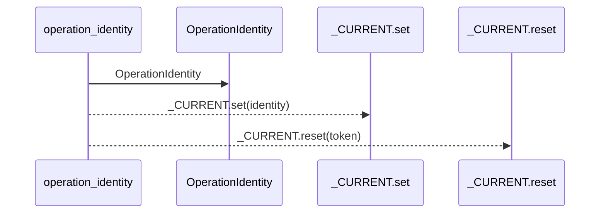
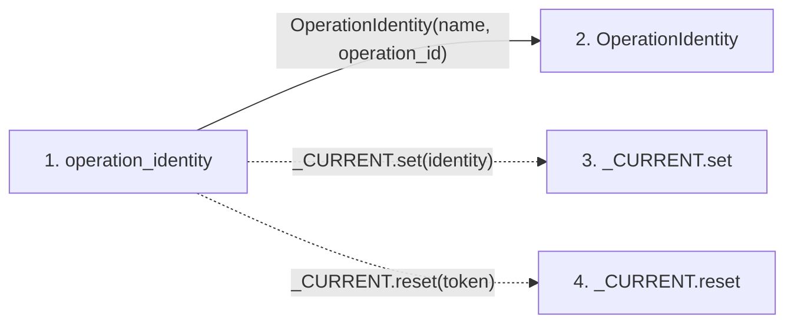

# operation_identity

**Entry point:** `operation_identity` (`api`)
**Source:** [engine_events](../modules/engine_events.md)
**Modules touched:** [engine_events](../modules/engine_events.md)

## Call sequence

> Static overview in presentation order, not runtime execution order. Arrows retain captured callers; representative internal continuations and boundary examples precede repeated helper detail.

<!-- Auto-generated from static call edges. Dashed arrows are external or unresolved calls. Reviewed runtime conditions and side effects belong in Behavior. -->

> Call sequence diagram shows 3 of 3 interactions; 0 omitted to keep the visualization within the 30-interaction and generated-diagram limits, with uncertain identities omitted rather than inferred.

> Captured boundary calls: external 0 of 0 (0 omitted); unresolved 2 of 2 (0 omitted). These counts cover the captured static trace.
> Detailed flow queries retain their own coverage and limits; omitted paths may execute at runtime.

## Data flow

<!-- Auto-generated static analysis. Treat values and boundaries as best-effort hints, not runtime proof. -->

### Analysis coverage

**Effect analysis partially available.** Flow assembly and source effect analysis are separate; empty observations do not prove an empty handler body.

Source steps: 2; effect analysis evaluated: 1, partial: 0, unavailable: 1. Counts include steps omitted from the displayed trace.

Collector observations for 1 source steps with known totals: observed: 2, emitted: 2, omitted: 0. Unavailable totals are excluded.

- Callable record unavailable for one or more source steps; those steps have no represented callable body.
- Effect collector totals unavailable; observed counts cover captured records only.

| Step | Callable record | Effect analysis | Collector totals | Observed | Emitted | Omitted |
|---|---|---|---|---:|---:|---:|
| `operation_identity` | `available` | `evaluated` | `available` | `2` | `2` | `0` |
| `OperationIdentity` | `unavailable` | `unavailable` | `unavailable` | — | — | — |
| `_CURRENT.set` | `not_applicable` | `not_applicable` | `not_applicable` | — | — | — |
| `_CURRENT.reset` | `not_applicable` | `not_applicable` | `not_applicable` | — | — | — |

### Step data

| Step | Inputs | Reads | Writes | Returns |
|---|---|---|---|---|
| `operation_identity` | `name: str`, `operation_id: str` | - | - | - |
| `OperationIdentity` | - | - | - | - |
| `_CURRENT.set` | - | - | - | - |
| `_CURRENT.reset` | - | - | - | - |

### Call data

| From | To | Line | Call |
|---|---|---:|---|
| operation_identity | OperationIdentity | 185 | `OperationIdentity(name, operation_id)` |
| operation_identity | _CURRENT.set | 186 | `_CURRENT.set(identity)` |
| operation_identity | _CURRENT.reset | 190 | `_CURRENT.reset(token)` |

### Boundary effects

*No boundary-effect observations were captured in this static trace.*

### Static analysis gaps

| Kind | Step | Target | Line |
|---|---|---|---:|
| unresolved_call | `operation_identity` | `_CURRENT.reset` | 190 |

## Behavior

This flow starts at `operation_identity` and is classified as `api`. The generated call and data-flow sections are bounded static projections; runtime conditions and side effects require source-level confirmation.
