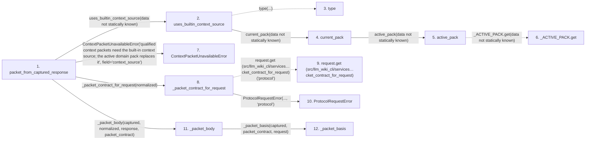

# packet_from_captured_response

**Entry point:** `packet_from_captured_response` (`api`)
**Source:** [context_packet_builder](../modules/context_packet_builder.md)
**Modules touched:** [canonical_json](../modules/canonical_json.md), [change_selection](../modules/change_selection.md), [common](../modules/common.md), [context_packet](../modules/context_packet.md), and 19 more

**Complete modules touched:**

- [canonical_json](../modules/canonical_json.md)
- [change_selection](../modules/change_selection.md)
- [common](../modules/common.md)
- [context_packet](../modules/context_packet.md)
- [context_packet_builder](../modules/context_packet_builder.md)
- [context_request_format](../modules/context_request_format.md)
- [context_service](../modules/context_service.md)
- [domain_pack](../modules/domain_pack.md)
- [extraction_service](../modules/extraction_service.md)
- [filesystem_guard](../modules/filesystem_guard.md)
- [gitignore](../modules/gitignore.md)
- [host](../modules/host.md)
- [knowledge_envelope](../modules/knowledge_envelope.md)
- [knowledge_evidence](../modules/knowledge_evidence.md)
- [knowledge_governance](../modules/knowledge_governance.md)
- [knowledge_observability](../modules/knowledge_observability.md)
- [maintenance_status](../modules/maintenance_status.md)
- [pack_interfaces](../modules/pack_interfaces.md)
- [packet_field_policy](../modules/packet_field_policy.md)
- [path_policy](../modules/path_policy.md)
- [source_selection](../modules/source_selection.md)
- [source_snapshot](../modules/source_snapshot.md)
- [validation](../modules/validation.md)

## Call sequence

> Static overview in presentation order, not runtime execution order. Arrows retain captured callers; representative internal continuations and boundary examples precede repeated helper detail.

```mermaid
sequenceDiagram
    participant p0 as packet_from_captured_response
    participant p1 as uses_builtin_context_source
    participant p2 as _packet_contract_for_request
    participant p3 as _packet_body
    participant p4 as _assert_source_unchanged
    participant p5 as _assert_wiki_unchanged
    participant p6 as _assert_selection_unchanged
    participant p7 as _packet_id
    participant p8 as _encode_packet_payload
    participant p9 as validate_context_packet
    participant p10 as ContextPacketUnavailableError
    participant p11 as _packet_basis
    participant p12 as _source_anchor
    participant p13 as _assert_wiki_integrity
    participant p14 as _validate_context_packet_bytes
    participant p15 as current_pack
    participant p16 as source_snapshot_matches_current_files
    participant p17 as _wiki_anchor
    participant p18 as select_changes
    participant p19 as _selected_git_changed_files
    participant p20 as _path_policy_receipt
    participant p21 as hash_source_snapshot
    participant p22 as validate_changes
    participant p23 as _git_changed_files
    participant p24 as _coerce_packet_bytes
    participant p25 as _strict_json_payload
    participant p26 as source_snapshot_inputs_match_current_files
    participant p27 as _git
    participant p28 as _freshness_basis
    participant p29 as type
    participant p30 as request.get (src/llm_wiki_cli/services…cket_contract_for_request)
    p0->>p1: uses_builtin_context_source
    p0->>p2: _packet_contract_for_request
    p0->>p3: _packet_body
    p0->>p4: _assert_source_unchanged
    p0->>p5: _assert_wiki_unchanged
    p0->>p6: _assert_selection_unchanged
    p0->>p7: _packet_id
    p0->>p8: _encode_packet_payload
    p0->>p9: validate_context_packet
    p0->>p10: ContextPacketUnavailableError
    p3->>p11: _packet_basis
    p4->>p12: _source_anchor
    p5->>p13: _assert_wiki_integrity
    p9->>p14: _validate_context_packet_bytes
    p1->>p15: current_pack
    p4->>p16: source_snapshot_matches_current_files
    p5->>p17: _wiki_anchor
    p6->>p18: select_changes
    p6->>p19: _selected_git_changed_files
    p3->>p20: _path_policy_receipt
    p11->>p21: hash_source_snapshot
    p18->>p22: validate_changes
    p19->>p23: _git_changed_files
    p14->>p24: _coerce_packet_bytes
    p14->>p25: _strict_json_payload
    p16->>p26: source_snapshot_inputs_match_current_files
    p18->>p27: _git
    p11->>p28: _freshness_basis
    p1-->>p29: type(...)
    p2-->>p30: request.get (src/llm_wiki_cli/services…cket_contract_for_request)('protocol')
```

<!-- Auto-generated from static call edges. Dashed arrows are external or unresolved calls. Reviewed runtime conditions and side effects belong in Behavior. -->

> Call sequence diagram shows 30 of 1112 interactions; 1082 omitted to keep the visualization within the 30-interaction and generated-diagram limits, with uncertain identities omitted rather than inferred.

> Captured boundary calls: external 1 of 303 (302 omitted); unresolved 1 of 298 (297 omitted). These counts cover the captured static trace.

Omitted captured detail, grouped by actual caller occurrence and target module:

| Caller | Parent step | Target module | Kind | Omitted interactions |
| --- | --- | --- | --- | --- |
| `src/llm_wiki_cli/services/domain_pack.py:current_pack` | 4 | [src/llm_wiki_engine/pack_interfaces.py](../modules/pack_interfaces.md) | internal | 1 |
| `src/llm_wiki_engine/pack_interfaces.py:active_pack` | 5 | - | unresolved | 1 |
| `src/llm_wiki_cli/services/context_packet_builder.py:_packet_contract_for_request` | 8 | [src/llm_wiki_engine/context_request_format.py](../modules/context_request_format.md) | internal | 1 |
| `src/llm_wiki_engine/knowledge_envelope.py:hash_source_snapshot` | 13 | - | external | 3 |
| `src/llm_wiki_engine/knowledge_envelope.py:hash_source_snapshot` | 13 | [src/llm_wiki_engine/knowledge_envelope.py](../modules/knowledge_envelope.md) | internal | 3 |
| `src/llm_wiki_engine/knowledge_envelope.py:hash_source_snapshot` | 13 | - | unresolved | 3 |
| `src/llm_wiki_engine/knowledge_envelope.py:_hash_structured` | 22 | - | unresolved | 1 |
| `src/llm_wiki_engine/knowledge_envelope.py:_hash_structured` | 22 | [src/llm_wiki_engine/knowledge_envelope.py](../modules/knowledge_envelope.md) | internal | 2 |
> Omission summary shows 8 of 313 groups; 305 further groups are not expanded here. Counts above include all omitted interactions.
> Detailed flow queries retain their own coverage and limits; omitted paths may execute at runtime.

> Trace truncated at the depth limit; deeper calls are omitted.

## Data flow

<!-- Auto-generated static analysis. Treat values and boundaries as best-effort hints, not runtime proof. -->

### Analysis coverage

**Effect analysis partially available.** Flow assembly and source effect analysis are separate; empty observations do not prove an empty handler body.

Source steps: 512; effect analysis evaluated: 319, partial: 5, unavailable: 188. Counts include steps omitted from the displayed trace.

Collector observations for 324 source steps with known totals: observed: 1471, emitted: 1445, omitted: 26. Unavailable totals are excluded.

- Callable record unavailable for one or more source steps; those steps have no represented callable body.
- Effect collector omitted observations before flow assembly; displayed effects are partial.
- Effect collector totals unavailable; observed counts cover captured records only.

| Step | Callable record | Effect analysis | Collector totals | Observed | Emitted | Omitted |
|---|---|---|---|---:|---:|---:|
| `packet_from_captured_response` | `available` | `evaluated` | `available` | `5` | `5` | `0` |
| `uses_builtin_context_source` | `available` | `evaluated` | `available` | `2` | `2` | `0` |
| `type` | `not_applicable` | `not_applicable` | `not_applicable` | — | — | — |
| `current_pack` | `available` | `evaluated` | `available` | `2` | `2` | `0` |
| `active_pack` | `available` | `evaluated` | `available` | `1` | `1` | `0` |
| `_ACTIVE_PACK.get` | `not_applicable` | `not_applicable` | `not_applicable` | — | — | — |
| `ContextPacketUnavailableError` | `unavailable` | `unavailable` | `unavailable` | — | — | — |
| `_packet_contract_for_request` | `available` | `evaluated` | `available` | `7` | `7` | `0` |
| `request.get (src/llm_wiki_cli/services…cket_contract_for_request)` | `not_applicable` | `not_applicable` | `not_applicable` | — | — | — |
| `ProtocolRequestError` | `unavailable` | `unavailable` | `unavailable` | — | — | — |
| `_packet_body` | `available` | `evaluated` | `available` | `6` | `6` | `0` |
| `_packet_basis` | `available` | `evaluated` | `available` | `7` | `7` | `0` |

### Step data

| Step | Inputs | Reads | Writes | Returns |
|---|---|---|---|---|
| `packet_from_captured_response` | `captured: CapturedContextRead`, `normalized: Mapping[str, Any]`, `response: Mapping[str, Any]` | - | `wiki_options[...]` | `validated.packet` |
| `uses_builtin_context_source` | - | `CodeContextSource` | - | `...` |
| `type` | - | - | - | - |
| `current_pack` | - | `CODE_DOCS_PACK` | - | `...` |
| `active_pack` | - | - | - | `_ACTIVE_PACK.get(...)` |
| `_ACTIVE_PACK.get` | - | - | - | - |
| `ContextPacketUnavailableError` | - | - | - | - |
| `_packet_contract_for_request` | `request: Mapping[str, Any]` | `_LEGACY_PACKET_CONTRACT`, `_LEGACY_PACKET_CONTRACT`, `_KNOWLEDGE_PACKET_CONTRACT`, `_KNOWLEDGE_PACKET_CONTRACT` | - | `_LEGACY_PACKET_CONTRACT`, `_KNOWLEDGE_PACKET_CONTRACT` |
| `request.get (src/llm_wiki_cli/services…cket_contract_for_request)` | - | - | - | - |
| `ProtocolRequestError` | - | - | - | - |
| `_packet_body` | `captured: CapturedContextRead`, `request: Mapping[str, Any]`, `response: Mapping[str, Any]`, `packet_contract: _PacketWireContract` | `CONTEXT_PACKET_ASSURANCE_LEVEL` | - | `{...}` |
| `_packet_basis` | `captured: CapturedContextRead`, `packet_contract: _PacketWireContract`, `request: Mapping[str, Any]` | `_KNOWLEDGE_PACKET_CONTRACT`, `__version__` | `knowledge[...]` | `{...}` |

### Call data

| From | To | Line | Call |
|---|---|---:|---|
| packet_from_captured_response | uses_builtin_context_source | 1319 | `uses_builtin_context_source(data not statically known)` |
| uses_builtin_context_source | type | 231 | `type(...)` |
| uses_builtin_context_source | current_pack | 231 | `current_pack(data not statically known)` |
| current_pack | active_pack | 324 | `active_pack(data not statically known)` |
| active_pack | _ACTIVE_PACK.get | 643 | `_ACTIVE_PACK.get(data not statically known)` |
| packet_from_captured_response | ContextPacketUnavailableError | 1321 | `ContextPacketUnavailableError('qualified context packets need the built-in context source; the active domain pack replaces it', field='context_source')` |
| packet_from_captured_response | _packet_contract_for_request | 1326 | `_packet_contract_for_request(normalized)` |
| _packet_contract_for_request | request.get (src/llm_wiki_cli/services…cket_contract_for_request) | 263 | `request.get('protocol')` |
| _packet_contract_for_request | ProtocolRequestError | 268 | `context_service.ProtocolRequestError(..., 'protocol')` |
| packet_from_captured_response | _packet_body | 1327 | `_packet_body(captured, normalized, response, packet_contract)` |
| _packet_body | _packet_basis | 1765 | `_packet_basis(captured, packet_contract, request)` |

### Boundary effects

*No boundary-effect observations were captured in this static trace.*

### Static analysis gaps

| Kind | Step | Target | Line |
|---|---|---|---:|
| external_call | `uses_builtin_context_source` | `type` | 231 |
| unresolved_call | `active_pack` | `_ACTIVE_PACK.get` | 643 |
| unresolved_call | `_packet_contract_for_request` | `request.get` | 263 |
| step_limit | `packet_from_captured_response` | `first 12 steps` | 0 |
| truncated_flow | `packet_from_captured_response` | `depth limit` | 0 |

## Behavior

This flow starts at `packet_from_captured_response` and is classified as `api`. The generated call and data-flow sections are bounded static projections; runtime conditions and side effects require source-level confirmation.
