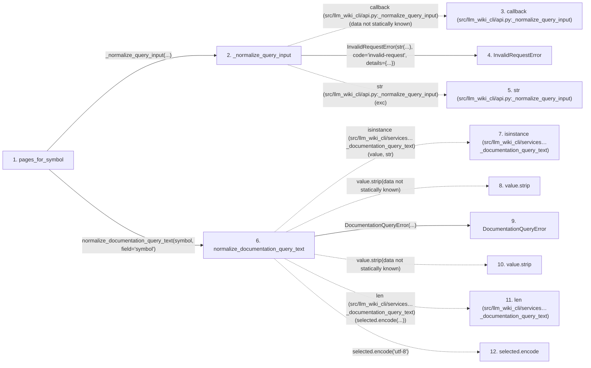

# pages_for_symbol

**Entry point:** `pages_for_symbol` (`api`)
**Source:** [api](../modules/api.md)
**Modules touched:** [api](../modules/api.md), [common](../modules/common.md), [config](../modules/config.md), [context_packet](../modules/context_packet.md), and 19 more

**Complete modules touched:**

- [api](../modules/api.md)
- [common](../modules/common.md)
- [config](../modules/config.md)
- [context_packet](../modules/context_packet.md)
- [documentation_queries](../modules/documentation_queries.md)
- [documentation_query_builder](../modules/documentation_query_builder.md)
- [filesystem_guard](../modules/filesystem_guard.md)
- [implementation_evidence](../modules/implementation_evidence.md)
- [io](../modules/io.md)
- [knowledge_consumption](../modules/knowledge_consumption.md)
- [knowledge_evidence](../modules/knowledge_evidence.md)
- [knowledge_governance](../modules/knowledge_governance.md)
- [knowledge_storage](../modules/knowledge_storage.md)
- [knowledge_storage_io](../modules/knowledge_storage_io.md)
- [maintenance_evidence](../modules/maintenance_evidence.md)
- [maintenance_shapes](../modules/maintenance_shapes.md)
- [maintenance_state](../modules/maintenance_state.md)
- [maintenance_status](../modules/maintenance_status.md)
- [python_implementation](../modules/python_implementation.md)
- [source_selection](../modules/source_selection.md)
- [source_snapshot](../modules/source_snapshot.md)
- [sync_manifest](../modules/sync_manifest.md)
- [validation](../modules/validation.md)

## Call sequence

> Static overview in presentation order, not runtime execution order. Arrows retain captured callers; siblings are shown before deeper helper detail.

```mermaid
sequenceDiagram
    participant p0 as pages_for_symbol
    participant p1 as _normalize_query_input
    participant p2 as normalize_documentation_query_text
    participant p3 as _effective_query_limit
    participant p4 as cast
    participant p5 as _run_query
    participant p6 as _query_service(…).pages_for_symbol
    participant p7 as _query_service
    participant p8 as callback (src/llm_wiki_cli/api.py:_normalize_query_input)
    participant p9 as isinstance (src/llm_wiki_cli/services…_documentation_query_text)
    participant p10 as _normalize_query_limit
    participant p11 as callback (src/llm_wiki_cli/api.py:_run_query)
    participant p12 as InvalidRequestError
    participant p13 as value.strip
    participant p14 as build_documentation_query_service
    participant p15 as str (src/llm_wiki_cli/api.py:_normalize_query_input)
    participant p16 as DocumentationQueryError
    participant p17 as str (src/llm_wiki_cli/api.py:_run_query)
    participant p18 as len (src/llm_wiki_cli/services…_documentation_query_text)
    participant p19 as selected.encode
    participant p20 as isinstance (src/llm_wiki_cli/api.py:b…cumentation_query_service)
    participant p21 as normalize_documentation_query_limit
    p0->>p1: _normalize_query_input
    p0->>p2: normalize_documentation_query_text
    p0->>p3: _effective_query_limit
    p0-->>p4: cast(PagesForSymbolResult, _run_query(...))
    p0->>p5: _run_query
    p0-->>p6: _query_service(…).pages_for_symbol(query)
    p0->>p7: _query_service
    p1-->>p8: callback (src/llm_wiki_cli/api.py:_normalize_query_input)
    p2-->>p9: isinstance (src/llm_wiki_cli/services…_documentation_query_text)(value, str)
    p3->>p10: _normalize_query_limit
    p5-->>p11: callback (src/llm_wiki_cli/api.py:_run_query)
    p7->>p12: InvalidRequestError
    p1->>p12: InvalidRequestError
    p2-->>p13: value.strip
    p5->>p12: InvalidRequestError
    p7->>p14: build_documentation_query_service
    p1-->>p15: str (src/llm_wiki_cli/api.py:_normalize_query_input)(exc)
    p2->>p16: DocumentationQueryError
    p5-->>p17: str (src/llm_wiki_cli/api.py:_run_query)(exc)
    p2-->>p13: value.strip
    p2-->>p18: len (src/llm_wiki_cli/services…_documentation_query_text)(selected.encode(...))
    p2-->>p19: selected.encode('utf-8')
    p2->>p16: DocumentationQueryError
    p10->>p1: _normalize_query_input
    p14-->>p20: isinstance (src/llm_wiki_cli/api.py:b…cumentation_query_service)(value, bool)
    p10->>p21: normalize_documentation_query_limit
    p14->>p12: InvalidRequestError
    p14-->>p20: isinstance (src/llm_wiki_cli/api.py:b…cumentation_query_service)(helper_cache_dir, (...))
    p14->>p12: InvalidRequestError
    p14->>p21: normalize_documentation_query_limit
```

<!-- Auto-generated from static call edges. Dashed arrows are external or unresolved calls. Reviewed runtime conditions and side effects belong in Behavior. -->

> Call sequence diagram shows 30 of 836 interactions; 806 omitted to keep the visualization within the 30-interaction and generated-diagram limits, with uncertain identities omitted rather than inferred.

> Captured boundary calls: external 7 of 350 (343 omitted); unresolved 6 of 183 (177 omitted). These counts cover the captured static trace.

Omitted captured detail, grouped by actual caller occurrence and target module:

| Caller | Parent step | Target module | Kind | Omitted interactions |
| --- | --- | --- | --- | --- |
| `src/llm_wiki_cli/services/documentation_query_builder.py:normalize_documentation_query_limit` | 17 | - | external | 3 |
| `src/llm_wiki_cli/services/documentation_query_builder.py:normalize_documentation_query_limit` | 17 | [src/llm_wiki_cli/services/documentation_queries.py](../modules/documentation_queries.md) | internal | 1 |
| `src/llm_wiki_cli/api.py:build_documentation_query_service` | 30 | [src/llm_wiki_cli/config.py](../modules/config.md) | internal | 1 |
| `src/llm_wiki_cli/config.py:validate_source_root` | 36 | [src/llm_wiki_cli/config.py](../modules/config.md) | internal | 7 |
| `src/llm_wiki_cli/config.py:validate_path` | 37 | [src/llm_wiki_cli/config.py](../modules/config.md) | internal | 2 |
| `src/llm_wiki_cli/config.py:validate_path` | 37 | - | unresolved | 3 |
| `src/llm_wiki_cli/config.py:validate_path` | 37 | - | external | 2 |
| `src/llm_wiki_cli/config.py:validate_source_root` | 36 | - | unresolved | 5 |
> Omission summary shows 8 of 178 groups; 170 further groups are not expanded here. Counts above include all omitted interactions.
> Detailed flow queries retain their own coverage and limits; omitted paths may execute at runtime.

> Trace truncated at the depth limit; deeper calls are omitted.

## Data flow

<!-- Auto-generated static analysis. Treat values and boundaries as best-effort hints, not runtime proof. -->

### Step data

| Step | Inputs | Reads | Writes | Returns |
|---|---|---|---|---|
| `pages_for_symbol` | `symbol: object`, `service: DocumentationGraphQueryService \| None`, `src_dir: str`, `wiki_dir: str`, `limit: int`, `allow_external_src: bool`, `read_only: bool`, `source_selection: str \| Path \| None` | `PagesForSymbolResult` | - | `cast(...)` |
| `_normalize_query_input` | `callback: Callable[[], _R]`, `field: str` | `DocumentationQueryError` | - | `callback(...)` |
| `callback (src/llm_wiki_cli/api.py:_normalize_query_input)` | - | - | - | - |
| `InvalidRequestError` | - | - | - | - |
| `str (src/llm_wiki_cli/api.py:_normalize_query_input)` | - | - | - | - |
| `normalize_documentation_query_text` | `value: object`, `field: str` | `QUERY_IDENTITY_BYTE_LIMIT`, `QUERY_IDENTITY_BYTE_LIMIT` | - | `selected` |
| `isinstance (src/llm_wiki_cli/services…_documentation_query_text)` | - | - | - | - |
| `value.strip` | - | - | - | - |
| `DocumentationQueryError` | - | - | - | - |
| `value.strip` | - | - | - | - |
| `len (src/llm_wiki_cli/services…_documentation_query_text)` | - | - | - | - |
| `selected.encode` | - | - | - | - |

### Call data

| From | To | Line | Call |
|---|---|---:|---|
| pages_for_symbol | _normalize_query_input | 2285 | `_normalize_query_input(...)` |
| _normalize_query_input | callback (src/llm_wiki_cli/api.py:_normalize_query_input) | 1998 | `callback(data not statically known)` |
| _normalize_query_input | InvalidRequestError | 2000 | `InvalidRequestError(str(...), code='invalid-request', details={...})` |
| _normalize_query_input | str (src/llm_wiki_cli/api.py:_normalize_query_input) | 2001 | `str(exc)` |
| pages_for_symbol | normalize_documentation_query_text | 2286 | `normalize_documentation_query_text(symbol, field='symbol')` |
| normalize_documentation_query_text | isinstance (src/llm_wiki_cli/services…_documentation_query_text) | 64 | `isinstance(value, str)` |
| normalize_documentation_query_text | value.strip | 64 | `value.strip(data not statically known)` |
| normalize_documentation_query_text | DocumentationQueryError | 65 | `DocumentationQueryError(...)` |
| normalize_documentation_query_text | value.strip | 66 | `value.strip(data not statically known)` |
| normalize_documentation_query_text | len (src/llm_wiki_cli/services…_documentation_query_text) | 67 | `len(selected.encode(...))` |
| normalize_documentation_query_text | selected.encode | 67 | `selected.encode('utf-8')` |

### Boundary effects

*No boundary effects detected.*

### Static analysis gaps

| Kind | Step | Target | Line |
|---|---|---|---:|
| unresolved_call | `_normalize_query_input` | `callback` | 1998 |
| external_call | `normalize_documentation_query_text` | `isinstance` | 64 |
| unresolved_call | `normalize_documentation_query_text` | `value.strip` | 64 |
| unresolved_call | `normalize_documentation_query_text` | `value.strip` | 66 |
| unresolved_call | `normalize_documentation_query_text` | `selected.encode` | 67 |
| step_limit | `pages_for_symbol` | `first 12 steps` | 0 |
| truncated_flow | `pages_for_symbol` | `depth limit` | 0 |

## Behavior

This flow starts at `pages_for_symbol` and is classified as `api`. The generated call and data-flow sections are bounded static projections; runtime conditions and side effects require source-level confirmation.
