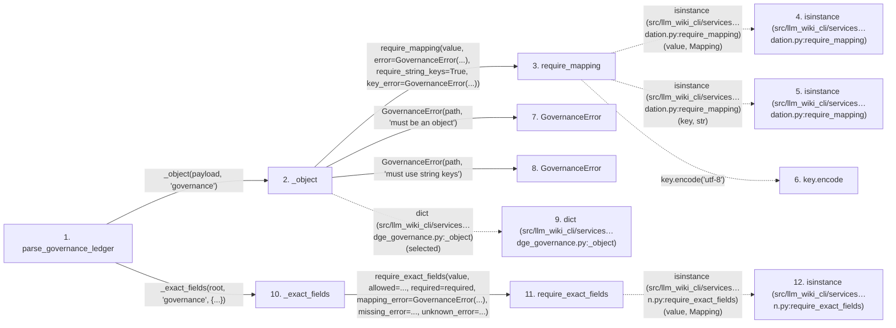

# parse_governance_ledger

**Entry point:** `parse_governance_ledger` (`api`)
**Source:** [knowledge_governance](../modules/knowledge_governance.md)
**Modules touched:** [concept_identity](../modules/concept_identity.md), [knowledge_evidence](../modules/knowledge_evidence.md), [knowledge_governance](../modules/knowledge_governance.md), and 4 more

**Complete modules touched:**

- [concept_identity](../modules/concept_identity.md)
- [knowledge_evidence](../modules/knowledge_evidence.md)
- [knowledge_governance](../modules/knowledge_governance.md)
- [knowledge_model](../modules/knowledge_model.md)
- [validation](../modules/validation.md)
- [wiki_media](../modules/wiki_media.md)
- [wiki_surface](../modules/wiki_surface.md)

## Call sequence

> Static overview in presentation order, not runtime execution order. Arrows retain captured callers; representative internal continuations and boundary examples precede repeated helper detail.

```mermaid
sequenceDiagram
    participant p0 as parse_governance_ledger
    participant p1 as _object
    participant p2 as _exact_fields
    participant p3 as _bundle_id
    participant p4 as _concept_uid
    participant p5 as _concept_kind
    participant p6 as _identity_value
    participant p7 as _parse_lifecycle_event
    participant p8 as _parse_review_event
    participant p9 as validate_governance_ledger
    participant p10 as GovernanceError
    participant p11 as GovernanceAllocation
    participant p12 as GovernanceAlias
    participant p13 as _alias_type
    participant p14 as GovernanceLedger
    participant p15 as validate_bundle_id
    participant p16 as validate_concept_uid
    participant p17 as validate_concept_kind
    participant p18 as _event_id
    participant p19 as validate_alias_value
    participant p20 as _section_locator
    participant p21 as _hash
    participant p22 as _parse_review_evidence
    participant p23 as _parse_actor
    participant p24 as authored_event_time
    participant p25 as _machine_code
    participant p26 as _identity_ownership_key
    participant p27 as _validate_lifecycle_event_fields
    participant p28 as _validate_lifecycle_histories
    participant p29 as str (src/llm_wiki_cli/services…y:parse_governance_ledger)
    participant p30 as concepts_raw.items
    p0->>p1: _object
    p0->>p2: _exact_fields
    p0->>p3: _bundle_id
    p0->>p4: _concept_uid
    p0->>p5: _concept_kind
    p0->>p6: _identity_value
    p0->>p7: _parse_lifecycle_event
    p0->>p8: _parse_review_event
    p0->>p9: validate_governance_ledger
    p0->>p10: GovernanceError
    p0->>p11: GovernanceAllocation
    p0->>p12: GovernanceAlias
    p0->>p13: _alias_type
    p0->>p14: GovernanceLedger
    p3->>p15: validate_bundle_id
    p4->>p16: validate_concept_uid
    p5->>p17: validate_concept_kind
    p7->>p18: _event_id
    p6->>p19: validate_alias_value
    p8->>p20: _section_locator
    p8->>p21: _hash
    p8->>p22: _parse_review_evidence
    p7->>p23: _parse_actor
    p7->>p24: authored_event_time
    p7->>p25: _machine_code
    p9->>p26: _identity_ownership_key
    p9->>p27: _validate_lifecycle_event_fields
    p9->>p28: _validate_lifecycle_histories
    p0-->>p29: str (src/llm_wiki_cli/services…y:parse_governance_ledger)(record[...])
    p0-->>p30: concepts_raw.items
```

<!-- Auto-generated from static call edges. Dashed arrows are external or unresolved calls. Reviewed runtime conditions and side effects belong in Behavior. -->

> Call sequence diagram shows 30 of 441 interactions; 411 omitted to keep the visualization within the 30-interaction and generated-diagram limits, with uncertain identities omitted rather than inferred.

> Captured boundary calls: external 1 of 93 (92 omitted); unresolved 1 of 87 (86 omitted). These counts cover the captured static trace.

Omitted captured detail, grouped by actual caller occurrence and target module:

| Caller | Parent step | Target module | Kind | Omitted interactions |
| --- | --- | --- | --- | --- |
| `src/llm_wiki_cli/services/knowledge_governance.py:_object` | 2 | [src/llm_wiki_cli/services/validation.py](../modules/validation.md) | internal | 1 |
| `src/llm_wiki_cli/services/validation.py:require_mapping` | 3 | - | external | 2 |
| `src/llm_wiki_cli/services/validation.py:require_mapping` | 3 | - | unresolved | 1 |
| `src/llm_wiki_cli/services/knowledge_governance.py:_object` | 2 | [src/llm_wiki_cli/services/knowledge_governance.py](../modules/knowledge_governance.md) | internal | 2 |
| `src/llm_wiki_cli/services/knowledge_governance.py:_object` | 2 | - | external | 1 |
| `src/llm_wiki_cli/services/knowledge_governance.py:_exact_fields` | 10 | [src/llm_wiki_cli/services/validation.py](../modules/validation.md) | internal | 1 |
| `src/llm_wiki_cli/services/validation.py:require_exact_fields` | 11 | - | external | 9 |
| `src/llm_wiki_cli/services/validation.py:require_exact_fields` | 11 | - | unresolved | 2 |
> Omission summary shows 8 of 122 groups; 114 further groups are not expanded here. Counts above include all omitted interactions.
> Detailed flow queries retain their own coverage and limits; omitted paths may execute at runtime.

> Trace truncated at the depth limit; deeper calls are omitted.

## Data flow

<!-- Auto-generated static analysis. Treat values and boundaries as best-effort hints, not runtime proof. -->

### Step data

| Step | Inputs | Reads | Writes | Returns |
|---|---|---|---|---|
| `parse_governance_ledger` | `payload: object`, `expected_bundle_id: str \| None` | `GOVERNANCE_SCHEMA_VERSION`, `GOVERNANCE_SCHEMA_VERSION`, `ALIAS_NATURAL_KEY`, `ALIAS_LOCATOR` | `concepts[...]`, `aliases[...]` | `validate_governance_ledger(...)` |
| `_object` | `value: object`, `path: str` | - | - | `dict(...)` |
| `require_mapping` | `value: object`, `error: Exception`, `require_string_keys: bool`, `key_error: Exception \| None`, `require_utf8_keys: bool`, `utf8_key_error: Exception \| None` | `Mapping` | - | `value` |
| `isinstance (src/llm_wiki_cli/services…dation.py:require_mapping)` | - | - | - | - |
| `isinstance (src/llm_wiki_cli/services…dation.py:require_mapping)` | - | - | - | - |
| `key.encode` | - | - | - | - |
| `GovernanceError` | - | - | - | - |
| `GovernanceError` | - | - | - | - |
| `dict (src/llm_wiki_cli/services…dge_governance.py:_object)` | - | - | - | - |
| `_exact_fields` | `value: Mapping[str, object]`, `path: str`, `required: set[str]`, `optional: set[str] \| frozenset[str]` | - | - | `require_shared_exact_fields(...)` |
| `require_exact_fields` | `value: object`, `allowed: Iterable[str]`, `required: Iterable[str]`, `mapping_error: Exception`, `missing_error: _ErrorFactory`, `unknown_error: _ErrorFactory`, `invalid_error: Callable[[tuple[str, ...], tuple[str, ...]], Exception] \| None`, `stringify_keys: bool` | `Mapping` | - | - |
| `isinstance (src/llm_wiki_cli/services…n.py:require_exact_fields)` | - | - | - | - |

### Call data

| From | To | Line | Call |
|---|---|---:|---|
| parse_governance_ledger | _object | 421 | `_object(payload, 'governance')` |
| _object | require_mapping | 3153 | `require_mapping(value, error=GovernanceError(...), require_string_keys=True, key_error=GovernanceError(...))` |
| require_mapping | isinstance (src/llm_wiki_cli/services…dation.py:require_mapping) | 765 | `isinstance(value, Mapping)` |
| require_mapping | isinstance (src/llm_wiki_cli/services…dation.py:require_mapping) | 769 | `isinstance(key, str)` |
| require_mapping | key.encode | 774 | `key.encode('utf-8')` |
| _object | GovernanceError | 3155 | `GovernanceError(path, 'must be an object')` |
| _object | GovernanceError | 3157 | `GovernanceError(path, 'must use string keys')` |
| _object | dict (src/llm_wiki_cli/services…dge_governance.py:_object) | 3159 | `dict(selected)` |
| parse_governance_ledger | _exact_fields | 422 | `_exact_fields(root, 'governance', {...})` |
| _exact_fields | require_exact_fields | 3176 | `require_shared_exact_fields(value, allowed=..., required=required, mapping_error=GovernanceError(...), missing_error=..., unknown_error=...)` |
| require_exact_fields | isinstance (src/llm_wiki_cli/services…n.py:require_exact_fields) | 1243 | `isinstance(value, Mapping)` |

### Boundary effects

*No boundary effects detected.*

### Static analysis gaps

| Kind | Step | Target | Line |
|---|---|---|---:|
| external_call | `require_mapping` | `isinstance` | 765 |
| external_call | `require_mapping` | `isinstance` | 769 |
| unresolved_call | `require_mapping` | `key.encode` | 774 |
| external_call | `require_exact_fields` | `isinstance` | 1243 |
| step_limit | `parse_governance_ledger` | `first 12 steps` | 0 |
| truncated_flow | `parse_governance_ledger` | `depth limit` | 0 |

## Behavior

This flow starts at `parse_governance_ledger` and is classified as `api`. The generated call and data-flow sections are bounded static projections; runtime conditions and side effects require source-level confirmation.
