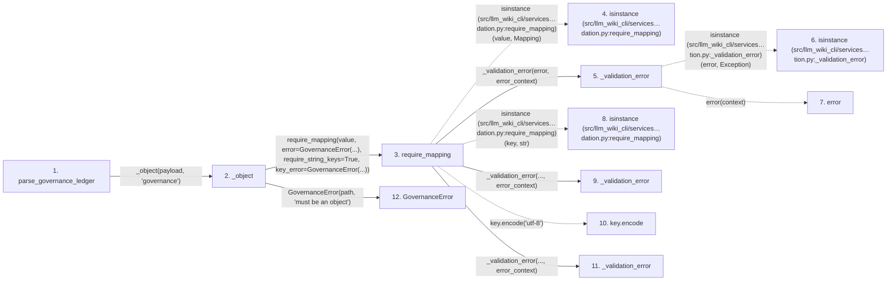

# parse_governance_ledger

**Entry point:** `parse_governance_ledger` (`api`)
**Source:** [knowledge_governance](../modules/knowledge_governance.md)
**Modules touched:** [concept_identity](../modules/concept_identity.md), [knowledge_evidence](../modules/knowledge_evidence.md), [knowledge_governance](../modules/knowledge_governance.md), and 4 more

**Complete modules touched:**

- [concept_identity](../modules/concept_identity.md)
- [knowledge_evidence](../modules/knowledge_evidence.md)
- [knowledge_governance](../modules/knowledge_governance.md)
- [knowledge_model](../modules/knowledge_model.md)
- [validation](../modules/validation.md)
- [wiki_media](../modules/wiki_media.md)
- [wiki_surface](../modules/wiki_surface.md)

## Call sequence

> Static overview in presentation order, not runtime execution order. Arrows retain captured callers; representative internal continuations and boundary examples precede repeated helper detail.

```mermaid
sequenceDiagram
    participant p0 as parse_governance_ledger
    participant p1 as _object
    participant p2 as _exact_fields
    participant p3 as _bundle_id
    participant p4 as _concept_uid
    participant p5 as _concept_kind
    participant p6 as _identity_value
    participant p7 as _parse_lifecycle_event
    participant p8 as _parse_review_event
    participant p9 as validate_governance_ledger
    participant p10 as GovernanceError
    participant p11 as GovernanceAllocation
    participant p12 as GovernanceAlias
    participant p13 as _alias_type
    participant p14 as GovernanceLedger
    participant p15 as require_mapping
    participant p16 as require_exact_fields
    participant p17 as validate_bundle_id
    participant p18 as validate_concept_uid
    participant p19 as validate_concept_kind
    participant p20 as _event_id
    participant p21 as validate_alias_value
    participant p22 as _section_locator
    participant p23 as _hash
    participant p24 as _parse_review_evidence
    participant p25 as _parse_actor
    participant p26 as authored_event_time
    participant p27 as _machine_code
    participant p28 as _identity_ownership_key
    participant p29 as str (src/llm_wiki_cli/services…y:parse_governance_ledger)
    participant p30 as concepts_raw.items
    p0->>p1: _object
    p0->>p2: _exact_fields
    p0->>p3: _bundle_id
    p0->>p4: _concept_uid
    p0->>p5: _concept_kind
    p0->>p6: _identity_value
    p0->>p7: _parse_lifecycle_event
    p0->>p8: _parse_review_event
    p0->>p9: validate_governance_ledger
    p0->>p10: GovernanceError
    p0->>p11: GovernanceAllocation
    p0->>p12: GovernanceAlias
    p0->>p13: _alias_type
    p0->>p14: GovernanceLedger
    p1->>p15: require_mapping
    p2->>p16: require_exact_fields
    p3->>p17: validate_bundle_id
    p4->>p18: validate_concept_uid
    p5->>p19: validate_concept_kind
    p7->>p20: _event_id
    p6->>p21: validate_alias_value
    p8->>p22: _section_locator
    p8->>p23: _hash
    p8->>p24: _parse_review_evidence
    p7->>p25: _parse_actor
    p7->>p26: authored_event_time
    p7->>p27: _machine_code
    p9->>p28: _identity_ownership_key
    p0-->>p29: str (src/llm_wiki_cli/services…y:parse_governance_ledger)(record[...])
    p0-->>p30: concepts_raw.items
```

<!-- Auto-generated from static call edges. Dashed arrows are external or unresolved calls. Reviewed runtime conditions and side effects belong in Behavior. -->

> Call sequence diagram shows 30 of 454 interactions; 424 omitted to keep the visualization within the 30-interaction and generated-diagram limits, with uncertain identities omitted rather than inferred.

> Captured boundary calls: external 1 of 94 (93 omitted); unresolved 1 of 88 (87 omitted). These counts cover the captured static trace.

Omitted captured detail, grouped by actual caller occurrence and target module:

| Caller | Parent step | Target module | Kind | Omitted interactions |
| --- | --- | --- | --- | --- |
| `src/llm_wiki_cli/services/validation.py:require_mapping` | 3 | - | external | 2 |
| `src/llm_wiki_cli/services/validation.py:require_mapping` | 3 | [src/llm_wiki_cli/services/validation.py](../modules/validation.md) | internal | 3 |
| `src/llm_wiki_cli/services/validation.py:_validation_error` | 5 | - | external | 1 |
| `src/llm_wiki_cli/services/validation.py:_validation_error` | 5 | - | unresolved | 1 |
| `src/llm_wiki_cli/services/validation.py:require_mapping` | 3 | - | unresolved | 1 |
| `src/llm_wiki_cli/services/knowledge_governance.py:_object` | 2 | [src/llm_wiki_cli/services/knowledge_governance.py](../modules/knowledge_governance.md) | internal | 2 |
| `src/llm_wiki_cli/services/knowledge_governance.py:_object` | 2 | - | external | 1 |
| `src/llm_wiki_cli/services/validation.py:require_exact_fields` | 16 | - | external | 9 |
> Omission summary shows 8 of 125 groups; 117 further groups are not expanded here. Counts above include all omitted interactions.
> Detailed flow queries retain their own coverage and limits; omitted paths may execute at runtime.

> Trace truncated at the depth limit; deeper calls are omitted.

## Data flow

<!-- Auto-generated static analysis. Treat values and boundaries as best-effort hints, not runtime proof. -->

### Analysis coverage

**Effect analysis partially available.** Flow assembly and source effect analysis are separate; empty observations do not prove an empty handler body.

Source steps: 273; effect analysis evaluated: 153, partial: 2, unavailable: 118. Counts include steps omitted from the displayed trace.

Collector observations for 155 source steps with known totals: observed: 688, emitted: 680, omitted: 8. Unavailable totals are excluded.

- Callable record unavailable for one or more source steps; those steps have no represented callable body.
- Effect collector omitted observations before flow assembly; displayed effects are partial.
- Effect collector totals unavailable; observed counts cover captured records only.

| Step | Callable record | Effect analysis | Collector totals | Observed | Emitted | Omitted |
|---|---|---|---|---:|---:|---:|
| `parse_governance_ledger` | `available` | `evaluated` | `available` | `9` | `9` | `0` |
| `_object` | `available` | `evaluated` | `available` | `3` | `3` | `0` |
| `require_mapping` | `available` | `evaluated` | `available` | `9` | `9` | `0` |
| `isinstance (src/llm_wiki_cli/services…dation.py:require_mapping)` | `not_applicable` | `not_applicable` | `not_applicable` | — | — | — |
| `_validation_error` | `available` | `evaluated` | `available` | `3` | `3` | `0` |
| `isinstance (src/llm_wiki_cli/services…tion.py:_validation_error)` | `not_applicable` | `not_applicable` | `not_applicable` | — | — | — |
| `error` | `not_applicable` | `not_applicable` | `not_applicable` | — | — | — |
| `isinstance (src/llm_wiki_cli/services…dation.py:require_mapping)` | `not_applicable` | `not_applicable` | `not_applicable` | — | — | — |
| `_validation_error` | `available` | `evaluated` | `available` | `3` | `3` | `0` |
| `key.encode` | `not_applicable` | `not_applicable` | `not_applicable` | — | — | — |
| `_validation_error` | `available` | `evaluated` | `available` | `3` | `3` | `0` |
| `GovernanceError` | `unavailable` | `unavailable` | `unavailable` | — | — | — |

### Step data

| Step | Inputs | Reads | Writes | Returns |
|---|---|---|---|---|
| `parse_governance_ledger` | `payload: object`, `expected_bundle_id: str \| None` | `GOVERNANCE_SCHEMA_VERSION`, `GOVERNANCE_SCHEMA_VERSION`, `ALIAS_NATURAL_KEY`, `ALIAS_LOCATOR` | `concepts[...]`, `aliases[...]` | `validate_governance_ledger(...)` |
| `_object` | `value: object`, `path: str` | - | - | `dict(...)` |
| `require_mapping` | `value: object`, `error: _ValidationError`, `error_context: str`, `require_string_keys: bool`, `key_error: _ValidationError \| None`, `require_utf8_keys: bool`, `utf8_key_error: _ValidationError \| None` | `Mapping` | - | `value` |
| `isinstance (src/llm_wiki_cli/services…dation.py:require_mapping)` | - | - | - | - |
| `_validation_error` | `error: _ValidationError`, `context: str` | - | - | `...` |
| `isinstance (src/llm_wiki_cli/services…tion.py:_validation_error)` | - | - | - | - |
| `error` | - | - | - | - |
| `isinstance (src/llm_wiki_cli/services…dation.py:require_mapping)` | - | - | - | - |
| `_validation_error` | `error: _ValidationError`, `context: str` | - | - | `...` |
| `key.encode` | - | - | - | - |
| `_validation_error` | `error: _ValidationError`, `context: str` | - | - | `...` |
| `GovernanceError` | - | - | - | - |

### Call data

| From | To | Line | Call |
|---|---|---:|---|
| parse_governance_ledger | _object | 422 | `_object(payload, 'governance')` |
| _object | require_mapping | 3290 | `require_mapping(value, error=GovernanceError(...), require_string_keys=True, key_error=GovernanceError(...))` |
| require_mapping | isinstance (src/llm_wiki_cli/services…dation.py:require_mapping) | 783 | `isinstance(value, Mapping)` |
| require_mapping | _validation_error | 784 | `_validation_error(error, error_context)` |
| _validation_error | isinstance (src/llm_wiki_cli/services…tion.py:_validation_error) | 95 | `isinstance(error, Exception)` |
| _validation_error | error | 95 | `error(context)` |
| require_mapping | isinstance (src/llm_wiki_cli/services…dation.py:require_mapping) | 787 | `isinstance(key, str)` |
| require_mapping | _validation_error | 788 | `_validation_error(..., error_context)` |
| require_mapping | key.encode | 792 | `key.encode('utf-8')` |
| require_mapping | _validation_error | 794 | `_validation_error(..., error_context)` |
| _object | GovernanceError | 3292 | `GovernanceError(path, 'must be an object')` |

### Boundary effects

*No boundary-effect observations were captured in this static trace.*

### Static analysis gaps

| Kind | Step | Target | Line |
|---|---|---|---:|
| external_call | `require_mapping` | `isinstance` | 783 |
| external_call | `_validation_error` | `isinstance` | 95 |
| unresolved_call | `_validation_error` | `error` | 95 |
| external_call | `require_mapping` | `isinstance` | 787 |
| unresolved_call | `require_mapping` | `key.encode` | 792 |
| step_limit | `parse_governance_ledger` | `first 12 steps` | 0 |
| truncated_flow | `parse_governance_ledger` | `depth limit` | 0 |

## Behavior

This flow starts at `parse_governance_ledger` and is classified as `api`. The generated call and data-flow sections are bounded static projections; runtime conditions and side effects require source-level confirmation.
