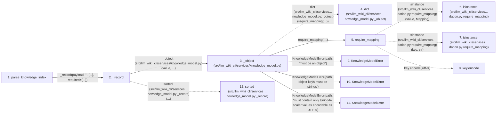

# parse_knowledge_index

**Entry point:** `parse_knowledge_index` (`api`)
**Source:** [knowledge_model](../modules/knowledge_model.md)
**Modules touched:** [analysis_compatibility](../modules/analysis_compatibility.md), [concept_identity](../modules/concept_identity.md), [implementation_evidence](../modules/implementation_evidence.md), and 16 more

**Complete modules touched:**

- [analysis_compatibility](../modules/analysis_compatibility.md)
- [concept_identity](../modules/concept_identity.md)
- [implementation_evidence](../modules/implementation_evidence.md)
- [knowledge_evidence](../modules/knowledge_evidence.md)
- [knowledge_governance](../modules/knowledge_governance.md)
- [knowledge_graph](../modules/knowledge_graph.md)
- [knowledge_model](../modules/knowledge_model.md)
- [knowledge_reuse](../modules/knowledge_reuse.md)
- [knowledge_storage](../modules/knowledge_storage.md)
- [maintenance_evidence](../modules/maintenance_evidence.md)
- [maintenance_projection](../modules/maintenance_projection.md)
- [maintenance_shapes](../modules/maintenance_shapes.md)
- [maintenance_state](../modules/maintenance_state.md)
- [markdown_sections](../modules/markdown_sections.md)
- [python_implementation](../modules/python_implementation.md)
- [section_ownership](../modules/section_ownership.md)
- [validation](../modules/validation.md)
- [wiki_media](../modules/wiki_media.md)
- [wiki_surface](../modules/wiki_surface.md)

## Call sequence

> Static overview in presentation order, not runtime execution order. Arrows retain captured callers; representative internal continuations and boundary examples precede repeated helper detail.

```mermaid
sequenceDiagram
    participant p0 as parse_knowledge_index
    participant p1 as _record
    participant p2 as _parse_bundle
    participant p3 as _parse_concept
    participant p4 as _parse_relationship
    participant p5 as _validated_reserved_extensions
    participant p6 as _validate_index_references
    participant p7 as validate_implementation_collection
    participant p8 as validate_maintenance_projection
    participant p9 as validate_governance_projection
    participant p10 as _string
    participant p11 as KnowledgeModelError
    participant p12 as _array (src/llm_wiki_cli/services/knowledge_model.py)
    participant p13 as KnowledgeIndex
    participant p14 as _object (src/llm_wiki_cli/services/knowledge_model.py)
    participant p15 as _parse_document
    participant p16 as validate_reuse_commitment
    participant p17 as _parse_repository
    participant p18 as _locator (src/llm_wiki_cli/services/knowledge_model.py)
    participant p19 as _parse_snapshot
    participant p20 as typed_graph_from_knowledge_extensions
    participant p21 as mcp_uri
    participant p22 as _parse_producer
    participant p23 as _parse_relationship_target
    participant p24 as validate_maintenance_binding
    participant p25 as validate_maintenance_state
    participant p26 as _object (src/llm_wiki_cli/services/knowledge_governance.py)
    participant p27 as _open_enum_value
    participant p28 as canonical_hash
    participant p29 as tuple (src/llm_wiki_cli/services….py:parse_knowledge_index)
    participant p30 as validated.get
    p0->>p1: _record
    p0->>p2: _parse_bundle
    p0->>p3: _parse_concept
    p0->>p4: _parse_relationship
    p0->>p5: _validated_reserved_extensions
    p0->>p6: _validate_index_references
    p0->>p7: validate_implementation_collection
    p0->>p8: validate_maintenance_projection
    p0->>p9: validate_governance_projection
    p0->>p10: _string
    p0->>p11: KnowledgeModelError
    p0->>p12: _array (src/llm_wiki_cli/services/knowledge_model.py)
    p0->>p13: KnowledgeIndex
    p1->>p14: _object (src/llm_wiki_cli/services/knowledge_model.py)
    p3->>p15: _parse_document
    p5->>p16: validate_reuse_commitment
    p2->>p17: _parse_repository
    p3->>p18: _locator (src/llm_wiki_cli/services/knowledge_model.py)
    p2->>p19: _parse_snapshot
    p5->>p20: typed_graph_from_knowledge_extensions
    p3->>p21: mcp_uri
    p2->>p22: _parse_producer
    p4->>p23: _parse_relationship_target
    p8->>p24: validate_maintenance_binding
    p8->>p25: validate_maintenance_state
    p9->>p26: _object (src/llm_wiki_cli/services/knowledge_governance.py)
    p3->>p27: _open_enum_value
    p8->>p28: canonical_hash
    p0-->>p29: tuple (src/llm_wiki_cli/services….py:parse_knowledge_index)(...)
    p7-->>p30: validated.get(IMPLEMENTATION_KEY)
```

<!-- Auto-generated from static call edges. Dashed arrows are external or unresolved calls. Reviewed runtime conditions and side effects belong in Behavior. -->

> Call sequence diagram shows 30 of 2316 interactions; 2286 omitted to keep the visualization within the 30-interaction and generated-diagram limits, with uncertain identities omitted rather than inferred.

> Captured boundary calls: external 1 of 676 (675 omitted); unresolved 1 of 459 (458 omitted). These counts cover the captured static trace.

Omitted captured detail, grouped by actual caller occurrence and target module:

| Caller | Parent step | Target module | Kind | Omitted interactions |
| --- | --- | --- | --- | --- |
| `src/llm_wiki_cli/services/knowledge_model.py:_object` | 3 | - | external | 1 |
| `src/llm_wiki_cli/services/knowledge_model.py:_object` | 3 | [src/llm_wiki_cli/services/validation.py](../modules/validation.md) | internal | 1 |
| `src/llm_wiki_cli/services/validation.py:require_mapping` | 5 | - | external | 2 |
| `src/llm_wiki_cli/services/validation.py:require_mapping` | 5 | - | unresolved | 1 |
| `src/llm_wiki_cli/services/knowledge_model.py:_object` | 3 | [src/llm_wiki_cli/services/knowledge_model.py](../modules/knowledge_model.md) | internal | 3 |
| `src/llm_wiki_cli/services/knowledge_model.py:_record` | 2 | - | external | 4 |
| `src/llm_wiki_cli/services/knowledge_model.py:_record` | 2 | [src/llm_wiki_cli/services/knowledge_model.py](../modules/knowledge_model.md) | internal | 6 |
| `src/llm_wiki_cli/services/knowledge_model.py:_parse_extensions` | 20 | [src/llm_wiki_cli/services/knowledge_model.py](../modules/knowledge_model.md) | internal | 7 |
> Omission summary shows 8 of 528 groups; 520 further groups are not expanded here. Counts above include all omitted interactions.
> Detailed flow queries retain their own coverage and limits; omitted paths may execute at runtime.

> Trace truncated at the depth limit; deeper calls are omitted.

## Data flow

<!-- Auto-generated static analysis. Treat values and boundaries as best-effort hints, not runtime proof. -->

### Analysis coverage

**Effect analysis partially available.** Flow assembly and source effect analysis are separate; empty observations do not prove an empty handler body.

Source steps: 1182; effect analysis evaluated: 757, partial: 19, unavailable: 406. Counts include steps omitted from the displayed trace.

Collector observations for 776 source steps with known totals: observed: 3751, emitted: 3498, omitted: 253. Unavailable totals are excluded.

- Callable record unavailable for one or more source steps; those steps have no represented callable body.
- Effect collector omitted observations before flow assembly; displayed effects are partial.
- Effect collector totals unavailable; observed counts cover captured records only.

| Step | Callable record | Effect analysis | Collector totals | Observed | Emitted | Omitted |
|---|---|---|---|---:|---:|---:|
| `parse_knowledge_index` | `available` | `evaluated` | `available` | `4` | `4` | `0` |
| `_record` | `available` | `evaluated` | `available` | `5` | `5` | `0` |
| `_object (src/llm_wiki_cli/services/knowledge_model.py)` | `available` | `evaluated` | `available` | `3` | `3` | `0` |
| `dict (src/llm_wiki_cli/services…nowledge_model.py:_object)` | `not_applicable` | `not_applicable` | `not_applicable` | — | — | — |
| `require_mapping` | `available` | `evaluated` | `available` | `8` | `8` | `0` |
| `isinstance (src/llm_wiki_cli/services…dation.py:require_mapping)` | `not_applicable` | `not_applicable` | `not_applicable` | — | — | — |
| `isinstance (src/llm_wiki_cli/services…dation.py:require_mapping)` | `not_applicable` | `not_applicable` | `not_applicable` | — | — | — |
| `key.encode` | `not_applicable` | `not_applicable` | `not_applicable` | — | — | — |
| `KnowledgeModelError` | `unavailable` | `unavailable` | `unavailable` | — | — | — |
| `KnowledgeModelError` | `unavailable` | `unavailable` | `unavailable` | — | — | — |
| `KnowledgeModelError` | `unavailable` | `unavailable` | `unavailable` | — | — | — |
| `sorted (src/llm_wiki_cli/services…nowledge_model.py:_record)` | `not_applicable` | `not_applicable` | `not_applicable` | — | — | — |

### Step data

| Step | Inputs | Reads | Writes | Returns |
|---|---|---|---|---|
| `parse_knowledge_index` | `payload: object` | `KNOWLEDGE_SCHEMA_VERSION`, `KNOWLEDGE_SCHEMA_VERSION` | - | `model` |
| `_record` | `value: object`, `path: str`, `fields: AbstractSet[str]`, `required: AbstractSet[str]` | - | - | `(...)` |
| `_object (src/llm_wiki_cli/services/knowledge_model.py)` | `value: object`, `path: str` | - | - | `dict(...)` |
| `dict (src/llm_wiki_cli/services…nowledge_model.py:_object)` | - | - | - | - |
| `require_mapping` | `value: object`, `error: Exception`, `require_string_keys: bool`, `key_error: Exception \| None`, `require_utf8_keys: bool`, `utf8_key_error: Exception \| None` | `Mapping` | - | `value` |
| `isinstance (src/llm_wiki_cli/services…dation.py:require_mapping)` | - | - | - | - |
| `isinstance (src/llm_wiki_cli/services…dation.py:require_mapping)` | - | - | - | - |
| `key.encode` | - | - | - | - |
| `KnowledgeModelError` | - | - | - | - |
| `KnowledgeModelError` | - | - | - | - |
| `KnowledgeModelError` | - | - | - | - |
| `sorted (src/llm_wiki_cli/services…nowledge_model.py:_record)` | - | - | - | - |

### Call data

| From | To | Line | Call |
|---|---|---:|---|
| parse_knowledge_index | _record | 526 | `_record(payload, '', {...}, required={...})` |
| _record | _object (src/llm_wiki_cli/services/knowledge_model.py) | 1608 | `_object(value, ...)` |
| _object (src/llm_wiki_cli/services/knowledge_model.py) | dict (src/llm_wiki_cli/services…nowledge_model.py:_object) | 1694 | `dict(require_mapping(...))` |
| _object (src/llm_wiki_cli/services/knowledge_model.py) | require_mapping | 1695 | `require_mapping(value, error=KnowledgeModelError(...), require_string_keys=True, key_error=KnowledgeModelError(...), require_utf8_keys=True, utf8_key_error=KnowledgeModelError(...))` |
| require_mapping | isinstance (src/llm_wiki_cli/services…dation.py:require_mapping) | 765 | `isinstance(value, Mapping)` |
| require_mapping | isinstance (src/llm_wiki_cli/services…dation.py:require_mapping) | 769 | `isinstance(key, str)` |
| require_mapping | key.encode | 774 | `key.encode('utf-8')` |
| _object (src/llm_wiki_cli/services/knowledge_model.py) | KnowledgeModelError | 1697 | `KnowledgeModelError(path, 'must be an object')` |
| _object (src/llm_wiki_cli/services/knowledge_model.py) | KnowledgeModelError | 1699 | `KnowledgeModelError(path, 'object keys must be strings')` |
| _object (src/llm_wiki_cli/services/knowledge_model.py) | KnowledgeModelError | 1703 | `KnowledgeModelError(path, 'must contain only Unicode scalar values encodable as UTF-8')` |
| _record | sorted (src/llm_wiki_cli/services…nowledge_model.py:_record) | 1610 | `sorted(...)` |

### Boundary effects

*No boundary-effect observations were captured in this static trace.*

### Static analysis gaps

| Kind | Step | Target | Line |
|---|---|---|---:|
| external_call | `require_mapping` | `isinstance` | 765 |
| external_call | `require_mapping` | `isinstance` | 769 |
| unresolved_call | `require_mapping` | `key.encode` | 774 |
| external_call | `_record` | `sorted` | 1610 |
| step_limit | `parse_knowledge_index` | `first 12 steps` | 0 |
| truncated_flow | `parse_knowledge_index` | `depth limit` | 0 |

## Behavior

This flow starts at `parse_knowledge_index` and is classified as `api`. The generated call and data-flow sections are bounded static projections; runtime conditions and side effects require source-level confirmation.
