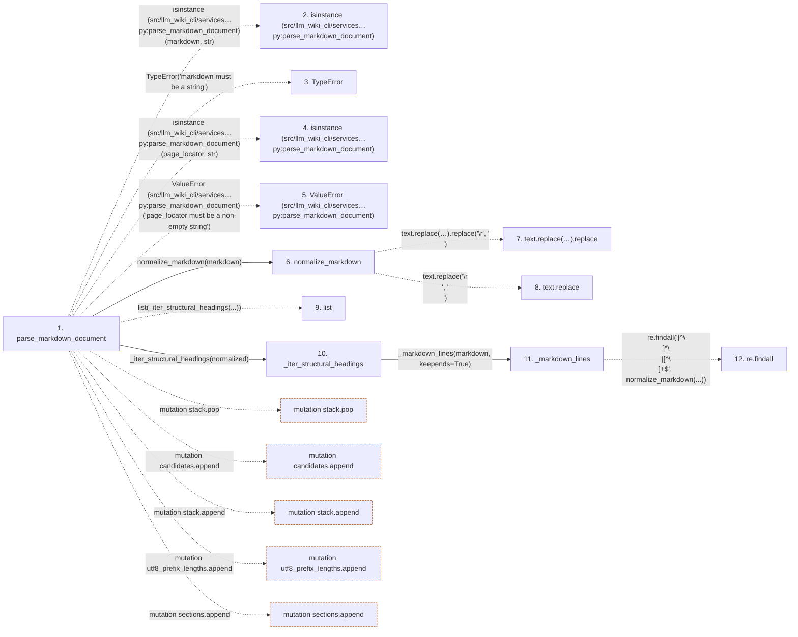

# parse_markdown_document

**Entry point:** `parse_markdown_document` (`api`)
**Source:** [markdown_sections](../modules/markdown_sections.md)
**Modules touched:** [knowledge_evidence](../modules/knowledge_evidence.md), [markdown_sections](../modules/markdown_sections.md)

## Call sequence

> Static overview in presentation order, not runtime execution order. Arrows retain captured callers; representative internal continuations and boundary examples precede repeated helper detail.

```mermaid
sequenceDiagram
    participant p0 as parse_markdown_document
    participant p1 as _iter_structural_headings
    participant p2 as hash_json
    participant p3 as normalize_markdown
    participant p4 as _HeadingCandidate
    participant p5 as section_locator
    participant p6 as MarkdownSection
    participant p7 as sha256_bytes
    participant p8 as MarkdownSectionDocument
    participant p9 as _markdown_lines
    participant p10 as _frontmatter_extent
    participant p11 as canonical_json_bytes
    participant p12 as _line_content
    participant p13 as _atx_heading
    participant p14 as canonical_json_text
    participant p15 as isinstance (src/llm_wiki_cli/services…py:parse_markdown_document)
    participant p16 as stack.pop
    participant p17 as TypeError
    participant p18 as ValueError (src/llm_wiki_cli/services…py:parse_markdown_document)
    participant p19 as list
    participant p20 as defaultdict
    participant p21 as candidates.append
    participant p22 as stack.append
    participant p23 as len (src/llm_wiki_cli/services…py:parse_markdown_document)
    participant p24 as utf8_prefix_lengths.append
    participant p25 as character.encode
    participant p26 as enumerate (src/llm_wiki_cli/services…py:parse_markdown_document)
    participant p27 as exact_text.encode
    p0->>p1: _iter_structural_headings
    p0->>p2: hash_json
    p0->>p3: normalize_markdown
    p0->>p4: _HeadingCandidate
    p0->>p5: section_locator
    p0->>p6: MarkdownSection
    p0->>p7: sha256_bytes
    p0->>p8: MarkdownSectionDocument
    p1->>p9: _markdown_lines
    p1->>p10: _frontmatter_extent
    p2->>p11: canonical_json_bytes
    p1->>p12: _line_content
    p1->>p13: _atx_heading
    p11->>p14: canonical_json_text
    p0-->>p15: isinstance (src/llm_wiki_cli/services…py:parse_markdown_document)(markdown, str)
    p0-->>p16: stack.pop
    p0-->>p17: TypeError('markdown must be a string')
    p0-->>p15: isinstance (src/llm_wiki_cli/services…py:parse_markdown_document)(page_locator, str)
    p0-->>p18: ValueError (src/llm_wiki_cli/services…py:parse_markdown_document)('page_locator must be a non-empty string')
    p0-->>p19: list(_iter_structural_headings(...))
    p0-->>p20: defaultdict(int)
    p0-->>p21: candidates.append(_HeadingCandidate(...))
    p0-->>p22: stack.append(...)
    p0-->>p23: len (src/llm_wiki_cli/services…py:parse_markdown_document)(candidates)
    p0-->>p24: utf8_prefix_lengths.append(...)
    p0-->>p23: len (src/llm_wiki_cli/services…py:parse_markdown_document)(character.encode(...))
    p0-->>p25: character.encode('utf-8')
    p0-->>p26: enumerate (src/llm_wiki_cli/services…py:parse_markdown_document)(candidates)
    p0-->>p23: len (src/llm_wiki_cli/services…py:parse_markdown_document)(normalized)
    p0-->>p27: exact_text.encode('utf-8')
```

<!-- Auto-generated from static call edges. Dashed arrows are external or unresolved calls. Reviewed runtime conditions and side effects belong in Behavior. -->

> Call sequence diagram shows 30 of 88 interactions; 58 omitted to keep the visualization within the 30-interaction and generated-diagram limits, with uncertain identities omitted rather than inferred.

> Captured boundary calls: external 10 of 44 (34 omitted); unresolved 6 of 23 (17 omitted). These counts cover the captured static trace.

Omitted captured detail, grouped by actual caller occurrence and target module:

| Caller | Parent step | Target module | Kind | Omitted interactions |
| --- | --- | --- | --- | --- |
| `src/llm_wiki_cli/services/markdown_sections.py:normalize_markdown` | 6 | - | unresolved | 2 |
| `src/llm_wiki_cli/services/markdown_sections.py:_markdown_lines` | 11 | - | external | 1 |
| `src/llm_wiki_cli/services/markdown_sections.py:_markdown_lines` | 11 | [src/llm_wiki_cli/services/markdown_sections.py](../modules/markdown_sections.md) | internal | 2 |
| `src/llm_wiki_cli/services/markdown_sections.py:_line_content` | 14 | - | unresolved | 1 |
| `src/llm_wiki_cli/services/markdown_sections.py:_frontmatter_extent` | 16 | - | unresolved | 3 |
| `src/llm_wiki_cli/services/markdown_sections.py:_frontmatter_extent` | 16 | [src/llm_wiki_cli/services/markdown_sections.py](../modules/markdown_sections.md) | internal | 2 |
| `src/llm_wiki_cli/services/markdown_sections.py:_frontmatter_extent` | 16 | - | external | 2 |
| `src/llm_wiki_cli/services/markdown_sections.py:_iter_structural_headings` | 10 | - | external | 5 |
> Omission summary shows 8 of 22 groups; 14 further groups are not expanded here. Counts above include all omitted interactions.
> Detailed flow queries retain their own coverage and limits; omitted paths may execute at runtime.

## Data flow

<!-- Auto-generated static analysis. Treat values and boundaries as best-effort hints, not runtime proof. -->

### Analysis coverage

**Effect analysis partially available.** Flow assembly and source effect analysis are separate; empty observations do not prove an empty handler body.

Source steps: 22; effect analysis evaluated: 19, partial: 0, unavailable: 3. Counts include steps omitted from the displayed trace.

- Callable record unavailable; the selected entry symbol has no represented callable body.
- Effect collector totals unavailable; observed counts cover captured records only.

| Step | Callable record | Effect analysis | Collector totals |
|---|---|---|---|
| `parse_markdown_document` | `available` | `evaluated` | `available` |
| `isinstance (src/llm_wiki_cli/services…py:parse_markdown_document)` | `not_applicable` | `not_applicable` | `not_applicable` |
| `TypeError` | `not_applicable` | `not_applicable` | `not_applicable` |
| `isinstance (src/llm_wiki_cli/services…py:parse_markdown_document)` | `not_applicable` | `not_applicable` | `not_applicable` |
| `ValueError (src/llm_wiki_cli/services…py:parse_markdown_document)` | `not_applicable` | `not_applicable` | `not_applicable` |
| `normalize_markdown` | `available` | `evaluated` | `available` |
| `text.replace(…).replace` | `not_applicable` | `not_applicable` | `not_applicable` |
| `text.replace` | `not_applicable` | `not_applicable` | `not_applicable` |
| `list` | `not_applicable` | `not_applicable` | `not_applicable` |
| `_iter_structural_headings` | `available` | `evaluated` | `available` |
| `_markdown_lines` | `available` | `evaluated` | `available` |
| `re.findall` | `not_applicable` | `not_applicable` | `not_applicable` |

### Step data

| Step | Inputs | Reads | Writes | Returns |
|---|---|---|---|---|
| `parse_markdown_document` | `markdown: str`, `page_locator: str` | `SECTION_ORDER_DOMAIN` | `occurrences[...]` | `MarkdownSectionDocument(...)` |
| `isinstance (src/llm_wiki_cli/services…py:parse_markdown_document)` | - | - | - | - |
| `TypeError` | - | - | - | - |
| `isinstance (src/llm_wiki_cli/services…py:parse_markdown_document)` | - | - | - | - |
| `ValueError (src/llm_wiki_cli/services…py:parse_markdown_document)` | - | - | - | - |
| `normalize_markdown` | `text: str` | - | - | `...` |
| `text.replace(…).replace` | - | - | - | - |
| `text.replace` | - | - | - | - |
| `list` | - | - | - | - |
| `_iter_structural_headings` | `markdown: str` | - | - | - |
| `_markdown_lines` | `markdown: str`, `keepends: bool` | - | - | `...` |
| `re.findall` | - | - | - | - |

### Call data

| From | To | Line | Call |
|---|---|---:|---|
| parse_markdown_document | isinstance (src/llm_wiki_cli/services…py:parse_markdown_document) | 333 | `isinstance(markdown, str)` |
| parse_markdown_document | TypeError | 334 | `TypeError('markdown must be a string')` |
| parse_markdown_document | isinstance (src/llm_wiki_cli/services…py:parse_markdown_document) | 335 | `isinstance(page_locator, str)` |
| parse_markdown_document | ValueError (src/llm_wiki_cli/services…py:parse_markdown_document) | 336 | `ValueError('page_locator must be a non-empty string')` |
| parse_markdown_document | normalize_markdown | 338 | `normalize_markdown(markdown)` |
| normalize_markdown | text.replace(…).replace | 82 | `text.replace('\r\n', '\n').replace('\r', '\n')` |
| normalize_markdown | text.replace | 82 | `text.replace('\r\n', '\n')` |
| parse_markdown_document | list | 339 | `list(_iter_structural_headings(...))` |
| parse_markdown_document | _iter_structural_headings | 339 | `_iter_structural_headings(normalized)` |
| _iter_structural_headings | _markdown_lines | 259 | `_markdown_lines(markdown, keepends=True)` |
| _markdown_lines | re.findall | 218 | `re.findall('[^\\n]*\\n\|[^\\n]+$', normalize_markdown(...))` |

### Boundary effects

| Kind | Target | Step | Line |
|---|---|---|---:|
| mutation | `stack.pop` | `parse_markdown_document` | 346 |
| mutation | `candidates.append` | `parse_markdown_document` | 358 |
| mutation | `stack.append` | `parse_markdown_document` | 370 |
| mutation | `utf8_prefix_lengths.append` | `parse_markdown_document` | 374 |
| mutation | `sections.append` | `parse_markdown_document` | 401 |

### Static analysis gaps

| Kind | Step | Target | Line |
|---|---|---|---:|
| external_call | `parse_markdown_document` | `isinstance` | 333 |
| external_call | `parse_markdown_document` | `TypeError` | 334 |
| external_call | `parse_markdown_document` | `isinstance` | 335 |
| external_call | `parse_markdown_document` | `ValueError` | 336 |
| unresolved_call | `normalize_markdown` | `text.replace('\r\n', '\n').replace` | 82 |
| unresolved_call | `normalize_markdown` | `text.replace` | 82 |
| external_call | `_markdown_lines` | `re.findall` | 218 |
| step_limit | `parse_markdown_document` | `first 12 steps` | 0 |

## Behavior

This flow starts at `parse_markdown_document` and is classified as `api`. The generated call and data-flow sections are bounded static projections; runtime conditions and side effects require source-level confirmation.
