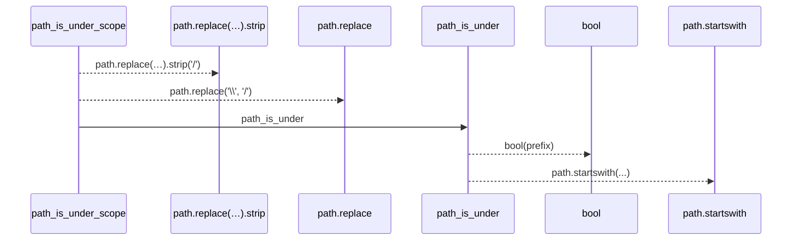
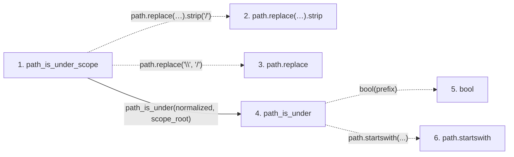

# path_is_under_scope

**Entry point:** `path_is_under_scope` (`api`)
**Source:** [validation](../modules/validation.md)
**Modules touched:** [validation](../modules/validation.md)

## Call sequence

> Static overview in presentation order, not runtime execution order. Arrows retain captured callers; representative internal continuations and boundary examples precede repeated helper detail.

<!-- Auto-generated from static call edges. Dashed arrows are external or unresolved calls. Reviewed runtime conditions and side effects belong in Behavior. -->

> Call sequence diagram shows 5 of 5 interactions; 0 omitted to keep the visualization within the 30-interaction and generated-diagram limits, with uncertain identities omitted rather than inferred.

> Captured boundary calls: external 1 of 1 (0 omitted); unresolved 3 of 3 (0 omitted). These counts cover the captured static trace.
> Detailed flow queries retain their own coverage and limits; omitted paths may execute at runtime.

## Data flow

<!-- Auto-generated static analysis. Treat values and boundaries as best-effort hints, not runtime proof. -->

### Analysis coverage

**Effect analysis evaluated.** Flow assembly and source effect analysis are separate; empty observations do not prove an empty handler body.

Source steps: 2; effect analysis evaluated: 2, partial: 0, unavailable: 0. Counts include steps omitted from the displayed trace.

### Step data

| Step | Inputs | Reads | Writes | Returns |
|---|---|---|---|---|
| `path_is_under_scope` | `path: str`, `scope_root: str` | - | - | `...` |
| `path.replace(…).strip` | - | - | - | - |
| `path.replace` | - | - | - | - |
| `path_is_under` | `path: str`, `prefix: str` | - | - | `...` |
| `bool` | - | - | - | - |
| `path.startswith` | - | - | - | - |

### Call data

| From | To | Line | Call |
|---|---|---:|---|
| path_is_under_scope | path.replace(…).strip | 473 | `path.replace('\\', '/').strip('/')` |
| path_is_under_scope | path.replace | 473 | `path.replace('\\', '/')` |
| path_is_under_scope | path_is_under | 474 | `path_is_under(normalized, scope_root)` |
| path_is_under | bool | 467 | `bool(prefix)` |
| path_is_under | path.startswith | 467 | `path.startswith(...)` |

### Boundary effects

*No boundary-effect observations were captured in this static trace.*

### Static analysis gaps

| Kind | Step | Target | Line |
|---|---|---|---:|
| unresolved_call | `path_is_under_scope` | `path.replace('\\', '/').strip` | 473 |
| unresolved_call | `path_is_under_scope` | `path.replace` | 473 |
| unresolved_call | `path_is_under` | `path.startswith` | 467 |

## Behavior

This flow starts at `path_is_under_scope` and is classified as `api`. The generated call and data-flow sections are bounded static projections; runtime conditions and side effects require source-level confirmation.
