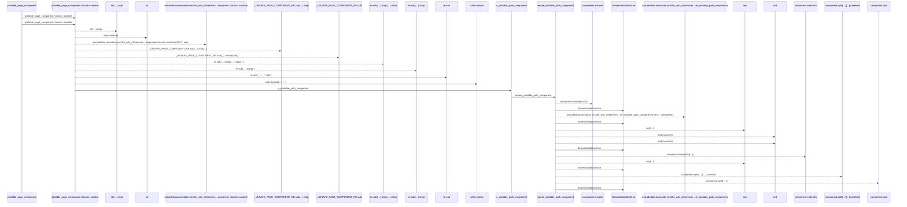
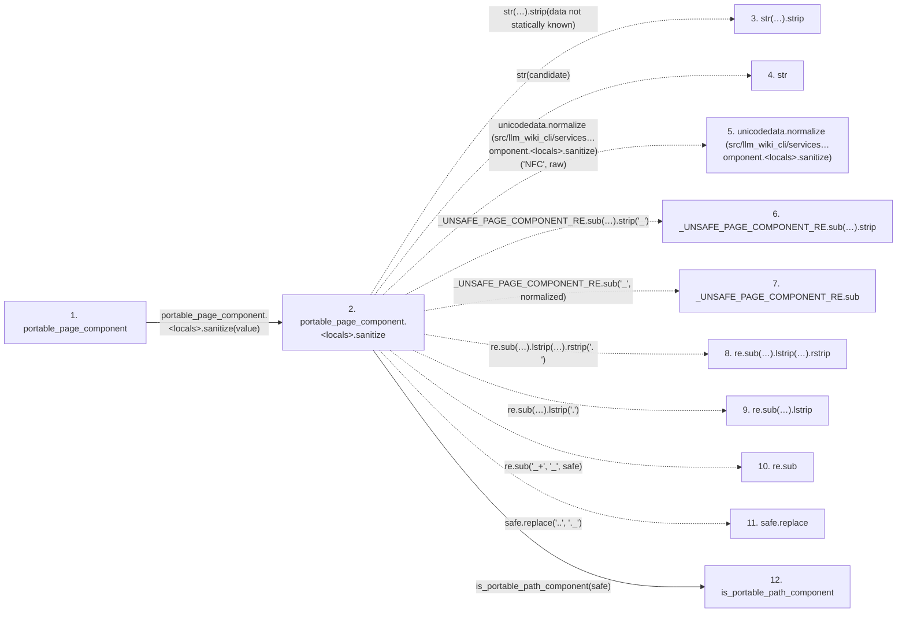

# portable_page_component

**Entry point:** `portable_page_component` (`api`)
**Source:** [validation](../modules/validation.md)
**Modules touched:** [validation](../modules/validation.md)

## Call sequence

> Static overview in presentation order, not runtime execution order. Arrows retain captured callers; representative internal continuations and boundary examples precede repeated helper detail.

<!-- Auto-generated from static call edges. Dashed arrows are external or unresolved calls. Reviewed runtime conditions and side effects belong in Behavior. -->

> Call sequence diagram shows 27 of 27 interactions; 0 omitted to keep the visualization within the 30-interaction and generated-diagram limits, with uncertain identities omitted rather than inferred.

> Captured boundary calls: external 8 of 8 (0 omitted); unresolved 10 of 10 (0 omitted). These counts cover the captured static trace.
> Detailed flow queries retain their own coverage and limits; omitted paths may execute at runtime.

## Data flow

<!-- Auto-generated static analysis. Treat values and boundaries as best-effort hints, not runtime proof. -->

### Analysis coverage

**Effect analysis partially available.** Flow assembly and source effect analysis are separate; empty observations do not prove an empty handler body.

Source steps: 10; effect analysis evaluated: 4, partial: 1, unavailable: 5. Counts include steps omitted from the displayed trace.

Collector observations for 5 source steps with known totals: observed: 23, emitted: 22, omitted: 1. Unavailable totals are excluded.

- Callable record unavailable for one or more source steps; those steps have no represented callable body.
- Effect collector omitted observations before flow assembly; displayed effects are partial.
- Effect collector totals unavailable; observed counts cover captured records only.

| Step | Callable record | Effect analysis | Collector totals | Observed | Emitted | Omitted |
|---|---|---|---|---:|---:|---:|
| `portable_page_component` | `available` | `evaluated` | `available` | `3` | `3` | `0` |
| `portable_page_component.<locals>.sanitize` | `available` | `evaluated` | `available` | `2` | `2` | `0` |
| `str(…).strip` | `not_applicable` | `not_applicable` | `not_applicable` | — | — | — |
| `str` | `not_applicable` | `not_applicable` | `not_applicable` | — | — | — |
| `unicodedata.normalize (src/llm_wiki_cli/services…omponent.<locals>.sanitize)` | `not_applicable` | `not_applicable` | `not_applicable` | — | — | — |
| `_UNSAFE_PAGE_COMPONENT_RE.sub(…).strip` | `not_applicable` | `not_applicable` | `not_applicable` | — | — | — |
| `_UNSAFE_PAGE_COMPONENT_RE.sub` | `not_applicable` | `not_applicable` | `not_applicable` | — | — | — |
| `re.sub(…).lstrip(…).rstrip` | `not_applicable` | `not_applicable` | `not_applicable` | — | — | — |
| `re.sub(…).lstrip` | `not_applicable` | `not_applicable` | `not_applicable` | — | — | — |
| `re.sub` | `not_applicable` | `not_applicable` | `not_applicable` | — | — | — |
| `safe.replace` | `not_applicable` | `not_applicable` | `not_applicable` | — | — | — |
| `is_portable_path_component` | `available` | `evaluated` | `available` | `4` | `4` | `0` |

### Step data

| Step | Inputs | Reads | Writes | Returns |
|---|---|---|---|---|
| `portable_page_component` | `value: object`, `fallback: str` | - | - | `...` |
| `portable_page_component.<locals>.sanitize` | `candidate: object` | - | - | `safe` |
| `str(…).strip` | - | - | - | - |
| `str` | - | - | - | - |
| `unicodedata.normalize (src/llm_wiki_cli/services…omponent.<locals>.sanitize)` | - | - | - | - |
| `_UNSAFE_PAGE_COMPONENT_RE.sub(…).strip` | - | - | - | - |
| `_UNSAFE_PAGE_COMPONENT_RE.sub` | - | - | - | - |
| `re.sub(…).lstrip(…).rstrip` | - | - | - | - |
| `re.sub(…).lstrip` | - | - | - | - |
| `re.sub` | - | - | - | - |
| `safe.replace` | - | - | - | - |
| `is_portable_path_component` | `component: str` | `SharedValidationError` | - | `False`, `True` |

### Call data

| From | To | Line | Call |
|---|---|---:|---|
| portable_page_component | portable_page_component.<locals>.sanitize | 616 | `sanitize(value)` |
| portable_page_component.<locals>.sanitize | str(…).strip | 606 | `str(candidate).strip(data not statically known)` |
| portable_page_component.<locals>.sanitize | str | 606 | `str(candidate)` |
| portable_page_component.<locals>.sanitize | unicodedata.normalize (src/llm_wiki_cli/services…omponent.<locals>.sanitize) | 607 | `unicodedata.normalize('NFC', raw)` |
| portable_page_component.<locals>.sanitize | _UNSAFE_PAGE_COMPONENT_RE.sub(…).strip | 608 | `_UNSAFE_PAGE_COMPONENT_RE.sub('_', normalized).strip('_')` |
| portable_page_component.<locals>.sanitize | _UNSAFE_PAGE_COMPONENT_RE.sub | 608 | `_UNSAFE_PAGE_COMPONENT_RE.sub('_', normalized)` |
| portable_page_component.<locals>.sanitize | re.sub(…).lstrip(…).rstrip | 609 | `re.sub('_+', '_', safe).lstrip('.').rstrip('. ')` |
| portable_page_component.<locals>.sanitize | re.sub(…).lstrip | 609 | `re.sub('_+', '_', safe).lstrip('.')` |
| portable_page_component.<locals>.sanitize | re.sub | 609 | `re.sub('_+', '_', safe)` |
| portable_page_component.<locals>.sanitize | safe.replace | 611 | `safe.replace('..', '._')` |
| portable_page_component.<locals>.sanitize | is_portable_path_component | 612 | `is_portable_path_component(safe)` |

### Boundary effects

*No boundary-effect observations were captured in this static trace.*

### Static analysis gaps

| Kind | Step | Target | Line |
|---|---|---|---:|
| unresolved_call | `portable_page_component.<locals>.sanitize` | `str(candidate).strip` | 606 |
| external_call | `portable_page_component.<locals>.sanitize` | `unicodedata.normalize` | 607 |
| unresolved_call | `portable_page_component.<locals>.sanitize` | `_UNSAFE_PAGE_COMPONENT_RE.sub('_', normalized).strip` | 608 |
| unresolved_call | `portable_page_component.<locals>.sanitize` | `_UNSAFE_PAGE_COMPONENT_RE.sub` | 608 |
| unresolved_call | `portable_page_component.<locals>.sanitize` | `re.sub('_+', '_', safe).lstrip('.').rstrip` | 609 |
| unresolved_call | `portable_page_component.<locals>.sanitize` | `re.sub('_+', '_', safe).lstrip` | 609 |
| external_call | `portable_page_component.<locals>.sanitize` | `re.sub` | 609 |
| unresolved_call | `portable_page_component.<locals>.sanitize` | `safe.replace` | 611 |
| step_limit | `portable_page_component` | `first 12 steps` | 0 |

## Behavior

This flow starts at `portable_page_component` and is classified as `api`. The generated call and data-flow sections are bounded static projections; runtime conditions and side effects require source-level confirmation.
