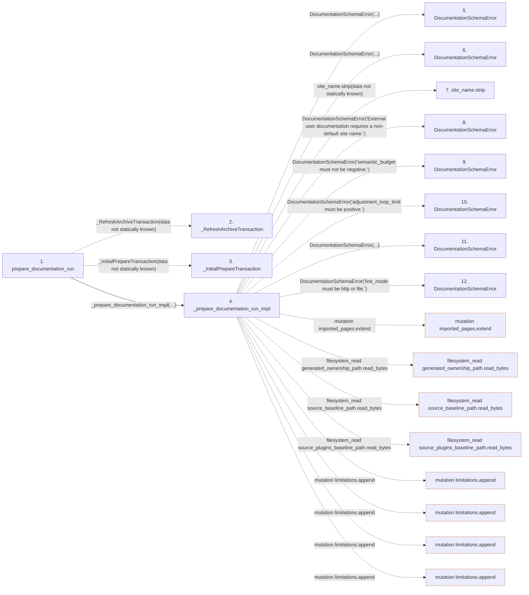

# prepare_documentation_run

**Entry point:** `prepare_documentation_run` (`api`)
**Source:** [prepare](../modules/prepare.md)
**Modules touched:** [api_contracts](../modules/api_contracts.md), [bootstrap_recovery](../modules/bootstrap_recovery.md), [bootstrap_runtime](../modules/bootstrap_runtime.md), and 32 more

**Complete modules touched:**

- [api_contracts](../modules/api_contracts.md)
- [bootstrap_recovery](../modules/bootstrap_recovery.md)
- [bootstrap_runtime](../modules/bootstrap_runtime.md)
- [bootstrap_service](../modules/bootstrap_service.md)
- [current_contracts](../modules/current_contracts.md)
- [documentation_native](../modules/documentation_native.md)
- [documentation_wiki_input](../modules/documentation_wiki_input.md)
- [extraction_service](../modules/extraction_service.md)
- [filesystem_guard](../modules/filesystem_guard.md)
- [infrastructure_sync](../modules/infrastructure_sync.md)
- [io](../modules/io.md)
- [knowledge_artifacts](../modules/knowledge_artifacts.md)
- [knowledge_consumption](../modules/knowledge_consumption.md)
- [knowledge_envelope](../modules/knowledge_envelope.md)
- [knowledge_freshness](../modules/knowledge_freshness.md)
- [knowledge_governance](../modules/knowledge_governance.md)
- [knowledge_observability](../modules/knowledge_observability.md)
- [knowledge_orchestration](../modules/knowledge_orchestration.md)
- [knowledge_reuse](../modules/knowledge_reuse.md)
- [knowledge_storage](../modules/knowledge_storage.md)
- [knowledge_storage_io](../modules/knowledge_storage_io.md)
- [maintenance_projection](../modules/maintenance_projection.md)
- [maintenance_protocol](../modules/maintenance_protocol.md)
- [maintenance_shapes](../modules/maintenance_shapes.md)
- [maintenance_state](../modules/maintenance_state.md)
- [module_maps](../modules/module_maps.md)
- [prepare](../modules/prepare.md)
- [services_dependencies](../modules/services_dependencies.md)
- [source_selection](../modules/source_selection.md)
- [source_snapshot](../modules/source_snapshot.md)
- [sync_manifest](../modules/sync_manifest.md)
- [validation](../modules/validation.md)
- [wiki_lifecycle](../modules/wiki_lifecycle.md)
- [wiki_media](../modules/wiki_media.md)
- [wiki_surface](../modules/wiki_surface.md)

## Call sequence

> Static overview in presentation order, not runtime execution order. Arrows retain captured callers; representative internal continuations and boundary examples precede repeated helper detail.

```mermaid
sequenceDiagram
    participant p0 as prepare_documentation_run
    participant p1 as _prepare_documentation_run_impl
    participant p2 as execute_bootstrap
    participant p3 as _adopt_documentation_wiki_snapshot_with_runtime
    participant p4 as _execute_documentation_workspace_refresh
    participant p5 as _validate_freshness_policy
    participant p6 as _bootstrap_run_options_from_request
    participant p7 as _execute_bootstrap_options
    participant p8 as _validate_input_root
    participant p9 as _validate_workspace_root
    participant p10 as _validate_source_root
    participant p11 as _validate_root_isolation
    participant p12 as _open_input_root_descriptor
    participant p13 as _adopt_validated_wiki_snapshot
    participant p14 as pending_bootstrap
    participant p15 as _paths_overlap
    participant p16 as _collect_input_tree
    participant p17 as guard_maintenance_owner
    participant p18 as _preflight_public_bootstrap
    participant p19 as _load_and_validate_metadata
    participant p20 as _is_relative_to
    participant p21 as _assert_input_directory
    participant p22 as _unknown_entries
    participant p23 as maintenance_write_operation
    participant p24 as _inspect_markdown
    participant p25 as bootstrap_write_operation
    participant p26 as _semantic_page_records
    participant p27 as _resolve_metadata_freshness
    participant p28 as _enforce_freshness_policy
    participant p29 as io.StringIO (src/llm_wiki_cli/services…time.py:execute_bootstrap)
    participant p30 as _RefreshArchiveTransaction
    p0->>p1: _prepare_documentation_run_impl
    p1->>p2: execute_bootstrap
    p1->>p3: _adopt_documentation_wiki_snapshot_with_runtime
    p1->>p4: _execute_documentation_workspace_refresh
    p3->>p5: _validate_freshness_policy
    p2->>p6: _bootstrap_run_options_from_request
    p2->>p7: _execute_bootstrap_options
    p3->>p8: _validate_input_root
    p3->>p9: _validate_workspace_root
    p3->>p10: _validate_source_root
    p3->>p11: _validate_root_isolation
    p3->>p12: _open_input_root_descriptor
    p3->>p13: _adopt_validated_wiki_snapshot
    p7->>p14: pending_bootstrap
    p11->>p15: _paths_overlap
    p13->>p16: _collect_input_tree
    p7->>p17: guard_maintenance_owner
    p7->>p18: _preflight_public_bootstrap
    p13->>p19: _load_and_validate_metadata
    p11->>p20: _is_relative_to
    p12->>p21: _assert_input_directory
    p13->>p22: _unknown_entries
    p7->>p23: maintenance_write_operation
    p13->>p24: _inspect_markdown
    p7->>p25: bootstrap_write_operation
    p13->>p26: _semantic_page_records
    p13->>p27: _resolve_metadata_freshness
    p13->>p28: _enforce_freshness_policy
    p2-->>p29: io.StringIO (src/llm_wiki_cli/services…time.py:execute_bootstrap)
    p0-->>p30: _RefreshArchiveTransaction
```

<!-- Auto-generated from static call edges. Dashed arrows are external or unresolved calls. Reviewed runtime conditions and side effects belong in Behavior. -->

> Call sequence diagram shows 30 of 1213 interactions; 1183 omitted to keep the visualization within the 30-interaction and generated-diagram limits, with uncertain identities omitted rather than inferred.

> Captured boundary calls: external 1 of 292 (291 omitted); unresolved 1 of 367 (366 omitted). These counts cover the captured static trace.

Omitted captured detail, grouped by actual caller occurrence and target module:

| Caller | Parent step | Target module | Kind | Omitted interactions |
| --- | --- | --- | --- | --- |
| `src/llm_wiki_cli/services/documentation_run/prepare.py:prepare_documentation_run` | 1 | - | unresolved | 7 |
| `src/llm_wiki_cli/services/documentation_run/prepare.py:_prepare_documentation_run_impl` | 4 | - | unresolved | 156 |
| `src/llm_wiki_cli/services/bootstrap_runtime.py:_bootstrap_run_options_from_request` | 59 | - | unresolved | 5 |
| `src/llm_wiki_cli/services/bootstrap_runtime.py:_bootstrap_run_options_from_request` | 59 | - | external | 5 |
| `src/llm_wiki_cli/services/bootstrap_runtime.py:_bootstrap_run_options_from_request` | 59 | [src/llm_wiki_cli/services/bootstrap_service.py](../modules/bootstrap_service.md) | internal | 3 |
| `src/llm_wiki_cli/services/bootstrap_runtime.py:_bootstrap_run_options_from_request` | 59 | [src/llm_wiki_cli/services/bootstrap_runtime.py](../modules/bootstrap_runtime.md) | internal | 1 |
| `src/llm_wiki_cli/services/bootstrap_recovery.py:pending_bootstrap` | 75 | [src/llm_wiki_cli/services/bootstrap_recovery.py](../modules/bootstrap_recovery.md) | internal | 1 |
| `src/llm_wiki_cli/services/bootstrap_recovery.py:_load_record` | 76 | [src/llm_wiki_cli/services/bootstrap_recovery.py](../modules/bootstrap_recovery.md) | internal | 5 |
> Omission summary shows 8 of 304 groups; 296 further groups are not expanded here. Counts above include all omitted interactions.
> Detailed flow queries retain their own coverage and limits; omitted paths may execute at runtime.

> Trace truncated at the depth limit; deeper calls are omitted.

## Data flow

<!-- Auto-generated static analysis. Treat values and boundaries as best-effort hints, not runtime proof. -->

### Analysis coverage

**Effect analysis partially available.** Flow assembly and source effect analysis are separate; empty observations do not prove an empty handler body.

Source steps: 555; effect analysis evaluated: 360, partial: 29, unavailable: 166. Counts include steps omitted from the displayed trace.

Collector observations for 389 source steps with known totals: observed: 2279, emitted: 2142, omitted: 137. Unavailable totals are excluded.

- Callable record unavailable for one or more source steps; those steps have no represented callable body.
- Effect collector omitted observations before flow assembly; displayed effects are partial.
- Effect collector totals unavailable; observed counts cover captured records only.

| Step | Callable record | Effect analysis | Collector totals | Observed | Emitted | Omitted |
|---|---|---|---|---:|---:|---:|
| `prepare_documentation_run` | `available` | `partial` | `available` | `24` | `9` | `15` |
| `_RefreshArchiveTransaction` | `not_applicable` | `not_applicable` | `not_applicable` | — | — | — |
| `_InitialPrepareTransaction` | `not_applicable` | `not_applicable` | `not_applicable` | — | — | — |
| `_prepare_documentation_run_impl` | `available` | `partial` | `available` | `37` | `20` | `17` |
| `DocumentationSchemaError` | `not_applicable` | `not_applicable` | `not_applicable` | — | — | — |
| `DocumentationSchemaError` | `not_applicable` | `not_applicable` | `not_applicable` | — | — | — |
| `site_name.strip` | `not_applicable` | `not_applicable` | `not_applicable` | — | — | — |
| `DocumentationSchemaError` | `not_applicable` | `not_applicable` | `not_applicable` | — | — | — |
| `DocumentationSchemaError` | `not_applicable` | `not_applicable` | `not_applicable` | — | — | — |
| `DocumentationSchemaError` | `not_applicable` | `not_applicable` | `not_applicable` | — | — | — |
| `DocumentationSchemaError` | `not_applicable` | `not_applicable` | `not_applicable` | — | — | — |
| `DocumentationSchemaError` | `not_applicable` | `not_applicable` | `not_applicable` | — | — | — |

### Step data

| Step | Inputs | Reads | Writes | Returns |
|---|---|---|---|---|
| `prepare_documentation_run` | `workspace: str \| Path`, `baseline_strategy: str`, `source_root: str \| Path \| None`, `source_selection: str \| Path \| None`, `input_wiki_root: str \| Path \| None`, `freshness_policy: str`, `site_name: str`, `audiences: Iterable[str] \| None` | - | - | `run` |
| `_RefreshArchiveTransaction` | - | - | - | - |
| `_InitialPrepareTransaction` | - | - | - | - |
| `_prepare_documentation_run_impl` | `workspace: str \| Path`, `baseline_strategy: str`, `source_root: str \| Path \| None`, `source_selection: str \| Path \| None`, `input_wiki_root: str \| Path \| None`, `freshness_policy: str`, `site_name: str`, `audiences: Iterable[str] \| None` | - | `integrity_anchors[...]`, `integrity_anchors[...]` | `existing`, `run` |
| `DocumentationSchemaError` | - | - | - | - |
| `DocumentationSchemaError` | - | - | - | - |
| `site_name.strip` | - | - | - | - |
| `DocumentationSchemaError` | - | - | - | - |
| `DocumentationSchemaError` | - | - | - | - |
| `DocumentationSchemaError` | - | - | - | - |
| `DocumentationSchemaError` | - | - | - | - |
| `DocumentationSchemaError` | - | - | - | - |

### Call data

| From | To | Line | Call |
|---|---|---:|---|
| prepare_documentation_run | _RefreshArchiveTransaction | 40 | `_RefreshArchiveTransaction(data not statically known)` |
| prepare_documentation_run | _InitialPrepareTransaction | 41 | `_InitialPrepareTransaction(data not statically known)` |
| prepare_documentation_run | _prepare_documentation_run_impl | 43 | `_prepare_documentation_run_impl(workspace, baseline_strategy=baseline_strategy, source_root=source_root, source_selection=source_selection, input_wiki_root=input_wiki_root, freshness_policy=freshness_policy, site_name=site_name, audiences=audiences, project_purpose=project_purpose, audience_intent=audience_intent, live_service_url=live_service_url, live_service_access_mode=live_service_access_mode, live_service_observation_allowed=live_service_observation_allowed, helper_cache_root=helper_cache_root, capture_root=capture_root, trust_source_plugins=trust_source_plugins, semantic_budget=semantic_budget, adjustment_loop_limit=adjustment_loop_limit, distribution_format=distribution_format, link_mode=link_mode, knowledge_mode=knowledge_mode, knowledge_public_repository_identity=knowledge_public_repository_identity, refresh=refresh, refresh_transaction=refresh_transaction, initial_prepare_transaction=initial_prepare_transaction)` |
| _prepare_documentation_run_impl | DocumentationSchemaError | 135 | `DocumentationSchemaError(...)` |
| _prepare_documentation_run_impl | DocumentationSchemaError | 139 | `DocumentationSchemaError(...)` |
| _prepare_documentation_run_impl | site_name.strip | 142 | `site_name.strip(data not statically known)` |
| _prepare_documentation_run_impl | DocumentationSchemaError | 143 | `DocumentationSchemaError('External user documentation requires a non-default site name.')` |
| _prepare_documentation_run_impl | DocumentationSchemaError | 147 | `DocumentationSchemaError('semantic_budget must not be negative.')` |
| _prepare_documentation_run_impl | DocumentationSchemaError | 149 | `DocumentationSchemaError('adjustment_loop_limit must be positive.')` |
| _prepare_documentation_run_impl | DocumentationSchemaError | 151 | `DocumentationSchemaError(...)` |
| _prepare_documentation_run_impl | DocumentationSchemaError | 155 | `DocumentationSchemaError('link_mode must be http or file.')` |

### Boundary effects

| Kind | Target | Step | Line |
|---|---|---|---:|
| mutation | `imported_pages.extend` | `_prepare_documentation_run_impl` | 478 |
| filesystem_read | `generated_ownership_path.read_bytes` | `_prepare_documentation_run_impl` | 552 |
| filesystem_read | `source_baseline_path.read_bytes` | `_prepare_documentation_run_impl` | 556 |
| filesystem_read | `source_plugins_baseline_path.read_bytes` | `_prepare_documentation_run_impl` | 560 |
| mutation | `limitations.append` | `_prepare_documentation_run_impl` | 608 |
| mutation | `limitations.append` | `_prepare_documentation_run_impl` | 610 |
| mutation | `limitations.append` | `_prepare_documentation_run_impl` | 612 |
| mutation | `limitations.append` | `_prepare_documentation_run_impl` | 626 |

### Static analysis gaps

| Kind | Step | Target | Line |
|---|---|---|---:|
| unresolved_call | `prepare_documentation_run` | `_RefreshArchiveTransaction` | 40 |
| unresolved_call | `prepare_documentation_run` | `_InitialPrepareTransaction` | 41 |
| unresolved_call | `_prepare_documentation_run_impl` | `DocumentationSchemaError` | 135 |
| unresolved_call | `_prepare_documentation_run_impl` | `DocumentationSchemaError` | 139 |
| unresolved_call | `_prepare_documentation_run_impl` | `site_name.strip` | 142 |
| unresolved_call | `_prepare_documentation_run_impl` | `DocumentationSchemaError` | 143 |
| unresolved_call | `_prepare_documentation_run_impl` | `DocumentationSchemaError` | 147 |
| unresolved_call | `_prepare_documentation_run_impl` | `DocumentationSchemaError` | 149 |
| unresolved_call | `_prepare_documentation_run_impl` | `DocumentationSchemaError` | 151 |
| unresolved_call | `_prepare_documentation_run_impl` | `DocumentationSchemaError` | 155 |
| step_limit | `prepare_documentation_run` | `first 12 steps` | 0 |
| truncated_flow | `prepare_documentation_run` | `depth limit` | 0 |

## Behavior

This flow starts at `prepare_documentation_run` and is classified as `api`. The generated call and data-flow sections are bounded static projections; runtime conditions and side effects require source-level confirmation.
