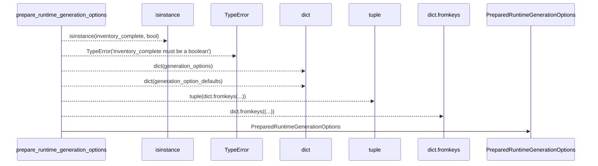
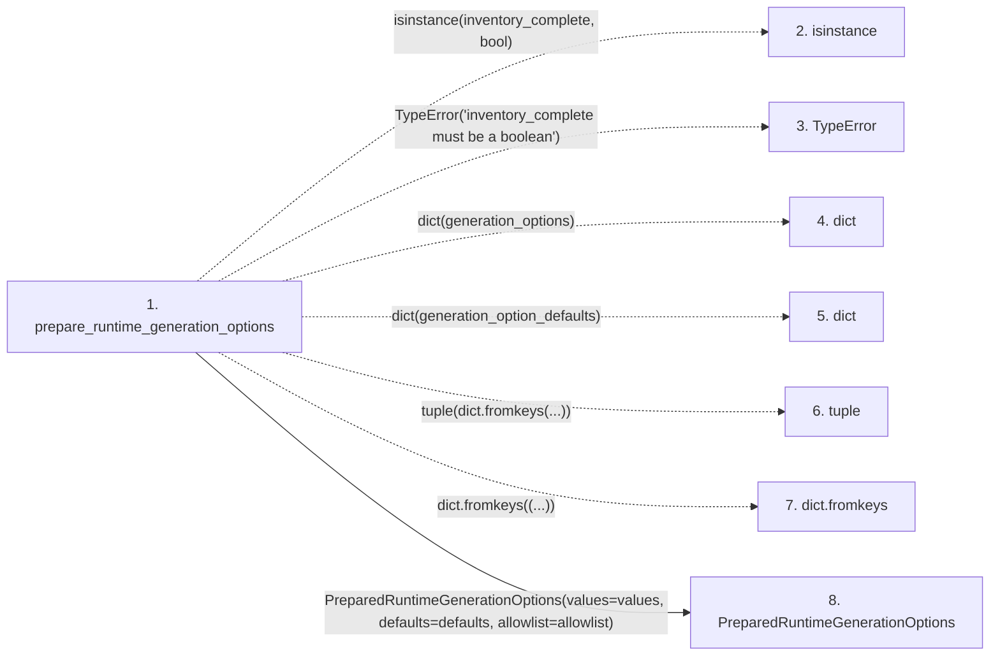

# prepare_runtime_generation_options

**Entry point:** `prepare_runtime_generation_options` (`api`)
**Source:** [knowledge_orchestration](../modules/knowledge_orchestration.md)
**Modules touched:** [knowledge_orchestration](../modules/knowledge_orchestration.md)

## Call sequence

> Static overview in presentation order, not runtime execution order. Arrows retain captured callers; siblings are shown before deeper helper detail.

<!-- Auto-generated from static call edges. Dashed arrows are external or unresolved calls. Reviewed runtime conditions and side effects belong in Behavior. -->

> Call sequence diagram shows 7 of 7 interactions; 0 omitted to keep the visualization within the 30-interaction and generated-diagram limits, with uncertain identities omitted rather than inferred.

> Captured boundary calls: external 6 of 6 (0 omitted); unresolved 0 of 0 (0 omitted). These counts cover the captured static trace.
> Detailed flow queries retain their own coverage and limits; omitted paths may execute at runtime.

## Data flow

<!-- Auto-generated static analysis. Treat values and boundaries as best-effort hints, not runtime proof. -->

### Step data

| Step | Inputs | Reads | Writes | Returns |
|---|---|---|---|---|
| `prepare_runtime_generation_options` | `generation_options: Mapping[str, Any]`, `generation_option_defaults: Mapping[str, Any]`, `generation_option_allowlist: Sequence[str]`, `inventory_complete: bool` | - | `values[...]`, `defaults[...]` | `PreparedRuntimeGenerationOptions(...)` |
| `isinstance` | - | - | - | - |
| `TypeError` | - | - | - | - |
| `dict` | - | - | - | - |
| `dict` | - | - | - | - |
| `tuple` | - | - | - | - |
| `dict.fromkeys` | - | - | - | - |
| `PreparedRuntimeGenerationOptions` | - | - | - | - |

### Call data

| From | To | Line | Call |
|---|---|---:|---|
| prepare_runtime_generation_options | isinstance | 341 | `isinstance(inventory_complete, bool)` |
| prepare_runtime_generation_options | TypeError | 342 | `TypeError('inventory_complete must be a boolean')` |
| prepare_runtime_generation_options | dict | 343 | `dict(generation_options)` |
| prepare_runtime_generation_options | dict | 345 | `dict(generation_option_defaults)` |
| prepare_runtime_generation_options | tuple | 347 | `tuple(dict.fromkeys(...))` |
| prepare_runtime_generation_options | dict.fromkeys | 348 | `dict.fromkeys((...))` |
| prepare_runtime_generation_options | PreparedRuntimeGenerationOptions | 350 | `PreparedRuntimeGenerationOptions(values=values, defaults=defaults, allowlist=allowlist)` |

### Boundary effects

*No boundary effects detected.*

### Static analysis gaps

| Kind | Step | Target | Line |
|---|---|---|---:|
| external_call | `prepare_runtime_generation_options` | `isinstance` | 341 |
| external_call | `prepare_runtime_generation_options` | `TypeError` | 342 |
| external_call | `prepare_runtime_generation_options` | `dict.fromkeys` | 348 |

## Behavior

This flow starts at `prepare_runtime_generation_options` and is classified as `api`. The generated call and data-flow sections are bounded static projections; runtime conditions and side effects require source-level confirmation.
