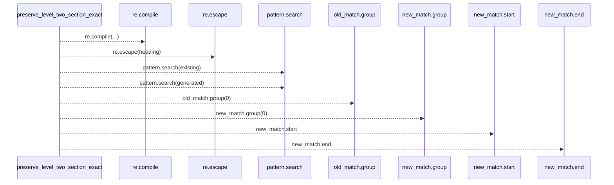
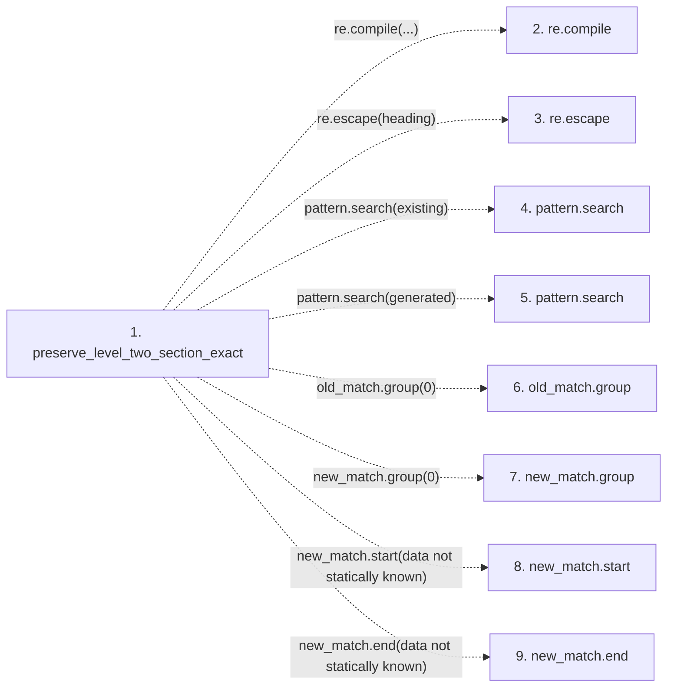

# preserve_level_two_section_exact

**Entry point:** `preserve_level_two_section_exact` (`api`)
**Source:** [markdown_sections](../modules/markdown_sections.md)
**Modules touched:** [markdown_sections](../modules/markdown_sections.md)

## Call sequence

> Static overview in presentation order, not runtime execution order. Arrows retain captured callers; representative internal continuations and boundary examples precede repeated helper detail.

<!-- Auto-generated from static call edges. Dashed arrows are external or unresolved calls. Reviewed runtime conditions and side effects belong in Behavior. -->

> Call sequence diagram shows 8 of 8 interactions; 0 omitted to keep the visualization within the 30-interaction and generated-diagram limits, with uncertain identities omitted rather than inferred.

> Captured boundary calls: external 2 of 2 (0 omitted); unresolved 6 of 6 (0 omitted). These counts cover the captured static trace.
> Detailed flow queries retain their own coverage and limits; omitted paths may execute at runtime.

## Data flow

<!-- Auto-generated static analysis. Treat values and boundaries as best-effort hints, not runtime proof. -->

### Analysis coverage

**Effect analysis evaluated.** Flow assembly and source effect analysis are separate; empty observations do not prove an empty handler body.

Source steps: 1; effect analysis evaluated: 1, partial: 0, unavailable: 0. Counts include steps omitted from the displayed trace.

Collector observations for 1 source steps with known totals: observed: 6, emitted: 6, omitted: 0. Unavailable totals are excluded.

### Step data

| Step | Inputs | Reads | Writes | Returns |
|---|---|---|---|---|
| `preserve_level_two_section_exact` | `existing: str`, `generated: str`, `heading: str` | - | - | `generated`, `generated`, `...` |
| `re.compile` | - | - | - | - |
| `re.escape` | - | - | - | - |
| `pattern.search` | - | - | - | - |
| `pattern.search` | - | - | - | - |
| `old_match.group` | - | - | - | - |
| `new_match.group` | - | - | - | - |
| `new_match.start` | - | - | - | - |
| `new_match.end` | - | - | - | - |

### Call data

| From | To | Line | Call |
|---|---|---:|---|
| preserve_level_two_section_exact | re.compile | 728 | `re.compile(...)` |
| preserve_level_two_section_exact | re.escape | 729 | `re.escape(heading)` |
| preserve_level_two_section_exact | pattern.search | 732 | `pattern.search(existing)` |
| preserve_level_two_section_exact | pattern.search | 733 | `pattern.search(generated)` |
| preserve_level_two_section_exact | old_match.group | 736 | `old_match.group(0)` |
| preserve_level_two_section_exact | new_match.group | 737 | `new_match.group(0)` |
| preserve_level_two_section_exact | new_match.start | 740 | `new_match.start(data not statically known)` |
| preserve_level_two_section_exact | new_match.end | 742 | `new_match.end(data not statically known)` |

### Boundary effects

*No boundary-effect observations were captured in this static trace.*

### Static analysis gaps

| Kind | Step | Target | Line |
|---|---|---|---:|
| external_call | `preserve_level_two_section_exact` | `re.compile` | 728 |
| external_call | `preserve_level_two_section_exact` | `re.escape` | 729 |
| unresolved_call | `preserve_level_two_section_exact` | `pattern.search` | 732 |
| unresolved_call | `preserve_level_two_section_exact` | `pattern.search` | 733 |
| unresolved_call | `preserve_level_two_section_exact` | `old_match.group` | 736 |
| unresolved_call | `preserve_level_two_section_exact` | `new_match.group` | 737 |
| unresolved_call | `preserve_level_two_section_exact` | `new_match.start` | 740 |
| unresolved_call | `preserve_level_two_section_exact` | `new_match.end` | 742 |

## Behavior

This flow starts at `preserve_level_two_section_exact` and is classified as `api`. The generated call and data-flow sections are bounded static projections; runtime conditions and side effects require source-level confirmation.
