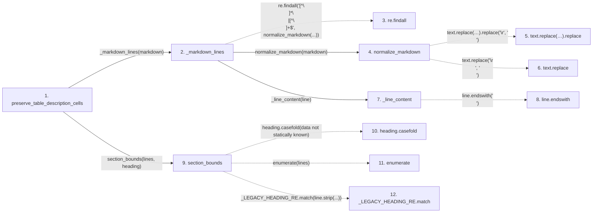

# preserve_table_description_cells

**Entry point:** `preserve_table_description_cells` (`api`)
**Source:** [markdown_sections](../modules/markdown_sections.md)
**Modules touched:** [markdown_sections](../modules/markdown_sections.md)

## Call sequence

> Static overview in presentation order, not runtime execution order. Arrows retain captured callers; representative internal continuations and boundary examples precede repeated helper detail.

```mermaid
sequenceDiagram
    participant p0 as preserve_table_description_cells
    participant p1 as _markdown_lines
    participant p2 as section_bounds
    participant p3 as split_table_row
    participant p4 as is_table_separator
    participant p5 as semantic_table_key
    participant p6 as format_table_row
    participant p7 as normalize_markdown
    participant p8 as _line_content
    participant p9 as range (src/llm_wiki_cli/services…ve_table_description_cells)
    participant p10 as headers.index
    participant p11 as len (src/llm_wiki_cli/services…ve_table_description_cells)
    participant p12 as descriptions.get
    participant p13 as (…).get
    participant p14 as predicate
    participant p15 as '\n'.join
    participant p16 as markdown.endswith
    participant p17 as re.findall
    participant p18 as heading.casefold
    participant p19 as line.strip (src/llm_wiki_cli/services…ections.py:split_table_row)
    participant p20 as all
    participant p21 as re.sub
    participant p22 as ' | '.join
    participant p23 as enumerate
    participant p24 as stripped.startswith
    participant p25 as re.fullmatch
    participant p26 as key.replace(…).replace(…).replace
    participant p27 as _LEGACY_HEADING_RE.match
    participant p28 as stripped.endswith
    participant p29 as cell.replace
    p0->>p1: _markdown_lines
    p0->>p2: section_bounds
    p0->>p3: split_table_row
    p0->>p4: is_table_separator
    p0->>p5: semantic_table_key
    p0->>p6: format_table_row
    p1->>p7: normalize_markdown
    p1->>p8: _line_content
    p0-->>p9: range (src/llm_wiki_cli/services…ve_table_description_cells)(start, end)
    p0-->>p10: headers.index('Description')
    p0-->>p9: range (src/llm_wiki_cli/services…ve_table_description_cells)(row_start, end)
    p0-->>p11: len (src/llm_wiki_cli/services…ve_table_description_cells)(row)
    p0-->>p12: descriptions.get(key)
    p0-->>p13: (…).get(key)
    p0-->>p14: predicate(existing_description, row[...], old_description)
    p0-->>p15: '\n'.join(lines)
    p0-->>p16: markdown.endswith('\n')
    p1-->>p17: re.findall('[^\\n]*\\n|[^\\n]+$', normalize_markdown(...))
    p2-->>p18: heading.casefold
    p3-->>p19: line.strip (src/llm_wiki_cli/services…ections.py:split_table_row)
    p4-->>p20: all(...)
    p5-->>p21: re.sub('\\[([^\\]]+)\\]\\([^)]+\\)', '\\1', cell)
    p6-->>p22: ' | '.join(cells)
    p2-->>p23: enumerate(lines)
    p3-->>p24: stripped.startswith('|')
    p4-->>p25: re.fullmatch(':?-{3,}:?', cell.replace(...))
    p5-->>p26: key.replace(…).replace(…).replace('\\|', '|')
    p2-->>p27: _LEGACY_HEADING_RE.match(line.strip(...))
    p3-->>p28: stripped.endswith('|')
    p4-->>p29: cell.replace(' ', '')
```

<!-- Auto-generated from static call edges. Dashed arrows are external or unresolved calls. Reviewed runtime conditions and side effects belong in Behavior. -->

> Call sequence diagram shows 30 of 63 interactions; 33 omitted to keep the visualization within the 30-interaction and generated-diagram limits, with uncertain identities omitted rather than inferred.

> Captured boundary calls: external 8 of 16 (8 omitted); unresolved 14 of 37 (23 omitted). These counts cover the captured static trace.

Omitted captured detail, grouped by actual caller occurrence and target module:

| Caller | Parent step | Target module | Kind | Omitted interactions |
| --- | --- | --- | --- | --- |
| `src/llm_wiki_cli/services/markdown_sections.py:normalize_markdown` | 4 | - | unresolved | 2 |
| `src/llm_wiki_cli/services/markdown_sections.py:_line_content` | 7 | - | unresolved | 1 |
| `src/llm_wiki_cli/services/markdown_sections.py:section_bounds` | 9 | - | unresolved | 8 |
| `src/llm_wiki_cli/services/markdown_sections.py:section_bounds` | 9 | - | external | 5 |
| `src/llm_wiki_cli/services/markdown_sections.py:split_table_row` | 27 | - | external | 3 |
| `src/llm_wiki_cli/services/markdown_sections.py:split_table_row` | 27 | - | unresolved | 9 |
| `src/llm_wiki_cli/services/markdown_sections.py:preserve_table_description_cells` | 1 | [src/llm_wiki_cli/services/markdown_sections.py](../modules/markdown_sections.md) | internal | 2 |
| `src/llm_wiki_cli/services/markdown_sections.py:semantic_table_key` | 52 | - | unresolved | 3 |
> Detailed flow queries retain their own coverage and limits; omitted paths may execute at runtime.

## Data flow

<!-- Auto-generated static analysis. Treat values and boundaries as best-effort hints, not runtime proof. -->

### Step data

| Step | Inputs | Reads | Writes | Returns |
|---|---|---|---|---|
| `preserve_table_description_cells` | `markdown: str`, `heading: str`, `descriptions: dict[str, str]`, `old_descriptions: dict[str, str] \| None`, `should_preserve: Callable[[str \| None, str \| None, str \| None], bool] \| None` | `should_preserve_semantic_value` | `row[...]`, `lines[...]` | `(...)`, `(...)`, `(...)`, `(...)` |
| `_markdown_lines` | `markdown: str`, `keepends: bool` | - | - | `...` |
| `re.findall` | - | - | - | - |
| `normalize_markdown` | `text: str` | - | - | `...` |
| `text.replace(…).replace` | - | - | - | - |
| `text.replace` | - | - | - | - |
| `_line_content` | `line: str` | - | - | `...` |
| `line.endswith` | - | - | - | - |
| `section_bounds` | `lines: list[str]`, `heading: str` | - | - | `(...)`, `None` |
| `heading.casefold` | - | - | - | - |
| `enumerate` | - | - | - | - |
| `_LEGACY_HEADING_RE.match` | - | - | - | - |

### Call data

| From | To | Line | Call |
|---|---|---:|---|
| preserve_table_description_cells | _markdown_lines | 885 | `_markdown_lines(markdown)` |
| _markdown_lines | re.findall | 218 | `re.findall('[^\\n]*\\n\|[^\\n]+$', normalize_markdown(...))` |
| _markdown_lines | normalize_markdown | 218 | `normalize_markdown(markdown)` |
| normalize_markdown | text.replace(…).replace | 82 | `text.replace('\r\n', '\n').replace('\r', '\n')` |
| normalize_markdown | text.replace | 82 | `text.replace('\r\n', '\n')` |
| _markdown_lines | _line_content | 219 | `_line_content(line)` |
| _line_content | line.endswith | 212 | `line.endswith('\n')` |
| preserve_table_description_cells | section_bounds | 886 | `section_bounds(lines, heading)` |
| section_bounds | heading.casefold | 669 | `heading.casefold(data not statically known)` |
| section_bounds | enumerate | 670 | `enumerate(lines)` |
| section_bounds | _LEGACY_HEADING_RE.match | 671 | `_LEGACY_HEADING_RE.match(line.strip(...))` |

### Boundary effects

*No boundary effects detected.*

### Static analysis gaps

| Kind | Step | Target | Line |
|---|---|---|---:|
| external_call | `_markdown_lines` | `re.findall` | 218 |
| unresolved_call | `normalize_markdown` | `text.replace('\r\n', '\n').replace` | 82 |
| unresolved_call | `normalize_markdown` | `text.replace` | 82 |
| unresolved_call | `_line_content` | `line.endswith` | 212 |
| unresolved_call | `section_bounds` | `heading.casefold` | 669 |
| external_call | `section_bounds` | `enumerate` | 670 |
| unresolved_call | `section_bounds` | `_LEGACY_HEADING_RE.match` | 671 |
| step_limit | `preserve_table_description_cells` | `first 12 steps` | 0 |

## Behavior

This flow starts at `preserve_table_description_cells` and is classified as `api`. The generated call and data-flow sections are bounded static projections; runtime conditions and side effects require source-level confirmation.
