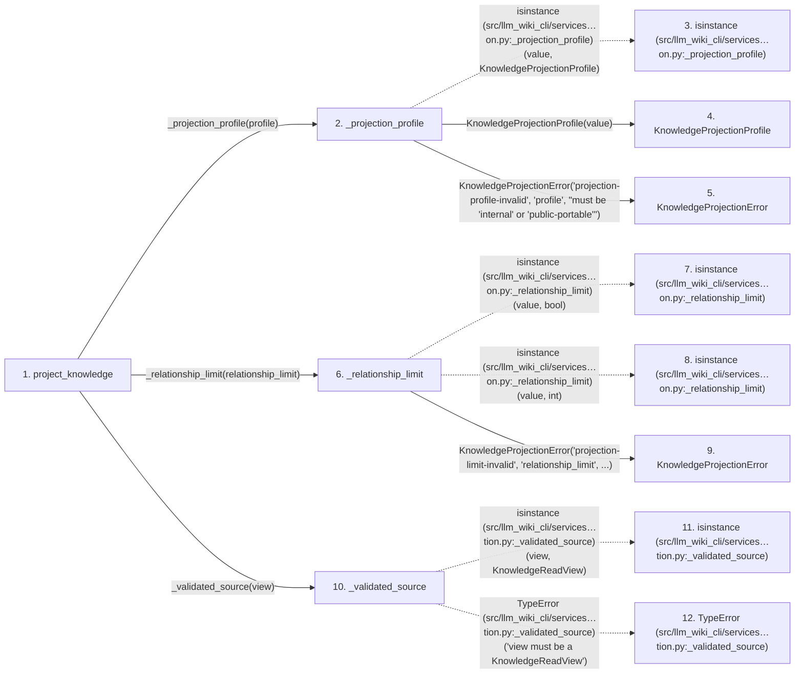

# project_knowledge

**Entry point:** `project_knowledge` (`api`)
**Source:** [knowledge_projection](../modules/knowledge_projection.md)
**Modules touched:** [common](../modules/common.md), [concept_identity](../modules/concept_identity.md), [filesystem_guard](../modules/filesystem_guard.md), [immutable](../modules/immutable.md), and 25 more

**Complete modules touched:**

- [common](../modules/common.md)
- [concept_identity](../modules/concept_identity.md)
- [filesystem_guard](../modules/filesystem_guard.md)
- [immutable](../modules/immutable.md)
- [implementation_evidence](../modules/implementation_evidence.md)
- [infrastructure_sync](../modules/infrastructure_sync.md)
- [knowledge_artifacts](../modules/knowledge_artifacts.md)
- [knowledge_envelope](../modules/knowledge_envelope.md)
- [knowledge_evidence](../modules/knowledge_evidence.md)
- [knowledge_governance](../modules/knowledge_governance.md)
- [knowledge_graph](../modules/knowledge_graph.md)
- [knowledge_index](../modules/knowledge_index.md)
- [knowledge_model](../modules/knowledge_model.md)
- [knowledge_observability](../modules/knowledge_observability.md)
- [knowledge_packs](../modules/knowledge_packs.md)
- [knowledge_projection](../modules/knowledge_projection.md)
- [knowledge_reuse](../modules/knowledge_reuse.md)
- [knowledge_storage](../modules/knowledge_storage.md)
- [knowledge_storage_io](../modules/knowledge_storage_io.md)
- [maintenance_projection](../modules/maintenance_projection.md)
- [maintenance_shapes](../modules/maintenance_shapes.md)
- [maintenance_state](../modules/maintenance_state.md)
- [manifest_storage](../modules/manifest_storage.md)
- [progress](../modules/progress.md)
- [section_ownership](../modules/section_ownership.md)
- [source_retirement](../modules/source_retirement.md)
- [sync_manifest](../modules/sync_manifest.md)
- [validation](../modules/validation.md)
- [wiki_surface](../modules/wiki_surface.md)

## Call sequence

> Static overview in presentation order, not runtime execution order. Arrows retain captured callers; representative internal continuations and boundary examples precede repeated helper detail.

```mermaid
sequenceDiagram
    participant p0 as project_knowledge
    participant p1 as _projection_profile
    participant p2 as _relationship_limit
    participant p3 as _validated_source
    participant p4 as _approved_public_repository_identity
    participant p5 as _initial_omitted_counts
    participant p6 as _project_relationships
    participant p7 as _project_concept
    participant p8 as _project_bundle
    participant p9 as _projection_warnings
    participant p10 as knowledge_freshness_disclosure
    participant p11 as _validate_projection_structure
    participant p12 as validate_governance_projection
    participant p13 as _governance_summary
    participant p14 as _empty_relationships
    participant p15 as KnowledgeProjectionError
    participant p16 as KnowledgeProjection
    participant p17 as _require_sha256
    participant p18 as _require_mapping
    participant p19 as _validate_projection_diagnostics
    participant p20 as _validate_projection_bundle
    participant p21 as _project_freshness
    participant p22 as _project_review
    participant p23 as serialize_knowledge_index
    participant p24 as _project_machine_check
    participant p25 as validate_knowledge_artifacts
    participant p26 as _json_copy
    participant p27 as _require_canonical_path
    participant p28 as _validate_projection_concept
    participant p29 as str (src/llm_wiki_cli/services…tion.py:project_knowledge)
    participant p30 as governance_by_locator.items
    p0->>p1: _projection_profile
    p0->>p2: _relationship_limit
    p0->>p3: _validated_source
    p0->>p4: _approved_public_repository_identity
    p0->>p5: _initial_omitted_counts
    p0->>p6: _project_relationships
    p0->>p7: _project_concept
    p0->>p8: _project_bundle
    p0->>p9: _projection_warnings
    p0->>p10: knowledge_freshness_disclosure
    p0->>p11: _validate_projection_structure
    p0->>p12: validate_governance_projection
    p0->>p13: _governance_summary
    p0->>p14: _empty_relationships
    p0->>p15: KnowledgeProjectionError
    p0->>p16: KnowledgeProjection
    p11->>p17: _require_sha256
    p11->>p18: _require_mapping
    p11->>p19: _validate_projection_diagnostics
    p11->>p20: _validate_projection_bundle
    p7->>p21: _project_freshness
    p7->>p22: _project_review
    p3->>p23: serialize_knowledge_index
    p7->>p24: _project_machine_check
    p3->>p25: validate_knowledge_artifacts
    p7->>p26: _json_copy
    p11->>p27: _require_canonical_path
    p11->>p28: _validate_projection_concept
    p0-->>p29: str (src/llm_wiki_cli/services…tion.py:project_knowledge)(governance[...])
    p0-->>p30: governance_by_locator.items
```

<!-- Auto-generated from static call edges. Dashed arrows are external or unresolved calls. Reviewed runtime conditions and side effects belong in Behavior. -->

> Call sequence diagram shows 30 of 2168 interactions; 2138 omitted to keep the visualization within the 30-interaction and generated-diagram limits, with uncertain identities omitted rather than inferred.

> Captured boundary calls: external 1 of 603 (602 omitted); unresolved 1 of 394 (393 omitted). These counts cover the captured static trace.

Omitted captured detail, grouped by actual caller occurrence and target module:

| Caller | Parent step | Target module | Kind | Omitted interactions |
| --- | --- | --- | --- | --- |
| `src/llm_wiki_cli/services/knowledge_projection.py:_projection_profile` | 2 | - | external | 1 |
| `src/llm_wiki_cli/services/knowledge_projection.py:_projection_profile` | 2 | [src/llm_wiki_cli/services/knowledge_model.py](../modules/knowledge_model.md) | internal | 1 |
| `src/llm_wiki_cli/services/knowledge_projection.py:_projection_profile` | 2 | [src/llm_wiki_cli/services/knowledge_projection.py](../modules/knowledge_projection.md) | internal | 1 |
| `src/llm_wiki_cli/services/knowledge_projection.py:_relationship_limit` | 6 | - | external | 2 |
| `src/llm_wiki_cli/services/knowledge_projection.py:_relationship_limit` | 6 | [src/llm_wiki_cli/services/knowledge_projection.py](../modules/knowledge_projection.md) | internal | 1 |
| `src/llm_wiki_cli/services/knowledge_projection.py:_validated_source` | 10 | - | external | 5 |
| `src/llm_wiki_cli/services/knowledge_projection.py:_validated_source` | 10 | [src/llm_wiki_cli/services/knowledge_projection.py](../modules/knowledge_projection.md) | internal | 6 |
| `src/llm_wiki_cli/services/knowledge_projection.py:_validated_source` | 10 | [src/llm_wiki_cli/services/knowledge_artifacts.py](../modules/knowledge_artifacts.md) | internal | 1 |
> Omission summary shows 8 of 494 groups; 486 further groups are not expanded here. Counts above include all omitted interactions.
> Detailed flow queries retain their own coverage and limits; omitted paths may execute at runtime.

> Trace truncated at the depth limit; deeper calls are omitted.

## Data flow

<!-- Auto-generated static analysis. Treat values and boundaries as best-effort hints, not runtime proof. -->

### Analysis coverage

**Effect analysis partially available.** Flow assembly and source effect analysis are separate; empty observations do not prove an empty handler body.

Source steps: 1172; effect analysis evaluated: 804, partial: 28, unavailable: 340. Counts include steps omitted from the displayed trace.

Collector observations for 832 source steps with known totals: observed: 4217, emitted: 4080, omitted: 137. Unavailable totals are excluded.

- Callable record unavailable for one or more source steps; those steps have no represented callable body.
- Effect collector omitted observations before flow assembly; displayed effects are partial.
- Effect collector totals unavailable; observed counts cover captured records only.

| Step | Callable record | Effect analysis | Collector totals | Observed | Emitted | Omitted |
|---|---|---|---|---:|---:|---:|
| `project_knowledge` | `available` | `evaluated` | `available` | `9` | `9` | `0` |
| `_projection_profile` | `available` | `evaluated` | `available` | `3` | `3` | `0` |
| `isinstance (src/llm_wiki_cli/services…on.py:_projection_profile)` | `not_applicable` | `not_applicable` | `not_applicable` | — | — | — |
| `KnowledgeProjectionProfile` | `unavailable` | `unavailable` | `unavailable` | — | — | — |
| `KnowledgeProjectionError` | `unavailable` | `unavailable` | `unavailable` | — | — | — |
| `_relationship_limit` | `available` | `evaluated` | `available` | `4` | `4` | `0` |
| `isinstance (src/llm_wiki_cli/services…on.py:_relationship_limit)` | `not_applicable` | `not_applicable` | `not_applicable` | — | — | — |
| `isinstance (src/llm_wiki_cli/services…on.py:_relationship_limit)` | `not_applicable` | `not_applicable` | `not_applicable` | — | — | — |
| `KnowledgeProjectionError` | `unavailable` | `unavailable` | `unavailable` | — | — | — |
| `_validated_source` | `available` | `evaluated` | `available` | `5` | `5` | `0` |
| `isinstance (src/llm_wiki_cli/services…tion.py:_validated_source)` | `not_applicable` | `not_applicable` | `not_applicable` | — | — | — |
| `TypeError (src/llm_wiki_cli/services…tion.py:_validated_source)` | `not_applicable` | `not_applicable` | `not_applicable` | — | — | — |

### Step data

| Step | Inputs | Reads | Writes | Returns |
|---|---|---|---|---|
| `project_knowledge` | `view: KnowledgeReadView`, `profile: KnowledgeProjectionProfile \| str`, `relationship_limit: int`, `public_repository_identity: str \| None` | `UNKNOWN_VALUE`, `Mapping`, `PROJECTION_SCHEMA_VERSION` | `projected_concepts[...]` | `projection` |
| `_projection_profile` | `value: KnowledgeProjectionProfile \| str` | `KnowledgeProjectionProfile` | - | `...` |
| `isinstance (src/llm_wiki_cli/services…on.py:_projection_profile)` | - | - | - | - |
| `KnowledgeProjectionProfile` | - | - | - | - |
| `KnowledgeProjectionError` | - | - | - | - |
| `_relationship_limit` | `value: object` | `MAX_RELATIONSHIP_LIMIT`, `MAX_RELATIONSHIP_LIMIT` | - | `value` |
| `isinstance (src/llm_wiki_cli/services…on.py:_relationship_limit)` | - | - | - | - |
| `isinstance (src/llm_wiki_cli/services…on.py:_relationship_limit)` | - | - | - | - |
| `KnowledgeProjectionError` | - | - | - | - |
| `_validated_source` | `view: KnowledgeReadView` | `KnowledgeReadView`, `KnowledgeAvailability` | - | `(...)`, `(...)` |
| `isinstance (src/llm_wiki_cli/services…tion.py:_validated_source)` | - | - | - | - |
| `TypeError (src/llm_wiki_cli/services…tion.py:_validated_source)` | - | - | - | - |

### Call data

| From | To | Line | Call |
|---|---|---:|---|
| project_knowledge | _projection_profile | 288 | `_projection_profile(profile)` |
| _projection_profile | isinstance (src/llm_wiki_cli/services…on.py:_projection_profile) | 3501 | `isinstance(value, KnowledgeProjectionProfile)` |
| _projection_profile | KnowledgeProjectionProfile | 3502 | `KnowledgeProjectionProfile(value)` |
| _projection_profile | KnowledgeProjectionError | 3505 | `KnowledgeProjectionError('projection-profile-invalid', 'profile', "must be 'internal' or 'public-portable'")` |
| project_knowledge | _relationship_limit | 289 | `_relationship_limit(relationship_limit)` |
| _relationship_limit | isinstance (src/llm_wiki_cli/services…on.py:_relationship_limit) | 3514 | `isinstance(value, bool)` |
| _relationship_limit | isinstance (src/llm_wiki_cli/services…on.py:_relationship_limit) | 3515 | `isinstance(value, int)` |
| _relationship_limit | KnowledgeProjectionError | 3518 | `KnowledgeProjectionError('projection-limit-invalid', 'relationship_limit', ...)` |
| project_knowledge | _validated_source | 290 | `_validated_source(view)` |
| _validated_source | isinstance (src/llm_wiki_cli/services…tion.py:_validated_source) | 2268 | `isinstance(view, KnowledgeReadView)` |
| _validated_source | TypeError (src/llm_wiki_cli/services…tion.py:_validated_source) | 2269 | `TypeError('view must be a KnowledgeReadView')` |

### Boundary effects

*No boundary-effect observations were captured in this static trace.*

### Static analysis gaps

| Kind | Step | Target | Line |
|---|---|---|---:|
| external_call | `_projection_profile` | `isinstance` | 3501 |
| external_call | `_relationship_limit` | `isinstance` | 3514 |
| external_call | `_relationship_limit` | `isinstance` | 3515 |
| external_call | `_validated_source` | `isinstance` | 2268 |
| external_call | `_validated_source` | `TypeError` | 2269 |
| step_limit | `project_knowledge` | `first 12 steps` | 0 |
| truncated_flow | `project_knowledge` | `depth limit` | 0 |

## Behavior

This flow starts at `project_knowledge` and is classified as `api`. The generated call and data-flow sections are bounded static projections; runtime conditions and side effects require source-level confirmation.
