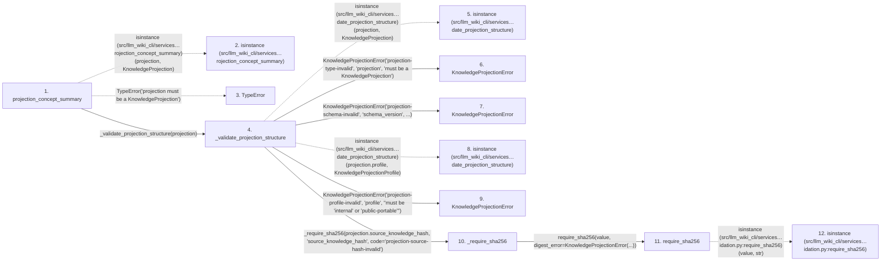

# projection_concept_summary

**Entry point:** `projection_concept_summary` (`api`)
**Source:** [knowledge_projection](../modules/knowledge_projection.md)
**Modules touched:** [concept_identity](../modules/concept_identity.md), [knowledge_envelope](../modules/knowledge_envelope.md), [knowledge_observability](../modules/knowledge_observability.md), and 2 more

**Complete modules touched:**

- [concept_identity](../modules/concept_identity.md)
- [knowledge_envelope](../modules/knowledge_envelope.md)
- [knowledge_observability](../modules/knowledge_observability.md)
- [knowledge_projection](../modules/knowledge_projection.md)
- [validation](../modules/validation.md)

## Call sequence

> Static overview in presentation order, not runtime execution order. Arrows retain captured callers; representative internal continuations and boundary examples precede repeated helper detail.

```mermaid
sequenceDiagram
    participant p0 as projection_concept_summary
    participant p1 as _validate_projection_structure
    participant p2 as _projection_concept_summary_unchecked
    participant p3 as _require_sha256
    participant p4 as _require_mapping
    participant p5 as _validate_projection_diagnostics
    participant p6 as _validate_projection_bundle
    participant p7 as _require_canonical_path
    participant p8 as _validate_projection_concept
    participant p9 as _validate_projection_relationships
    participant p10 as _json_copy
    participant p11 as require_sha256
    participant p12 as _require_exact_fields
    participant p13 as _require_relative_path
    participant p14 as validate_bundle_id
    participant p15 as _shape_error
    participant p16 as _validate_concept_kind
    participant p17 as _validate_projection_identity
    participant p18 as validate_configured_public_identity
    participant p19 as _validate_projection_lifecycle
    participant p20 as _validate_projection_evidence
    participant p21 as _validate_projection_freshness
    participant p22 as _validate_projection_relationship
    participant p23 as _require_positive_int
    participant p24 as _require_enum
    participant p25 as _validate_projection_review
    participant p26 as _validate_projection_machine_check
    participant p27 as _validate_projection_producer
    participant p28 as _validate_safe_json_value
    participant p29 as isinstance (src/llm_wiki_cli/services…rojection_concept_summary)
    participant p30 as projection.concept_for_path
    p0->>p1: _validate_projection_structure
    p0->>p2: _projection_concept_summary_unchecked
    p1->>p3: _require_sha256
    p1->>p4: _require_mapping
    p1->>p5: _validate_projection_diagnostics
    p1->>p6: _validate_projection_bundle
    p1->>p7: _require_canonical_path
    p1->>p8: _validate_projection_concept
    p1->>p9: _validate_projection_relationships
    p2->>p10: _json_copy
    p3->>p11: require_sha256
    p6->>p12: _require_exact_fields
    p7->>p13: _require_relative_path
    p6->>p14: validate_bundle_id
    p5->>p15: _shape_error
    p8->>p16: _validate_concept_kind
    p8->>p17: _validate_projection_identity
    p6->>p18: validate_configured_public_identity
    p8->>p19: _validate_projection_lifecycle
    p8->>p20: _validate_projection_evidence
    p8->>p21: _validate_projection_freshness
    p9->>p22: _validate_projection_relationship
    p5->>p23: _require_positive_int
    p6->>p24: _require_enum
    p8->>p25: _validate_projection_review
    p8->>p26: _validate_projection_machine_check
    p6->>p27: _validate_projection_producer
    p6->>p28: _validate_safe_json_value
    p0-->>p29: isinstance (src/llm_wiki_cli/services…rojection_concept_summary)(projection, KnowledgeProjection)
    p2-->>p30: projection.concept_for_path(canonical_path)
```

<!-- Auto-generated from static call edges. Dashed arrows are external or unresolved calls. Reviewed runtime conditions and side effects belong in Behavior. -->

> Call sequence diagram shows 30 of 626 interactions; 596 omitted to keep the visualization within the 30-interaction and generated-diagram limits, with uncertain identities omitted rather than inferred.

> Captured boundary calls: external 1 of 161 (160 omitted); unresolved 1 of 117 (116 omitted). These counts cover the captured static trace.

Omitted captured detail, grouped by actual caller occurrence and target module:

| Caller | Parent step | Target module | Kind | Omitted interactions |
| --- | --- | --- | --- | --- |
| `src/llm_wiki_cli/services/knowledge_projection.py:projection_concept_summary` | 1 | - | external | 1 |
| `src/llm_wiki_cli/services/knowledge_projection.py:_validate_projection_structure` | 4 | - | external | 6 |
| `src/llm_wiki_cli/services/knowledge_projection.py:_validate_projection_structure` | 4 | [src/llm_wiki_cli/services/knowledge_projection.py](../modules/knowledge_projection.md) | internal | 13 |
| `src/llm_wiki_cli/services/validation.py:require_sha256` | 11 | - | external | 1 |
| `src/llm_wiki_cli/services/validation.py:require_sha256` | 11 | [src/llm_wiki_cli/services/validation.py](../modules/validation.md) | internal | 1 |
| `src/llm_wiki_cli/services/validation.py:require_trimmed_text` | 13 | [src/llm_wiki_cli/services/validation.py](../modules/validation.md) | internal | 1 |
| `src/llm_wiki_cli/services/validation.py:require_nonempty_text` | 14 | - | external | 1 |
| `src/llm_wiki_cli/services/validation.py:require_nonempty_text` | 14 | - | unresolved | 1 |
> Omission summary shows 8 of 125 groups; 117 further groups are not expanded here. Counts above include all omitted interactions.
> Detailed flow queries retain their own coverage and limits; omitted paths may execute at runtime.

> Trace truncated at the depth limit; deeper calls are omitted.

## Data flow

<!-- Auto-generated static analysis. Treat values and boundaries as best-effort hints, not runtime proof. -->

### Analysis coverage

**Effect analysis partially available.** Flow assembly and source effect analysis are separate; empty observations do not prove an empty handler body.

Source steps: 349; effect analysis evaluated: 301, partial: 6, unavailable: 42. Counts include steps omitted from the displayed trace.

Collector observations for 307 source steps with known totals: observed: 1214, emitted: 1188, omitted: 26. Unavailable totals are excluded.

- Callable record unavailable for one or more source steps; those steps have no represented callable body.
- Effect collector omitted observations before flow assembly; displayed effects are partial.
- Effect collector totals unavailable; observed counts cover captured records only.

| Step | Callable record | Effect analysis | Collector totals | Observed | Emitted | Omitted |
|---|---|---|---|---:|---:|---:|
| `projection_concept_summary` | `available` | `evaluated` | `available` | `4` | `4` | `0` |
| `isinstance (src/llm_wiki_cli/services…rojection_concept_summary)` | `not_applicable` | `not_applicable` | `not_applicable` | — | — | — |
| `TypeError` | `not_applicable` | `not_applicable` | `not_applicable` | — | — | — |
| `_validate_projection_structure` | `available` | `evaluated` | `available` | `8` | `8` | `0` |
| `isinstance (src/llm_wiki_cli/services…date_projection_structure)` | `not_applicable` | `not_applicable` | `not_applicable` | — | — | — |
| `KnowledgeProjectionError` | `unavailable` | `unavailable` | `unavailable` | — | — | — |
| `KnowledgeProjectionError` | `unavailable` | `unavailable` | `unavailable` | — | — | — |
| `isinstance (src/llm_wiki_cli/services…date_projection_structure)` | `not_applicable` | `not_applicable` | `not_applicable` | — | — | — |
| `KnowledgeProjectionError` | `unavailable` | `unavailable` | `unavailable` | — | — | — |
| `_require_sha256` | `available` | `evaluated` | `available` | `4` | `4` | `0` |
| `require_sha256` | `available` | `evaluated` | `available` | `7` | `7` | `0` |
| `isinstance (src/llm_wiki_cli/services…idation.py:require_sha256)` | `not_applicable` | `not_applicable` | `not_applicable` | — | — | — |

### Step data

| Step | Inputs | Reads | Writes | Returns |
|---|---|---|---|---|
| `projection_concept_summary` | `projection: KnowledgeProjection`, `canonical_path: str` | `KnowledgeProjection` | - | `_projection_concept_summary_unchecked(...)` |
| `isinstance (src/llm_wiki_cli/services…rojection_concept_summary)` | - | - | - | - |
| `TypeError` | - | - | - | - |
| `_validate_projection_structure` | `projection: KnowledgeProjection` | `KnowledgeProjection`, `PROJECTION_SCHEMA_VERSION`, `PROJECTION_SCHEMA_VERSION`, `KnowledgeProjectionProfile`, `UNEVALUATED_FRESHNESS_DISCLOSURE`, `UNEVALUATED_FRESHNESS_DISCLOSURE` | `concept_by_path[...]` | - |
| `isinstance (src/llm_wiki_cli/services…date_projection_structure)` | - | - | - | - |
| `KnowledgeProjectionError` | - | - | - | - |
| `KnowledgeProjectionError` | - | - | - | - |
| `isinstance (src/llm_wiki_cli/services…date_projection_structure)` | - | - | - | - |
| `KnowledgeProjectionError` | - | - | - | - |
| `_require_sha256` | `value: object`, `path: str`, `code: str` | - | - | `require_shared_sha256(...)` |
| `require_sha256` | `value: object`, `digest_error: Exception`, `text_error: Exception \| None`, `reject_control_characters: bool`, `allow_empty: bool` | - | - | `parsed`, `parsed` |
| `isinstance (src/llm_wiki_cli/services…idation.py:require_sha256)` | - | - | - | - |

### Call data

| From | To | Line | Call |
|---|---|---:|---|
| projection_concept_summary | isinstance (src/llm_wiki_cli/services…rojection_concept_summary) | 414 | `isinstance(projection, KnowledgeProjection)` |
| projection_concept_summary | TypeError | 415 | `TypeError('projection must be a KnowledgeProjection')` |
| projection_concept_summary | _validate_projection_structure | 416 | `_validate_projection_structure(projection)` |
| _validate_projection_structure | isinstance (src/llm_wiki_cli/services…date_projection_structure) | 808 | `isinstance(projection, KnowledgeProjection)` |
| _validate_projection_structure | KnowledgeProjectionError | 809 | `KnowledgeProjectionError('projection-type-invalid', 'projection', 'must be a KnowledgeProjection')` |
| _validate_projection_structure | KnowledgeProjectionError | 815 | `KnowledgeProjectionError('projection-schema-invalid', 'schema_version', ...)` |
| _validate_projection_structure | isinstance (src/llm_wiki_cli/services…date_projection_structure) | 820 | `isinstance(projection.profile, KnowledgeProjectionProfile)` |
| _validate_projection_structure | KnowledgeProjectionError | 821 | `KnowledgeProjectionError('projection-profile-invalid', 'profile', "must be 'internal' or 'public-portable'")` |
| _validate_projection_structure | _require_sha256 | 826 | `_require_sha256(projection.source_knowledge_hash, 'source_knowledge_hash', code='projection-source-hash-invalid')` |
| _require_sha256 | require_sha256 | 2240 | `require_shared_sha256(value, digest_error=KnowledgeProjectionError(...))` |
| require_sha256 | isinstance (src/llm_wiki_cli/services…idation.py:require_sha256) | 1138 | `isinstance(value, str)` |

### Boundary effects

*No boundary-effect observations were captured in this static trace.*

### Static analysis gaps

| Kind | Step | Target | Line |
|---|---|---|---:|
| external_call | `projection_concept_summary` | `isinstance` | 414 |
| external_call | `projection_concept_summary` | `TypeError` | 415 |
| external_call | `_validate_projection_structure` | `isinstance` | 808 |
| external_call | `_validate_projection_structure` | `isinstance` | 820 |
| external_call | `require_sha256` | `isinstance` | 1138 |
| step_limit | `projection_concept_summary` | `first 12 steps` | 0 |
| truncated_flow | `projection_concept_summary` | `depth limit` | 0 |

## Behavior

This flow starts at `projection_concept_summary` and is classified as `api`. The generated call and data-flow sections are bounded static projections; runtime conditions and side effects require source-level confirmation.
