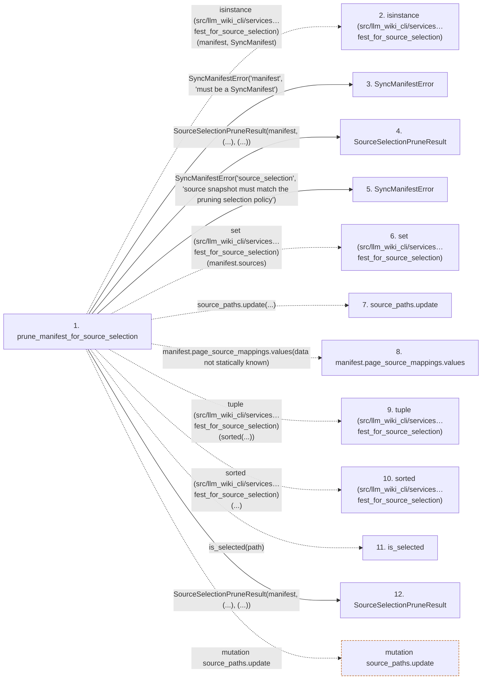

# prune_manifest_for_source_selection

**Entry point:** `prune_manifest_for_source_selection` (`api`)
**Source:** [sync_manifest](../modules/sync_manifest.md)
**Modules touched:** [source_retirement](../modules/source_retirement.md), [sync_manifest](../modules/sync_manifest.md), [validation](../modules/validation.md), [wiki_surface](../modules/wiki_surface.md)

## Call sequence

> Static overview in presentation order, not runtime execution order. Arrows retain captured callers; representative internal continuations and boundary examples precede repeated helper detail.

```mermaid
sequenceDiagram
    participant p0 as prune_manifest_for_source_selection
    participant p1 as read_entity_retirement_state
    participant p2 as with_entity_retirement_state
    participant p3 as SyncManifestError
    participant p4 as SourceSelectionPruneResult
    participant p5 as canonical_path
    participant p6 as ManifestPageSource.from_payload
    participant p7 as _entry_for
    participant p8 as _mapping_value
    participant p9 as _validate_page_id
    participant p10 as _validate_exact_keys
    participant p11 as is_safe_page_id
    participant p12 as is_portable_path_component
    participant p13 as SourceRetirementError
    participant p14 as portable_path_key
    participant p15 as ManifestPageSource
    participant p16 as WikiSurfaceError
    participant p17 as require_mapping
    participant p18 as PageKind
    participant p19 as require_exact_fields
    participant p20 as require_portable_path_component
    participant p21 as isinstance (src/llm_wiki_cli/services…fest_for_source_selection)
    participant p22 as source_paths.update
    participant p23 as set (src/llm_wiki_cli/services…fest_for_source_selection)
    participant p24 as manifest.page_source_mappings.values
    participant p25 as tuple (src/llm_wiki_cli/services…fest_for_source_selection)
    participant p26 as sorted (src/llm_wiki_cli/services…fest_for_source_selection)
    participant p27 as is_selected
    participant p28 as manifest.page_source_mappings.items
    p0->>p1: read_entity_retirement_state
    p0->>p2: with_entity_retirement_state
    p0->>p3: SyncManifestError
    p0->>p4: SourceSelectionPruneResult
    p1->>p5: canonical_path
    p1->>p6: ManifestPageSource.from_payload
    p5->>p7: _entry_for
    p6->>p8: _mapping_value
    p5->>p9: _validate_page_id
    p6->>p10: _validate_exact_keys
    p9->>p11: is_safe_page_id
    p11->>p12: is_portable_path_component
    p1->>p13: SourceRetirementError
    p1->>p14: portable_path_key
    p6->>p15: ManifestPageSource
    p5->>p16: WikiSurfaceError
    p8->>p17: require_mapping
    p7->>p18: PageKind
    p10->>p19: require_exact_fields
    p12->>p20: require_portable_path_component
    p0-->>p21: isinstance (src/llm_wiki_cli/services…fest_for_source_selection)(manifest, SyncManifest)
    p0-->>p22: source_paths.update(...)
    p0-->>p23: set (src/llm_wiki_cli/services…fest_for_source_selection)(manifest.sources)
    p0-->>p24: manifest.page_source_mappings.values
    p0-->>p25: tuple (src/llm_wiki_cli/services…fest_for_source_selection)(sorted(...))
    p0-->>p26: sorted (src/llm_wiki_cli/services…fest_for_source_selection)(...)
    p0-->>p27: is_selected(path)
    p0-->>p23: set (src/llm_wiki_cli/services…fest_for_source_selection)(deselected_sources)
    p0-->>p28: manifest.page_source_mappings.items
    p0-->>p25: tuple (src/llm_wiki_cli/services…fest_for_source_selection)(sorted(...))
```

<!-- Auto-generated from static call edges. Dashed arrows are external or unresolved calls. Reviewed runtime conditions and side effects belong in Behavior. -->

> Call sequence diagram shows 30 of 127 interactions; 97 omitted to keep the visualization within the 30-interaction and generated-diagram limits, with uncertain identities omitted rather than inferred.

> Captured boundary calls: external 6 of 52 (46 omitted); unresolved 4 of 32 (28 omitted). These counts cover the captured static trace.

Omitted captured detail, grouped by actual caller occurrence and target module:

| Caller | Parent step | Target module | Kind | Omitted interactions |
| --- | --- | --- | --- | --- |
| `src/llm_wiki_cli/services/sync_manifest.py:prune_manifest_for_source_selection` | 1 | [src/llm_wiki_cli/services/sync_manifest.py](../modules/sync_manifest.md) | internal | 3 |
| `src/llm_wiki_cli/services/sync_manifest.py:prune_manifest_for_source_selection` | 1 | - | external | 5 |
| `src/llm_wiki_cli/services/sync_manifest.py:prune_manifest_for_source_selection` | 1 | - | unresolved | 5 |
| `src/llm_wiki_cli/services/source_retirement.py:read_entity_retirement_state` | 21 | - | external | 21 |
| `src/llm_wiki_cli/services/source_retirement.py:read_entity_retirement_state` | 21 | [src/llm_wiki_cli/services/source_retirement.py](../modules/source_retirement.md) | internal | 8 |
| `src/llm_wiki_cli/services/source_retirement.py:read_entity_retirement_state` | 21 | - | unresolved | 6 |
| `src/llm_wiki_cli/services/wiki_surface.py:_entry_for` | 32 | - | external | 1 |
| `src/llm_wiki_cli/services/wiki_surface.py:_entry_for` | 32 | [src/llm_wiki_cli/services/wiki_surface.py](../modules/wiki_surface.md) | internal | 1 |
> Omission summary shows 8 of 26 groups; 18 further groups are not expanded here. Counts above include all omitted interactions.
> Detailed flow queries retain their own coverage and limits; omitted paths may execute at runtime.

> Trace truncated at the depth limit; deeper calls are omitted.

## Data flow

<!-- Auto-generated static analysis. Treat values and boundaries as best-effort hints, not runtime proof. -->

### Analysis coverage

**Effect analysis partially available.** Flow assembly and source effect analysis are separate; empty observations do not prove an empty handler body.

Source steps: 44; effect analysis evaluated: 17, partial: 0, unavailable: 27. Counts include steps omitted from the displayed trace.

- Callable record unavailable; the selected entry symbol has no represented callable body.
- Effect collector totals unavailable; observed counts cover captured records only.

| Step | Callable record | Effect analysis | Collector totals |
|---|---|---|---|
| `prune_manifest_for_source_selection` | `available` | `evaluated` | `available` |
| `isinstance (src/llm_wiki_cli/services…fest_for_source_selection)` | `not_applicable` | `not_applicable` | `not_applicable` |
| `SyncManifestError` | `unavailable` | `unavailable` | `unavailable` |
| `SourceSelectionPruneResult` | `unavailable` | `unavailable` | `unavailable` |
| `SyncManifestError` | `unavailable` | `unavailable` | `unavailable` |
| `set (src/llm_wiki_cli/services…fest_for_source_selection)` | `not_applicable` | `not_applicable` | `not_applicable` |
| `source_paths.update` | `not_applicable` | `not_applicable` | `not_applicable` |
| `manifest.page_source_mappings.values` | `not_applicable` | `not_applicable` | `not_applicable` |
| `tuple (src/llm_wiki_cli/services…fest_for_source_selection)` | `not_applicable` | `not_applicable` | `not_applicable` |
| `sorted (src/llm_wiki_cli/services…fest_for_source_selection)` | `not_applicable` | `not_applicable` | `not_applicable` |
| `is_selected` | `not_applicable` | `not_applicable` | `not_applicable` |
| `SourceSelectionPruneResult` | `unavailable` | `unavailable` | `unavailable` |

### Step data

| Step | Inputs | Reads | Writes | Returns |
|---|---|---|---|---|
| `prune_manifest_for_source_selection` | `manifest: SyncManifest`, `policy: SourceSelectionPolicy \| None`, `source_snapshot: SourceSnapshot \| None` | `SyncManifest` | - | `SourceSelectionPruneResult(...)`, `SourceSelectionPruneResult(...)`, `SourceSelectionPruneResult(...)` |
| `isinstance (src/llm_wiki_cli/services…fest_for_source_selection)` | - | - | - | - |
| `SyncManifestError` | - | - | - | - |
| `SourceSelectionPruneResult` | - | - | - | - |
| `SyncManifestError` | - | - | - | - |
| `set (src/llm_wiki_cli/services…fest_for_source_selection)` | - | - | - | - |
| `source_paths.update` | - | - | - | - |
| `manifest.page_source_mappings.values` | - | - | - | - |
| `tuple (src/llm_wiki_cli/services…fest_for_source_selection)` | - | - | - | - |
| `sorted (src/llm_wiki_cli/services…fest_for_source_selection)` | - | - | - | - |
| `is_selected` | - | - | - | - |
| `SourceSelectionPruneResult` | - | - | - | - |

### Call data

| From | To | Line | Call |
|---|---|---:|---|
| prune_manifest_for_source_selection | isinstance (src/llm_wiki_cli/services…fest_for_source_selection) | 1742 | `isinstance(manifest, SyncManifest)` |
| prune_manifest_for_source_selection | SyncManifestError | 1743 | `SyncManifestError('manifest', 'must be a SyncManifest')` |
| prune_manifest_for_source_selection | SourceSelectionPruneResult | 1745 | `SourceSelectionPruneResult(manifest, (...), (...))` |
| prune_manifest_for_source_selection | SyncManifestError | 1754 | `SyncManifestError('source_selection', 'source snapshot must match the pruning selection policy')` |
| prune_manifest_for_source_selection | set (src/llm_wiki_cli/services…fest_for_source_selection) | 1766 | `set(manifest.sources)` |
| prune_manifest_for_source_selection | source_paths.update | 1767 | `source_paths.update(...)` |
| prune_manifest_for_source_selection | manifest.page_source_mappings.values | 1768 | `manifest.page_source_mappings.values(data not statically known)` |
| prune_manifest_for_source_selection | tuple (src/llm_wiki_cli/services…fest_for_source_selection) | 1770 | `tuple(sorted(...))` |
| prune_manifest_for_source_selection | sorted (src/llm_wiki_cli/services…fest_for_source_selection) | 1771 | `sorted(...)` |
| prune_manifest_for_source_selection | is_selected | 1771 | `is_selected(path)` |
| prune_manifest_for_source_selection | SourceSelectionPruneResult | 1774 | `SourceSelectionPruneResult(manifest, (...), (...))` |

### Boundary effects

| Kind | Target | Step | Line |
|---|---|---|---:|
| mutation | `source_paths.update` | `prune_manifest_for_source_selection` | 1767 |

### Static analysis gaps

| Kind | Step | Target | Line |
|---|---|---|---:|
| external_call | `prune_manifest_for_source_selection` | `isinstance` | 1742 |
| unresolved_call | `prune_manifest_for_source_selection` | `manifest.page_source_mappings.values` | 1768 |
| external_call | `prune_manifest_for_source_selection` | `sorted` | 1771 |
| unresolved_call | `prune_manifest_for_source_selection` | `is_selected` | 1771 |
| step_limit | `prune_manifest_for_source_selection` | `first 12 steps` | 0 |
| truncated_flow | `prune_manifest_for_source_selection` | `depth limit` | 0 |

## Behavior

This flow starts at `prune_manifest_for_source_selection` and is classified as `api`. The generated call and data-flow sections are bounded static projections; runtime conditions and side effects require source-level confirmation.
